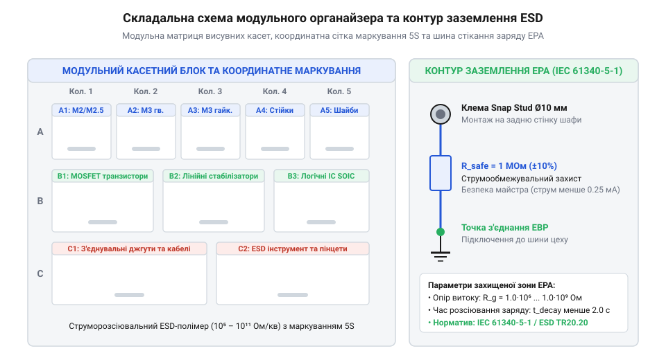

# Проєктування та розгортання модульної системи зберігання кріплення й SMD-компонентів для радіолабораторії

## Вибір конфігурації та розрахунок місткості

У повсякденній практиці радіоелектронної лабораторії та майстерні швидкого прототипування хаос у зберіганні дрібних металовиробів, розʼємів та електронних компонентів стає головним джерелом непродуктивних витрат часу. Коли сотні типорозмірів гвинтів, гайок, шайб та мікросхем лежать у випадкових пакунках чи немаркованих коробках, пошук потрібної деталі перетворюється на рутинну перешкоду. Ба більше, під час монтажу висока ймовірність помилково взяти кріплення не тієї довжини чи кроку різьби, що призводить до зриву різьбових отворів або пошкодження друкованих плат.

Проєктування модульної системи зберігання починають із вибору між двома базовими архітектурами:
1. **Стаціонарні касетні блоки (комоди з висувними шухлядами).** Призначені для основного складу майстерні з високою щільністю зберігання. Монтуються на стіну або встановлюються на монтажний стіл у зоні безпосередньої досяжності оператора. Їхня перевага — миттєвий візуальний огляд великої кількості позицій та швидкий доступ однією рукою. 2. **Переносні кейси-органайзери з ручкою та замками-клямками.** Незамінні для виїзних налагоджувальних робіт, монтажу на обʼєктах та проектного компонування (англ. *kitting*), коли в один кейс збирають повний комплект деталей під конкретний прилад.

Головна інженерна задача при виборі розмірів комірок — точний розрахунок необхідного обʼєму під металовироби. Якщо насипати гвинти чи гайки без урахування порожнеч між ними, комірка переповниться, а закривання кришки спричинить заклинювання або деформацію стінок. Розрахунок ведуть через коефіцієнт випадкового насипного пакування:

    V_pure = L · W · H · N

де `V_pure` — чистий геометричний обʼєм металу деталей у комірці, `L`, `W`, `H` — габаритні розміри однієї деталі (мм), а `N` — їхня планова кількість. Насипний обʼєм з урахуванням хаотичного розташування визначається як:

    V_bulk = V_pure / η

Для циліндричних та призматичних металовиробів (гвинти М2–М5, гайки, дистанційні [стійки М2/М3](root:cat-hw-parts/standoffs)) експериментальний коефіцієнт насипної щільності становить `η ≈ 0.55–0.60`. До отриманого обʼєму додають обовʼязковий технологічний запас `k_safety = 1.25–1.30` (25–30% вільного простору зверху), який запобігає пересипанню деталей через край при висуванні шухляди та дозволяє зручно захоплювати гвинти пальцями або пінцетом:

    V_required = V_bulk · k_safety

Для автоматизації розрахунків геометричної матриці касет, місткості комірок під стандартні ряди компонентів та перевірки електростатичної безпеки розроблено програмні модулі мовами C та C++.

:::tabs
@tab C
:::code proj-modular-workshop-organizer-system/c/include/organizer_calc.h
:::code proj-modular-workshop-organizer-system/c/src/organizer_calc.c
:::code proj-modular-workshop-organizer-system/c/src/main.c
@tab C++
:::code proj-modular-workshop-organizer-system/cpp/include/organizer_matrix.hpp
:::code proj-modular-workshop-organizer-system/cpp/src/organizer_matrix.cpp
:::code proj-modular-workshop-organizer-system/cpp/src/main.cpp
:::

Програма на C обчислює обʼєми засипки та підбирає оптимальне співвідношення колонок і рядків касетного блоку під ряди номіналів E12 та E24. Модуль на C++ реалізує обʼєктну модель матриці комірок із розрахунком відсотка заповнення кожної чарунки та валідатором відповідності матеріалу стандарту IEC 61340-5-1.

## Організація перегородок та система маркування

Найбільш критичний дефект недорогих пластикових органайзерів — самовільне змішування компонентів сусідніх комірок (пересортиця). Коли кейс перевертають або струшують під час перевезення, плоскі деталі (шайби М2, дрібні гайки) або мікроскопічні пасивні SMD-чіпи типорозмірів 0603 та 0805 підклинюють під нижній край перегородки чи перелітають через верхній зазор між перегородкою та кришкою.

Для запобігання пересортиці конструкція розбірних комірок повинна відповідати суворим вимогам:
- **Пазові замки перегородок.** Знімні перегородки фіксуються в бічних вертикальних пазах із технологічним ухилом стінок 1–2° («ластівчин хвіст» або Т-подібний фіксатор). На дні лотка формують відповідний фіксуючий паз глибиною не менше 1.5 мм, куди заходить нижня кромка перегородки, що унеможливлює проникнення під неї тонких деталей товщиною від 0.2 мм. - **Лабіринтне ущільнення кришки.** Прозора кришка органайзера з внутрішнього боку повинна мати сітку формованих виступів (ребер лабіринту), які входять у зачеплення з верхнім зрізом перегородок з гарантованим перекриттям `h_overlap ≥ 1.5–2.0 мм`. Додатково по периметру кришки встановлюють еластомірний ущільнювач, який демпфує вібрації.

*Конструктивна компоновка касетного блоку: взаємне розміщення шухляд різної місткості, координатна сітка маркування 5S та шина заземлення.*

Організацію зберігання будують на японській виробничій філософії 5S (від яп. *Seiri, Seiton, Seiso, Seiketsu, Shitsuke* — Сортування, Впорядкування, Чистота, Стандартизація, Самодисципліна, @@en|5S methodology@@) та сигнальній системі Канбан (англ. *Kanban*, @@en|Kanban@@):
1. **Колірне кодування груп деталей.** Кожна технологічна група маркується окремим кольором ярлика: синій — кріплення М3, жовтий — дрібне кріплення М2 та М2.5 [з набору кріплення М2.5](root:cat-hw-parts/m25-fastener-kit), зелений — пасивні SMD-компоненти, червоний — силові напівпровідники та транзистори. 2. **Шахова індексація та QR-коди.** Кожна комірка має унікальну буквено-цифрову координату (наприклад, `B3` — рядок B, колонка 3), продубльовану на фасаді шухляди та в цифровій базі даних лабораторії. Поруч наноситься мініатюрний матричний DataMatrix або QR-код розміром 10×10 мм. Сканування коду смартфоном або бездротовим сканером відкриває паспорт деталі, посилання на специфікацію (Datasheet) та залишок на складі. 3. **Метод двох бункерів (Two-Bin Kanban).** Для витратних матеріалів (гвинти DIN 7991 [з наборів гвинтів М3](root:cat-hw-parts/m3-screw-kits)) комірку ділять перегородкою на дві секції: робочу та резервну. Коли робоча секція спорожнюється, це слугує сигналом для негайного формування заявки на поповнення запасів, поки оператор використовує деталі з резерву.

## Інтеграція антистатичного захисту ESD

Зберігання напівпровідникових виробів (польових транзисторів із MOS-затвором, мікроконтролерів, чутливих аналогових підсилювачів та логічних мікросхем) у звичайних пластикових контейнерах із полістиролу чи поліпропілену суворо заборонено. Під час ковзання мікросхем по діелектричному дну виникає контактна трибоелектризація. Потенціал заряду легко сягає 2000–5000 В, тоді як критична напруга пробою підзатворного оксиду сучасних мікросхем становить усього 30–50 В.

Для створення безпечного сховища напівпровідників робочу зону організують відповідно до вимог міжнародного стандарту IEC 61340-5-1:
- **Струморозсіювальні матеріали.** Комірки та висувні лотки виготовляють із вуглеценаповнених струморозсіювальних полімерів (ESD-пластики) з питомим поверхневим опором у діапазоні:

    10⁵ ≤ R_surface ≤ 10⁹ Ом/кв

- **Заземлювальна шина каркаса.** Усі окремі касети та напрямні шухляд електрично зʼєднують між собою в єдиний контур за допомогою мідних шин або латунного дроту. У переносних кейсах на дно вкладають електропровідний поролон із закритими порами високої щільності, в який встромляють виводи мікросхем для вирівнювання потенціалів усіх ніжок. - **Підключення до загального контуру заземлення EPA.** На зовнішній стінці блоку монтують стандартну 10-міліметрову кнопкову клему заземлення (англ. *press-stud / snap connector*, @@en|press-stud terminal@@). Клему надійно притискають до шини, використовуючи [болти та шайби М3](root:cat-hw-parts/bolts-and-washers). У розрив проводу, що веде до центральної шини заземлення приміщення, обовʼязково встановлюють захисний резистор номіналом:

    R_safety = 1.0 МОм ± 10% (потужність 1 Вт)

Цей резистор унеможливлює ураження оператора електричним струмом у разі пробою фази лабораторного живлення на конструкцію столу та обмежує струм короткого розряду, розтягуючи час стікання заряду до безпечних мікросекунд.

Верифікація зібраного органайзера включає два обовʼязкових тести:
1. **Метрологічний контроль опору тераомметром.** Вимірюють опір витоку на землю з кожної чарунки органайзера тестовою напругою 100 В. Опір повинен складати строго від 1.0 до 1.5 МОм (з урахуванням вбудованого резистора). 2. **Тест на стійкість до пересортиці при падінні.** Кейс заповнюють металовиробами М2 та М3 [із набору кріплення М2.5](root:cat-hw-parts/m25-fastener-kit), закривають замки та здійснюють триразове скидання з висоти 0.5 м на пружну поверхню в різних орієнтаціях. Жодна деталь не повинна проникнути в сусідню комірку чи висипатися назовні. Створена за цими правилами система гарантує збереження дорогої компонентної бази та скорочує час пошуку кріплення до лічених секунд.