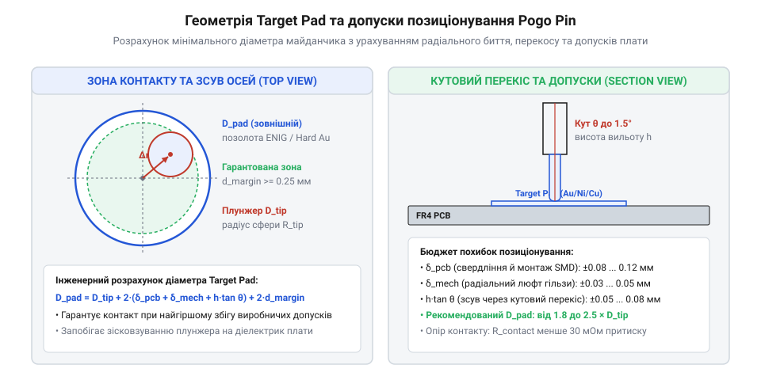
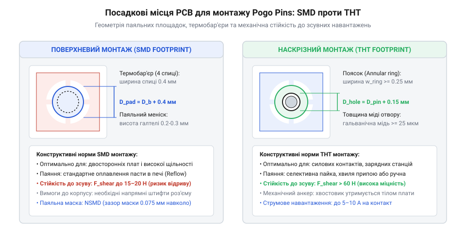
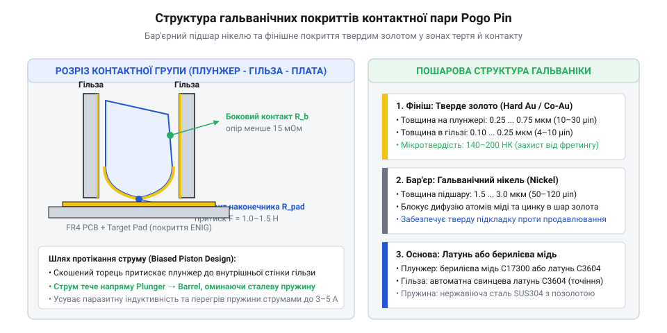
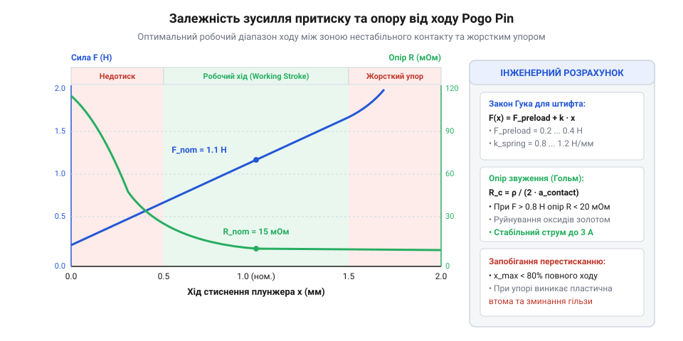

# Геометрія контактних майданчиків, типи монтажу та електричні специфікації Pogo Pins

<preknowlist>
- [Штирьові зʼєднувачі (male)](root:cat-hw-parts/pin-headers) — базову геометрію кроку між контактами та порівняльні параметри стаціонарних з'єднувачів проти рознімних пружинних контактів
- [Тросові та еластомірні віброізолятори](root:cat-hw-parts/wire-rope-isolators) — характеристики амплітуди вібраційних навантажень та заходи захисту рознімних контактних груп від демпфування
- [Класи міцності й матеріали кріплення](root:cat-hw-parts/fastener-strength-classes-and-materials) — допуски монтажних отворів корпусу та методики розрахунку механічного зусилля стиснення для збереження постійного притиску pogo pins
- [Капсульне ковзне кільце](root:cat-hw-parts/capsule-slip-ring) — фізичні принципи формування ковзного електричного контакту та особливості зносу гальванічних покриттів під дією механічного тертя
</preknowlist>

## Чому зникає контакт у пружинному з'єднанні

Роз'ємні модулі, швидкознімні електронні блоки та док-станції на основі пружинних контактів @@en|Pogo Pins@@ (англ. *pogo*, від назви іграшки-стрибунка *pogo stick*) нерідко стикаються з виснажливими збоями: спорадичним скиданням живлення, спотворенням цифрових сигнальних фронтів або прогресуючим зростанням перехідного опору під час експлуатації. На відміну від статичних роз'ємів, таких як жорсткі [штирьові з'єднувачі male](root:cat-hw-parts/pin-headers), пружинний контакт є динамічним електромеханічним вузлом. Конструктивно кожен штифт складається з трьох базових деталей: рухомого штока або плунжера @@en|plunger@@ (англ. *plunge* — занурюватися), зовнішньої тонкостінної гільзи @@en|barrel@@ (англ. *barrel* — циліндр, бочка) та внутрішньої спіральної пружини стиснення. Втрата електричного зв'язку у цій системі майже ніколи не виникає через раптовий злам пружини — це результат прихованих трибологічних і гальванічних процесів на контактних межах.

Основний електричний струм у з'єднанні @@en|Pogo Pin@@ має протікати від приймального майданчика @@en|target pad@@ (англ. *target* — ціль, мета) через масивне тіло плунжера безпосередньо на внутрішню стінку гільзи. Для забезпечення цього шляху в якісних контактах застосовують зріз нижнього торця плунжера під кутом 4°–12° @@en|bias cut@@ або вбудовану мікрокульку @@en|ball pin@@ між плунжером і пружиною. Під дією стиснення пружини похила площина створює боковий вектор зусилля `F_lateral = F_spring × tan(α)`, який примусово притискає бічну поверхню плунжера до внутрішнього дзеркала гільзи, забезпечуючи низький опір контакту (менше 30 мОм). Якщо цей механізм порушується через недотискання пружини або бічний перекос, струм від берилієво-мідного плунжера починає текти через спіральну сталеву пружину. Оскільки пружинна сталь має високий питомий опір і малу площу перерізу (`R_spring ≈ 1.5–3.0 Ом`), на ній виділяється значна теплова потужність `P = I² × R`. Це призводить до небезпечного локального перегріву, відпалу пружинного сплаву з втратою пружних властивостей, іскріння (мікродугового розряду або мікроіскріння @@en|micro-arcing@@) та обвуглювання внутрішнього технологічного мастила.

Під час руху або роботи охолоджувальних вентиляторів електронний модуль зазнає вібраційних навантажень. Якщо зовнішні [еластомірні віброізолятори з демпфуванням](root:cat-hw-parts/wire-rope-isolators) не гасять мікропереміщення корпусів, плунжер починає здійснювати циклічні зсуви відносно контактної площадки з амплітудою від 5 до 50 мкм. Виникає фретинг-корозія @@en|fretting corrosion@@ (англ. *fret* — роз'їдати, стирати). Тонке фінішне золоте покриття @@en|gold plating@@ зношується до нікелевого підшару. Викритий нікель під дією кисню повітря миттєво утворює плівку діелектричного оксиду NiO, через що перехідний опір @@en|contact resistance@@ зростає від часток ома до десятків ом. Подібно до того як руйнуються контактні доріжки, коли працює [капсульне ковзне кільце](root:cat-hw-parts/capsule-slip-ring), зношена поверхня майданчика перестає пропускати струм, провокуючи падіння напруги під навантаженням.

Додатковим деструктивним чинником є різниця температурних коефіцієнтів розширення (ТКР) між матеріалами плат та корпусу, а також розбіжність осей плунжера й приймального майданчика. Коли корпусний [монтаж кріплення зі сталі](root:cat-hw-parts/fastener-strength-classes-and-materials) має розкид допусків суміщення, або якщо [нарізні втулки для термопластів](root:cat-hw-parts/threaded-inserts-and-heat-set) запресовані під кутом, плунжер зазнає небезпечного бічного вигинального зусилля. Поперечне навантаження викликає прискорене витирання золота на краї гільзи, заклинювання штока та високочастотний дребезг контактів @@en|contact bounce@@ під час вібрації. Повністю усунути ці ризики можна лише шляхом строгих розрахунків геометричних допусків суміщення та правильного конструювання посадкових місць.

## Розрахунок геометрії контактних майданчиків Target Pads

Щоб плунжер @@en|Pogo Pin@@ гарантовано контактував із струмопровідним металевим шаром приймального майданчика @@en|target pad@@ і за жодних умов не зсувався на захисну паяльну маску, геометрія майданчика повинна розраховуватися на основі граничного накопичення допусків @@en|tolerance stackup@@ усіх елементів конструкції.


*Геометричне співвідношення розмірів плунжера та контактного майданчика з урахуванням сумарної похибки суміщення осей.*

Повний радіальний зсув осі плунжера відносно центра майданчика `R_misalign` складається з чотирьох незалежних технологічних похибок:

1. `e_pin_pcb` — радіальний допуск позиціювання штифта @@en|Pogo Pin@@ на друкованій платі @@en|PCB@@, який залежить від точності суміщення фотошаблону, розкиду отворів або зсуву компонента під час поверхневого монтажу @@en|SMD@@ чи монтажу в отвори @@en|THT@@;
2. `e_pad_pcb` — радіальний допуск позиціювання самого майданчика @@en|target pad@@ на протилежній друкованій платі;
3. `e_housing` — механічна похибка суміщення двох частин корпусу або стикувальних направляючих штифтів у рознімному модулі;
4. `e_play` — радіальне відхилення торця плунжера через внутрішній технологічний зазор між плунжером і гільзою @@en|barrel@@. Під час стиснення на робочому ході @@en|working stroke@@ це значення обчислюється через кут перекосу `θ_tilt` як `e_play = d_clearance / 2 + L_cantilever × sin(θ_tilt)`.

У конструкторській практиці розрахунок радіального зміщення здійснюють за методом найгіршого випадку (арифметичне додавання) для відповідальних вузлів або за статистичним методом середньоквадратичного підсумовування (RSS). Загальна сумарна похибка найгіршого випадку визначається формулою:

```
R_misalign = e_pin_pcb + e_pad_pcb + e_housing + e_play
```

Для обчислення мінімального діаметра контактного майданчика `D_pad_min` необхідно врахувати діаметр робочого торця плунжера `d_plunger`, подвійний радіальний зсув `R_misalign` та технологічний маржинальний запас `m_margin` (безпечний відступ від краю контактної плями плунжера до межі паяльної маски, що зазвичай становить від 0.10 мм до 0.15 мм):

```
D_pad_min = d_plunger + 2 × R_misalign + 2 × m_margin
```

**Приклад обчислення мінімального діаметра майданчика для штифта з діаметром плунжера 1.0 мм:**

Розглянемо розрахунок для модуля із вихідними параметрами: діаметр плунжера `d_plunger = 1.00` мм, допуск монтажу штифта `e_pin_pcb = 0.10` мм, допуск виготовлення майданчика `e_pad_pcb = 0.05` мм, допуск корпусних елементів `e_housing = 0.15` мм, бічний люфт плунжера `e_play = 0.08` мм та маржинальний край `m_margin = 0.10` мм.

```
R_misalign = e_pin_pcb + e_pad_pcb + e_housing + e_play
           = 0.10 + 0.05 + 0.15 + 0.08                  [підсумовування радіальних складників похибок]
           = 0.38 мм                                    [найгірший сумарний радіальний зсув]

D_pad_min = d_plunger + 2 × R_misalign + 2 × m_margin
          = 1.00 + 2 × 0.38 + 2 × 0.10                  [підстановка параметрів у формулу майданчика]
          = 1.00 + 0.76 + 0.20                          [обчислення підсумкової суми розширень]
          = 1.96 мм                                     [мінімальний допустимий діаметр target pad]
```

Розрахований мінімальний діаметр становить 1.96 мм. На практиці розробник обирає найближчий більший стандартний розмір з сітки топології `D_pad = 2.00` мм або `2.20` мм для створення додаткового технологічного запасу.

Форма контактного майданчика обирається відповідно до кінематики з'єднання модулів. Для прямого притиску перпендикулярно до плати використовують круглі майданчики. Проте у випадку сферичної головки плунжера контактна пляма залишається точковою, тоді як плоский торець або корона вимагають кращої паралельності плат. Якщо модуль вставляється з бічним зсувом уздовж направляючих салазок, майданчик виконують овальної або прямокутної форми з радіусними закругленнями, орієнтуючи довшу вісь уздовж лінії ковзання плунжера.

Металізація поверхні @@en|target pad@@ вимагає нанесення фінішного покриття з твердого золота товщиною 0.75–1.25 мкм по підшару електролітичного нікелю товщиною 2.5–5.0 мкм. Категорично заборонено розміщувати відкриті перехідні отвори @@en|vias@@ безпосередньо на майданчику без їх повного заповнення та герметизації (технологія @@en|via-in-pad@@), оскільки рідкий припій під час рефлоу протече в отвір, або торець плунжера провалиться в фаску отвору. Топологія паяльної маски навколо майданчика повинна бути виконана за стандартом без покриття маскою @@en|non-solder mask defined (NSMD)@@ з гарантованим зазором не менше 0.05 мм. Це унеможливлює утворення ступеньки з паяльної маски, про яку плунжер міг би зачепитися під час перетискання пружини в режимі @@en|over-stroke@@. Визначена геометрія контактних майданчиків є основою для подальшого вибору типу монтажу та розрахунку паяльних стоп на друкованій платі.

## Конструювання посадкових місць SMD та THT

Механічна надійність пружинного з'єднання на основі @@en|Pogo Pins@@ (від англ. *pogo pin*, пружинний контакт) критично залежить від міцності паяного шва між гільзою штифта та контактним майданчиком друкованої плати. На відміну від стаціонарних роз'ємів із [традиційними штирьовими зʼєднувачами](root:cat-hw-parts/pin-headers), де паяльний шов сприймає навантаження лише під час стикування чи розтикування, гільза пружинного контакту перебуває під постійним осьовим зусиллям стиснення внутрішньої пружини від 0.5 N до 1.5 N на один контакт. Якщо посадкова площадка розрахована без урахування напрямку вектора сили та капілярного розтікання припою, у паяному з'єднанні виникають втомні мікротріщини, що призводять до зсуву або відриву контакту під дією вібраційних навантажень у [промислових віброізоляторах](root:cat-hw-parts/wire-rope-isolators).

Вибір між поверхневим @@en|SMD@@ (від англ. *Surface-Mount Device*, пристрій для поверхневого монтажу) та наскрізним @@en|THT@@ (від англ. *Through-Hole Technology*, технологія монтажу в отвори) монтажем визначається механічною специфікою вузла, вільним простором на платі та способом складання. Монтаж у наскрізні отвори THT забезпечує найвищу механічну стійкість до зрізу й виривання, оскільки галтель припою заповнює весь металізований канал отвору, утворюючи фізичний анкер.

Для проектування посадкового місця THT розраховують діаметр свердління металізованого отвору плати `D_hole` на основі максимального зовнішнього діаметра хвостовика гільзи `D_pin_max` та необхідного капілярного зазору `delta_clearance`:

```
D_hole = D_pin_max + delta_clearance
       = 1.00 + 0.15                    [зазор для капілярного затікання припою]
       = 1.15 mm                        [розрахований діаметр свердла]
```

Капілярний зазор `delta_clearance` повинен становити від 0.10 mm до 0.20 mm на діаметр (від 0.05 mm до 0.10 mm на бік). Зменшення зазору менше 0.05 mm блокує вихід флюсових газів та перешкоджає підйому рідкого припою вгору по каналу під дією поверхневого натягу. Збільшення зазору понад 0.25 mm руйнує капілярну силу, через що припою не вдається утриматися в отворі, утворюючи пустоти. 

При цьому співвідношення товщини плати до діаметра отвору (@@en|aspect ratio@@, від англ. *aspect ratio*, співвідношення глибини до діаметра) не повинно перевищувати 8:1 для забезпечення рівномірного гальванічного осадження міді по всій висоті стінок отвору. Ширина контактного кільця (@@en|annular ring@@) розраховується як:

```
w_annular = (D_pad - D_drill) / 2
          = (1.75 - 1.15) / 2           [розрахунок ширини мідного пояска]
          = 0.30 mm                     [мінімально необхідне значення >= 0.15 mm]
```

Значення `w_annular` має бути не менше 0.15 mm після зсуву свердління, щоб відривні зусилля пружини не призводили до відшарування мідної фольги від діелектрика.

Монтаж на поверхню SMD використовується в компактній електроніці, де виключено наскрізне свердління (наприклад, у багатошарових платах із щільним внутрішнім трасуванням). Проте високий центр ваги циліндричної гільзи @@en|barrel@@ (від англ. *barrel*, гільза пружинного контакту) та вертикальне зусилля притиску створюють перекидальний момент. Для компенсації цього ефекту геометрія контактного майданчика виконується за стандартом @@en|NSMD@@ (від англ. *Non-Solder Mask Defined*, майданчик, не обмежений паяльною маскою). Зазори паяльної маски роблять на 0.05–0.075 mm більшими за мідну площадку, що дозволяє припою змочувати бічні стінки мідного майданчика. Бічна галтель підвищує стійкість шва до зсуву на 30–40% порівняно зі схемою @@en|SMD pad@@ (від англ. *Solder Mask Defined pad*, майданчик, обмежений маскою).


*Геометрична топологія контактних площадок SMD та THT із розрахунковими допусками отворів та віасів.*

Якщо під SMD-майданчиком необхідно розмістити перехідний отвір для відведення струму чи тепла, застосовують технологію @@en|via-in-pad@@ (від англ. *via in pad*, перехідний отвір у контактному майданчику). Негерметизований відкритий отвір у контактному майданчику висмоктує припій з поверхні під час оплавлення в печі за рахунок капілярного ефекту, спричиняючи нестачу припою та ефект перехиляння штифта (@@en|tombstoning@@, від англ. *tombstoning*, ефект надгробної плити). Тому всі віаси в майданчиках Pogo Pins підлягають обов'язковому заповненню компаундом із наступною гальванічною металізацією та планаризацією за стандартом IPC-4761 Type VII (@@en|POFV@@, від англ. *Plated Over Filled Via*, заповнений та металізований перехідний отвір).

Під час підключення посадкових місць THT або SMD до суцільних внутрішніх мідних шарів живлення й заземлення необхідно застосовувати теплові бар'єри (@@en|thermal relief@@, від англ. *thermal relief*, термобар'єр). Вони складаються з 4 мідних містків шириною 0.25–0.40 mm, які запобігають швидкому відведенню тепла в мідну площину під час селективного або ручного паяння. Без термобар'єрів висока теплоємність внутрішніх шарів призводить до непропаю та механічного ослаблення контакту під навантаженням.

## Вибір гальванічних покриттів нікелю та золота

Електрична стабільність та довговічність контактного з'єднання Pogo Pin визначаються характеристиками гальванічного покриття його рухомих частин і прийомного контактного майданчика @@en|target pad@@ (від англ. *target pad*, прийомна контактна площадка). Рухомий шток @@en|plunger@@ (від англ. *plunger*, рухомий шток) під час кожного циклу спрацьовування здійснює ковзний рух відносно гільзи та протилежної площадки. У разі відсутності спеціальних захисних шарів базові матеріали деталей — латунь C3604 або берилієва мідь CuBe C17200 — швидко покриваються плівкою оксидів та сульфідів, що спричиняє стрибки перехідного опору @@en|contact resistance@@ (від англ. *contact resistance*, перехідний опір контакту) та фретинг-корозію (@@en|fretting corrosion@@, від англ. *fretting corrosion*, корозія внаслідок мікрозсувів тертя).

Надійна покриттєва система складається з двох основних гальванічних шарів: бар'єрного підшару нікелю (@@en|nickel underlayer@@, від англ. *nickel underlayer*, підшар гальванічного нікелю) та зовнішнього фінішного покриття з золота (@@en|gold plating@@, від англ. *gold plating*,золоте покриття).


*Мікроструктура гальванічних шарів Nickel та Hard Gold на контактних поверхнях Pogo Pin.*

Нікелевий підшар товщиною від 1.5 μm до 3.0 μm виконує дві критичні функції. По-перше, він слугує бар'єром дифузії, який блокує міграцію атомів міді та цинку з базового сплаву на поверхню золотого шару, де вони могли б окиснитися. По-друге, нікель створює тверду підкладку з твердістю за Віккерсом 300–400 HV, яка запобігає продавлюванню тонкого покриття золота під час точкового механічного тиску плунжера.

Зовнішній шар золота безпосередньо забезпечує низький опір контакту та хімічну інертність. Залежно від хімічного складу золото поділяють на м'яке (@@en|soft gold plating@@, від англ. *soft gold plating*, покриття м'яким золотом з вмістом Au >= 99.9%) та тверде гальванічне золото (@@en|hard gold plating@@, від англ. *hard gold plating*, покриття твердим золотом, легованим 0.1–0.3% кобальту або нікелю). М'яке золото має низьку мікротвердість (60–90 HK за Кнупом) і зтирається за 100–500 циклів стискання, тому його використання на рухомих контактах заборонене. Тверде золото володіє мікротвердістю 130–200 HK за Кнупом і витримує тривалу фретинг-зношуваність.

Вибір товщини покриття твердим золотом залежить від умов експлуатації та розрахункового ресурсу з'єднання:
1. Споживча електроніка та побутові пристрої (ресурс до 10 000 циклів): товщина золота на плунжері становить 0.125–0.25 μm (5–10 μinch) по підшару нікелю 1.5 μm. 2. Промислові модулі, робототехніка та тестувальні адаптери (ресурс 50 000–100 000+ циклів): товщина золота на плунжері та всередині гільзи підвищується до 0.75–1.25 μm (30–50 μinch) по підшару нікелю 2.5–3.0 μm.

Для прийомних контактних майданчиків @@en|target pad@@ на друкованій платі допустиме використання іммерсійного золочення @@en|ENIG@@ (від англ. *Electroless Nickel Immersion Gold*, хімічний нікель / іммерсійне золото: 3–5 μm Ni, 0.05–0.1 μm Au) за низької циклічності. Проте при високих частотах з'єднання тонке іммерсійне золото протирається плунжером до нікелевого шару, викликаючи окиснення. У відповідальних вузлах target pad покривають гальванічним твердим золотом товщиною не менше 0.75 μm. На відміну від шарнірних механізмів [колекторних ковзних кілець](root:cat-hw-parts/capsule-slip-ring), де тертя ковзання є постійним, Pogo Pins зазнають найбільшого зносу в точці контакту під час робочого ходу.


*Зміна механічного притиску й електричного опору в робочій зоні ходу плунжера.*

Електричні специфікації Pogo Pin безпосередньо пов'язані з механікою робочого ходу (@@en|working stroke@@, від англ. *working stroke*, робочий хід плунжера). Номінальний робочий хід становить приблизно 2/3 від повного ходу плунжера. Саме в цій точці пружина створює розрахункове зусилля стиснення (наприклад, 1.0 N), яке руйнує тонку плівку забруднень і стабілізує перехідний опір на рівні 30 - 50 mOhm.

Недотискання плунжера (робочий хід менше 30% від максимального) призводить до нестабільного контакту з опором понад 100 mOhm і виникнення мікродуг (@@en|micro-arcing@@, від англ. *micro-arcing*, мікродуговий розряд), які випалюють золото. Перестискання (понад 90% ходу) небезпечне механічним упором плунжера в дно гільзи, що передає нерозраховані згинальні напруження на паяний шов плати та елементи корпусу, з'єднані за вимогами [стандартів міцності кріплення](root:cat-hw-parts/fastener-strength-classes-and-materials).

Для проходження високих струмів (понад 3 A) використовують конструкцію з косим зрізом основи плунжера (@@en|bias cut@@, від англ. *bias cut*, косий зріз хвостовика) або внутрішньою кулькою (@@en|ball pin@@, від англ. *ball pin*, плунжер з внутрішньою кулькою). Цей механізм примусово притискає хвостовик плунжера до внутрішньої стінки гільзи під час стискання. Завдяки цьому струм протікає безпосередньо з плунжера в гільзу через низькоомний контакт стінки, минаючи сталеву пружину з високим питомим опором. Це запобігає перегріву та відпалу пружини Джоулевим теплом і гарантує збереження притискного зусилля протягом усього терміну служби.

## Електричні параметри та механіка робочого ходу

Електрична надійність рознімного пружинного з'єднання на основі @@en|Pogo Pins@@ безпосередньо визначається динамічною механікою стискання внутрішньої пружини. На відміну від непорушних з'єднань із [силовими роз'ємами XT](root:cat-hw-parts/xt-connectors), де контактне зусилля задається пружністю пелюсток роз'єму, в пружинному контакті перехідний опір @@en|contact resistance@@ не є постійною величиною, а динамічно змінюється залежно від величини стискання штока @@en|plunger@@. Без належного математичного розрахунку робочого ходу (@@en|working stroke@@, від англ. *working stroke*, робочий хід плунжера) електроніка ризикує зіткнутися з двома граничними пастками: недотисканням пружного елемента, що викликає високий опір і випалювання контактів, або перестисканням, яке механічно руйнує посадкове місце друкованої плати.

Формування якісного металевого контакту вимагає створення нормального притискного зусилля, здатного пробити мікроскопічні діелектричні плівки й оксиди на поверхні прийомної площадки @@en|target pad@@. Пружинний контакт має початкове зусилля попереднього натягу (@@en|initial force@@, від англ. *initial force*, початкове зусилля пружини) `F_init`, яке створюється у зібраній гільзі @@en|barrel@@ для утримання плунжера в крайньому висунутому положенні. При першому дотику плунжера до target pad зусилля `F_init` запобігає виникненню високої амплітуди дребезгу контактів (@@en|contact bounce@@). Під час подальшого заглиблення плунжера на величину робочого ходу `s_work` зусилля зростає відповідно до коефіцієнта жорсткості пружини `k` і досягає робочого значення (@@en|working force@@, від англ. *working force*, притискне зусилля на робочому ході) `F_work`.

Залежність підсумкового притискного зусилля `F_work` від геометричного ходу та коефіцієнта жорсткості пружини описується лінійним співвідношенням:

```
F_work = F_init + k * s_work
```

Для практичного розрахунку контактної групи розтульованого електронного модуля з номінальним робочим ходом `s_work = 1.20 mm`, початковим натягом пружини `F_init = 0.25 N` та жорсткістю спіралі `k = 0.625 N/mm` розраховують підсумкове зусилля та оцінюють стабільність перехідного опору:

```
F_work = F_init + k * s_work
       = 0.25 + 0.625 * 1.20       [множення жорсткості на робочий хід]
       = 0.25 + 0.75               [додавання початкового зусилля натягу]
       = 1.00 N                    [розраховане робоче притискне зусилля]
```

Отримане зусилля `F_work = 1.00 N` є оптимальним для більшості сигнальних і силових Pogo Pins: воно гарантує стабільний опір `R_contact <= 25 mOhm` і компенсацію мікровібрацій корпусу, що гасяться в [силіконових вібродемпферах](root:cat-hw-parts/wire-rope-isolators).

Максимальний номінальний струм (@@en|rated current@@, від англ. *rated current*, номінальний струм контакту) обмежений джоулевим нагріванням (@@en|Joule heating@@, від англ. *Joule heating*, теплова дисипація на контактному опорі) та теплопровідністю штока й гільзи. Під час проходження струму `I` на перехідному опорі розсіюється теплова потужність `P = I^2 * R_contact`. Якщо струм протікає безпосередньо через сталеву спіральну пружину з високим питомим опором, вона швидко розігрівається до температур понад 120–150 °C. Це спричиняє термічний відпал металу пружини, незворотну втрату пружних властивостей і падіння притискного зусилля `F_work` до нуля. Для запобігання цьому у високострумових контактах (від 3 A до 10 A), що живлять провідники на зразок [монтажного проводу 18 AWG](root:cat-hw-parts/hookup-wire), застосовують плунжери з косим зрізом хвостовика @@en|bias cut@@ або кульковим механізмом @@en|ball pin@@. Вони примусово відхиляють хвостовик до внутрішньої стінки гільзи, спрямовуючи понад 95% струму в обхід пружини.

Конструктор повинен суворо витримувати допустимий діапазон стискання пружини в межах 50–80% від повного ходу `s_full`. При недотисканні плунжера (`s < 0.5 * s_work`) притискне зусилля падає нижче 0.4 N, через що перехідний опір зростає до 100–300 mOhm. У момент перемикання або вібрацій це викликає мікродуговий розряд (@@en|micro-arcing@@), який випалює тонкий шар покриття золотом і призводить до зварювання контактної пари. Натомість перестискання (`s > s_max`, понаднормовий хід @@en|over-stroke@@) призводить до вибірництва міжвитокового зазору пружини до стану повного зібрання (@@en|solid height@@, від англ. *solid height*, висота пружини при виток-до-витка) або прямого механічного удару хвостовика в дно гільзи. Зусилля на контакт стрибкоподібно зростає від 1.0 N до > 6 N (@@en|over-stroke force@@, від англ. *over-stroke force*, зусилля при граничному стисканні), створюючи надмірне осьове навантаження на корпусні елементи, скріплені згідно з рекомендаціями [матеріалів різьбового кріплення](root:cat-hw-parts/fastener-strength-classes-and-materials), та викликає зріз паяного шва посадкового місця на друкованій платі.

Правильна інтеграція @@en|Pogo Pins@@ у вироби вимагає дотримання чотирьох підсумкових норм:
1. Номінальна робоча точка контактної групи має розташовуватися на рівні 65–70% від повного ходу плунжера, що забезпечує симетричний запас ходу як на усадку допусків корпусу (±0.3 mm), так і на компенсацію зносу. 2. Притискне зусилля на один контакт має становити не менше 0.8 N для сигнальних ліній та 1.2–1.5 N для ліній живлення з метою утримання опором `R_contact < 30 mOhm`. 3. Для міжплатних з'єднань із високою щільністю слід орієнтуватися на параметри крок-і-висота, порівнюючи їх із можливістю застосування [традиційних штирьових з'єднувачів](root:cat-hw-parts/pin-headers), однак надаючи перевагу Pogo Pins при ресурсі понад 5 000 циклів стикування. 4. Контроль відведення тепла при струмах понад 3 A повинен включати розширені мідні площадки на платі та перевірку відсутності проходження струму через пружинний елемент.