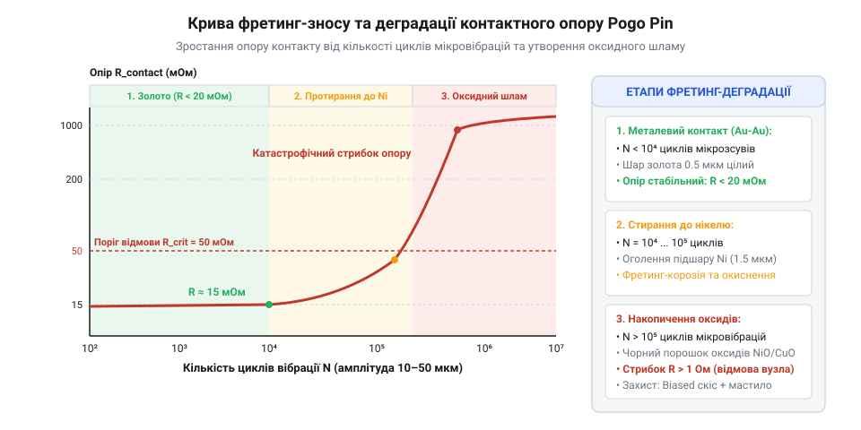
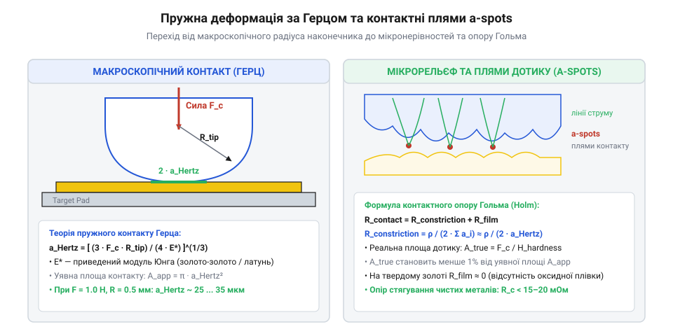

# Розрахунок контактного опору, механіки пружини та фретинг-зносу

<preknowlist>
- [Штирьові зʼєднувачі (male)](root:cat-hw-parts/pin-headers) — базові принципи рознімних механічних та електричних з'єднань і геометрію штирових контактів
- [Тросові та еластомірні віброізолятори: Wire Rope, силіконові демпфери та поглинання ударів](root:cat-hw-parts/wire-rope-isolators) — механізми виникнення та гасіння мікровібрацій у рухомих вузлах
- [Класи міцності та матеріали кріплення: сталі 8.8–12.9, нержавійка A2/A4, титан Gr5 та задирання різьби](root:cat-hw-parts/fastener-strength-classes-and-materials) — поверхневі властивості металів, твердість та механіку контактної деформації матеріалів
</preknowlist>

## Чому пружинний контакт втрачає сигнал

У роботизованих системах, безпілотних літальних апаратах та вимірювальних модулях роз'єми на пружинних контактах (від англ. @@en|Pogo Pin@@ — пружинний штир) часом демонструють спорадичні розриви кола, стрибки перехідного опору та високий рівень електричних шумів. Інженер-початківець часто вважає, що для надійного електричного з'єднання достатньо простого геометричного дотику двох металевих поверхонь під притиском пружини в частки ньютона, на зразок того, як працюють стандартні роз'єми зі @@en|pin headers@@ ([штирьовими з'єднувачами](root:cat-hw-parts/pin-headers)). Проте на мікроскопічному рівні металеві поверхні не є ідеально плоскими: вони вкриті хаотичним рельєфом із мікронерівностей (від англ. @@en|asperity@@ — шорсткий виступ) та діелектричними плівками оксидів і адсорбованих газів.

Коли плунжер (від англ. @@en|plunger@@ — рухомий штир) притискається до контактного майданчика (від англ. @@en|target pad@@), реальний механічний контакт відбувається не по всій видимій площі наконечника, а лише в окремих вершинах мікровиступів. Сумарна площа цих реальних контактних плям становить менше 0.1% від геометричної площі стику. Струм змушений оминати ізоляційні ділянки й звужуватися до вузьких каналів провідності (від англ. @@en|a-spots@@ — плями дотику), що різко збільшує електричний опір стягування.

Ситуація ускладнюється в умовах мікровібрацій, які виникають у рухомих механізмах без належного застосування [тросових віброізоляторів](root:cat-hw-parts/wire-rope-isolators). Відносне мікрозміщення плунжера й майданчика амплітудою від 1 до 50 мкм спричиняє фретинг-знос (від англ. @@en|fretting wear@@ — втомне стирання мікроконтактів). Під час фретингу крихкі мікрозварні містки між плямами дотику безперервно руйнуються, а оголений метал миттєво окислюється киснем повітря. Накопичення продуктів окиснення — оксидного шламу — формує діелектричний шар, який ізолює контактну пару й викликає падіння напруги або повну втрату сигналу.


*Динаміка зростання контактного опору під час фретинг-зношування: після стирання захисного золотого шару утворюються оксиди базисного металу, що викликає спалахи електричного шуму.*

Щоб відвернути виникнення фретинг-корозії та стабілізувати електричний зв'язок, необхідно розрахувати сили й напруження в зоні дотику. Основною задачею є встановлення математичної залежності між механічним зусиллям стиснення пружини `F_s`, пружно-пластичною деформацією мікровиступів та підсумковим перехідним опором. Ураховуючи [матеріали контактних деталей](root:cat-hw-parts/fastener-strength-classes-and-materials), вибір твердості покриття та зусилля пружини визначає межу між стабільним контактом і систематичними збоями.

## Деформація мікронерівностей за теорією Герца

Для визначення площі електричного контакту слід розібрати механіку розтискання та стиснення пружини, а також деформацію мікронерівностей поверхні. Сила притиску пружини `F_s` розраховується за законом Гука залежно від жорсткості пружини `k` та робочого ходу плунжера `Δx`:

```
F_s = k · Δx
```

Ця сила передається через сферичний або радіусний наконечник плунжера радіусом `R` на плоский контактний майданчик. За теорією контактної взаємодії Герца (від англ. @@en|Hertzian contact stress@@ — герцівське контактне напруження), при пружному стисненні двох тіл виникає коловий макроскопічний контактний майданчик радіуса `a`. Для розрахунку радіуса `a` вводиться ефективний модуль пружності `E_eff`, який враховує moduli Юнга `E₁`, `E₂` та коефіцієнти Пуассона `ν₁`, `ν₂` матеріалів плунжера та майданчика:

```
1 / E_eff = (1 - ν₁²) / E₁ + (1 - ν₂²) / E₂
= (1 - 0.31²) / 110 + (1 - 0.31²) / 110       [для покриття золото-латунь з E = 110 GPa]
= 0.0164 GPa⁻¹                                [значення оберненого модуля]
E_eff ≈ 60.9 GPa                              [ефективний модуль пружності]
```

Радіус пружного макроконтакту за Герцом `a` обчислюється через силу притиску `F_s`, радіус наконечника `R` та ефективний модуль `E_eff`:

```
a = (3 · F_s · R / (4 · E_eff))^(1/3)
```

Проте пружна модель Герца описує лише загальне макроскопічне контурне осереддя контакту `A_e = π · a²`. Реальна поверхня містить мікровиступи із середнім радіусом заокруглення вершин `r_i`. Локальне напруження на вершинах мікронерівностей суттєво перевищує макроскопічний тиск і швидко досягає межі плинності металу `y · H_v`, де `H_v` — твердість за Віккерсом або Майєром найм'якішого поверхневого шару (наприклад, чистого золотого чи срібного гальванічного покриття).

Під дією високого локального тиску мікровиступи зазнають пластичної деформації (від англ. @@en|plastic flow@@ — пластична течія металу). За моделлю Грінвуда-Вільямсона (від англ. @@en|Greenwood-Williamson model@@), сумарна реальна площа контактних плям `A_r` при пластичній деформації асперитетів прямо пропорційна силі притиску `F_s` і обернено пропорційна контактній твердості `H`:

```
A_r = F_s / H
```


*Контактна зона Pogo Pin: макроскопічний контур стиснення за Герцом містить безліч пластично деформованих мікровиступів (a-spots), що формують реальні провідні канали.*

Якщо реальна площа `A_r` розподілена між `n` окремими мікроплями дотику (від англ. @@en|a-spots@@), середній радіус поодинокої мікроплями `r_a` визначається виразом:

```
r_a = √(A_r / (n · π))
= √(F_s / (n · π · H))                        [підстановка площі пластичного контакту]
```

Обчислимо геометричні параметри мікроконтакту на практичному інженерному прикладі.

**Розрахунок площі мікроконтакту для золоченого плунжера Pogo Pin:**
Пружина створює силу притиску `F_s = 0.5 N`. Наконечник вкритий м'яким гальванічним золотом із твердістю `H = 1.2 GPa` (`1.2 × 10⁹ Pa`). Кількість активних плям дотику оцінюється як `n = 25`.

```
A_r = F_s / H
= 0.5 / (1.2 × 10⁹)                            [формула пластичної деформації]
= 4.167 × 10⁻¹⁰ m²                             [сумарна площа мікроконтактів, або 416.7 μm²]

r_a = √(A_r / (n · π))
= √((4.167 × 10⁻¹⁰) / (25 · 3.1416))           [обчислення радіуса однієї плями]
= √(5.305 × 10⁻¹²)                             [підкореневий вираз]
≈ 2.303 × 10⁻⁶ m                               [середній радіус a-spot: 2.30 мкм]
```

Розрахований радіус поодинокої контактної плями `r_a ≈ 2.30 мкм` є базовою величиною для обчислення опору звуження електричного струму. Подібні розрахунки використовуються також під час проектування прецизійних рухомих струмознімачів із [капсульних ковзних кілець](root:cat-hw-parts/capsule-slip-ring).

## Контактний опір та пробиття плівок

Отриманий радіус контактних плям `r_a` дозволяє розрахувати електричні параметри стику. Коли лінійки електричного струму проходять крізь плунжер і потрапляють у малі плями `a-spots`, лінії провідності викривляються й стискаються. Це явище описує опір стягування Гольма (від англ. @@en|Holm constriction resistance@@).

Для поодинокої кругової плями радіуса `r_a` в однорідному матеріалі з питомим електричним опором `ρ` опір стягування `R_s1` становить:

```
R_s1 = ρ / (2 · r_a)
```

Якщо контактна пара складається з двох різних матеріалів із питомими опорами `ρ₁` та `ρ₂` (наприклад, латунь плунжера та мідь контактного майданчика), застосовують середній питомий опір `ρ_avg = (ρ₁ + ρ₂) / 2`.

У реальному контакті `n` плям розташовані кластером у межах контурного радіуса `α`. Сумарний опір стягування `R_constriction` враховує як паралельну провідність окремих мікроплям, так і макроскопічне стягування струму до всього кластера:

```
R_constriction = ρ / (2 · n · r_a) + ρ / (2 · α)
```

Окрім опору стягування, на перехідний опір впливає опір тонких поверхневих плівок `R_film` (від англ. @@en|film resistance@@). Якщо поверхня вкрита напівпровідниковим або оксидним шаром із питомим поверхневим опором `σ_f` (Ом·м²), опір плівки визначається виразом:

```
R_film = σ_f / A_r
```

Підсумковий перехідний опір контакту `R_c` є сумою опору стягування та опору плівки:

```
R_c = R_constriction + R_film
```

Для руйнування діелектричних оксидних плівок застосовують два механізми: механічне роздавлювання та електричне пробиття (від англ. @@en|fritting@@ — фриттінг). Механічне руйнування відбувається, коли середня інтенсивність тиску на асперитетах перевищує твердість покриття `H`, викликаючи тріщини в крихкому оксиді та витискання чистого металу в тріщини.

Електричний фриттінг виникає, коли падіння напруги на контакті перевищує критичну напругу пробиття плівки `U_f` (для оксидів міді та нікелю `U_f ≈ 0.3 - 1.0 V`). Під дією сильного електричного поля `E ≥ 10⁶ V/cm` відбувається локальний пробій діелектрика, плавлення мікрооб'єму металу та формування міцного металевого містка (від англ. @@en|molten bridge@@).

Мінімальна сила пружини `F_min`, необхідна для механічного пробиття плівок та стабілізації перехідного опору нижче заданого допустимого значення `R_target`, розраховується з умови пластичної деформації:

```
F_min = H · (ρ / (2 · R_target))²
```

**Обчислення повного перехідного опору золоченого пружинного контакту:**
Визначимо `R_c` для контакту з золотим покриттям (`ρ = 2.44 × 10⁻⁸ Ohm·m`), силою притиску `F_s = 1.0 N`, твердістю `H = 1.5 GPa`, кількістю плям `n = 30`, радіусом кластера `α = 0.15 mm` (`1.5 × 10⁻⁴ m`) та поверхневим опором чистого золота `σ_f = 10⁻¹⁴ Ohm·m²`.

```
A_r = F_s / H
= 1.0 / (1.5 × 10⁹)                            [площа пластичного контакту]
= 6.667 × 10⁻¹⁰ m²                             [реальна площа A_r = 666.7 μm²]

r_a = √(A_r / (n · π))
= √((6.667 × 10⁻¹⁰) / (30 · 3.1416))           [радіус поодинокої плями]
= √(7.073 × 10⁻¹²)                             [підкореневе значення]
≈ 2.660 × 10⁻⁶ m                               [радіус плями r_a = 2.66 мкм]

R_micro = ρ / (2 · n · r_a)
= (2.44 × 10⁻⁸) / (2 · 30 · 2.660 × 10⁻⁶)       [мікроскопічна складова стягування]
= (2.44 × 10⁻⁸) / (1.596 × 10⁻⁴)               [обчислення мікроопору]
≈ 1.529 × 10⁻⁴ Ohm                             [R_micro = 0.153 мОм]

R_macro = ρ / (2 · α)
= (2.44 × 10⁻⁸) / (2 · 1.5 × 10⁻⁴)             [макроскопічна складова стягування]
= (2.44 × 10⁻⁸) / (3.0 × 10⁻⁴)                 [обчислення макроопору]
≈ 0.813 × 10⁻⁴ Ohm                             [R_macro = 0.081 мОм]

R_constriction = R_micro + R_macro
= 1.529 × 10⁻⁴ + 0.813 × 10⁻⁴                  [сумарний опір стягування]
= 2.342 × 10⁻⁴ Ohm                             [R_constriction = 0.234 мОм]

R_film = σ_f / A_r
= (10⁻¹⁴) / (6.667 × 10⁻¹⁰)                    [опір поверхневої плівки]
≈ 1.500 × 10⁻⁵ Ohm                             [R_film = 0.015 мОм]

R_c = R_constriction + R_film
= 2.342 × 10⁻⁴ + 0.150 × 10⁻⁴                  [підсумковий перехідний опір]
= 2.492 × 10⁻⁴ Ohm                             [R_c ≈ 0.25 мОм]
```

Отриманий розрахунковий перехідний опір близько `0.25 мОм` відповідає якісному стану нового чистий контакту Pogo Pin. При виборі з'єднувальних вузлів для передачі сигналів у [сигнальних кабелях JST-GH](root:cat-hw-parts/jst-gh-cable) або при розводці ліній у [монтажних проводах AWG](root:cat-hw-parts/hookup-wire), точний розрахунок `R_c` за формулами Гольма гарантує відсутність просідання напруги та стабільність сигнальних кіл.

## Динаміка накопичення фретинг-зносу при вібраціях

У рухомих механізмах, промислових маніпуляторах та безпілотних апаратах роз'єми на пружинних контактах піддаються постійним вібраційним навантаженням та циклічним мікропереміщенням. За відсутності належного демпфування через [тросові віброізолятори](root:cat-hw-parts/wire-rope-isolators), між наконечником плунжера та контактним майданчиком виникає відносне проковзування з амплітудою `δ` від 1 до 50 мкм. Ці мікрозміщення викликають фретинг-знос (від англ. @@en|fretting wear@@ — втомне стирання мікроконтактів) та фретинг-корозію (від англ. @@en|fretting corrosion@@ — окислення стираного металу), що поступово руйнують тонкі захисні покриття та деградують електричне з'єднання.

Об'єм зношеного матеріалу покриття `V_w` під час фретингу описується законом зношування Аршарда (від англ. @@en|Archard's wear law@@):

```
V_w = K_w · F_s · L / H
```

де `K_w` — безрозмірний коефіцієнт зношування (від англ. @@en|wear coefficient@@), який для контакту золото-золото зазвичай становить `10⁻⁴ ... 10⁻³`, `F_s` — нормальна сила притиску пружини, `H` — контактна твердість м'якшого з матеріалів покриття, а `L` — сумарний шлях тертя. Для `N` циклів мікровібрацій з амплітудою проковзування `δ` (від англ. @@en|slip amplitude@@) повний шлях тертя дорівнює `L = 2 · δ · N`.

Захисне гальванічне покриття з чистого або твердого золота має товщину `h_Au` (від англ. @@en|plating thickness@@), яка наноситься поверх нікелевого підшару (від англ. @@en|undercoating@@ — бар'єрний шар) товщиною `h_Ni`. Під час фретингу знос локалізується на площі макроскопічного контуру стиснення за Герцом `A_e`. Глибина зношування покриття `h_w` після `N` циклів визначається як відношення зношеного об'єму до площі макроконтакту `h_w = V_w / A_e`.

Критична кількість циклів мікровібрацій `N_c`, за якої відбувається повне стирання захисного золотого шару на всю його товщину `h_Au`, обчислюється шляхом підстановки виразу для зношеного об'єму:

```
N_c = (h_Au · H · A_e) / (2 · K_w · F_s · δ)
```

Поки кількість циклів вібрації нижча за критичну межу (`N < N_c`), контактний опір `R_c` залишається низьким і стабільним на рівні часток міліома. Однак після пробиття та стирання золотого покриття (`N > N_c`) мікроконтакт переходить на нікелевий підшар або латунну основу плунжера. На повітрі оголений базисний метал миттєво окислюється, а постійне стирання подрібнює оксидну плівку у шар оксидного шламу (від англ. @@en|debris layer@@ — накопичення продуктів зносу).

Питомий опір оксидів нікелю й міді в мільйони разів перевищує опір золота. Шлам накопичується в зоні плям дотику `a-spots`, ізолює контактні поверхні й викликає хаотичні спалахи електричного шуму, падіння напруги або повний розрив кола. Подібна деградація є критичною в [кабельних шлейфах заземлення](root:cat-hw-parts/industrial-pendant-cable-harnessing-and-shielding) та високошвидкісних лініях передачі даних у [кабелях USB Type-C](root:cat-hw-parts/usb-cables).

**Розрахунок ресурсу золотого покриття Pogo Pin до повального зростання опору:**
Визначимо критичну кількість циклів `N_c` для пружинного контакту з силою притиску `F_s = 0.6 N`, радіусом макроконтакту Герца `A_e = 1.1 × 10⁻⁹ m²`, товщиною золотого покриття `h_Au = 0.76 μm` (`7.6 × 10⁻⁷ m`), твердістю `H = 1.6 GPa` (`1.6 × 10⁹ Pa`), коефіцієнтом зношування `K_w = 1.5 × 10⁻⁴` та амплітудою мікровібрацій `δ = 12 μm` (`1.2 × 10⁻⁵ m`).

```
L_cycle = 2 · δ
= 2 · (1.2 × 10⁻⁵)                             [шлях тертя за один цикл]
= 2.4 × 10⁻⁵ m                                 [циклове зміщення: 24 мкм]

N_c = (h_Au · H · A_e) / (K_w · F_s · L_cycle)
= (7.6 × 10⁻⁷ · 1.6 × 10⁹ · 1.1 × 10⁻⁹) / (1.5 × 10⁻⁴ · 0.6 · 2.4 × 10⁻⁵)   [підстановка у формулу Аршарда]
= (1.3376 × 10⁻⁶) / (2.160 × 10⁻⁹)            [ділення об'єму покриття на цикловий знос]
≈ 6.193 × 10⁵ cycles                           [критичний ресурс: ~619 300 циклів]
```

Розрахований ресурс показує, що при амплітуді вібрацій 12 мкм контакт збереже низький перехідний опір протягом приблизно 619 тисяч циклів. Після досягнення цієї межі опір зростає від 0.3 мОм до сотень міліом або декількох ом.

## Розрахунок та оптимізація пружинного контакту

Проектування надійного пружинного контакту Pogo Pin вимагає розв'язання фундаментального інженерного компромісу між електричною провідністю, механічною стабільністю та цикловою зносостійкістю.

З одного боку, збільшення сили притиску пружини `F_s` зменшує опір стягування Гольма `R_constriction` (оскільки опір обернено пропорційний квадратному кореню з сили `1 / √F_s`), забезпечує надійне механічне руйнування діелектричних плівок та запобігає мікророзривам при ударних навантаженнях. З іншого боку, згідно із законом Аршарда, об'єм зношеного покриття `V_w` прямо пропорційний силі `F_s`. Надмірне зусилля пружини призводить до швидкого стирання золотого шару й катастрофічного виникнення фретинг-корозії.

Геометрія наконечника плунжера також визначає характер деформації. Збільшення радіуса заокруглення наконечника `R` розширює площу герцівського макроконтакту `A_e`, зменшуючи питому глибину зношування за цикл, але знижує локальний тиск на мікровиступах. Для підвищення надійності застосовують тверде золото (від англ. @@en|hard gold@@ — гальванічне золото з додаванням кобальту чи нікелю, твердістю `H ≈ 1.8 - 2.2 GPa`) та підшар нікелю (від англ. @@en|nickel barrier layer@@ — нікелевий бар'єрний шар), який запобігає міжметалевій дифузії (від англ. @@en|intermetallic diffusion@@) міді з латунного корпусу у поверхневе золото. Для самоочищення від оксидів використовують наконечники з зрізаним або короноподібним профілем, що забезпечують ефект самоочищення (від англ. @@en|wiping action@@ — зсувне зрізання плівок при контакті) на задану відстань (від англ. @@en|wipe distance@@).

Інженерна методика розрахунку та оптимізації Pogo Pin складається з п'яти послідовних кроків:

1. Розрахунок мінімальної сили притиску `F_min` з умови забезпечення заданого допустимого перехідного опору `R_target` та механічного руйнування оксидів. 2. Розрахунок максимально припустимої сили притиску `F_max` з умови забезпечення необхідного циклового ресурсу вібраційного зносу `N_req` до стирання товщини золота `h_Au`. 3. Вибір робочого зусилля пружини `F_work` у безпечному інтервалі `F_min_safe < F_work < F_max`, зазвичай із запасом `F_work = (1.5 ... 2.5) · F_min_safe`. 4. Визначення необхідної жорсткості пружини `k = F_work / Δx_work` за робочим ходом плунжера `Δx_work`. 5. Перевірка геометричного профілю наконечника `R` та товщини покриттів `h_Au`, `h_Ni`.

**Комплексна оптимізація пружинного контакту для міжплатного з'єднувача:**
Необхідно розрахувати параметри Pogo Pin для забезпечення перехідного опору не більше `R_target = 1.2 мОм` (`1.2 × 10⁻³ Ohm`) та ресурсу вібраційної стійкості `N_req = 300 000 циклів` (`3.0 × 10⁵ cycles`) при амплітуді проковзування `δ = 10 μm` (`1.0 × 10⁻⁵ m`). Робочий хід плунжера становить `Δx = 0.8 mm` (`8.0 × 10⁻⁴ m`).

Параметри матеріалів: покриття твердим золотом з питомим опором `ρ = 2.44 × 10⁻⁸ Ohm·m`, твердістю `H = 2.0 GPa` (`2.0 × 10⁹ Pa`), товщиною `h_Au = 0.76 μm` (`7.6 × 10⁻⁷ m`), коефіцієнтом зношування `K_w = 1.8 × 10⁻⁴`, кількості плям `n = 20` та площею макроконтакту `A_e = 1.0 × 10⁻⁹ m²`.

```
F_min = (π · H / n) · (ρ / (2 · R_target))²
= (3.1416 · 2.0 × 10⁹ / 20) · ((2.44 × 10⁻⁸) / (2 · 1.2 × 10⁻³))²     [формула Гольма для опору звуження]
= (3.1416 × 10⁸) · (1.0167 × 10⁻⁵)²           [обчислення відношення опорів]
= 3.1416 × 10⁸ · 1.0336 × 10⁻¹⁰               [квадрат відношення]
≈ 0.0325 N                                    [теоретична мінімальна сила: 32.5 мН]

F_min_safe = 4 · F_min
= 4 · 0.0325                                  [урахування пробиття плівок та запасу]
= 0.130 N                                     [мінімальне безпечне зусилля: 0.13 Н]

F_max = (h_Au · H · A_e) / (2 · K_w · δ · N_req)
= (7.6 × 10⁻⁷ · 2.0 × 10⁹ · 1.0 × 10⁻⁹) / (2 · 1.8 × 10⁻⁴ · 1.0 × 10⁻⁵ · 3.0 × 10⁵)  [граничний вираз Аршарда]
= (1.520 × 10⁻⁶) / (1.080 × 10⁻³)             [ділення запасу металу на цикловий знос]
≈ 1.407 N                                     [максимально припустима сила: 1.41 Н]

F_work = 0.50 N                               [вибір робочого зусилля у межах 0.13 N ... 1.41 N]

k = F_work / Δx
= 0.50 / (8.0 × 10⁻⁴)                          [визначення жорсткості пружини]
= 625 N/m                                      [необхідна жорсткість: 0.625 Н/мм]
```

За результатами обчислень обрано робоче зусилля пружини `F_work = 0.50 N` та жорсткість `k = 625 N/m` (або `0.625 N/mm`). Це зусилля знаходиться в оптимальному діапазоні між 0.13 Н та 1.41 Н: воно з запасом гарантує руйнування окисних плівок і низький контактний опір `R_c ≈ 0.35 мОм`, при цьому забезпечуючи розрахунковий ресурс зносостійкості золотого покриття понад 840 000 циклів вібрації, що майже втричі перевищує технічну вимогу у 300 000 циклів.

Дана математична методика застосовується при виборі та проектуванні пружинних з'єднувачів для [силових роз'ємів XT30](root:cat-hw-parts/xt-connectors) у бортовому живленні або при монтажі планарних контактних груп з [нарізними втулками](root:cat-hw-parts/threaded-inserts-and-heat-set) у корпусах електронних пристроїв.