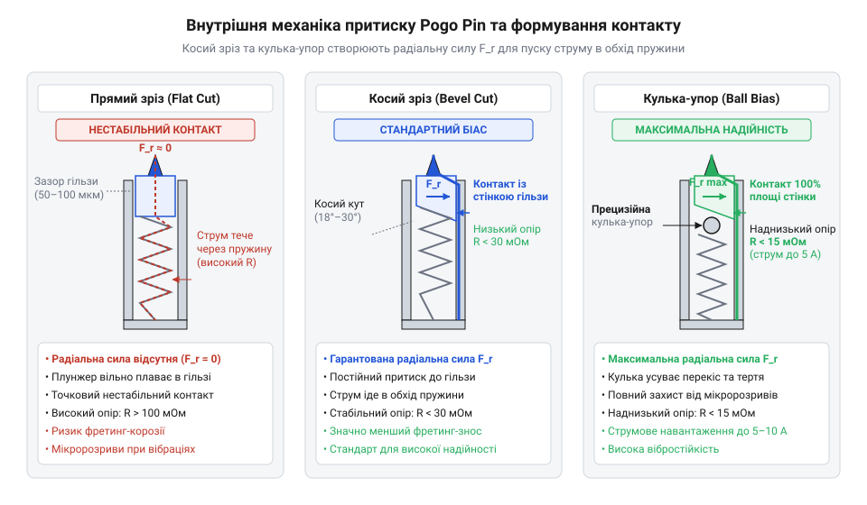
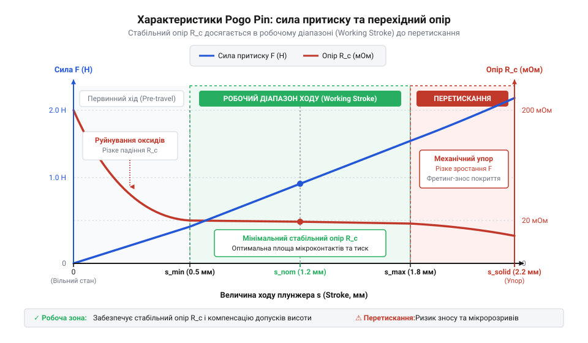
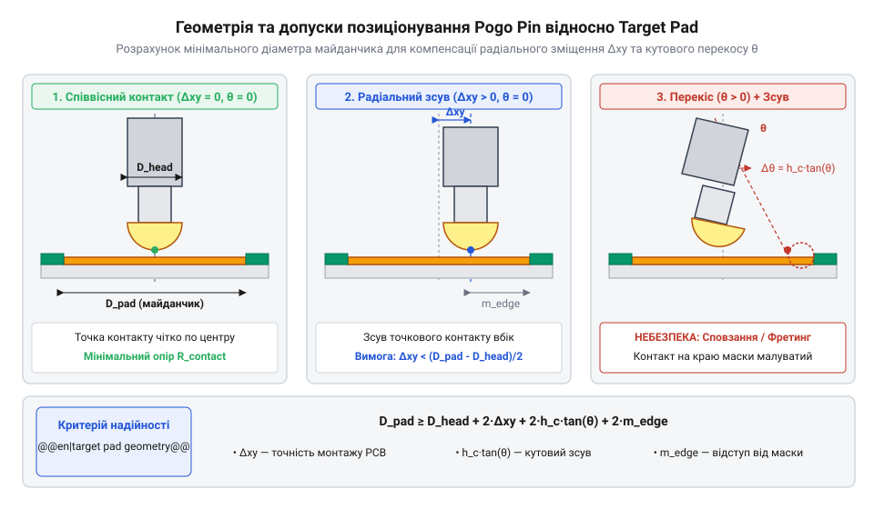
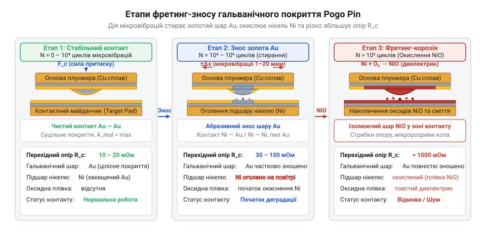
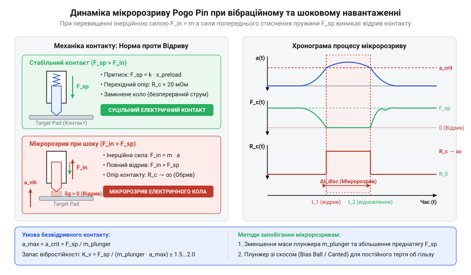

# Пружинні контакти Pogo Pins: механіка притиску, фретинг-корозія та вібростійкість

<preknowlist>
- [Штирьові зʼєднувачі (male)](root:cat-hw-parts/pin-headers) — конструктивні обмеження суцільнометалевих вилок при багаторазовому сочлененні та відмінність жорстких роз'ємів від підпружинених динамічних контактів
- [Тросові та еластомірні віброізолятори: Wire Rope, силіконові демпфери та поглинання ударів](root:cat-hw-parts/wire-rope-isolators) — механізм передачі вібраційних навантажень через елементи корпусу та способи зниження амплітуди коливань
</preknowlist>

## Відмова жорстких роз'ємів у рухомих вузлах

Спроба з'єднати дві частини рухомого пристрою за допомогою класичних роз'ємів майже завжди закінчується виходом електроніки з ладу. Коли розробник проектує зарядний док для безпілотника, знімний пульт промислового контролера, акумуляторний модуль чи докінг-станцію ноутбука, першим інтуїтивним рішенням здається використання стандартних [штирьових зʼєднувачів](root:cat-hw-parts/pin-headers). Проте жорстка фрикційна фіксація, на якій базується класичний @@en|pin header@@ (від англ. *pin header* — штирьова з'єднувальна гребінка) та відповідний @@en|socket@@ (від англ. *socket* — роз'ємна розетка, гніздо), розрахована виключно на стаціонарне з'єднання всередині закритого корпусу. У рухомих, знімних або часто розєднуваних вузлах така конструктивна схема виявляється принципово непрацездатною.

Класичний роз'єм працює за принципом сочленення з натягом — @@en|interference fit@@ (від англ. *interference fit* — механічне сочленення з натягом). Щоб забезпечити електричний контакт, металевий штир повинен з зусиллям розсунути пружні пелюстки гнізда та увійти всередину на визначену глибину. Це вимагає строго ідеального осьового напрямку руху. У реальному серійному пристрої кожен елемент корпусу має виготовлювальні допуски, розкид розмірів та деформації від теплового розширення. Цей ефект називається накопиченням допусків — @@en|tolerance stackup@@ (від англ. *tolerance stackup* — накопичення геометричних допусків). Якщо два жорсткі корпуси стикуються з найменшим кутовим або поперечним перекосом навіть у 0.2 мм, жорсткий штир упирається в край гнізда. Замість плавної посадки виникають колосальні бічні навантаження та згинальні моменти. Оскільки штир та гніздо жорстко упаяні в друковані плати, ці згинальні зусилля передаються безпосередньо на місця пайки. У результаті виникає зсув контактних майданчиків, виривання доріжок та утворення мікротріщин у безсвинцевих паяних з'єднаннях, що призводить до раптової відмови пристрою.

Друга критична проблема жорстких з'єднань — обмежений ресурс сочленень та зусилля монтажу. Стандартний @@en|pin header@@ розрахований лише на 50–100 циклів підключення — @@en|mating cycles@@ (від англ. *mating cycles* — цикли сочленення та розлучення). Під час кожного сочленення та розлучення виникає сильне тертя ковзання, яке швидко здирає тонкий шар захисного гальванічного покриття. Оголений метал підкладки миттєво окислюється під дією кисню та вологи, а пружні пелюстки гнізда зазнають залишкової пластичної деформації та розхитуються. В результаті стрімко зростає перехідний електричний опір — @@en|contact resistance@@ (від англ. *contact resistance* — перехідний електричний опір), контакт починає грітися та іскрити при найменшому мікрозсуві. Крім того, багатопінові жорсткі роз'єми вимагають значного сумарного зусилля вставляння — @@en|insertion force@@ (від англ. *insertion force* — зусилля сочленення), яке для 40-пінового з'єднувача може досягати 40–50 Н. Це унеможливлює легке стикування пристрою однією рукою або використання автоматичних магнітних фіксаторів. На відміну від стійких механічних вузлів, де застосовують [еластомірні віброізолятори](root:cat-hw-parts/wire-rope-isolators) для гасіння зовнішніх коливань, жорсткий роз'єм передає всі зовнішні вібрації прямо на електричний контакт, викликаючи мікророзриви кола десятки разів на секунду.

Для рухомих, модульних та докінгових інтерфейсів потрібен принципово інший підхід — динамічний пружний контакт із нульовим зусиллям сочленення, або @@en|zero insertion force@@ (від англ. *zero insertion force* — сочленення без зусилля вставляння). Замість вставляння одного металевого елемента всередину іншого, з'єднання має відбуватися шляхом торцевого притискання підпружиненого штока до плаского металевого майданчика. Конструкція повинна містити механічні обмежувачі ходу — @@en|mechanical stop@@ (від англ. *mechanical stop* — механічний упор), які запобігають надмірному стисканню пружини — @@en|over-stroke@@ (від англ. *over-stroke* — перевищення робочого ходу) понаднормово від рекомендованої величини (зазвичай не більше 2/3 від максимального ходу), захищаючи її від пластичної деформації. Для первинного позиціонування корпусів застосовують напрямні штифти — @@en|alignment pins@@ (від англ. *alignment pins* — центруючі штифти) або магнітні засувки — @@en|magnetic latching@@ (від англ. *magnetic latching* — магнітна фіксація), які вирівнюють контакти до моменту торкання.

Пружинні контакти @@en|pogo pin@@ (від англ. *pogo stick* — пружинний костур-стрибалка для стрибків) виникли саме як відповідь на цю потребу в галузі автоматизованого тестового обладнання — @@en|automated test equipment@@ (скорочено @@en|ATE@@). Під час випробувань зібраних друкованих плат тестова установка («поле голок») повинна була одночасно торкнутися сотень або тисяч контрольних точок на платі, не пошкоджуючи паяні майданчики та витримуючи від 100 000 до 1 000 000 вимірювальних циклів без заміни голок. З розвитком портативної електроніки, носимих пристроїв та робототехніки ця технологія швидко мігрувала з вимірювальних стендів у масові споживчі та промислові вироби. Сучасні зарядні док-станції, смарт-годинники, бездротові навушники та промислові знімні батарейні блоки повністю відмовилися від традиційних гнізд на користь пружинних контактів. Вони дозволяють створити герметичну пласку поверхню пристрою (класу IP67/IP68), яка легко чиститься від бруду, компенсує похибки позиціонування корпусу в межах ходу пружини та не вимагає точних напрямних салазок. Порівняно з обмеженим ресурсом та вразливістю до пилу у [роз'ємах USB-кабелів](root:cat-hw-parts/usb-cables), підпружинений контакт забезпечує стабільне з'єднання протягом десятків тисяч циклів підключення.

Конструкція пружинного контакту дозволяє повністю розділити механічне позиціонування корпусів та електричний зв'язок між платами. Щоб побудувати надійний вузол, розробнику необхідно розібратися у внутрішній механіці самого контакту та фізичних процесах, що відбуваються всередині його гільзи під час стискання.

## Внутрішня механіка та шляхи проходження струму

Кожен контакт @@en|pogo pin@@ на перший погляд здається простим мініатюрним металевим циліндром, проте всередині нього приховано прецизійний механічний вузол, що складається з трьох основних елементів. Перший елемент — рухомий шток, або @@en|plunger@@ (від англ. *plunge* — занурюватися, пірнати), який виступає з гільзи й безпосередньо контактує з зовнішнім майданчиком. Другий елемент — зовнішня напрямна гільза, або @@en|barrel@@ (від англ. *barrel* — циліндрична бочка або гільза), яка утримує внутрішні деталі та монтується на друковану плату. Третій елемент — внутрішня спіральна пружина, або @@en|spring@@ (від англ. *spring* — пружина), яка створює повертальний механічний тиск на шток.

Головне інженерне завдання при проективанні та виборі @@en|pogo pin@@ полягає в забезпеченні мінімального та стабільного електричного опору. Недосвідчений розробник може припустити, що електричний струм тече від штока @@en|plunger@@ через витки спіральної пружини @@en|spring@@ до денця гільзи @@en|barrel@@. Проте проходження основними шляхами струму через пружину є серйозною конструктивною помилкою з кількох фізичних причин:

1. **Високий опір матеріалу та геометрії**: Пружини виготовляють із високоміцної пружинної сталі (наприклад, SUS304) або берилієвої бронзи (BeCu). Довжина дроту, звитого у спіраль, у кілька разів перевищує фізичну довжину самого контакту, а малий переріз дроту створює високий послідовний опір (десятки Ом). 2. **Паразитна індуктивність**: Спіральна навивка пружини утворює справжню котушку індуктивності. При передачі високочастотних сигналів або імпульсів живлення виникає значний індуктивний опір — @@en|parasitic inductance@@ (від англ. *parasitic inductance* — паразитна індуктивність), що завалює фронти цифрових сигналів, викликає дзвін та створює імпульсні електромагнітні завади. 3. **Термічний відпал пружини**: При проходженні великого струму через витки пружини на її внутрішньому опорі виділяється теплова потужність `P = I² × R`. Нагрівання понад критичну температуру призводить до відпалу матеріалу — @@en|annealing@@ (від англ. *annealing* — втрата гартування та пружності). Пружина безповоротно втрачає пружні властивості, просідає і перестає створювати необхідне нормальне зусилля, що призводить до катастрофічного розриву кола.

Щоб уникнути цих руйнівних наслідків, конструкція @@en|pogo pin@@ повинна спрямовувати понад 99% струму альтернативним коротким шляхом: безпосередньо від штока @@en|plunger@@ через його бічну поверхню на внутрішню позолочену стінку гільзи @@en|barrel@@, оминаючи пружину.


*Внутрішня будова Pogo Pin із варіантами конструкції торця плунжера: косий зріз та кулька-упор спрямовують струм через стінку гільзи, минаючи високоомну пружину.*

Для гарантованого та стабільного притискання штока до внутрішньої стінки гільзи використовують спеціальну геометрію внутрішнього торця штока:

*   **Прямий зріз (Flat cut)**: Внутрішній торець штока виконаний перпендикулярно до його осі (під кутом 90°) — @@en|flat cut@@ (від англ. *flat cut* — плоский торець). При стисканні пружини сила діє strictly вздовж осі контакту. За наявності технологічного зазору шток може вільно висіти по центру гільзи, а контакт зі стінкою виникає лише випадково під дією зовнішнього кутового перекосу. При мікровібраціях цей бічний контакт безперервно розривається, змушуючи струм протікати через пружину. Це викликає флуктуації опору, електричні шуми та мікродуговий розряд — @@en|arcing@@ (від англ. *arcing* — мікродуговий розряд), який обвуглює внутрішні поверхні. Конструкція @@en|flat cut@@ придатна лише для найдешевших сигнальних контактів із малим струмом у стаціонарних умовах. *   **Косий зріз (Bevel cut)**: Внутрішній торець штока скошено під кутом від 15° до 25° — @@en|bevel cut@@ (від англ. *bevel cut* — скошений торець). Коли пружина тисне на цю похилу площину, осьове зусилля пружини розкладається на дві компоненти: відновлювальну осьову силу та бічну радіальну силу притиску.

Розрахунок бічної сили притиску здійснюється за наступним покроковим співвідношенням. Позначимо `F_axial` як осьову силу стискання пружини у ньютонах, `θ` як кут нахилу косого зрізу штока у градусах, а `F_lateral` як бічну силу притискання штока до внутрішньої стінки гільзи у ньютонах.

```
F_lateral = F_axial × tan(θ)    [розкладання вектора сили на похилій площині торця штока]
```

Завдяки бічній силі `F_lateral` шток @@en|plunger@@ під час всього робочого ходу щільно притискається своєю бічною поверхнею до внутрішньої стінки гільзи @@en|barrel@@. Щоб мінімізувати опір звуження — @@en|constriction resistance@@ (від англ. *constriction resistance* — опір звуження струмових ліній) — внутрішню стінку гільзи із латуні — @@en|brass@@ (від англ. *brass* — латунь C3604) — та поверхню штока вкривають шаром гальванічного золота поверх нікелевого підшару — @@en|gold plating@@ (від англ. *gold plating* — гальванічне золочення поверх нікелю @@en|electroless nickel underplate@@). Нікель товщиною 1.5–3.0 мкм слугує дифузійним бар'єром для міді, а золото товщиною 0.25–1.5 мкм забезпечує корозійну стійкість та мінімальний перехідний опір.

*   **Кулька-упор (Ball bias)**: У високострумових та вібростійких контактах між хвостовиком штока та пружиною поміщають прецизійну металеву або керамічну кульку — @@en|ball bias@@ (від англ. *ball bias* — механізм відхилення кулькою). Сферична поверхня кульки при стисканні виштовхує хвостовик штока вбік, створюючи потужне та рівномірне бічне зусилля притиску до гільзи. Це рішення забезпечує найнижчий опір, мінімізує механічний гістерезис — @@en|mechanical hysteresis@@ (від англ. *mechanical hysteresis* — різниця зусилля при ході вперед і назад через тертя ковзання) — та дозволяє витримувати постійний струм — @@en|current rating@@ (від англ. *current rating* — номінальний струм) — понад 3–5 А в динамічних умовах без перегріву. *   **Висвердлений торець (Countersunk cut)**: Хвостовик штока має внутрішню циліндричну виїмку, всередину якої частково заходить пружина — @@en|countersunk cut@@ (від англ. *countersunk cut* — висвердлений торець). Це дозволяє зменшити загальну висоту контакту @@en|pogo pin@@ при збереженні великого робочого ходу пружини, що критично для низькопрофільних портативних пристроїв.

Для розробки стійкого [рознімного магнітного інтерфейсу](root:cat-hw-parts/pogo-pins/proj-pogo-pin-dock-interface.md) критично обирати пружинні контакти з внутрішньою конструкцією @@en|bevel cut@@ або @@en|ball bias@@. Вони гарантують стабільність електричного кола під час руху штока. Виконаний розробником [розрахунок контактного опору](root:cat-hw-parts/pogo-pins/math-pogo-pin-mechanics-and-contact-resistance.md) опирається саме на ці механічні параметри, а правильне узгодження з [геометрією контактних майданчиків](root:cat-hw-parts/pogo-pins/api-pogo-pins-footprint-and-landing-pads.md) забезпечує тривалу експлуатацію без зносу гальванічного покриття.

## Залежність контактного опору від сили притиску

Коли дві гладкі позолочені деталі торкаються одна одної, здається, що електричний струм повинен безперешкодно протікати через усю площу їхнього зіткнення. Проте на мікроскопічному рівні навіть найретельніше полірована металева поверхня нагадує гірський рельєф із безліччю виступів та западин. Коли торець плунжера @@en|pogo pin@@ торкається контактного майданчика, реальний фізичний контакт виникає лише у кількох найвищих мікроточках. Номінальна геометрична площа зіткнення може становити кілька квадратних міліметрів, але дійсна площа мікроскопічного контакту — @@en|real contact area@@ (від англ. *real contact area* — дійсна площа мікроскопічного контакту) — на початковому етапі дорівнює лише незначній частці відсотка від загальної поверхні.

Через таке екстремальне звуження струмових ліній електричний струм змушений стискатися у вузькі струмові канали — мікроскопічні плями металевого контакту, або @@en|a-spots@@ (від англ. *a-spots* — мікроскопічні плями металевого контакту). Це явище створює додатковий опір звуження струмових ліній — @@en|constriction resistance@@. Крім того, будь-який метал на повітрі миттєво вкривається тонкими плівками оксидів, адсорбованої вологи та забруднень. Ці тонкі поверхневі шари формують опір поверхневої плівки — @@en|film resistance@@ (від англ. *film resistance* — електричний опір поверхневої оксидної плівки). Загальний перехідний електричний опір контакту @@en|contact resistance@@ складається із суми опору звуження та опору плівки.

Для руйнування ізолюючих оксидних плівок та збільшення дійсної площі контакту необхідне нормальне механічне зусилля притиску. Коли пружина всередині гільзи починає стискатися, сила притиску `F_contact` зростає, викликаючи пластичну деформацію мікровиступів у точках зіткнення. Під дією високого локального механічного напруження поверхневі оксидні плівки тріскаються та зсуваються вбік, оголюючи чистий ювенільний метал. Мікровиступи зминаються, їхня площа збільшується, а окремі плями контакту @@en|a-spots@@ зливаються між собою.

Математичний зв'язок між силою притиску, матеріалом покриття та опором звуження описується класичною моделлю Гольма для пластичного контакту. Позначимо `F_contact` як нормальну силу притиску плунжера у ньютонах, `H` як мікротвердість — @@en|microhardness@@ (від англ. *microhardness* — мікротвердість матеріалу поверхневого шару) м'якшого з двох контактних металів у паскалях, `ρ` як питомий електричний опір гальванічного покриття в ом-метрах, `A_real` як дійсну площу контакту у квадратних метрах, `a_spot` як еквівалентний радіус плями контакту у метрах, а `R_c` як опір звуження в омах.

```
A_real = F_contact ÷ H    [збільшення дійсної площі контакту через пластичне зминання мікровиступів]
a_spot = √(F_contact ÷ (π × H))    [еквівалентний радіус сумарної плями металевого контакту]
R_c = ρ ÷ (2 × √(F_contact ÷ (π × H)))
= (ρ ÷ 2) × √(π × H ÷ F_contact)    [залежність опору звуження від нормальної сили притиску]
```

З одержаного співвідношення видно, що опір звуження `R_c` є зворотно пропорційним квадратному кореню від сили притиску `F_contact`. При малій силі притиску навіть незначне коливання зусилля викликає стрибкоподібну зміну опору. Проте по мірі зростання сили притиску графік залежності виходить на плато, де подальше збільшення зусилля майже не знижує опір. Для точного [розрахунку контактного опору](root:cat-hw-parts/pogo-pins/math-pogo-pin-mechanics-and-contact-resistance.md) розробники визначають робочі характеристики пружини на всіх етапах ходу плунжера.

Залежність перехідного опору та сили притиску від величини занурення плунжера описується характеристичною кривою ходу пружного контакту. Загальний хід плунжера ділиться на три виразні фази.


*Залежність перехідного опору та сили притиску від ходу плунжера: досягнення рекомендованого робочого ходу стабілізує опір на мінімальному плато.*

Перша фаза — початковий натяг, або @@en|pre-load@@ (від англ. *pre-load* — початкове натягнення внутрішньої пружини). На початку ходу (від 0% до 20% від максимальної величини занурення) сила притиску є мінімальною (менше 0.2–0.3 Н). На цьому відрізку опір є високим (понад 100 мОм) та нестабільним. Найменша зовнішня вібрація викликає мікрозсуви плунжера та хаотичні стрибки опору. Експлуатувати контакт у зоні початкового натягу категорично заборонено.

Друга фаза — рекомендований робочий хід, або @@en|working stroke@@ (від англ. *working stroke* — оптимальний експлуатаційний хід плунжера). Вона відповідає зануренню штока на 30%–70% від його максимально можливого ходу (найчастіше близько 2/3 ходу). У цій зоні пружина створює розраховане нормальне зусилля (зазвичай від 0.5 Н до 1.5 Н, або 50–150 gf). Перехідний опір виходить на стабільний мінімальний рівень (15–30 мОм) і перестає реагувати на дрібні геометричні похибки збірки корпусу. Завдяки цьому пружний контакт легко компенсує температурне розширення матеріалів та технологічні допуски деталей.

Третя фаза — перевищення робочого ходу, або @@en|over-stroke@@ (від англ. *over-stroke* — перевищення допустимої глибини занурення). Коли шток занурюється понад 80% ходу і наближається до межі повністю стиснутої пружини — @@en|solid height@@ (від англ. *solid height* — висота контакту при зіткненні витків пружини), сила притиску стрімко зростає. Витки пружини впираються один в одного, або торець штока вдаряється в внутрішній механічний упор гільзи. Це призводить до катастрофічного перевантаження: пружина зазнає пластичної деформації та втрачає пружність, голівка плунжера деформується, а на друкованій платі виникають зсувні напруження, здатні відірвати паяний майданчик.

Окрім поздовжнього ходу плунжера, на стабільність контакту впливає геометричне вирівнювання та розмір контактного майданчика — @@en|target pad@@ (від англ. *target pad* — плаский контактний майданчик на друкованій платі). При сочлененні двох корпусів неминуче виникають геометричні допуски позиціонування та кутовий перекос — @@en|angular misalignment@@ (від англ. *angular misalignment* — кутовий перекос осей притиску).


*Геометричне узгодження голівки плунжера та контактного майданчика: компенсація кутового перекосу та зміщення осей за рахунок правильного вибору діаметра pad.*

Щоб забезпечити надійне торкання при кутовому перекосі до 2°–3°, голівку плунжера виготовляють у формі півсфери або радіусного закруглення. Сферичний торець зберігає постійну точку контакту навіть при нахилі осі. Проте діаметр контактного майданчика `D_pad` повинен з запасом перекривати максимальне радіальне зміщення плунжера. Опис правил проектування та вимоги до [геометрії контактних майданчиків](root:cat-hw-parts/pogo-pins/api-pogo-pins-footprint-and-landing-pads.md) враховують суммарний допуск збірки корпусу, радіус закруглення плунжера та додаткову фаску для відведення накопиченого пилу. Для надійного кріплення елементів корпусу в пластикових деталях док-станцій інженери монтують [нарізні втулки](root:cat-hw-parts/threaded-inserts-and-heat-set) та застосовують перевірені [класи міцності кріплення](root:cat-hw-parts/fastener-strength-classes-and-materials), що запобігає люфтам і збереже розраховане зусилля притиску протягом усього терміну служби пристрою.

## Фретинг-корозія та деградація гальванічного покриття

Навіть якщо пружинний контакт спроєктований із дотриманням усіх вимог щодо сили притиску та робочого ходу, у реальних умовах експлуатації з'єднання з часом може раптово втратити провідність. Пристрій, що встановлений у автомобілі, промисловому цеху або кишені користувача, піддається постійним мікровібраціям та температурним коливанням. Ці зовнішні впливи викликають мікропереміщення контактних поверхонь одна відносно одної. В результаті виникає руйнівний процес — фретинг-корозія — @@en|fretting corrosion@@ (від англ. *fretting corrosion* — корозія внаслідок мікрофрикційного зносу під дією вібрації).

Сутність фретинг-корозії полягає в циклічному мікрозсуві — @@en|micro-motion@@ (від англ. *micro-motion* — мікропереміщення контактних поверхонь з амплітудою від 0.5 до 100 мкм) — між точкою торкання плунжера та поверхнею контактного майданчика. Процес деградації гальванічного покриття проходить через чотири послідовні етапи.


*Етапи деградації контактного покриття під дією фретинг-корозії: від зносу захисного золотого шару до оголення нікелю та утворення ізолюючого оксидного пилу.*

На першому етапі поверхня плунжера та майданчика вкрита цілісним гальванічним золотим покриттям — @@en|gold plating@@ (від англ. *gold plating* — гальванічне покриття золотом). Золото є хімічно інертним шляхетним металом, який не окислюється на повітрі та забезпечує мінімальний перехідний опір (менше 20 мОм). Проте під дією циклічних мікрозсувів м'яке золото зазнає адгезійного зносу: мікровиступи поверхні поступово здирають та переносять тонкі лусочки золота з однієї деталі на іншу.

На другому етапі золото в точці контакту повністю стирається. Під золотим шаром оголюється бар'єрний нікелевий підшар — @@en|nickel underplate@@ (від англ. *nickel underplate* — гальванічний підшар нікелю). Нікель має значно вищу твердість, ніж золото, але на відміну від нього є хімічно активним металом.

На третьому етапі мікротерення руйнує тонку природну пасивну плівку нікелю. Дрібні металеві частки нікелю та латунного основного металу, відірвані внаслідок фретинг-зносу, миттєво вступають у реакцію з киснем повітря. Утворюється дрібнодисперсний оксид нікелю (NiO) та оксиди міді.

На четвертому етапі оксидні частки накопичуються безпосередньо у зоні контакту. Оскільки амплітуда мікрозсувів дуже мала (кілька мікронів), продуктові відходи зносу — @@en|fretting debris@@ (від англ. *fretting debris* — накопичення дрібнодисперсних оксидних продуктів фретинг-зносу) — не можуть самостійно вилитися або висипатися з зони торкання. Вони пресуються під дією сили притиску в щільний ізолюючий оксидний шар. Перехідний опір з'єднання стрибкоподібно зростає від міліомів до десятків Ом або навіть до повного розриву електричного кола.

Окрім мікрозсувів від температурного розширення, серйозною загрозою для стабільності з'єднання є механічні шоки та висока вібрація. При зовнішньому ударі на плунженер діє прискорення, яке намагається відірвати його від майданчика.


*Динамічна поведінка плунжера при вібраційному навантаженні: виникнення мікророзривів кола при перевищенні сили інерції над зусиллям пружини.*

Система плунжер-пружина має власну резонансну частоту — @@en|natural frequency@@ (від англ. *natural frequency* — власна частота механічних коливань):

```
f_n = (1 ÷ (2 × π)) × √(k_spring ÷ m_plunger)    [власна резонансну частота рухомої системи плунжера]
```

де `k_spring` — жорсткість пружини в Н/м, а `m_plunger` — маса плунжера в кілограмах. Якщо частота зовнішньої вібрації наближається до `f_n`, або якщо зовнішнє інерційне прискорення `a_ext × m_plunger` перевищує силу притиску пружини `F_contact`, плунженер фізично відривається від контактного майданчика. Виникає короткочасний мікророзрив електричного кола — @@en|micro-disconnection@@ (від англ. *micro-disconnection* — короткочасна втрата електричного контакту тривалістю від наносекунд до мікросекунд) або динамічний відскок — @@en|transient bounce@@ (від англ. *transient bounce* — тимчасовий відскок штока від поверхні). У цифрових шинах даних це викликає збої пакетів та перезавантаження мікроконтролерів, а у колах живлення — спалахи мікродуги та обвуглювання точок торкання.

Для захисту від фретинг-корозії та мікророзривів застосовують комплексний підхід до вибору матеріалів та конструктиву.

По-перше, для підвищення зносостійкості замість м'якого чистого золота використовують тверде золоте покриття — @@en|hard gold plating@@ (від англ. *hard gold plating* — позолочення, леговане 0.1% кобальту або нікелю). Тверде золото має мікротвердість 150–200 HV (проти 30–90 HV для м'якого золота), що збільшує кількість циклів сочленення та стійкість до мікротерення в 5–10 разів. Товщину золотого шару обирають залежно від умов: для побутових пристроїв достатньо 0.25–0.38 мкм, а для відповідальних промислових вузлів та автоелектроніки застосовують покриття товщиною 0.76–1.5 мкм поверх твердого нікелевого підшару завтовшки 1.5–3.0 мкм.

По-друге, у вібронавантажених вузлах зону контакту обробляють спеціальним захисним мастилом — @@en|contact lubricant@@ (від англ. *contact lubricant* — синтетичне мастило на основі поліфенілових ефірів або синтетичних вуглеводнів). Мастильна плівка ізолює ювенільний метал від кисню, запобігаючи окисленню фретинг-частинок, та змащує зони мікроковзання, знижуючи знос у рази.

По-третє, для зниження амплітуди вібрацій, що передаються на контактний вузол, конструкцію корпусу розв'язують через [тросові та еластомірні віброізолятори](root:cat-hw-parts/wire-rope-isolators). При розробці [герметичного док-інтерфейсу](root:cat-hw-parts/pogo-pins/proj-pogo-pin-dock-interface.md) інженери поєднують підпружинені контакти з магнітними засувками, що забезпечує постійний нормальний притиск та усуває поперечний люфт. У порівнянні з жорсткими роз'ємами, якими підключають [промислові кабельні шлейфи](root:cat-hw-parts/industrial-pendant-cable-harnessing-and-shielding) або класичні [силові роз'єми XT](root:cat-hw-parts/xt-connectors), правильно спроєктовані пружинні контакти із твердим позолоченням забезпечують стабільну роботу протягом сотень тисяч циклів у найжорсткіших умовах експлуатації.

## Вібростійкість та запобігання мікророзривам електричного кола

Коли електронний модуль працює у складі бортового обладнання безпілотного літального апарата, колісної чи гусеничної техніки, роботизованого маніпулятора або ручного вимірювального приладу, статичного розрахунку контактного зусилля виявляється недостатньо. Механічні удари, сплески прискорення та високочастотна вібрація викличуть динамічне зміщення елементів з'єднання. Якщо зовнішнє інерційне навантаження на плунжер перевищить силу пружності пружини, контактний кінчик короткочасно відірветься від площини друкованої плати.

Цей феномен називається @@en|мікророзрив@@ (англ. @@en|micro-disconnection@@, від грец. *mikros* — малий та лат. *dis-connectere* — роз'єднувати) електричного кола. Тривалість розмикання може становити від десятків наносекунд до кількох мікросекунд, що абсолютно непомітно для людського ока, проте спричиняє спотворення сигналів у високошвидкісних цифрових шинах даних, скидання регістрів мікроконтролерів через короткочасне просідання напруги живлення (brownout) та обрив процесів передачі даних. При розриві плям мікроконтакту (a-spots) радіус площадки торкання `a` прямує до нуля, через що опір звуження `R_c` стрибкоподібно зростає до нескінченності. У силових колах @@en|мікророзрив@@ додатково викликає мікродугові розряди: під дією індуктивності провідників напівавтоматично виникає перенапруга, яка іонізує повітряний проміжок та створює мікрократери на позолоченому покритті.

Фізична механіка @@en|мікророзрив@@у визначається динамічним балансом сил, що діють на плунжер під час прискорення. На плунжер масою `m_p` під дією зовнішнього вібраційного прискорення `a(t)` діє @@en|інерційна сила@@ (англ. @@en|inertial force@@, від лат. *inertia* — нерухомість):

F_inertia = m_p · a(t)

У стабільному статичному стані плунжер притискається до контактного майданчика із результуючою силою `F_contact`, яка залежить від геометричного стиснення пружини. Під час дії зовнішньої вібрації нормальна сила контакту `F_net(t)` стає динамічною функцією часу:

F_net(t) = F_preload + k · x_working - m_p · a(t)

де `F_preload` — @@en|попередній натяг@@ (англ. @@en|pre-load@@) пружини у вільному стані всередині гільзи, `k` — жорсткість контактної пружини, `x_working` — робочий хід плунжера.

Якщо вектор прискорення спрямований у бік стискання пружини і його значення досягає критичної межі `a_crit`:

a_crit = (F_preload + k · x_working) ÷ m_p

результуюча сила `F_net(t)` знижується до нуля. В цей момент площа дійсно задіяних мікроконтактів миттєво скорочується, перехідний опір `R_c` зростає на кілька порядків, і відбувається @@en|мікророзрив@@ електричного кола.


*Баланс сил на плунжері під час прискорення: перевищення інерційною силою зусилля пружини призводить до короткочасного відриву від контактного майданчика.*

Найнебезпечнішим є режим роботи вузла на частотах, близьких до власної резонансної частоти рухомої системи плунжер-пружина. За відсутності загасання амплітуда коливань плунжера зростає у десятки разів порівняно зі статичним зміщенням, що призводить до регулярних циклічних розривів кола навіть при відносно малих амплітудах зовнішньої вібрації.

Для усунення резонансних явищ та стабілізації електричного контакту застосовують @@en|демпфування@@ (нім. @@en|Dämpfung@@, від *dämpfen* — глушити) — розсіювання кінетичної енергії коливань шляхом в'язкого тертя. Заповнення внутрішньої порожнини гільзи спеціальним високостабільним контактним мастилом підвищує коефіціент в'язкого опору, знижуючи добротність резонансного піку `Q`. Одночасно мастило запобігає виникненню фретинг-зносу, захищаючи поверхню від окислення та корозії.

Інженерні методи забезпечення вібростійкості з'єднання на @@en|Pogo Pins@@ охоплюють комплекс механічних, схемотехнічних та системних рішень:

1. **Оптимізація коефіцієнта попереднього натягу та жорсткості**: Збільшення `F_preload` та жорсткості `k` підвищує критичний поріг прискорення `a_crit`. Проте це збільшує статичний тиск на гальванічне покриття, що прискорює його механічний знос при циклічних підключеннях. 2. **Мінімізація маси плунжера `m_p`**: Використання порожнистих плунжерів із висвердленим денцем (countersunk cut) або мініатюрних плунжерів із високопровідних берилієвих бронз дозволяє зменшити масу рухомого елемента у 1.5–2.5 рази, пропорційно підвищуючи допустимий рівень вібраційних навантажень без збільшення притискного зусилля. 3. **Застосування багатоточкових плунжерів**: Використання плунжерів із корончастою або розеточною формою верхівки (англ. @@en|crown plunger@@ або @@en|multi-finger plunger@@) забезпечує кілька паралельних точок торкання до одного майданчика. Завдяки мікронерівностям поверхні та розділеним контактним пелюсткам імовірність одночасного відриву всіх точок знижується на кілька порядків. 4. **Електричне дублювання та схемотехнічна фільтрація**: Силові шини та критичні сигнальні лінії розводять через кілька паралельно встановлених контактів @@en|Pogo Pin@@. На сигнальних лініях додатково передбачають аналогові RC-фільтри або програмний фільтр блукаючих імпульсів (glitch filter / debounce) у налаштуваннях портів введення-виведення. 5. **Зовнішнє структурне демпфування**: При експлуатації в умовах екстремальних ударних навантажень увесь контактний модуль або плату ізолюють, застосовуючи [силіконові демпфери](root:cat-hw-parts/wire-rope-isolators), які гасять високочастотні компоненти вібраційного спектра до їх передачі на підпружинені контакти.

Детальні математичні моделі коливань плунжера, розрахунок добротності та рівняння перехідного опору наведені в [математичному розрахунку контактного опору](root:cat-hw-parts/pogo-pins/math-pogo-pin-mechanics-and-contact-resistance.md).

## Проєктування контактних майданчиків та монтаж вузлів

Надійність підпружиненого контактного вузла залежить не лише від конструкції самого плунжера та пружини, але й від геометричних параметрів, топографії та гальванічного покриття відповідних поверхонь друкованої плати. Неправильно спроєктований контактний майданчик або порушення допусків монтажу корпусу здатні знівелювати переваги найякіснішого підпружиненого контакту.

Основним елементом відповідної частини є @@en|контактний майданчик@@ (англ. @@en|target pad@@, від *target* — ціль, та *pad* — подушка). Головна вимога до геометрії майданчика — компенсація сумарного накопичення допусків (tolerance stackup), що виникає при виготовленні друкованої плати, штампуванні або 3D-друку пластикового корпусу, встановленні монтажних елементів та радіальному люфті плунжера в гільзі.

Мінімально допустимий діаметр контактного майданчика `D_pad` розраховують за формулою:

D_pad ≥ D_p + 2 · Δr_tolerance + 2 · s_margin

де `D_p` — діаметр контактного торця плунжера, `Δr_tolerance` — векторна сума максимальних просторових відхилень співвісності контактної пари, `s_margin` — гарантований технологічний край (зазвичай становить 0.2–0.4 мм) для запобігання соскочуванню плунжера на ізолюючу поверхню плати.

Вибір геометрії та структури контактних майданчиків залежить від умов експлуатації:

1. **Плоскі майданчики (Flat Target Pads)**: Стандартне та найдешевше рішення. Забезпечують стабільний контакт при суворому дотриманні перпендикулярності плунжера до плати. 2. **Увігнуті або чашоподібні майданчики (Concave Target Pads)**: Завдяки радіусній заглибленості забезпечують механічне самоцентрування плунжера, запобігаючи зсуву контактної точки під дією поперечних вібрацій. 3. **Кільцеві та концентричні майданчики (Ring Target Pads)**: Використовуються у поворотних док-станціях або пристроях із довільним кутом сочленення, де контакт має зберігатися при обертанні модуля навколо своєї осі, аналогічно до принципів роботи [капсульного ковзного кільця](root:cat-hw-parts/capsule-slip-ring).

Критичною помилкою при проєктуванні друкованих плат під @@en|Pogo Pins@@ є використання фінішного покриття ENIG (Electroless Nickel Immersion Gold). За технологією ENIG шар золота осаджується хімічним заміщенням і має товщину лише 0.05–0.1 мкм. Під дією пружинного тиску та фретингу цей тонкий шар золота стирається впродовж кількох десятків або сотень циклів сочленення. Оголений підшар хімічного нікелю швидко окислюється на повітрі, утворюючи щільний діелектричний оксид нікелю, який призводить до втрати провідності.

Для довговічних інтерфейсів з'єднання контактні майданчики виготовляють із покриттям @@en|тверде золочення@@ (англ. @@en|hard gold plating@@, Electroplated Au/Ni). Гальванічний шар золота, легованого кобальтом або нікелем, має товщину від 0.76 мкм до 1.27 мкм та мікротвердість до 180–220 HV. Підшар електролітичного нікелю товщиною 2.5–5.0 мкм створює тверду основу, яка запобігає продавлюванню м'якої міді друкованої плати під тиском плунжера.

Топографія поверхні контактного майданчика повинна бути суцільною та гладкою. Неприпустимо розміщувати у зоні контактування відкриті перехідні отвори (Via-in-Pad без заповнення та планаризації) або краї паяльної маски. Гострі ребра отворів та краї паяльної маски діють як абразивний різець, що здирає золоте покриття з плунжера під час кожного робочого ходу. Після пайки плати контактні майданчики обов'язково очищають від залишків каніфолі та флюсу, оскільки загартований флюс утворює ізолюючу плівку, яку підпружинений контакт із малим зусиллям не здатний пробити.


*Конструктивні вимоги до контактного майданчика target pad: розрахунок діаметра з урахуванням сумарного відхилення співвісності та кутового перекосу плунжера.*

Конструкція механічного корпусу та обойми для кріплення @@en|Pogo Pins@@ повинна гарантувати сувору @@en|співвісність@@ (англ. @@en|coaxiality@@, від лат. *co-* — разом та *axis* — вісь) та обмежувати кутовий перекіс плунжера відносно нормалі до плати величиною `θ < 2°`. Перевищення цього кута викликає зростання бічної сили тертя `F_lateral` всередині гільзи, що призводить до гістерезису ходу, підклинювання плунжера та нерівномірного зносу стінок гільзи.

Для забезпечення точного позиціонування у корпусних деталях проєктують центруючі штифти (dowel pins) та напрямні фаски. У напрямних обоймах макетів тестерів застосовують антистатичні термопласти або поліацеталь (POM/Delrin) для мінімізації тертя стінок плунжера. У рознімних модулях та промислових тестерах (англ. @@en|test fixture@@ або @@en|JIG@@) обов'язково передбачають механічні обмежувачі ходу (hard stops). Обмежувачі ходу приймають на себе основне механічне зусилля притиску корпусу, не дозволяючи стискати плунжер далі допустимого робочого ходу `x_working`. Без обмежувачів плунжер може бути витиснутий до крайнього упору (bottoming), що викличе пластичну деформацію внутрішньої пружини та швидке руйнування контактного вузла.

При конструюванні пластикових обойм під підпружинені контакти для надійного багаторазового збирання та розбирання корпусних елементів у термопласт встановлюють [нарізні втулки та футорки](root:cat-hw-parts/threaded-inserts-and-heat-set). Різьбові з'єднання силових обойм фіксують гвинтами, вибираючи відповідні [класи міцності та матеріали](root:cat-hw-parts/fastener-strength-classes-and-materials) кріплення для запобігання ослабленню попереднього натягу під впливом постійних механічних циклів та температурних коливань.

Повний довідник геометричних футпринтів та специфікації посадкових місць наведено в [специфікації контактних майданчиків](root:cat-hw-parts/pogo-pins/api-pogo-pins-footprint-and-landing-pads.md), а розробку практичної док-станції детально висвітлює [проєктування рознімного магнітного інтерфейсу](root:cat-hw-parts/pogo-pins/proj-pogo-pin-dock-interface.md).