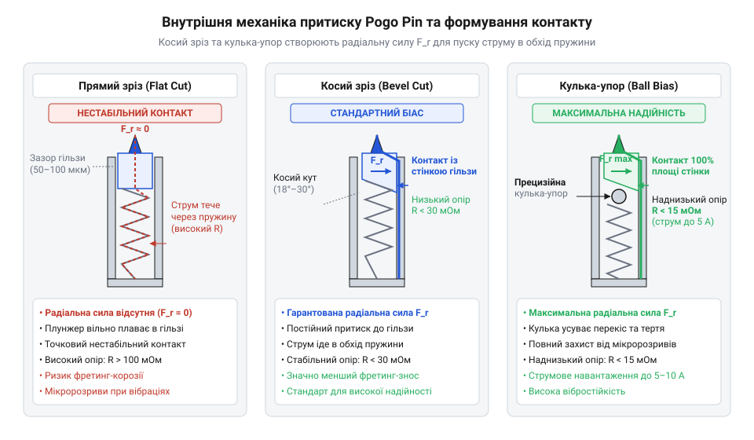
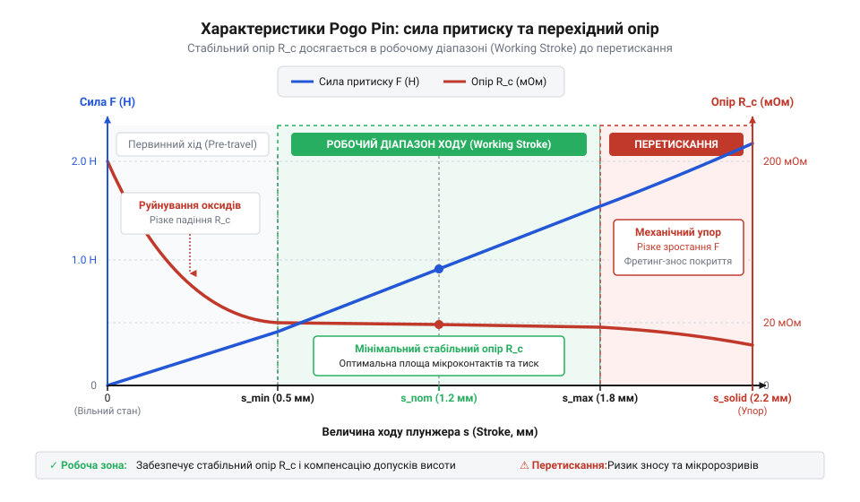
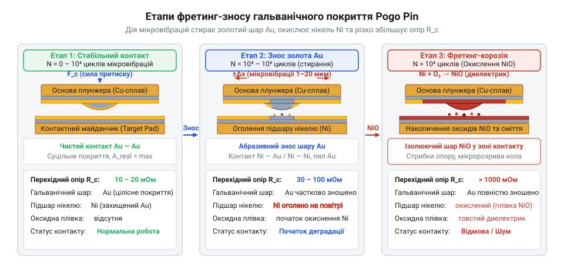
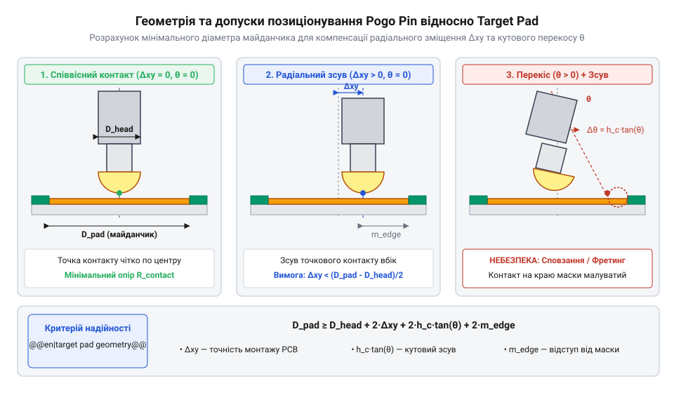

# Пружинні контакти Pogo Pins: механіка притиску, фретинг-корозія та вібростійкість

<preknowlist>
- [Штирьові зʼєднувачі (male)](root:cat-hw-parts/pin-headers) — конструктивні обмеження суцільнометалевих вилок при багаторазовому сочлененні та відмінність жорстких роз'ємів від підпружинених динамічних контактів
- [Тросові та еластомірні віброізолятори: Wire Rope, силіконові демпфери та поглинання ударів](root:cat-hw-parts/wire-rope-isolators) — механізм передачі вібраційних навантажень через елементи корпусу та способи зниження амплітуди коливань
</preknowlist>

## Відмова жорстких роз'ємів у рухомих вузлах

Міжплатні з'єднувачі в рухомих вузлах виходять з ладу через накопичення геометричних допусків (@@en|tolerance stackup@@ — від англ. *tolerance stack-up*, сумарне відхилення розмірів корпусу й плат), що спричиняє перекос штирів. При з'єднанні з натягом (@@en|interference fit@@) [класичні штирьові з'єднувачі](root:cat-hw-parts/pin-headers) (@@en|pin header@@) вимагають значного зусилля сочленення (@@en|insertion force@@), яке через жорсткий корпус передає згинальні напруження на місця пайки та руйнує галтелі припою.

Суцільнометалеві вилки й гнізда мають обмежений ресурс з'єднань (@@en|mating cycles@@ — 50–500 циклів). Тертя металу стирає покриття та створює оксиди, що неухильно підвищує [перехідний контактний опір](root:cat-hw-parts/pogo-pins/math-pogo-pin-mechanics-and-contact-resistance.md) (@@en|contact resistance@@), викликаючи падіння напруги й нагрів. Розв'язком є [пружинні контакти Pogo Pins](root:cat-hw-parts/pogo-pins) (@@en|pogo pin@@): стискання пружини забезпечує сочленення з нульовим зусиллям вставляння (@@en|zero insertion force@@), компенсуючи міжплатні люфти та знімаючи навантаження з пайки.

## Внутрішня механіка та шляхи проходження струму

Підпружинений контакт складається з рухомого плунжера (@@en|plunger@@, від фр. *plonger* — занурюватися), напрямної гільзи (@@en|barrel@@) та спіральної пружини (@@en|spring@@). Проходження струму безпосередньо через пружину недопустиме з двох причин: її високий опір спричиняє джоулевий нагрів та термічний відпал (@@en|annealing@@) сталі з втратою пружності, а гелікоїдальна форма створює паразитну індуктивність (@@en|parasitic inductance@@), що спотворює ВЧ-сигнали.

Для спрямування струму від плунжера на стінку гільзи використовують спеціальну геометрію хвостовика. Косий зріз (@@en|bevel cut@@) під кутом 18°–30° створює радіальну силу, яка притискає бічну поверхню плунжера до гільзи. Альтернативою є встановлення кульки (@@en|ball bias@@), що зміщує точку прикладання зусилля від осі. Для мінімізації опору на межі дотику наноситься гальванічне покриття (@@en|gold plating@@) по бар'єрному підшару нікелю, який блокує дифузію міді та запобігає окисненню.


*Конструкція з косим хвостовиком та кульковим зсувом примусово спрямовує струм через стінку гільзи в обхід високоомної пружини.*

## Залежність контактного опору від сили притиску

Реальний електричний контакт плунжера з майданчиком виникає лише у дискретних мікроскопічних плямах торкання (@@en|a-spots@@, від англ. *asperity spots*). Звуження струмових ліній у цих каналах визначає [контактний опір](root:cat-hw-parts/pogo-pins/math-pogo-pin-mechanics-and-contact-resistance.md) (@@en|contact resistance@@), описуваний моделлю Гольма:

```
R_c = (ρ / 2) · √(π · H / F_N)
```
[де `ρ` — питомий опір матеріалу, `H` — пластична твердість за Віккерсом, `F_N` — нормальна сила притиску]

Зростання сили `F_N` пластично деформує мікровиступи металу, збільшує площу `a-spots` та руйнує поверхневу оксидну плівку.

Характеристика ходу описує зміни сили й опору при стисканні пружини. Початковий натяг (@@en|pre-load@@) утримує плунжер висунутим і запобігає дребезгу контактів. Робочий хід (@@en|working stroke@@ — зазвичай 2/3 повного ходу) забезпечує розрахункову силу (0.5–1.5 Н) і стабілізує опір на рівні 20–50 мОм. Перевищення допустимого зміщення викликає надлишковий хід (@@en|over-stroke@@): витки пружини повністю змикаються («виток до витка»), а сила притиску стрімко зростає, що спричиняє пластичну деформацію пружини та механічне перевантаження плати.


*Крива ходу плунжера демонструє стабілізацію контактного опору в зоні робочого ходу та ризик перевищення сили при over-stroke.*

## Фретинг-корозія та деградація гальванічного покриття

Зовнішні вібрації та температурні коливання викликають мікроскопічні зсуви (@@en|micro-motion@@) плунжера відносно контактного майданчика. Вони спричиняють фретинг-корозію (@@en|fretting corrosion@@). У зоні контактного тертя м'яке золоте покриття поступово стирається. Це оголює підкладку з активного нікелю. Нікель окиснюється на повітрі, утворюючи тонкі оксидні плівки. Постійний мікрозсув зрізає ці плівки й формує ізолюючі продукти зносу (@@en|fretting debris@@). Накопичення цих продуктів забиває плями торкання та викликає стрибки опору.

Для захисту контактної пари застосовують покриття з твердого золота (@@en|hard gold plating@@), легованого кобальтом або нікелем. Додатково використовують синтетичні контактні мастила (@@en|contact lubricant@@). Вони ізолюють ювенільний метал від кисню та запобігають зношуванню. При високочастотних вібраціях виникає ризик короткочасних мікророзривів (@@en|micro-disconnection@@). Якщо частота збурення збігається з власною частотою плунжера, нормальна сила притиску падає до нуля. Для гасіння таких коливань застосовують зовнішні [віброізолятори та демпфери](root:cat-hw-parts/wire-rope-isolators).


*Послідовний знос покриття викриває нікелеву підкладку з подальшим накопиченням діелектричних продуктів debris під дією мікрозсувів.*

## Проєктування контактних майданчиків та монтаж вузлів

Геометрія контактного майданчика (@@en|target pad@@) враховує допуски позиціонування плат, радіальний люфт плунжера та кутовий перекос осей. Мінімальний діаметр `D_pad` обчислюють за формулою:

```
D_pad = d_tip + 2 · (Δr_pos + Δr_play + h_stroke · tan(θ))
```
[де `d_tip` — діаметр кінчика плунжера, `Δr_pos` — відхилення позиціонування, `Δr_play` — радіальний люфт штока, `h_stroke` — робочий хід, `θ` — кут перекосу осей]

Точне [моделювання контактних майданчиків](root:cat-hw-parts/pogo-pins/api-pogo-pins-footprint-and-landing-pads.md) гарантує утримання плунжера в межах покриття при граничних зсувах плат.


*Геометрія контактного майданчика та допуски суміщення: показано розрахунковий діаметр з урахуванням радіального люфту плунжера, відхилення позиціонування плат та кутового перекосу осей.*

Покриття ENIG непридатне: тонке золото стирається плунжером до крихкого нікель-фосфору. Необхідно застосовувати гальванічне тверде золочення (0.76–1.27 мкм) по нікелевому підшару. Для захисту пружини від надлишкового стискання встановлюють механічні обмежувачі ходу (@@en|mechanical stop@@ — жорсткі корпусні упори). У [рознімних док-інтерфейсах](root:cat-hw-parts/pogo-pins/proj-pogo-pin-dock-interface.md) контакти поєднують із напрямними штифтами та магнітами, які забезпечують притиск і захищають від бічних зсувів.