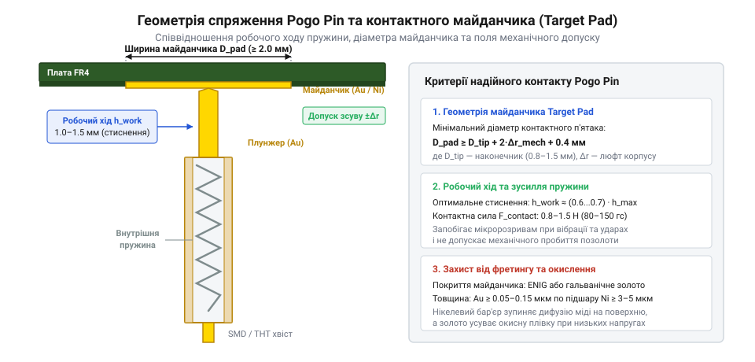
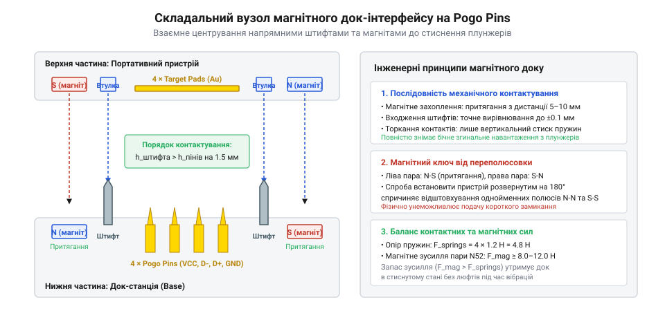

# Проєктування та збірка рознімного магнітного інтерфейсу на Pogo Pins

<preknowlist>
- [Нарізні втулки та футорки: монтаж різьби в карбон, композити та термопласти 3D-друку](root:cat-hw-parts/threaded-inserts-and-heat-set) — техніка встановлення гарячопресованих втулок у друковані корпуси для надійного гвинтового з'єднання деталей дока
- [Тросові та еластомірні віброізолятори: Wire Rope, силіконові демпфери та поглинання ударів](root:cat-hw-parts/wire-rope-isolators) — способи ізоляції контактних вузлів від високочастотних вібрацій для запобігання мікророзривам
- [Монтажний провід 18 і 20 AWG](root:cat-hw-parts/hookup-wire) — методи вибору перерізу провідників та їх паяння до контактних площадок Pogo Pins
- [Класи міцності та матеріали кріплення: сталі 8.8–12.9, нержавійка A2/A4, титан Gr5 та задирання різьби](root:cat-hw-parts/fastener-strength-classes-and-materials) — специфіка використання немагнітних метизів A2/A4 поруч із силовими неодимовими магнітами
</preknowlist>

## Проблема бокових навантажень у рознімних контактах

Коли переносна зарядна станція, бездротовий промисловий сканер або блок акумуляторів стикується з док-станцією, людина чи маніпулятор робота ніколи не опускають пристрій суворо під прямим кутом уздовж вертикальної осі. Завжди виникає кутовий перекіс у кілька градусів або зсув у бічній площині. Якщо рознімний вузол побудовано на відкритих пружних штирях — @@en|pogo pin@@ (англ. *pogo pin*, пружинний контактний штир) — будь-яке неконтрольоване бічне переміщення перетворюється на руйнівне механічне навантаження.

Типовий контакт @@en|pogo pin@@ складається з трьох ключових деталей: зовнішньої напрямної гільзи (@@en|barrel@@), прецизійної пружини стиснення з берилієвої міді або нержавіючої сталі та рухомого наконечника — плунжера (@@en|plunger@@). Вся конструкція розрахована виключно на роботу вздовж власної поздовжньої осі. Якщо ж контактний майданчик приладу торкається вістря плунжера під кутом і тягне його вбік, плунжер починає працювати як консольна балка з плечем, рівним вильоту його робочої частини. Критерії вибору контактних штирів за струмом та покриттям подано в [посібнику з вибору штирів Pogo Pin](root:cat-hw-parts/pogo-pin-selection-guide).

У момент виникнення бічного зусилля в зазорі між плунжером і трубкою гільзи виникає пара сил: одна концентрується на верхньому завальцьованому вінці трубки, а друга — на хвостовику плунжера всередині гільзи. Зазор ковзання між ними становить усього 15–30 мкм. Бічне зусилля змушує плунжер перекошуватися відносно осі, викликаючи локальне заклинювання. Замість плавного стискання внутрішньої пружини рухливий шток механічно блокується, впираючись у край трубки. Якщо сила притискання корпусу ззовні продовжує зростати, шток деформується на вигин, або тонкостінна латунна гільза тріскається по радіусу завальцювання.

Другий наслідок нескомпенсованого бічного зсуву — зрізання захисного гальванічного шару. Щоб забезпечити контактний опір на рівні 15–30 мОм, поверхні плунжера та зустрічного контактного майданчика покривають тонким шаром твердого золота завтовшки від 0.25 до 1.0 мкм по нікелевому підшарку. Коли під час стикування пристрій волочиться по контактах, гостра вершина плунжера діє як різець. Золото миттєво сколюється, оголюючи шар бар'єрного нікелю та латунну основу. Нікель на відкритому повітрі окислюється за лічені години, утворюючи діелектричну оксидну плівку, через що перехідний опір зростає на два-три порядки — до десятків Ом. Під струмовим навантаженням у 2–5 А в зоні деградованого контакту починається виділення джоулевого тепла, мікроприварювання та дугове іскріння, що призводить до повного вигоряння вузла.

Порушення співвісності небезпечне і в замкненому стані, якщо система працює в умовах експлуатаційних вібрацій, де часто використовують спеціальні [тросові віброізолятори](root:cat-hw-parts/wire-rope-isolators). Вібраційні збурення викликають високочастотне взаємне ковзання плунжера по контактній поверхні з амплітудою в кілька десятків мікрометрів. Цей процес відомий як фретинг (@@en|fretting@@, трибокорозійне зношування контактів під дією циклічних мікропереміщень). Продукти зносу заповнюють зону контакту діелектричним порошком, провокуючи мікророзриви ланцюга живлення (@@en|glitch@@, короткочасні збої тривалістю від одиниць до сотень мікросекунд).

Через це в інженерній практиці розробки інтерфейсів на @@en|pogo pin@@ діє суворе правило: пружні контакти ніколи не повинні виконувати функцію механічного позиціонування або центрування пристроїв. Будь-які бічні зусилля мають повністю сприйматися корпусними напрямними елементами та магнітними замками ще до того, як плунжери торкнуться контактних майданчиків.

## Розрахунок допусків і геометрії контактних майданчиків

Надійність рознімного інтерфейсу базується на точному узгодженні кінематичного ходу контактів та геометричних розмірів зустрічних майданчиків — @@en|target pad@@ (англ. *target pad*, контактний майданчик на платі). Першим конструкторським кроком є вибір способу монтажу контактних штирів на друковану плату дока: поверхневий монтаж (@@en|SMD@@) чи монтаж у наскрізні отвори (@@en|THT@@).

Контактори типу @@en|SMD@@ мають плоску основу, яка запаюється безпосередньо на мідні полігони зовнішнього шару плати. Вони компактні, підходять для автоматизованого монтажу, проте мають обмежену міцність на відрив: зусилля від десяти стиснутих пружин створює постійний відривний момент на паяних галтелях. Контакти типу @@en|THT@@ мають циліндричний хвостовик, який проходить крізь металізований отвір друкованої плати та фіксується припоєм по всій товщині текстоліту. Для силових інтерфейсів із сумарним притискним зусиллям понад 5 Н перевагу завжди віддають варіанту @@en|THT@@, оскільки механічне навантаження сприймається масивом склотекстоліту FR-4, а не лише тонкою мідною фольгою.

Робочий хід плунжера (@@en|working stroke@@) визначає довговічність та електричний опір вузла. У ненавантаженому стані плунжер висунутий на повну висоту `H_free`. Максимальний конструктивний хід до упору позначають як `S_max`. Експлуатувати пружинні штирі в діапазоні від 0 до 20% ходу не можна: попередній натяг пружини в цій зоні замалий, нормальна сила контакту не перевищує 0.1–0.2 Н, що спричиняє нестабільний опір і чутливість до трясіння. Працювати на ходах понад 80% від `S_max` також неприпустимо: виникає ризик жорсткого удару плунжера об дно гільзи при температурних коливаннях чи накопиченні механічних допусків корпусу, що призводить до руйнування внутрішньої механіки.

Оптимальний робочий хід `S_work` обирають у межах від 40% до 60% повного ходу, де сила стиснення пружини виходить на стабільне плато. Силу контакту `F_c` обчислюють за лінійним законом Гука з урахуванням сили попереднього стиснення `F_pre`:

```
F_c = F_pre + k · S_work
```

де `k` — жорсткість внутрішньої пружини (Н/мм), `F_pre` — попередній натяг пружини при складанні штиря (Н). Для надійного з'єднання в промислових приладах цільове зусилля `F_c` становить від 0.8 до 1.5 Н на один контакт. 

Визначивши номінальний робочий хід `S_work`, інженер розраховує діаметр контактного майданчика `D_pad`. Площадка повинна мати такий радіус, щоб навіть за найгіршого збігу похибок виготовлення корпусу, монтажу плати та люфту напрямних вершина плунжера не зісковзнула на діелектричну маску плати.


*Поперечний розріз контактної пари: оптимізація робочого ходу плунжера та діаметра контактного майданчика гарантує стабільний опір переходу.*

Розрахунок мінімального діаметра майданчика проводять за методом накопичення допусків у гіршому випадку:

**Умова розрахунку контактного майданчика:** діаметр вершини плунжера `d_tip = 1.0` мм; допуск позиціонування отворів під штирі в корпусі `T_hole = ±0.15` мм; похибка встановлення роз'єму на плату за SMT-технологією `T_smt = ±0.05` мм; радіальний люфт напрямних штифтів у гніздах корпусу `δ_guide = 0.20` мм; гарантований відступ краю контакту від краю площадки для запобігання сколам `c_edge = 0.25` мм.

Сумарне максимальне позиційне відхилення `Δ_pos` становить:

```
Δ_pos
= T_hole + T_smt + δ_guide      [сума незалежних механічних похибок]
= 0.15 + 0.05 + 0.20           [підстановка числових значень]
= 0.40 мм                      [максимальний радіальний зсув]
```

Звідси мінімально допустимий діаметр контактного майданчика `D_pad`:

```
D_pad
= d_tip + 2 · Δ_pos + 2 · c_edge  [рівняння перекриття площі плунжера]
= 1.0 + 2 · 0.40 + 2 · 0.25      [підстановка допусків]
= 2.30 мм                        [мінімальний діаметр площадки]
```

Отримане значення округлюють до стандартного ряду друкованих плат: для плунжера діаметром 1.0 мм обирають майданчик `D_pad = 2.50` мм. Поверхню майданчика виконують за технологією ENIG (Electroless Nickel Immersion Gold) або гальванічного золочення товщиною не менше 0.5 мкм. Покриття HASL (гаряче лудіння припоєм) для рознімних контактів суворо заборонено: припій має нерівномірну кривизну поверхні («лінзу») та швидко окислюється, викликаючи брязкіт і перегрів.

## Проєктування корпусу з напрямними та магнітами

Повна ізоляція контактів від зсувних зусиль досягається інтеграцією в корпус док-станції механічних напрямних штифтів (@@en|locating pins@@) та постійних неодимових магнітів сплаву NdFeB (класів N42–N52). Корпус створює кінематичну систему, яка спочатку самоорієнтує прилад у просторі, потім фіксує його механічними замками, і лише на фінальній ділянці руху дозволяє стиснути пружини штирів.


*Пошарове складання магнітного дока: напрямні штифти з фаскою вирівнюють корпус до електричного контакту пружинних пінів.*

Геометрія корпусу підпорядковується часовій послідовності входження елементів у зачеплення. Напрямні штифти виконують у вигляді конічних або циліндричних виступів із заходами під кутом 30°–45° і радіусним скругленням вершини. Висота напрямного штифта `H_guide` над базовою площиною контакту розраховується так, щоб штифт заходив у відповідний паз пристрою на глибину не менше 2.0 мм до того, як плунжери контактів торкнуться майданчиків:

```
H_guide ≥ H_free + 2.0 мм
```

Завдяки цьому кутовий перекіс корпусу ліквідується стінками напрямних пазів. Коли плунжери торкаються площадок, пристрій уже повністю зорієнтований, і рух відбувається суворо по осі Z. Для кріплення друкованої плати всередині корпусу використовують латунні [нарізні втулки](root:cat-hw-parts/threaded-inserts-and-heat-set), які угвинчують або впресовують термоспособом у пластикові стійки, а силові з'єднання розраховують на основі вимог до кріплення металевих деталей [класи міцності метизів](root:cat-hw-parts/fastener-strength-classes-and-materials).

Магнітна система дока вирішує два завдання: створює утримуючу силу, яка протидіє відштовхуванню стиснутих пружин, та забезпечує захист від помилкового встановлення зворотною стороною (принцип @@en|poka-yoke@@). Для цього застосовують пару магнітів, розташованих симетрично відносно контактної групи. Магніти орієнтують зустрічними полюсами: на лівому боці дока встановлюють магніт північним полюсом (N) назовні, а на правому боці — південним (S). У пристрої, що стикується, полюси розташовують у зворотному порядку (S та N). При спробі вставити прилад навпаки однакові полюси відштовхуються з силою в кілька десятків ньютонів, фізично блокуючи зближення контактів.

Розрахунок утримуючого зусилля магнітів ведеться за статичним балансом сил. Якщо інтерфейс містить `n` пружинних контактів із робочим зусиллям `F_c = 1.0` Н кожен, то сумарна сила відштовхування становить:

```
F_push = n · F_c
```

Для чотириконтактного інтерфейсу (живлення VBUS, GND і диференційна пара даних D+/D-) сила пружинного відштовхування дорівнює `F_push = 4.0` Н. Щоб прилад не втрачав зв'язку при вібраціях або випадковому торканні кабелю, сумарна сила притягання пари магнітів `F_mag` у положенні змикання повинна перевищувати `F_push` щонайменше у два рази:

```
F_mag ≥ k_safe · F_push
```

де `k_safe = 2.0` — коефіцієнт запасу утримання. Звідси мінімальна сумарна магнітна сила становить `F_mag = 2.0 · 4.0 = 8.0` Н, тобто кожен із двох неодимових магнітів повинен розвивати силу притягання не менше 4.0 Н (приблизно 400 г утримання) при зазорі між магнітами 0.5–0.8 мм, який задається товщиною пластикової стінки корпусу.

Для верифікації надійності зібраного док-вузла проводять вібровипробування на стенді. У ході випробувань реєструють події розмикання ланцюга. Для цього контакти підключають до мікроконтролера, який фіксує переривання GPIO за зміною логічного рівня:

:::code proj-pogo-pin-dock-interface/c/include/pogo_pin_monitor.h 14-33
:::code proj-pogo-pin-dock-interface/c/src/pogo_pin_monitor.c 26-53

Алгоритм визначає тривалість мікророзривів у мікросекундах. Якщо фільтр відсікає високочастотний шум менше 2–5 мкс, а кількість подій розриву за 10 хвилин вібрації дорівнює нулю, док-інтерфейс вважається спроєктованим правильно: магнітний притиск повністю компенсує динамічні прискорення, а напрямні штифти надійно усувають фретингове ковзання.

## Збірка та монтування контактно-магнітного вузла

Фізичне збирання інтерфейсу вимагає суворої черговості дій, оскільки капілярні ефекти клеїв та флюсів здатні безповоротно заблокувати рухомий механізм. Найпідступніша небезпека під час паяння контактів @@en|pogo pin@@ полягає у затіканні рідкого припою або рідкого каніфольного флюсу всередину гільзи (англ. @@en|barrel@@). Якщо флюс проникне крізь зазор між рухомим штоком (англ. @@en|plunger@@) і стінкою гільзи, зворотна пружина склеюється, контакт втрачає пружність або виникає високий перехідний опір. Під час монтажу в наскрізні отвори (THT) слід застосовувати помірну кількість термостабільного гелевого флюсу та паяльне жало з вузьким конусом, утримуючи плату контактними голівками донизу. Гравітація в такому положенні не дозволяє рідкому флюсу стікати всередину каналу. Для механічної стійкості нарізних отворів корпусу попередньо виконують [монтаж гарячопресованих втулок](root:cat-hw-parts/threaded-inserts-and-heat-set) у пластикові посадочні гнізда термопласту.

Монтаж постійних магнітів у гнізда надрукованого корпусу здійснюють виключно після завершення паяння електронної плати. Неодимові магніти фіксують на двокомпонентний епоксидний клей або еластичний поліуретановий герметик. Категорично заборонено використовувати рідкий ціаноакрилат: через випаровування мономерів білий наліт покриває золоте напилення контактних майданчиків (англ. @@en|target pad@@), а висока плинність клею призводить до заклинювання плунжерів сусідніх контактів. Перед запресовуванням магнітів контролюють взаємну магнітну полярність парних роз'ємів за допомогою еталонного магнітного маркера. Щоб силове поле постійних магнітів не спричиняло паразитних деформацій та заїдання кріпильних гвинтів, застосовують [немагнітне нержавіюче кріплення A2](root:cat-hw-parts/fastener-strength-classes-and-materials), яке не притягується до неодимових полюсів і забезпечує рівномірне затягування деталей.

Контроль висоти виступу штоків проводять цифровим штангенциркулем або мікрометричним індикатором годинникового типу. Початковий виліт плунжера над площиною корпусу має суворо відповідати розрахованому робочому ходу, залишаючи технологічний запас до повного механічного упору не менше 0.3 мм. Якщо притискна площина дока впирається в корпус раніше, ніж плунжер досягне номінального стиснення пружини, контактний тиск падає нижче 0.5 Н, що провокує брязкіт і перегрів при номінальному струмі. З іншого боку, за відсутності жорстких упорів уся сила магнітного притягання переноситься на внутрішні пружини контактів, руйнуючи дно гільзи при зіткненні.

## Тестування стабільності контакту під вібраціями

В експлуатації рухомі з'єднання піддаються гармонійним та випадковим вібраціям, які спричиняють мікроскопічні взаємні зміщення контактуючих поверхонь. Цей процес викликає корозійне стирання золотого покриття — фретинг (англ. @@en|fretting@@), внаслідок якого в зоні дотику утворюються діелектричні оксидні плівки з нікелю та міді. За значних прискорень сили інерції плунжера можуть перевищити пружність внутрішньої пружини, викликаючи короткочасний механічний відрив штока від контактного майданчика — збій контакту (англ. @@en|glitch@@). Якщо амплітуда прискорень висока, для демпфування модуля дока застосовують [тросові та силіконові віброізолятори](root:cat-hw-parts/wire-rope-isolators), що зрізають резонансні піки коливань.

Для об'єктивного оцінювання вібростійкості з'єднання збирають випробувальний контур із замкненою лінією моніторингу через джерело струму та мікроконтролер. Електрична схема формує підтяжку контакту до живлення 3.3 В або 5 В через резистор 1 кОм: коли контакт @@en|pogo pin@@ притиснутий до площадки @@en|target pad@@, на цифровому вході мікроконтролера утримується логічний нуль. Будь-який механічний розрив ланцюга викликає миттєвий стрибок напруги до логічної одиниці. Апаратний таймер фіксує точну часову тривалість кожного розриву в мікросекундах.

Нижче наведено програмні модулі для фіксації та статистичної обробки мікророзривів на мовах C та C++. Модуль на мові C оптимізовано для безпосереднього виклику з переривань GPIO, де критично важливо уникати динамічного виділення пам'яті:

:::tabs
:::code proj-pogo-pin-dock-interface/c/include/pogo_pin_monitor.h 17-32
:::code proj-pogo-pin-dock-interface/c/src/pogo_pin_monitor.c 26-53
:::code proj-pogo-pin-dock-interface/cpp/include/PogoPinContactMonitor.hpp 23-45
:::code proj-pogo-pin-dock-interface/cpp/src/PogoPinContactMonitor.cpp 11-27
:::

Алгоритм обробки мікророзривів відсікає високочастотний електричний шум тривалістю менше 2 мкс і накопичує сумарну тривалість перебування інтерфейсу у розімкненому стані. Відсоток втрати контакту обчислюється як відношення накопиченого часу розриву до загального часу тесту. На мові C++ клас `PogoPinContactMonitor` дозволяє об'єднати збір часових міток і генерацію підсумкового діагностичного звіту у зручний об'єктно-орієнтований інтерфейс.

Повний демонстраційний цикл тестування контакту під впливом вібраційних збурень реалізовано у головних функціях проєкту:

:::tabs
:::code proj-pogo-pin-dock-interface/c/src/main.c 9-56
:::code proj-pogo-pin-dock-interface/cpp/src/main.cpp 5-46
:::

За результатами тестового прогону на вібростенді аналізують діагностичний висновок. Якщо контактний ланцюг показує нульову кількість подій розмикання, баланс попереднього натягу пружин та магнітного утримання підібрано бездоганно. Показник втрати зв'язку менше 0.05% свідчить про допустимі поодинокі вібраційні мікророзриви: такий інтерфейс надійно живитиме акумуляторні батареї, проте для чутливих цифрових шин UART або I2C вимагатиме фільтрації або збільшення контактного тиску пружини. Значення понад 0.05% сигналізує про критичну втрату контакту, викликану резонансним розгойдуванням дока або недостатнім робочим ходом плунжера.