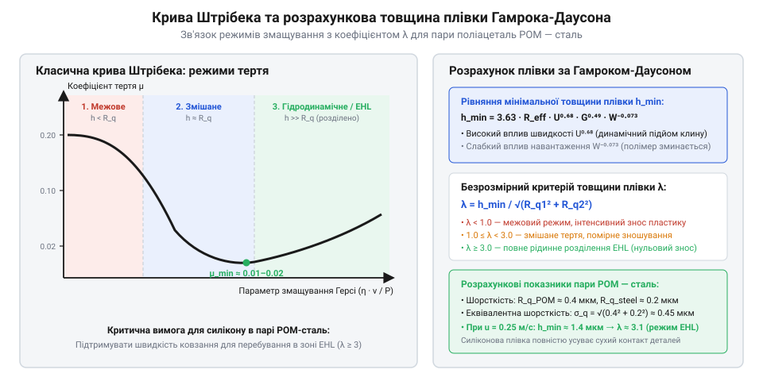

# Трибологічні розрахунки та оцінка товщини плівки силіконової змазки

<preknowlist>
- [Мініатюрні кулькові підшипники (623, 625, 685, 686)](root:cat-hw-parts/miniature-ball-bearings) — розподіл контактних зусиль та кінематика тіл кочення
- [Гнучка муфта 5×5 мм](root:cat-hw-parts/flexible-shaft-coupling) — компенсація кутової та осьової несоосності валів
</preknowlist>

## Механіка контакту та знемащення пар

У механічних вузлах точного приладобудування — каретках 3D-принтерів, редукторах сервоприводів та оптичних механізмах — поверхні тертя ніколи не є ідеально гладкими. Навіть після прецизійного шліфування тверді тіла контактують лише вершинами мікронерівностей (шорсткостей), сумарна площа яких становить менше 1% від видимої геометричної площі деталі. За відсутності надійного розділового шару мастила в точках мікроконтакту виникають колосальні локальні напруження, які призводять до молекулярного схоплювання, зрізу матеріалу та утворення катастрофічних задирів.

Наука про тертя, зношування та змащування — трибологія (від грец. *tribos* — тертя та *logos* — вчення, @@en|tribology@@) — класифікує роботу вузлів за трьома послідовними режимами тертя. Цей перехід наочно ілюструє крива Штрібека (від прізвища німецького інженера Ріхарда Штрібека, @@en|Stribeck curve@@), яка встановлює звʼязок коефіцієнта тертя `μ` з параметром змащування Герсі — добутком динамічної вʼязкості `η` на швидкість ковзання `v`, віднесеним до питомого навантаження `P`:

1. Межове змащування (англ. *boundary lubrication*, @@en|boundary lubrication@@). Виникає при низьких швидкостях руху, частих реверсах або високому питомому тиску. Товщина мастильного шару `h` менша за сумарну висоту мікрошорсткостей контактуючих поверхонь: `h < R_q`. Навантаження майже повністю сприймається твердими гребінцями нерівностей. Мастило працює лише завдяки хемосорбованим мономолекулярним плівкам. Якщо використовується мастило з низькою несучою здатністю плівки, відбувається сухе тертя з високим зносом (`μ = 0.10–0.25`). 2. Змішане змащування (англ. *mixed lubrication*, @@en|mixed lubrication@@). Частина контактного зусилля передається через плями торкання мікронерівностей, а частина — через гідродинамічний тиск рідини в западинах між ними. Коефіцієнт тертя стрімко падає до мінімальних значень (`μ = 0.02–0.08`). 3. Гідродинамічне та еластогідродинамічне змащування (англ. *Elastohydrodynamic Lubrication*, @@en|EHL@@). Поверхні тертя повністю розділені суцільною рідинною плівкою мастила: `h >> R_q`. Металевий або полімерний контакт відсутній, а опір рухові визначається виключно внутрішнім молекулярним тертям рідини (`μ = 0.005–0.03`).


*Крива Штрібека та розрахункова товщина мастильної плівки для полімерних пар тертя.*

Силіконова змазка на основі полідиметилсилоксану (англ. *polydimethylsiloxane*, @@en|PDMS@@) завдяки гнучкості силоксанових ланцюгів Si-O-Si має стабільну вʼязкість у широкому діапазоні температур і відмінне змочування пластиків. Проте низький пʼєзокоефіцієнт вʼязкості (полідиметилсилоксан практично не гусне під високим контактним тиском на відміну від мінеральних олив) робить силікон схильним до видавлювання з плями контакту під високим питомим навантаженням. Пʼєзокоефіцієнт вʼязкості PDMS становить лише `α ≈ 1.2–1.5 · 10⁻⁸ Па⁻¹`, тоді як у синтетичних вуглеводневих мастил на основі поліальфаолефінів (англ. *polyalphaolefin*, @@en|PAO@@) цей показник сягає `α ≈ 1.8–2.2 · 10⁻⁸ Па⁻¹`. Через це у важконавантажених зубчастих редукторах зі сталевими шестернями при контактних тисках понад 300–500 МПа поліальфаолефінові оливи миттєво переходять у склоподібний високовʼязкий стан, формуючи надміцний гідродинамічний барʼєр із високою тримальною здатністю. На противагу їм силіконова основа у силових редукторах легко витікає з контактної щілини, що спричиняє пряме зіткнення металевих мікронерівностей та катастрофічне втомне викришування (пітинг). Саме тому силіконові композиції оптимізовані для легких прецизійних пар тертя з полімерами, де тиски не перевищують 20–50 МПа, а для запобігання переходу в аварійне сухе тертя інженер повинен виконати строгий розрахунок контактного тиску та товщини плівки.

## Контактний тиск Герца для полімерів

Для визначення ризику витіснення змазки з зони кочення чи ковзання необхідно знати піковий тиск та розмір площадки контакту. Розрахунок пружного контакту двох тіл криволінійної форми базується на класичній теорії Герца (англ. *Hertzian contact pressure*, @@en|Hertzian pressure@@).

У точній механіці найпоширенішими є пари з конструкційного термопласту поліацеталю (поліоксиметилену, @@en|POM@@, капролон/делрін) у парі зі сталлю або POM по POM (зубчасті вінці, кулачки, ходові гайки). Оскільки полімер має низький модуль пружності (`E_POM ≈ 2.8–3.2 ГПа`) порівняно зі сталлю (`E_steel ≈ 210 ГПа`), площадка контакту значно деформується, зменшуючи піковий тиск.

Ефективний (приведений) модуль пружності пари `E_eff` розраховують через модулі Юнга `E_1, E_2` та коефіцієнти Пуассона `ν_1, ν_2` контактуючих матеріалів:

```
1 / E_eff = ((1 - ν_1²) / E_1) + ((1 - ν_2²) / E_2)      [розрахунок приведеного модуля пружності]
```

Для пари «сталь (1) — поліацеталь POM (2)»:
- `E_1 = 210 ГПа = 210 × 10⁹ Па`, `ν_1 = 0.30`
- `E_2 = 3.0 ГПа = 3.0 × 10⁹ Па`, `ν_2 = 0.38`

Якщо ж розглядається пара «полімер по полімеру» (POM-POM), де обидва контактуючі тіла мають однакові механічні параметри (`E_1 = E_2 = 3.0 ГПа`, `ν_1 = ν_2 = 0.38`), приведений модуль становить:

```
1 / E_eff = 2 · (1 - ν²) / E
          = 2 · (1 - 0.38²) / 3.0
          = 2 · 0.8556 / 3.0
          = 0.5704 ГПа⁻¹
E_eff     ≈ 1.753 ГПа = 1.753 × 10⁹ Па
```

За тієї самої нормальної сили `F_n = 25 Н`, довжини лінії контакту `L_c = 0.006 м` та приведеного радіуса кривини `R_eff = 0.005 м`, подвійна податливість полімерних поверхонь розширює площадку контакту й відчутно знижує піковий тиск:

```
b     = √((4 · 25 · 0.005) / (π · 0.006 · 1.753 × 10⁹))
      = √(0.5 / 3.304 × 10⁷)
      ≈ 1.23 × 10⁻⁴ м = 0.123 мм              [напівширина контакту POM-POM]

p_max = (2 · 25) / (π · 1.23 × 10⁻⁴ · 0.006)
      ≈ 21.56 × 10⁶ Па = 21.56 МПа            [піковий тиск Герца POM-POM]
```

Зменшення максимального контактного тиску з 30.25 МПа (у парі зі сталлю) до 21.56 МПа в гомогенній парі POM-POM послаблює градієнт тиску в зоні тертя, завдяки чому силіконова змазка значно довше втримується на робочих поверхнях без примусового видавлювання.

Приведений модуль пружності пари становить:
```
1 / E_eff = ((1 - 0.30²) / 210) + ((1 - 0.38²) / 3.0)
          = (0.91 / 210) + (0.8556 / 3.0)
          = 0.00433 + 0.28520
          = 0.28953 ГПа⁻¹
E_eff     ≈ 3.45 ГПа = 3.45 × 10⁹ Па
```

Приведений радіус кривини контакту `R_eff` для двох циліндричних поверхонь радіусами `R_1` та `R_2` (наприклад, зуби шестерень або ролик на площині) визначають за виразом:

```
1 / R_eff = (1 / R_1) + (1 / R_2)      [приведений радіус кривини контактної пари]
```

Для циліндричного лінійного контакту довжиною `L_c` під дією нормальної сили `F_n` напівширина контактної смуги `b` та максимальний тиск у центрі плями `p_max` розраховуються за формулами Герца:

```
b     = √((4 · F_n · R_eff) / (π · L_c · E_eff))      [напівширина контактної смуги Герца]
p_max = (2 · F_n) / (π · b · L_c)                     [максимальний контактний тиск у центрі]
```

**Розрахунок контактного тиску в парі POM-сталь:**
Нехай нормальна сила складає `F_n = 25 Н`, довжина лінії контакту `L_c = 6.0 мм = 0.006 м`, а приведений радіус кривини `R_eff = 5.0 мм = 0.005 м`.

```
b     = √((4 · 25 · 0.005) / (π · 0.006 · 3.45 × 10⁹))
      = √(0.5 / 6.503 × 10⁷)
      = √(7.689 × 10⁻⁹)
      ≈ 8.77 × 10⁻⁵ м = 0.0877 мм              [напівширина контакту]

p_max = (2 · 25) / (π · 8.77 × 10⁻⁵ · 0.006)
      = 50 / 1.653 × 10⁻⁶
      ≈ 30.25 × 10⁶ Па = 30.25 МПа            [піковий тиск Герца]
```

Отриманий тиск 30.25 МПа не перевищує межу текучості POM (65–70 МПа), тобто деформація є суто пружною. Для зниження паразитних перекосів валів, які спричиняють кромочні концентрації тиску, у приводах використовується [гнучка муфта 5×5 мм](root:cat-hw-parts/flexible-shaft-coupling).

## Товщина плівки за Гамроком-Даусоном

В умовах пружного деформування полімерів товщина мастильного клину визначається за теорією еластогідродинамічного змащування (@@en|EHL@@) для мʼяких матеріалів (ізовіскозний режим з пружним зминанням). Інженери Бернард Гамрок та Дункан Даусон вивели напівемпіричні рівняння для розрахунку мінімальної товщини плівки `h_min` та центральної товщини `h_c`.

Для точкового контакту мінімальна товщина плівки виражається через безрозмірні параметри швидкості `U`, навантаження `W` та властивостей матеріалів `G`:

```
h_min = 3.63 · R_eff · U⁰·⁶⁸ · G⁰·⁴⁹ · W⁻⁰·⁰⁷³ · (1 - e⁻⁰·⁶⁸·ᵏ)      [рівняння Гамрока-Даусона для h_min]
```

Де безрозмірні комплекси дорівнюють:
- Швидкість: `U = (η_0 · u) / (E_eff · R_eff)`, де `u = (u_1 + u_2) / 2` — середня швидкість перекочування/ковзання поверхонь, а `η_0` — динамічна вʼязкість змазки при атмосферному тиску (Па·с);
- Навантаження: `W = F_n / (E_eff · R_eff²)`;
- Матеріали: `G = α_p · E_eff`, де `α_p` — пʼєзокоефіцієнт вʼязкості мастила (Па⁻¹);
- Еліптичність контакту: `k = a / b` (для лінійного або циліндричного контакту наближається до 1).

Для силіконового масла PDMS середньої вʼязкості (наприклад, 1000 сСт, що відповідає `η_0 ≈ 0.97 Па·с` при 25 °C) пʼєзокоефіцієнт становить лише `α_p ≈ 1.5 × 10⁻⁸ Па⁻¹` (проти `2.2 × 10⁻⁸ Па⁻¹` у мінеральних олив). Через малу величину степеня `W⁻⁰·⁰⁷³` навантаження слабко впливає на товщину шару, тоді як швидкість `u` має вирішальне значення (`U⁰·⁶⁸`).

Для перевірки захисту від сухого контакту обчислюють безрозмірний параметр змащування лямбда `λ`:

```
λ = h_min / √(R_q1² + R_q2²)      [коефіцієнт товщини мастильної плівки]
```

У цій формулі `R_q1` та `R_q2` — середньоквадратичні шорсткості контактуючих поверхонь. Критерії безпеки за коефіцієнтом `λ`:
- `λ < 1.0` — режим межового змащування, прямий контакт нерівностей, високий ризик зносу;
- `1.0 ≤ λ < 3.0` — змішане змащування, частковий контакт мікровершин;
- `λ ≥ 3.0` — повне рідинне змащування, контакт поверхонь повністю виключений.

У кулькових опорах валів якість кочення забезпечують попередньо змащені [мініатюрні кулькові підшипники](root:cat-hw-parts/miniature-ball-bearings), де плівка утримується у замкненому контурі канавок.

## В'язкісні втрати та температурна стійкість

При русі деталей товстий шар силіконової змазки чинить гідродинамічний опір зсуву. Сила вʼязкісного тертя `F_visc` на контактній площадці площею `A_contact` розраховується за законом Ньютона для ламінарного зсуву рідини:

```
F_visc = η · (v / h) · A_contact      [сила в'язкісного тертя мастильного шару]
```

Потужність теплових втрат `P_loss` (Вт), що виділяється у плівці мастила й нагріває полімерний вузол, дорівнює добутку сили опору на швидкість відносного ковзання `v`:

```
P_loss = F_visc · v = η · (v² / h) · A_contact      [потужність в'язкісного дисипативного нагріву]
```

Зі зростанням температури динамічна вʼязкість кремнійорганічної рідини експоненційно зменшується. Температурну залежність вʼязкості силіконової основи описує рівняння Андраде-Френкеля:

```
η(T) = η_0 · exp((E_a / R_gas) · ((1 / T) - (1 / T_0)))      [температурна залежність динамічної в'язкості]
```

Де:
- `η(T)` — динамічна вʼязкість при абсолютній температурі `T` (К);
- `η_0` — базова вʼязкість при нормальній температурі `T_0 = 298.15 К` (25 °C);
- `E_a` — енергія активації вʼязкої течії полідиметилсилоксану (`E_a ≈ 15.5 кДж/моль`);
- `R_gas` — універсальна газова стала (`R_gas = 8.314 Дж/(моль·К)`).

Енергія активації силіконових мастил є однією з найнижчих серед відомих рідин (у мінеральних олив `E_a ≈ 30–50 кДж/моль`), що зумовлює унікальний високий індекс вʼязкості силікону (понад 200–300). При зміні робочої температури від +20 °C до +80 °C вʼязкість PDMS падає лише у 2.5–3 рази, тоді як вуглеводневі мастила розріджуються у 15–25 разів. Це гарантує збереження стабільного мастильного клину в прецизійній механіці без критичного падіння товщини плівки `h_min`.