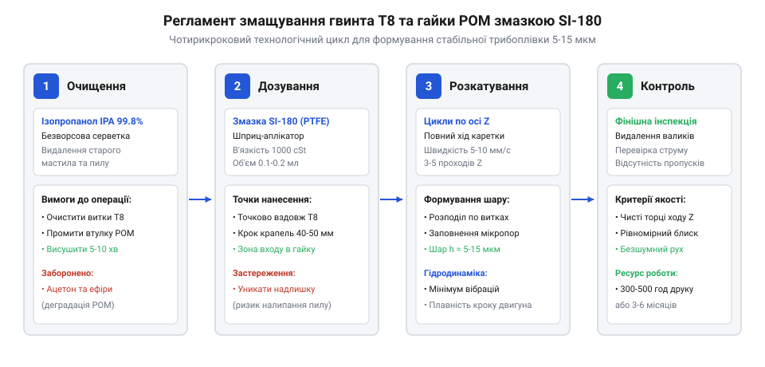

# Практикум з обслуговування вузлів тертя 3D-принтера змазкою SI-180

<preknowlist>
- [Мініатюрні кулькові підшипники (623, 625, 685, 686)](root:cat-hw-parts/miniature-ball-bearings) — конструкція кулькових підшипників кочення та пилозахисних шайб
- [Гнучка муфта 5×5 мм](root:cat-hw-parts/flexible-shaft-coupling) — вузол з'єднання вала двигуна NEMA17 з ходовим гвинтом T8
</preknowlist>

## Діагностика зношення кінематики 3D-принтера

У процесі багатогодинного 3D-друку механіка осі Z піддається безперервним мікропереміщенням, які супроводжуються частими реверсивними рухами для підйому сопла над надрукованим шаром — @@en|Z-hop@@ (англ. *Z-hop*, підстрибування сопла по вертикалі). На відміну від горизонтальних осей X та Y, де навантаження розподіляються на ролики або кулькові каретки, вертикальна вісь спирається на гвинтову передачу. Класичний ходовий гвинт @@en|lead screw@@ стандарту T8 із трапецеїдальною чотиризахідною нарізкою передає обертання від крокового двигуна NEMA17, з'єднаного через [гнучку муфту вала](root:cat-hw-parts/flexible-shaft-coupling), безпосередньо на гайку каретки. Якщо заводське консерваційне мастило висохло або наситилося пилом філаменту, трибологічний контакт різко переходить у зону напівсухого або граничного тертя.

Першою ознакою деградації мастильного прошарку є поява високочастотного писку, скрипіння або нерівномірного вібраційного гулу під час швидкого позиціонування каретки. Коли сталевий загартований гвинт обертається у сухій полімерній гайці з поліацеталю — @@en|polyoxymethylene@@ (поліоксиметилен, POM), коефіцієнт тертя зростає з номінальних 0.08 до 0.35 і вище. Опір обертанню починає перевищувати утримуючий момент крокового двигуна, внаслідок чого виникає пропуск мікрокроків. На надрукованій деталі це проявляється у формі горизонтальної смугастості: окремі шари товщають або стоншуються через затримку підйому балки, утворюючи помітні дефекти геометрії стінки.

Тривала експлуатація за відсутності мастила призводить до абразивного викришування внутрішніх витків гайки. Полімерний пил змішується з оксидами металу, створюючи люфт (англ. @@en|backlash@@, осьовий зазор між витками гвинта та гайки). У результаті каретка під власною вагою перекошується, викликаючи паразитне заклинювання на верхніх радіальних опорах, де встановлені [мініатюрні кулькові підшипники](root:cat-hw-parts/miniature-ball-bearings). Регламентну перевірку слід проводити кожні 300–500 годин роботи принтера, контролюючи рівномірність ходу та стан контактних поверхонь гвинта.

Механізм руйнування мастильної плівки тісно пов'язаний із кінематикою крокового приводу. Під час руху в режимі мікрокрокування (типово 1/16 або 1/32 кроку) вал двигуна обертається не безперервно, а серіями дискретних мікропереміщень із мікрозупинками, що збуджує високочастотні пульсації тиску на робочих гранях витків. За низької кутової швидкості підйому столу або сопла лінійна швидкість відносного ковзання становить лише одиниці міліметрів на секунду, чого недостатньо для затягування мастила в контактну щілину та утворення стійкого гідродинамічного клина. Високий питомий тиск у точках контакту витискає мастило SI-180 з робочої канавки трапецеїдальної нарізі на периферію западини витка. Ситуацію посилюють часті реверси під час Z-hop: зміна напрямку обертання миттєво зриває залишкову плівку, перерозподіляючи змазку за межі активної плями контакту, а під час різкого прискорення на холостих ходах залишки мастила виштовхуються вздовж гвинтової лінії, провокуючи локальне сухе тертя поверхонь.

## Очищення та знежирення вузлів тертя

Нанесення свіжої змазки поверх відпрацьованого шару є грубою інженерною помилкою, оскільки старе мастило утримує в собі волокна пластику PLA, PETG чи ABS, крихти карбону та кімнатний пил. Утворена суміш діє як притирочна абразивна паста, яка за лічені тижні сточує трапецеїдальний профіль нарізки. Технологічний регламент обслуговування завжди починається з глибокого та беззалишкового хімічного очищення поверхонь тертя.

Вибір промивного розчинника визначається хімічною стійкістю матеріалів кінематичного вузла. Для промивання ходового гвинта T8 та гайки з POM єдиним безпечним стандартом є ізопропіловий спирт — @@en|IPA@@ (англ. *isopropyl alcohol*) з концентрацією основної речовини не менше 99.8%. Спирт ефективно розчиняє залишки силіконових та мінеральних олив, швидко випаровується без залишку сухого осаду та абсолютно інертний до поліацеталю POM, алюмінієвих кронштейнів і гумових зубчастих ременів. Застосування агресивних розчинників, таких як ацетон, розчинники марок 646/647 чи технічний бензин, категорично заборонено: вони спричиняють розтріскування поліацеталю під напругою, руйнують пластикові деталі корпусу принтера та викликають набухання еластомірних демпферів.

Процес знежирення виконують за допомогою щільної безворсової серветки та пружної щітки з нейлоновим ворсом. Спирт наносять на серветку або розпилюють безпосередньо на витки гвинта, після чого вручну прокручують гвинт, пропускаючи серветку по канавках нарізки зверху донизу. Особливу увагу приділяють зоні нижнього упору, де найчастіше накопичується спресований бруд. Для промивання внутрішньої нарізки гайки каретку піднімають у верхнє положення, наносять ізопропіловий спирт у зазор і здійснюють кілька коротких реверсивних переміщень, збираючи витіснений темний осад серветкою. До нанесення свіжого мастила переходять лише після повного висихання спирту з усіх порожнин.

## Нанесення та дозування змазки SI-180

Для надійного змащення вузлів тертя з парою контактних матеріалів «сталь–POM» застосовують високотемпературну силіконову змазку SI-180. Її основою є полідиметилсилоксанова рідина з кінематичною в'язкістю близько 1000 сСт, загущена ультрадисперсним політетрафторетиленом (PTFE) або колоїдним діоксидом кремнію. Змазка має робочий діапазон температур від -50 °C до +180 °C, що гарантує стабільність характеристик навіть у закритих термокамерах з підігрівом об'єму до 70–80 °C. Силіконова основа не мігрує по металевих поверхнях, не висихає протягом тисяч годин роботи та не взаємодіє з полімерною структурою гайки.

Послідовність виконання сервісних операцій наведено на технологічній схемі:

*Технологічний регламент сервісу гвинта T8: беззалишкове очищення та дозоване нанесення змазки забезпечують формування плівки без надлишків.*

Ключовим правилом є суворе дозування змазки: товщина робочої трибологічної плівки на робочих витках має перебувати в діапазоні від 5 до 15 мкм. Надмірна кількість мастила не покращує ковзання, а створює гідродинамічний опір та перетворюється на пилозбірник. На стандартний ходовий гвинт завдовжки 300–400 мм наносять усього 0.10–0.15 мл мастила у вигляді мікрокрапель через кожні 30–50 мм по всій робочій висоті. Після цього каретку вручну або через меню керування принтера плавно переміщують від нульового рівня до верхньої точки та назад 2–3 рази. Гайка POM самостійно розкочує мастило по спіральних канавках гвинта, витісняючи зайву порцію на кінцеві ділянки. Залишки мастила, які зібралися біля верхнього та нижнього торців гайки, обов'язково видаляють чистою серветкою, залишаючи поверхню сухою на дотик.

## Верифікація плавності ходу та обслуговування

Після завершення змащення проводять перевірку плавності ходу механіки. За вимкнених крокових двигунів ходовий гвинт обертають вручну кінчиками пальців за верхній край або гнучку муфту: опір обертанню має бути абсолютно однаковим на всій висоті осі Z без відчутних заїдань чи ривків. У сучасних платах керування з драйверами крокових двигунів (наприклад, TMC2209) рівномірність навантаження можна контролювати за струмом або рівнем сигналу безсенсорного детектування навантаження StallGuard: за стабільної гідродинамічної плівки графік зворотного опору не має стрибків.

Для автоматизованого контролю ресурсу мастила та планування регламентних робіт розроблено програмні модулі мовами C та C++. Модуль на мові C призначений для вбудовування у прошивки контролерів і відстежує пробіг у метрах, кількість реверсивних рухів Z-hop та розрахунковий знос плівки:

:::tabs
:::code proj-3d-printer-maintenance-si180/c/t8_maintenance.h 14-36
:::code proj-3d-printer-maintenance-si180/c/t8_maintenance.c 27-67
:::code proj-3d-printer-maintenance-si180/cpp/friction_node.hpp 35-84
:::code proj-3d-printer-maintenance-si180/cpp/service_calculator.cpp 50-76
:::

Алгоритм враховує, що кожен реверс Z-hop викликає локальний зсув мастила на краях нарізки, тому деградація плівки під час частих підстрибувань сопла відбувається вдвічі швидше, ніж під час рівномірного руху вгору. Об'єктно-орієнтована модель C++ дозволяє об'єднати гвинтові пари та лінійні рейкові напрямні принтера в єдину мережу моніторингу. Коли розрахункова товщина мастильної плівки опускається нижче критичної позначки 3 мкм або індекс забруднення пилом перевищує 75–80%, сервісний менеджер формує попередження про необхідність проведення планового регламенту. Дотримання графіка очищення та використання спеціалізованої змазки SI-180 гарантує відсутність дефектів шарів та подовжує термін служби кінематики 3D-принтера на роки.