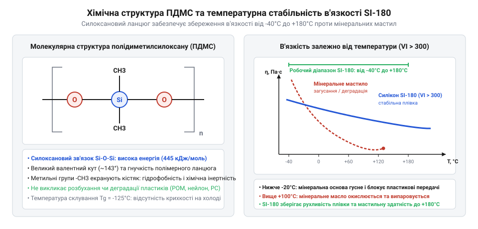
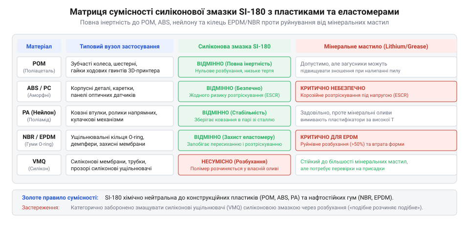
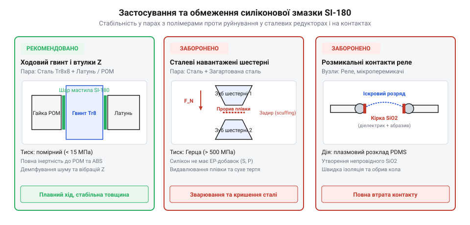

# Силіконова змазка SI-180

<preknowlist>
- [Мініатюрні кулькові підшипники (623, 625, 685, 686)](root:cat-hw-parts/miniature-ball-bearings) — конструкційні особливості малонавантажених підшипників качення та вимоги до в'язкості й чистоти мастила у точних вузлах
</preknowlist>

## Деградація пластикових вузлів без змащення

Коли у механізмі 3D-принтера, приладового приводу чи точного направляючого вузла починають заклинювати пластикові шестерні або повзуни, першим поривом часто стає внесення будь-якого наявного мастила. Проте після змащування звичайним мінеральним литолом чи машиною оливою пластикові деталі нерідко розм'якшуються, змінюють свої геометричні розміри, а гумові ущільнювальні кільця розбухають і розтріскуються. Причина полягає у глибокій фізико-хімічній несумісності класичних мастильних матеріалів із конструкційними полімерами та еластомерами.

Механічні елементи з полімерів функціонують за умов специфічного фрикційного контакту. Полімер (@@en|polymer@@, від грецького @@grc|πολύς@@ — численний та @@grc|μέρος@@ — частина) має вкрай низьку коефіцієнтну теплопровідність, яка становить приблизно від 0.2 до 0.4 Вт/(м·К), що у сотні разів нижче за аналогічний показник конструкційної сталі. Під час руху у вузлах тертя «пластик-пластик» або «пластик-метал» за відсутності мастила виникає сухе тертя. Вся виділена фрикційна енергія локалізується у мікроскопічних зонах фактичного контакту виступів шорсткості. Через відсутність ефективного відводу тепла у цих плямах виникають локальні температурні піки, які миттєво перевищують температуру скловування та розм'якшення полімерного матеріалу.

Внаслідок термічного перегріву поверхневий шар пластику втрачає механічну жорсткість. Виникає мікрооплавлення, адгезійне схоплювання та виривання матеріалу з поверхонь тертя. Пластикова деталь починає прискорено зношуватися, вкриваючись глибинними задирами та полімерним пилом. Якщо у цей вузол входить еластомер (@@en|elastomer@@, від грецького @@grc|ἐλατός@@ — ковкий та @@grc|μέρος@@ — частина), наприклад гумовий ущільнювач, підвищена температура та постійне сухе стирання призводять до втрати його пружності, прискореного випаровування внутрішніх пластифікаторів, пересихання й формування сітки мікротріщин.

Спроба розв'язати проблему за допомогою звичайних мінеральних мастил лише прискорює руйнування механізму. Нафтові оливи містять складову суміш аліфатичних, нафтенових та ароматичних вуглеводнів. Параметри розчинності цих сполук дуже близькі до параметрів розчинності багатьох конструкційних пластиків, таких як акрилонітрилбутадієнстирол (@@en|ABS@@) чи полікарбонат (@@en|Polycarbonate@@), а також еластомерів на основі нітрильного (@@en|NBR@@) чи етиленпропілендієнового (@@en|EPDM@@) каучуку. Молекули мінеральної оливи вільно дифундують між полімерними макромолекулярними ланцюгами, діючи як агресивний розчинник та неполярний пластифікатор.

У литих пластикових деталях завжди присутні залишкові внутрішні напруження після формування чи 3D-друку. Потрапляння мінеральної оливи викликає явище довкіллєвого розтріскування під напругою (@@en|environmental stress cracking@@). Проникаючи у мікротріщини на поверхні пластику, вуглеводні знижують поверхневу енергію матеріалу, через що тріщини стрімко розростаються при навантаженнях, значно менших за межу плинності. Зубчасті колеса з @@en|ABS@@ або полікарбонату під дією мінерального мастила буквально кришаться на шматки упродовж кількох тижнів експлуатації.

Одночасно відбувається деструкція гумових ущільнювальних кілець @@en|O-ring@@. Внаслідок поглинання мінеральних вуглеводнів гума розбухає, збільшуючись в об'ємі на 20–50%. Зміна лінійних розмірів призводить до того, що ущільнювач виходить із посадкової канавки, заклинює у зазорі та розривається під час руху поршня чи вала.

Зокрема, коли у високоточних приладах застосовують [малонавантажені кулькові підшипники](root:cat-hw-parts/miniature-ball-bearings), поява дрібних часток зносу від деградованого пластикового сепаратора спричиняє моментальне збільшення моменту опору обертанню. Аналогічно у приводних механізмах, де встановлена [гнучка муфта вала](root:cat-hw-parts/flexible-shaft-coupling), еластомерний вкладиш під дією невідповідного мастила швидко втрачає демпфуючу здатність та розпадається на фрагменти.

Трибологія (@@en|tribology@@, від грецького @@grc|τριβός@@ — тертя та @@grc|λόγος@@ — вчення) полімерних вузлів вимагає створення стійкої розділювальної плівки, яка б не вступала у хімічну взаємодію з матеріалом деталей і не розчиняла їхню структуру. Сила тертя у змащеному вузлі визначається співвідношенням:

F_f = μ × N
= 0.05 × N    [підстановка коефіцієнта тертя у режимі межевого змащення]

де `F_f` — сила тертя, `μ` — коефіцієнт тертя, а `N` — сила нормального притиску. Щоб розрахувати точні значення опірності та гідродинамічного розділення контактних поверхонь, застосовують [математичний трибологічний розрахунок](root:cat-hw-parts/silicone-grease/math-tribology-silicone-film-thickness.md), який визначає критичні межі переходу від сухого тертя до межевого змащування. Для надійного захисту полімерних механізмів потрібен спеціалізований мастильний матеріал, який поєднує високу хімічну інертність, термічну стабільність та низьку поверхневу енергію.

## Фізико-хімічні властивості силіконової змазки SI-180

Для захисту чутливих полімерних та еластомерних вузлів розроблено термостійке мастило @@en|SI-180@@. Його основою є синтетичний полідиметилсилоксан (@@en|polydimethylsiloxane@@, від грецького @@grc|πολύς@@ — чисельний, латинського @@la|methylium@@ — метил та @@en|siloxane@@ — силоксан), який скорочено позначають як @@en|PDMS@@. На відміну від мінеральних олив із вуглецевим скелетом `-C-C-`, молекулярна структура силікону побудована на чергуванні атомів кремнію та кисню `-Si-O-Si-O-`.

Енергія дисоціації зв'язку `Si-O` становить приблизно 460 кДж/моль, що суттєво перевищує міцність вуглець-вуглецевого зв'язку `C-C` (близько 348 кДж/моль) у мінеральних оливах. Завдяки такій міцній хімічній основі мастило @@en|SI-180@@ володіє винятковою термоокиснювальною стабільністю. Воно без деструкції витримує тривале нагрівання до +180°C, не випаровується, не утворює лакових відкладений і не коксується навіть при тривалій експлуатації в гарячих зонах.

Водночас кремнійорганічний ланцюг володіє унікальною гнучкістю. Потенційний бар'єр обертання навколо зв'язку `Si-O` є практично нульовим (близько 0.8 кДж/моль проти 13 кДж/моль для зв'язку `C-C`). Додатково кут зв'язку `Si-O-Si` є розширюваним і становить від 140° до 180°, а міжатомна відстань складає 1.63 Å. Ця висока конформаційна рухливість молекул забезпечує рекордну низьку температуру скловування полімеру (близько -125°C). У результаті мастило @@en|SI-180@@ зберігає м'яку пластичність і плинність при сильних морозах до -40°C, не кристалізуючись і не створюючи надмірного моменту опору при пуску механізму.

В'язкість (@@en|viscosity@@, від латинського @@la|viscum@@ — липкий сік омели) силіконового мастила має вкрай низьку чутливість до температурних коливань. При зміні температури від -40°C до +180°C динамічна @@en|viscosity@@ @@en|PDMS@@ змінюється в десятки разів менше порівняно з будь-якими мінеральними чи синтетичними вуглеводневими оливами. За низьких температур макромолекули @@en|PDMS@@ згортаються у компактні спіралі, а при нагріванні спіралі розгортаються, збільшуючи міжмолекулярне зачеплення. Цей механізм ефективно компенсаторно вирівнює плинність матеріалу в усьому робочому діапазоні.

Неполярні бічні метильні групи `-CH3`, приєднані до атомів кремнію, орієнтовані назовні від силоксанового скелета й формують суцільну захисну оболонку. Це визначає дві ключові властивості матеріалу: гідрофобність та діелектричну ізоляцію. Гідрофобність (@@en|hydrophobicity@@, від грецького @@grc|ὕδωρ@@ — вода та @@grc|φόβος@@ — страх) зумовлена дуже низькою поверхневою енергією матеріалу (близько 21 мН/м). Вода не змочує поверхню, вкриту мастилом: кут змочування перевищує 90°, тому краплі роси чи конденсат скочуються з вузла, захищаючи деталі від вологи та корозії.

Діелектрик (@@en|dielectric@@, від грецького @@grc|διά@@ — через та @@en|electric@@ — електричний), яким є @@en|PDMS@@, демонструє об'ємний електричний опір понад 10¹⁴ Ом·см та високу електричну міцність. Це робить @@en|SI-180@@ ефективним ізолюючим матеріалом для герметизації електричних роз'ємів та захисту контактних вузлів від пробоїв і витоків струму в умовах високої вологості.

Історія синтетичних кремнійорганічних змазок сягає середини XX століття, коли бурхливий розвиток авіації та високовольтної електротехніки висунув жорсткі вимоги до матеріалів, здатних працювати в екстремальних температурних умовах без деградації. Традиційні мінеральні оливи виявилися непридатними для ущільнень новітніх літальних апаратів, оскільки при високих температурах вони окислювалися й коксувалися, а при мінусових — повністю втрачали плинність і спричиняли розбухання гумових деталей. Синтез полімерних силоксанових ланцюгів дозволив створити кардинально новий клас мастильних матеріалів, чий температурний діапазон охоплював значення від глибокого морозу до тривалого нагріву. Подальша стандартизація термостійких продуктів серії SI відкрила шлях для їхнього масового впровадження у точну механіку, електротехніку та побутову техніку, де потрібна довготривала стабільність без заміни мастила.

Завдяки високій молекулярній масі силоксанових ланцюгів та відсутності низькокиплячих фракцій мастило @@en|SI-180@@ має практично нульову леткість. Вона не висихає, не випаровується й не втрачає змащувальних властивостей упродовж багатьох років експлуатації у відкритих і закритих механізмах.

*Молекулярна будова полідиметилсилоксанового ланцюга із винесеними метильними групами пояснює збереження стабільної динамічної в'язкості у широкому температурному інтервалі.*

## Сумісність змазки з конструкційними матеріалами

Головною трибологічною перевагою силіконового мастила @@en|SI-180@@ є його абсолютна хімічна інертність щодо широкого спектра конструкційних полімерів та еластомерних ущільнень. Поліоксиметилен (@@en|polyoxymethylene@@, від грецького @@grc|πολύς@@ — багато, @@en|oxy@@ — кисень та @@en|methylene@@ — метилен), відомий під абревіатурою @@en|POM@@ або торговельною назвою ацеталь, поліамід (капролон, @@en|Nylon@@), акрилонітрилбутадієнстирол (@@en|ABS@@) та полікарбонат (@@en|Polycarbonate@@) повністю збережують свій хімічний склад і механічну міцність при контакті з @@en|PDMS@@.

Фундаментом цієї сумісності є суттєва відмінність параметрів розчинності Гільдебранда. Параметр розчинності @@en|PDMS@@ становить приблизно від 14.9 до 15.4 (МПа)⁰·⁵, тоді як для полярних конструкційних пластиків він лежить у межах від 19.5 до 28.0 (МПа)⁰·⁵ (наприклад, для @@en|POM@@ це 22.6, а для @@en|Nylon@@ — 28.0). Значна різниця цих величин унеможливлює термодинамічне змішування та дифузію силіконових макромолекул у мікроструктуру пластику. Внаслідок цього мастило @@en|SI-180@@ не викликає розбухання, розм'якшення чи деформації деталей, а також створює захисну плівку, яка блокує випаровування внутрішніх пластифікаторів і запобігає старінню матеріалу.

Щодо еластомерів, змазка @@en|SI-180@@ демонструє повну сумісність із гумовими ущільнювальними кільцями @@en|O-ring@@ на основі нітрильного каучуку (@@en|NBR@@), етиленпропілендієнового каучуку (@@en|EPDM@@), а також із силіконовими мембранами. Вона утримує гуму в еластичному стані, запобігає її прилипанню до металу й розтріскуванню від висихання.

*Порівняльний аналіз хімічної інертності демонструє відсутність структурної деградації полімерів та еластомерів при контакті з кремнійорганічним мастилом.*

Основні сфери застосування @@en|SI-180@@ охоплюють малонавантажені вузли тертя «пластик-пластик» та «пластик-метал». Змазка широко використовується у трапецеїдальних гвинтових передачах Z-осі та полімерних втулках напрямних 3D-принтерів, шестернях прецизійних редукторів, зубчастих передачах оргтехніки, оптичних фокусувальних механізмах та поворотних вузлах приладів. Завдяки високій в'язкості базової оливи @@en|SI-180@@ володіє чудовим демпфуючим ефектом: вона поглинає акустичні шуми, гасить мікровібрації у зазорах кінематики та забезпечує м'який, плавній хід регулювальних елементів.

Щоб правильно провести регулярний сервіс кінематики, корисно опрацювати [покроковий практичний регламент](root:cat-hw-parts/silicone-grease/proj-3d-printer-maintenance-si180.md), який деталізує процедуру обслуговування напрямних та гвинтових передач.

*Наочний розподіл робочих зон виділяє ефективне використання мастила в полімерних напрямних та розкриває небезпеку його потрапляння на високонавантажені сталеві шестерні й контактні групи.*

Поряд із численними перевагами, мастило @@en|SI-180@@ має чітко окреслені фізичні обмеження:

1. Непридатність для високонавантажених сталевих передач: @@en|PDMS@@ володіє низькою несучою здатністю змащувальної плівки у контактах «сталь-сталь» при високих контактних тисках Герца. Силікон не має протизадирних властивостей і не утворює міцних хімічних хемосорбованих шарів на сталі, через що під значним навантаженням плівка проривається, виникає безпосередній контакт металів та швидке задироутворення. 2. Ризики силіконового забруднення: через надзвичайно низький поверхневий натяг мастило здатне повзти по поверхнях (міграція силікону). Якщо мікрокраплі силікону потрапляють на ділянки, призначені під подальше склеювання чи фарбування, адгезія клейових складувальних матеріалів та фарб повністю блокується, утворюючи кратери й плями відшарування. 3. Ізолюючий ефект на комутаційних електричних контактах: нанесення мастила на розмикальні контакти реле, перемикачів чи вимикачів є неприпустимим. Під дією електричної мікродуги, що виникає при розмиканні контактів, @@en|PDMS@@ розкладається з утворенням твердого, абразивного та діелектричного діоксиду кремнію `SiO₂`. Цей діоксид осідає на контактах у вигляді ізолюючої кірки, що призводить до повної втрати електричної провідності.

Технологічний регламент застосування @@en|SI-180@@ передбачає обов'язкову підготовку поверхонь. Перед внесенням мастила деталі слід ретельно очистити та знежирити ізопропіловим спиртом для видалення залишків старого мінерального мастила й бруду. Змазку наносять тонким рівномірним шаром товщиною 50–100 мкм. Надлишок змазки не покращує трибологічний стан, але стає пасткою для зовнішнього абразивного пилу. Для безпечного видалення старих силіконових відкладень використовують ізопропіловий спирт або спеціальні вуглеводневі змивки, які не розчиняють конструкційний пластик деталей.

## Області застосування та трибологічні обмеження

Вибір мастильного матеріалу для точних механізмів вимагає чіткого розуміння умов контакту, швидкостей зсуву та навантажень у вузлі тертя. Мастило @@en|SI-180@@ розроблене спеціально для умов, де ключовою вимогою є довговіддана стабільність, хімічна інертність та відсутність негативного впливу на конструкційні полімери. Проте трибологія (@@en|tribology@@) силіконових олив має суттєві відмінності від класичних нафтових матеріалів, що визначає як ефективні сфери використання, так і суворі межі застосування.

Основною робочою зоною для @@en|SI-180@@ є малонавантажені вузли тертя у парах «пластик-пластик» та «пластик-метал». До таких кінематичних пар належать полімерні втулки ковзання, трапецеїдальні гвинтові передачі Z-осей 3D-принтерів, зубчасті редуктори приладових приводів, оптичні фокусувальні механізми та поворотні елементи побутової та офісної техніки. У цих вузлах швидкість ковзання відносно мала, а контактні тиски не перевищують межі плинності полімеру.

У малонавантажених полімерних контактах мастило @@en|SI-180@@ функціонує в режимі межевого змащення. Межеве змащення (@@en|boundary lubrication@@, від латинського @@la|limis@@ — межа) характеризується тим, що поверхові мікронерівності деталей розділені тонким шарчиком мастила товщиною у кілька молекулярних шарів. Молекули @@en|PDMS@@ адсорбуються на поверхні пластику завдяки ван-дер-ваальсовим силам, створюючи фізичний бар'єр. Ця плівка запобігає безпосередньому зачепленню макромолекулярних ланцюгів полімерів, знижуючи коефіцієнт тертя з 0.35–0.50 (при сухому терті) до 0.05–0.08.

Оцінити точні трибологічні характеристики та визначити товщину мастильного шару допомагає [математичний трибологічний розрахунок](root:cat-hw-parts/silicone-grease/math-tribology-silicone-film-thickness.md), який описує поведінку плівки залежно від навантаження та швидкості руху.

Окрім зниження зносу, мастило @@en|SI-180@@ виконує важливу демпфуючу функцію. Висока молекулярна маса базової оливи та її в'язкопружні властивості забезпечують ефективне гасіння мікровібрацій у зазорах кінематичних пар. Це суттєво знижує акустичний шум під час роботи зубчастих передач та забезпечує тактильно плавний, «оксамитовий» хід регулювальних ручок і оптичних блоків.

Поряд із цим мастило @@en|SI-180@@ має чітко окреслені трибологічні та технологічні обмеження, нехтування якими призводить до виходу механізмів з ладу:

1. Непридатність для високонавантажених сталевих передач: силоксановий ланцюг @@en|PDMS@@ має низьку міцність змащувальної плівки у контактах «сталь-сталь» при високих контактних тисках Герца (@@en|Hertzian contact pressure@@). На відміну від мінеральних олив, які містять протизадирні добавки (@@en|extreme pressure additives@@, від латинського @@la|additio@@ — додавання) на основі сірки, фосфору чи цинку, силікон повністю інертний і не утворює на поверхні сталі хімічно зв'язаних хемосорбованих захисних шарів. Під дією високих зсувних напружень силіконова плівка миттєво видавлюється з зони контакту, що спричиняє сухий контакт металів, мікрозварювання виступів шорсткості та стрімке задироутворення (@@en|scuffing@@). Тому для високонавантажених сталевих редукторів змазка @@en|SI-180@@ є неприпустимою.

2. Ризик деградації та ізоляції електричних контактів: мастило @@en|SI-180@@ є високоякісним діелектриком (@@en|dielectric@@). Якщо мастило випадково потрапляє на струмопровідні поверхні розмикальних електричних контактів (реле, перемикачів, колекторів двигунів), під дією електричної мікродуги відбувається термічний розклад @@en|PDMS@@. На відміну від вуглеводневих олив, які згорають до газоподібних продуктів чи м'якого сажового нагару, кремнійорганіка розкладається з утворенням твердого діоксиду кремнію SiO₂. Цей діоксид осідає на контактах у вигляді твердої абразивної ізолюючої кірки, що викликає повну втрату електричної провідності та прискорене механічне зношування контактної групи.

3. Забруднення поверхонь та міграція силікону: завдяки дуже низькій поверхневій енергії (близько 21 мН/м) мастило @@en|SI-180@@ має високу здатність до поверхневого повзання — міграції (@@en|silicone creep@@). Мікроскопічна плівка силікону здатна самочинно поширюватися на значні відстані від місця нанесення. Якщо силікон потрапляє на деталі, які підлягають подальшому склеюванню чи фарбуванню, адгезія (@@en|adhesion@@, від латинського @@la|adhaesio@@ — прилипання) фарб та клеїв повністю порушується. На пофарбованій поверхні утворюються плями відшарування та кратери («силіконові очі»), а клейові з'єднання повністю втрачають міцність.

У точних приладах, де поруч із полімерними втулками працюють [малонавантажені кулькові підшипники](root:cat-hw-parts/miniature-ball-bearings), змазка @@en|SI-180@@ забезпечує надійне функціонування лише за умови відсутності високих радіально-осьових навантажень. А у вузлах, де застосовується [гнучка муфта вала](root:cat-hw-parts/flexible-shaft-coupling) з полімерним вкладишем, силіконова змазка запобігає стиранню еластомеру, утримуючи його у робочому стані без висихання.

## Технологія нанесення та видалення мастила

Надійність і довговічність малонавантаженого вузла тертя залежать не лише від правильного вибору мастильного матеріалу, але й від суворого дотримання технологічного регламенту його внесення та обслуговування. Поширеною помилкою під час технічного обслуговування є внесення надлишкової кількості змазки, що замість покращення роботи призводить до стрімкого забруднення механізму.

Надлишок мастила @@en|SI-180@@ не підвищує трибологічну ефективність, оскільки у робочому контакті утримується лише мікроскопічна плівка товщиною у кілька десятків мікрометрів. Усі випнуті назовні залишки стають пасткою для пилу, продуктів зносу та технологічного сміття. Утворена суміш перетворюється на абразивну пасту (@@en|abrasive paste@@), яка інтенсивно стирає полімерні деталі та гвинтові поверхні. Крім того, надлишкова змазка через високу плинність мігрує на суміжні вузли — приводні ремені, оптичні датчики та електричні контакти.

Правильна технологія обслуговування вузла складається з трьох послідовних етапів:

Перший етап — це якісна підготовка та знежирення (@@en|degreasing@@) поверхонь. Перед внесенням нового мастила необхідно повністю видалити залишки старого відпрацьованого матеріалу, бруд та пил. Для очищення полімерних та комбінованих деталей слід використовувати розчинник (@@en|solvent@@, від латинського @@la|solvere@@ — розчиняти), який не викликає деструкції пластиків та розбухання гумових ущільнювачів.

Оптимальним вибором є чистий ізопропіловий спирт (@@en|isopropyl alcohol@@). Він ефективно розчиняє жирові та мінеральні забруднення, не викликаючи довкіллєвого розтріскування під напругою у таких чутливих пластиках, як @@en|ABS@@, полікарбонат (@@en|Polycarbonate@@) чи поліоксиметилен (@@en|POM@@), і не пошкоджує гумові ущільнювальні кільця @@en|O-ring@@ з каучуків @@en|NBR@@ та @@en|EPDM@@. Категорично заборонено використовувати агресивні органічні розчинники, такі як ацетон (@@en|acetone@@), толуол чи етилацетат, які миттєво розчиняють поверхневий шар полімерних деталей і призводять до втрати геометричної точності. Очищення проводять за допомогою серветок із безворсової мікрофібри або м'яких пензлів із синтетичним ворсом.

Другий етап — це точне дозування (@@en|dosing@@) та нанесення мастила. Оптимальна товщина змащувальної плівки у робочому контакті повинна становити від 50 до 100 мкм. Мастило @@en|SI-180@@ наносять невеликими точковими порціями або тонкою смужкою на робочі поверхні за допомогою чистого пластикового шпателя, дозувального шприца або пензля. 

Після первинного внесення механізм вручну провертають або проганяють по усій довжині робочого ходу на 5–10 циклів. Це дозволяє мастилу рівномірно розподілитися по всій контактній площі гвинта чи направляючої. Після цього усі витиснені на краї робочих зон надлишки мастила обов'язково видаляють чистою безворсовою серветкою.

Щоб детально опанувати практичну послідовність обслуговування механізмів, варто вивчити [покрокову технологію обслуговування](root:cat-hw-parts/silicone-grease/proj-3d-printer-maintenance-si180.md) кінематичних вузлів, де наведено регламент сервісу гвинтових і направляючих передач.

Третій етап — це видалення старих залимків та нейтралізація силіконового забруднення. Через високу гідрофобність (@@en|hydrophobicity@@) та нерозчинність у воді видалення застарілих шарів силіконового мастила може викликати труднощі. Звичайні миючі засоби на водній основі не здатні змити @@en|PDMS@@. 

Для повного видалення силіконової плівки застосовують ізопропіловий спирт із механічним протиранням або спеціальні вуглеводневі змивки для силікону (@@en|silicone solvent@@). Якщо поверхня готується під фарбування чи склеювання, одного промивання недостатньо. Очищену деталь необхідно піддати багаторазовому знежиренню ізопропіловим спиртом з наступною обробкою поверхнево-активними речовинами, після чого перевірити змочуваність поверхні водою. Якщо крапля води рівномірно розтікається по поверхні, а не збирається у кулясту краплю, силіконову плівку повністю видалено.