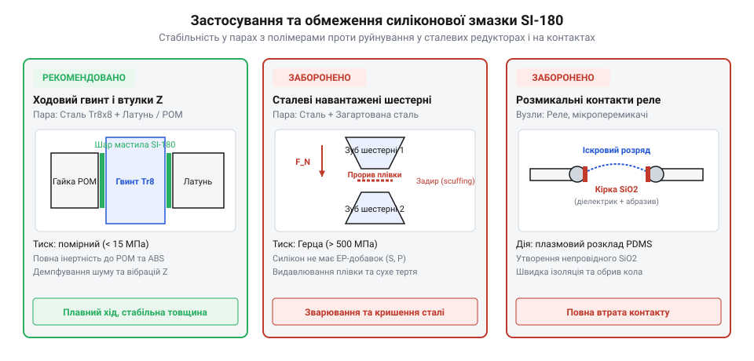

# Силіконова змазка SI-180

<preknowlist>
- [Мініатюрні кулькові підшипники (623, 625, 685, 686)](root:cat-hw-parts/miniature-ball-bearings) — конструкційні особливості малонавантажених підшипників качення та вимоги до чистоти мастила у точних вузлах
</preknowlist>

## Деградація пластикових вузлів без змащення

Коли в 3D-принтерах чи приладових редукторах пластикові деталі заклинюють, їх часто помилково змащують автомобільним літолом або машинною оливою. Проте незабаром пластикові шестерні тріскаються, а гумові ущільнювачі розбухають і блокують осі через несумісність мінеральних олив із конструкційними полімерами.

Пластик має вкрай низьку теплопровідність (0.2–0.4 Вт/(м·К)), тому під час сухого тертя виділене тепло локалізується на мікронерівностях і миттєво перевищує точку розмʼякшення. Виникає оплавлення та виривання часток матеріалу, через що [мініатюрні кулькові підшипники (623, 625, 685, 686)](root:cat-hw-parts/miniature-ball-bearings) засмічуються полімерним пилом і заклинюють.

Мінеральні вуглеводні мають близькі до полімерів параметри розчинності, тому дифундують між макромолекулами й викликають довкіллєве розтріскування під напругою (environmental stress cracking). Гумові кільця від цього розбухають на 20–50% і розриваються, а у приводних вузлах [гнучка муфта 5×5 мм](root:cat-hw-parts/flexible-shaft-coupling) втрачає пружний вкладиш і руйнується.

## Властивості та інертність змазки SI-180

Для пластикових і гумових елементів використовують термостійке кремнійорганічне мастило SI-180 на основі полідиметилсилоксану (PDMS). Ланцюг -Si-O-Si-O- має високу міцність звʼязку (460 кДж/моль), тому мастило не висихає і витримує тривалий нагрів до +180°C без коксування чи окислення.

Завдяки вільному обертанню навколо звʼязків Si-O мастило зберігає плинність до -40°C. Неполярні метильні групи -CH3 формують захисну оболонку з низькою поверхневою енергією (21 мН/м), забезпечуючи виражену гідрофобність та діелектричний опір понад 10¹⁴ Ом·см.

Головна перевага SI-180 — повна інертність до полярних пластиків (POM, нейлон, ABS, полікарбонат). Через відмінність параметрів розчинності мастило не дифундує в полімери й утворює стабільну плівку межевого змащення, що знижує коефіцієнт тертя до 0.05–0.08 та захищає ущільнювачі від старіння.

## Правила нанесення та критичні обмеження

Перед змащуванням контактні поверхні очищають і знежирюють ізопропіловим спиртом. Мастило SI-180 наносять пензликом тонким шаром 50–100 мкм, уникаючи надлишків, які притягують абразивний пил.

Кремнійорганічне мастило має два суворих обмеження. Його не можна застосовувати у високонавантажених сталевих редукторах: під тиском Герца понад 500 МПа силікон без протизадирних присадок видавлюється з контакту, спричиняючи сухе тертя й аварійні задири.

Також SI-180 заборонено наносити на розмикальні контакти реле й вимикачів. Під дією електричної мікродуги PDMS розкладається до твердого діоксиду кремнію SiO₂, який формує абразивну склоподібну кірку й повністю ізолює контакт.