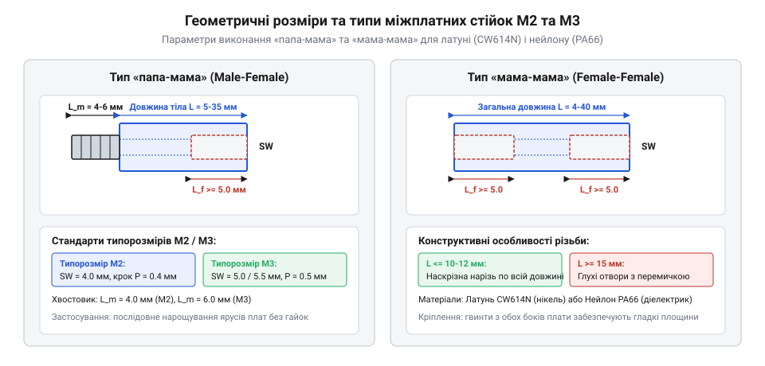
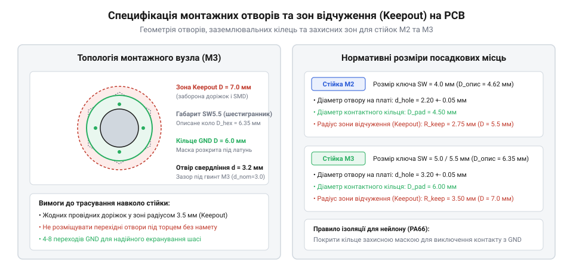

# Геометричні специфікації та кріпильні стандарти стійок М2 і М3

<preknowlist>
- [Набори гвинтів М3 (шестигранник, потайні DIN7991)](root:cat-hw-parts/m3-screw-kits) — параметри метричної різьби та стандарти міцності гвинтів
- [Набір кріплення М2.5 (нікельований)](root:cat-hw-parts/m25-fastener-kit) — стандарти міжплатного кріплення в електроніці
</preknowlist>

## Призначення та види стійок

Метричні міжплатні стійки є ключовим конструкційним елементом просторового компонування радіоелектронної апаратури. Їхня головна функція полягає у створенні фіксованого геометричного зазору між кількома паралельними друкованими платами або між платою та металевим шасі приладу. За відсутності надійних жорстких опор під дією власної ваги масивних компонентів, силових розʼємів та вібраційних навантажень склотекстоліт прогинається. Навіть незначний прогин плати на 0.5–1.0 мм призводить до концентрації механічних напружень у паяних зʼєднаннях планарних мікросхем BGA та QFN, мікротріщин у керамічних конденсаторах MLCC і небезпеки прямого електричного замикання виводів сусідніх модулів.

Окрім чисто механічної жорсткості, стійки визначають конфігурацію охолодження та електромагнітної сумісності вузла. Простір між платами формує вентиляційний коридор, необхідний для вільної або примусової конвекції повітря навколо нагрітих мікроконтролерів і силових ключів. Водночас вибір матеріалу стійки дозволяє або створити суцільну низькоомну шину заземлення, або забезпечити повну гальванічну розвʼязку цифрової та високовольтної секцій.

За конструктивним виконанням різьби міжплатні стійки поділяються на три базові типи:

1. Виконання «мама-мама» (Female-Female, F-F). Стійка являє собою шестигранний призматичний циліндр із наскрізним або двостороннім глухим внутрішнім різьбленням. Вона використовується як базова дистанційна опора: нижній торець прикручується до монтажної панелі корпуса окремим гвинтом, а верхній приймає гвинт фіксації плати. Стійки F-F забезпечують максимальну міцність на розтяг і використовуються на крайніх поверхах багатоплатних стеків. 2. Виконання «папа-мама» (Male-Female, M-F). Конструкція поєднує шестигранне тіло з внутрішньою різьбою з одного торця та монолітний нарізний хвостовик (шпильку) з протилежного. Це базовий будівельний блок модульних ярусних систем. Нарізний хвостовик проходить крізь отвір друкованої плати й напряму вкручується у внутрішню різьбу нижньої стійки, затискаючи плату між гранями без використання окремих проміжних гайок. Завдяки цьому збирання багатоповерхових стеків прискорюється в рази, а маса конструкції знижується. 3. Виконання «папа-папа» (Male-Male, M-M). Стійка має зовнішні нарізні хвостовики з обох боків шестигранного тіла. Її призначення — прохідний монтаж крізь товсті перегородки приладових шасі або зʼєднання двох плат, які затягуються глухими чи самоконтруючими гайками з зовнішніх боків.

У компактних приладах часто доводиться обирати між мікрокріпленням М2 та проміжними стандартами. Порівняти геометричні особливості та межі міцності дозволяє [набір кріплення М2.5 (нікельований)](root:cat-hw-parts/m25-fastener-kit), який займає проміжне положення між легкими стійками М2 та масивними М3.

## Геометричні стандарти М2 та М3

Геометричні розміри метричних стійок суворо стандартизовані міжнародними нормативами ISO та DIN для забезпечення взаємозамінності з гвинтами й гайками відповідних типорозмірів. Основними параметрами є номінальний діаметр різьби, крок різьби, розмір шестигранника під ключ та робочі довжини тіла й хвостовика.

Для різьби стандарту М2 метричний діаметр становить 2.0 мм із основним великим кроком P = 0.4 мм. Стійки М2 мають шестигранне тіло з розміром під ключ SW = 4.0 мм (відстань між паралельними плоскими гранями). Зовнішній діаметр описаного навколо шестигранника кола складає приблизно 4.62 мм. Різьба М2 використовується у високощільних портативних модулях, сенсорних вузлах дронів, смарт-годинниках та платах стандарту Raspberry Pi Zero.

Для різьби стандарту М3 номінальний діаметр складає 3.0 мм із кроком P = 0.5 мм. Розмір під ключ шестигранника для латунних стійок стандартизований як SW = 5.0 мм (рідше SW = 5.5 мм відповідно до DIN), а для нейлонових виробів зазвичай становить SW = 5.5 мм для компенсації нижчого модуля пружності пластику. Діаметр описаного кола для SW = 5.0 мм становить 5.77 мм, а для SW = 5.5 мм — 6.35 мм. Стандарт М3 є найбільш універсальним у промисловій електроніці, материнських платах формфакторів Mini-ITX, шасі 3D-принтерів та сервоприводах. При виборі відповідного металовиробу для фіксації верхнього ярусу застосовують сумісні [набори гвинтів М3 (шестигранник, потайні DIN7991)](root:cat-hw-parts/m3-screw-kits).

Довжина призматичного тіла стійки L стандартизована лінійкою: 3, 5, 6, 8, 10, 12, 15, 18, 20, 25 та 30 мм. У стійках малої висоти (L до 5 мм для М2 та до 6 мм для М3) виконання «мама-мама» має повністю наскрізну різьбу. У довших стійках внутрішня різьба робиться глухою з кожного боку з глибиною заходження від 5.0 до 8.0 мм для гарантування міцності перемички в центрі шестигранника. Довжина зовнішнього різьбового хвостовика L_stud у виконанні «папа-мама» стандартизована значеннями 3.0 мм, 4.0 мм, 5.0 мм та 6.0 мм. Для монтажу крізь стандартну друковану плату товщиною 1.6 мм обирають хвостовик довжиною 5.0–6.0 мм: це залишає 3.4–4.4 мм корисної різьби для вкручування в основу, що перевищує мінімальний критерій надійності зачеплення, рівний 1.5 номінального діаметра.

## Посадочні отвори та зони відчуження

Коректне проектування посадочних місць під стійки у САПР друкованих плат (KiCad, Altium Designer) є критичним для запобігання пошкодженню мідних провідників і коротких замикань на корпус. Помилки топології у зоні кріплення призводять до того, що під час обертання інструменту грані шестигранника здирають захисну паяльну маску й замикають сигнальні доріжки на земляний контур.

Діаметр отвору на друкованій платі підбирається відповідно до стандарту ISO 273 (середній клас точності). Для гвинтів і хвостовиків М2 номінальний діаметр свердління становить 2.2–2.3 мм (готовий металізований отвір 2.1–2.2 мм). Менший отвір створює натяг і розтріскування текстоліту під час вкручування, а більший (понад 2.5 мм) викликає ексцентриситетний люфт плати. Для кріплення М3 отвір свердлять діаметром 3.3–3.4 мм (готовий отвір 3.2 мм).

Навколо кожного кріпильного отвору формується кругова зона відчуження (keepout zone), всередині якої суворо заборонено розміщувати компоненти поверхневого монтажу (SMD-резистори, конденсатори, діоди), відкриті провідні доріжки та глухі чи наскрізні перехідні отвори (vias). Радіус зони відчуження розраховують не за номінальним розміром під ключ, а за радіусом описаного кола шестигранника з урахуванням технологічного допуску на позиціонування головки торцевого ключа:

R_keepout = (SW / (2 × cos(30°))) + Δ_tool
= (SW / 1.732) + 0.5 мм

Для стійки М2 з SW = 4.0 мм діаметр зони відчуження становить не менше D_keepout = 5.2 мм. Для стійки М3 з SW = 5.0 мм зона відчуження має діаметр D_keepout = 6.8 мм, а для SW = 5.5 мм — не менше 7.4 мм. Якщо стійка затягується товстостінною торцевою головкою з ручного інструменту, зону розширюють до 8.0 мм.

Конструкція посадочного кільця навколо отвору залежить від електричного призначення стійки. Якщо стійка слугує точкою заземлення (Chassis GND), отвір виконується металізованим (PTH) із відкритим від паяльної маски кільцевим контактним майданчиком шириною 0.8–1.2 мм, вкритим гальванічним золотом (ENIG) чи гарячим лудженням (HASL). Майданчик зʼєднують із внутрішніми земляними полігонами масивом із 4–8 зшиваючих перехідних отворів, розміщених поза площиною притиску торця стійки. Якщо ж потрібна гальванічна ізоляція або використовується нейлонова стійка, отвір проектують неметалізованим (NPTH), а шар захисної паяльної маски перекриває зону навколо отвору з відступом мідного полігону не менше ніж на 1.0 мм від краю шайби.

## Механічні та електричні граничні характеристики

Вибір між латунними та нейлоновими стійками диктується механічними навантаженнями, вібраційним профілем виробу та вимогами до електроізоляції.

Латунні стійки виготовляються з автоматного свинцевого сплаву CW614N (CuZn39Pb3 / DIN 2.0401) із захисним гальванічним нікелюванням товщиною 3–5 мкм. Цей матеріал має високу границю міцності на розтяг (σ_b = 400–450 МПа) та модуль пружності E = 100–105 ГПа. Нікелеве покриття захищає латунь від окиснення та утворює стабільний низькоомний перехідний опір (R_contact < 0.01 Ом), що робить латунні стійки безальтернативними для високочастотного екранування та скидання статичного заряду ESD на металеве шасі.

Нейлонові стійки виготовляються методом лиття під тиском із поліаміду PA66 (часто без наповнювача або з 30% армуванням скловолокном PA66-GF30). Поліамід є відмінним діелектриком із питомим обʼємним опором понад 10¹² Ом·см та електричною міцністю ізоляції 15–20 кВ/мм. Нейлонові стійки повністю усувають паразитні земляні петлі між платами аналогових датчиків та імпульсних стабілізаторів живлення, а також мають низьку густину (1.14 г/см³ проти 8.5 г/см³ у латуні), що критично для авіамоделей та портативних приладів.

Гранично допустимий момент затягування T_max жорстко лімітується межею зрізу різьби:

1. Латунні стійки М2: номінальний монтажний момент становить 0.15–0.18 Н·м, граничний ліміт руйнування різьби T_max = 0.25 Н·м. 2. Латунні стійки М3: номінальний монтажний момент 0.50–0.60 Н·м, граничний ліміт T_max = 0.85 Н·м. Перевищення цього зусилля призводить до зрізу перших трьох ниток внутрішньої різьби або відриву нарізного хвостовика у місці підрізу біля шестигранного бурта. 3. Нейлонові стійки М2: монтажний момент становить 0.05–0.08 Н·м, критичний ліміт T_max = 0.12 Н·м. 4. Нейлонові стійки М3: монтажний момент 0.18–0.22 Н·м, критичний ліміт T_max = 0.35 Н·м. При перетягуванні нейлону грані шестигранника зминаються інструментом, а в тілі виникає пластична повзучість (cold flow), яка призводить до послаблення натягу різьби з часом.

Для запобігання самовідкручуванню стійок від вібрацій у латунних вузлах застосовують пружинні шайби Гровера (DIN 127) або наносять краплю розбірного синього анаеробного фіксатора різьби середньої міцності (наприклад, Loctite 243). Категорично заборонено наносити рідкі анаеробні фіксатори на нейлонові стійки PA66: хімічні компоненти фіксатора ініціюють миттєве розтріскування поліаміду під механічною напругою (environmental stress cracking), через що стійка розсипається на фрагменти упродовж кількох діб. Для фіксації нейлону використовують самоконтруючі гайки з нейлоновим кільцем (DIN 985) або краплю силіконового еластомеру.

Для систематизованого зберігання розсипу стійок різної висоти та різьби у радіоелектронній лабораторії незамінним є секційний [органайзер для дрібних деталей](root:cat-hw-parts/parts-organizer), який унеможливлює випадкове змішування метричних стандартів М2, М2.5 та М3 під час швидкого монтажу.