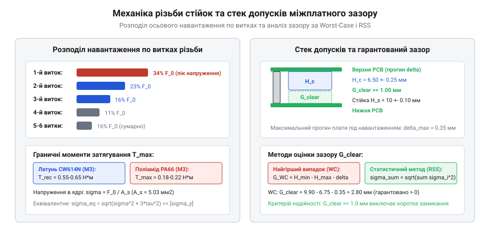

# Механічний розрахунок затягування та допусків міжплатних стійок

<preknowlist>
- [Набори гвинтів М3 (шестигранник, потайні DIN7991)](root:cat-hw-parts/m3-screw-kits) — геометричні розміри метричної різьби та стандарти міцності гвинтів
- [Набір кріплення М2.5 (нікельований)](root:cat-hw-parts/m25-fastener-kit) — правила монтажу міжплатних стеків та особливості механічного навантаження плат
</preknowlist>

## Деформації та зрив різьби стійок

Міжплатна дистанційна стійка (@@en|standoff@@) під час складання радіоелектронного блока працює як силовий пружний елемент різьбового зʼєднання. Коли монтажник затягує гвинт або нарізний хвостовик сусідньої секції, виникає осьова сила попереднього натягу (від англ. *pre-load* — попереднє навантаження, @@en|preload@@). Ця сила стискає склотекстоліт друкованої плати та розтягує тіло стійки. Якщо прикласти надмірне обертальне зусилля «на око», у контактній зоні різьби виникають напруження, що перевищують межу плинності матеріалу (англ. *yield strength*, @@en|yield strength@@), що призводить до миттєвого руйнування кріплення.

Характер аварійного руйнування принципово відрізняється залежно від матеріалу стійки:

1. Латунні стійки (сплав CW614N / CuZn39Pb3). Латунь має високу границю міцності на зсув, проте внутрішня різьба дрібних розмірів М2 та М3 має малу висоту профілю витка (0.217 мм для М2 і 0.271 мм для М3). При перевищенні допустимого крутного моменту відбувається зріз перших двох-трьох витків внутрішньої різьби стійки, оскільки зовнішній сталевий гвинт має значно вищу твердість. У стійках типу «папа-мама» критичною точкою є концентратор напружень у місці переходу нарізного хвостовика у шестигранне тіло: під дією кручення та згину хвостовик зрізається заподлицо з буртиком, залишаючи уламок усередині нижньої стійки.

2. Нейлонові стійки (поліамід PA66). Поліамід має модуль пружності близько 2.8–3.2 ГПа, що майже у 35 разів менше за латунь (105 ГПа). При затягуванні витки внутрішньої різьби деформуються пластично: різьба «випливає», перетворюючись на гладкий циліндричний отвір без зачеплення. Крім того, при затягуванні шестигранника рожковим або торцевим ключем грані поліаміду легко зминаються, роблячи вузол непридатним до демонтажу.

Окрему загрозу несе контактний тиск під торцем стійки на склотекстоліт FR-4. Якщо площа опорного бурта замала, а затяжка надмірна, край шестигранника проминає мідні шари й руйнує епоксидну матрицю плати. Для рівномірного розподілу зусилля й захисту текстоліту під торець обовʼязково підкладають [металеві або діелектричні шайби](root:cat-hw-parts/bolts-and-washers). При використанні металевих гвинтів навантаження розподіляється між витками нерівномірно: перший робочий виток сприймає до 35–40% усього осьового навантаження, другий — близько 25%, третій — 15%, а решта витків майже не навантажуються, що робить точний розрахунок затягування безальтернативною вимогою надійності.


*Розподіл напружень у витках різьби та формування сумарного зазору між двома платами.*

## Механічний розрахунок моменту затягування різьби

Крутний момент затягування (@@en|tightening torque@@) перетворюється через гвинтову поверхню на осьову силу попереднього натягу `F_p`. Ця сила повинна бути достатньою, щоб тертя в різьбі та під головкою запобігало розкручуванню від вібрацій, але не перевищувала 65–75% від межі текучості матеріалу стрижня чи витків.

Для розрахунку допустимої осьової сили спочатку визначають номінальну площу напруженого перерізу метричної різьби `A_s`. Вона розраховується за середнім діаметром `d_2` та внутрішнім діаметром по западинах `d_3`:

```
A_s = (π / 4) · ((d_2 + d_3) / 2)²      [площа напруженого перерізу метричної різьби]
```

Для стандартних метричних різьб значення площі становлять:
- М2 (крок P = 0.4 мм): `A_s = 2.07 мм² = 2.07 × 10⁻⁶ м²`
- М3 (крок P = 0.5 мм): `A_s = 5.03 мм² = 5.03 × 10⁻⁶ м²`

Максимально допустиму силу попереднього натягу `F_p` визначають через границю текучості матеріалу `σ_y` та коефіцієнт запасу `c = 0.70`:

```
F_p = c · A_s · σ_y      [допустима осьова сила затягування]
```

Границя плинності становить:
- Латунь автоматна CW614N: `σ_y = 250 МПа = 250 × 10⁶ Па`
- Нейлон технічний PA66: `σ_y = 60 МПа = 60 × 10⁶ Па`

Звʼязок між крутним моментом `T` (Н·м) та осьовою силою `F_p` (Н) описується короткою формулою затягування:

```
T = K · F_p · d      [залежність крутного моменту від сили натягу та діаметра]
```

У цій залежності `d` — номінальний діаметр різьби (0.002 м для М2 та 0.003 м для М3), а `K` — безрозмірний узагальнений коефіцієнт тертя різьбового зʼєднання (nut factor). Він враховує кут підйому різьби, тертя між витками та тертя на торці шестигранника або шайби:
- Для сухої нікельованої латуні по сталі або латуні: `K ≈ 0.20`
- Для нейлону PA66 по сталі чи текстоліту: `K ≈ 0.15`

Розрахуємо допустимий крутний момент для латунної та нейлонової стійки М3 при складанні стандартними [наборами гвинтів М3](root:cat-hw-parts/m3-screw-kits).

**Розрахунок монтажного моменту для латунної стійки М3 (CW614N):**
```
F_p = 0.70 · (5.03 × 10⁻⁶) · (250 × 10⁶)
    = 880.25 Н                               [допустима сила осьового натягу]

T   = 0.20 · 880.25 · 0.003
    = 0.528 Н·м                              [номінальний крутний момент]
```

**Розрахунок монтажного моменту для нейлонової стійки М3 (PA66):**
```
F_p = 0.70 · (5.03 × 10⁻⁶) · (60 × 10⁶)
    = 211.26 Н                               [допустима сила осьового натягу]

T   = 0.15 · 211.26 · 0.003
    = 0.095 Н·м                              [номінальний крутний момент]
```

Граничний момент руйнування для нейлону М3 становить близько 0.20–0.25 Н·м, тому перевищення моменту понад 0.12 Н·м при ручному складанні гарантовано зриває різьбу. Для мініатюрних вузлів порівняти характеристики допомагає [набір кріплення М2.5](root:cat-hw-parts/m25-fastener-kit).

## Накопичення допусків міжплатного зазору

У багатоплатних електронних модулях сумарна висота простору між платами визначається виробничими відхиленнями геометричних розмірів деталей. Похибки виготовлення стійок, товщини текстоліту плат, паяних виступів і висот електронних компонентів підсумовуються. Це явище описує інженерний розрахунок накопичення допусків (від англ. *tolerance stack-up* — складання похибок у стопку, @@en|tolerance stack-up@@).

Гарантований безпечний зазор `Gap` між найвищим компонентом нижньої плати та зворотною стороною верхньої плати має задовольняти умову:

```
Gap = H_standoff - H_comp - H_lead - δ_warp ≥ Gap_min      [умова запобігання механічному контакту]
```

Де:
- `H_standoff` — номінальна висота стійки з допуском `±Δ_s`;
- `H_comp` — габаритна висота найвищого SMD чи THT-компонента з допуском `±Δ_c`;
- `H_lead` — довжина паяних виводів компонентів верхньої плати з допуском `±Δ_l`;
- `δ_warp` — стріла прогину (викривлення) друкованої плати під дією нагріву чи механічних напружень (за стандартом IPC-A-600 допустимий прогин складає до 0.75% від діагоналі плати);
- `Gap_min` — нормативний безпечний повітряний проміжок (не менше 1.0–1.5 мм для уникнення електричного пробою та нормальної вентиляції). Для вирівнювання тиску у щільних замкнених корпусах вмонтовують [вентиляційні захисні клапани ePTFE](root:cat-hw-parts/eptfe-protective-vents).

Для оцінки сумарної похибки розмірного ланцюга застосовують два методи:

1. Метод найгіршого випадку (англ. *Worst-Case Analysis*, @@en|worst-case@@). Передбачає, що всі компоненти одночасно мають найбільш несприятливі відхилення розмірів:

```
Δ_total_wc = Δ_s + Δ_c + Δ_l + Δ_warp      [підсумовування абсолютних похибок найгіршого випадку]
```

Цей метод є консервативним і застосовується для відповідальних аерокосмічних і медичних виробів, проте веде до невиправданого збільшення габаритів стійок у масовому виробництві.

2. Статистичний метод кореня з суми квадратів (англ. *Root Sum Square*, @@en|RSS@@). Спирається на нормальний розподіл похибок виготовлення незалежних деталей:

```
Δ_total_rss = √(Δ_s² + Δ_c² + Δ_l² + Δ_warp²)      [статистичне підсумовування похибок методом RSS]
```

Метод RSS дає реалістичну оцінку розкиду для 99.73% виробів (рівень довірчого інтервалу 3σ).

**Порівняльний розрахунок сумарного допуску для міжплатного вузла:**
Умови: стійка 15 мм (`Δ_s = ±0.15 мм`), електролітичний конденсатор (`Δ_c = ±0.30 мм`), обрізані виводи розʼєму (`Δ_l = ±0.25 мм`), можливий прогин плати (`Δ_warp = ±0.40 мм`).

```
Δ_total_wc  = 0.15 + 0.30 + 0.25 + 0.40
            = 1.10 мм                              [сумарний допуск за найгіршим випадком]

Δ_total_rss = √(0.15² + 0.30² + 0.25² + 0.40²)
            = √(0.0225 + 0.0900 + 0.0625 + 0.1600)
            = √0.3350
            ≈ 0.579 мм                             [сумарний допуск за методом RSS]
```

Статистичний допуск 0.58 мм майже вдвічі менший за найгірший випадок (1.10 мм), що дозволяє вибрати компактнішу стандартну висоту стійки без ризику колізій. Під час монтажу дрібні стійки та шайби розкладають у [секційний органайзер для деталей](root:cat-hw-parts/parts-organizer) для запобігання переплутуванню висот.

## Вібраційні напруження та стійкість стійок

В умовах динамічної експлуатації (автомобільна електроніка, дрони, промислове обладнання) міжплатні стійки навантажуються не лише осьовим зусиллям затяжки, але й знакозмінними згинальними та зсувними напруженнями. Коли маса плати `m` під дією прискорення вібрації `a = g · G_peak` коливається, кожна стійка сприймає динамічну силу зсуву `F_shear = (m · a) / n`, де `n` — кількість опорних стійок.

Якщо стійка має велику довжину `L` при малому поперечному перерізі (наприклад, довга стійка М2 або М3 довжиною 25–35 мм), критичною загрозою стає втрата стійкості при стисканні — поздовжній згин (від нім. *Knickung*, @@en|buckling@@). Критичну осьову силу `P_cr`, перевищення якої спричиняє раптове викривлення стійки дугою, описує формула Ейлера:

```
P_cr = (π² · E · I) / (K_column · L)²      [критична сила втрати поздовжньої стійкості за Ейлером]
```

У цій формулі:
- `E` — модуль пружності матеріалу (105 ГПа для латуні CW614N, 3.0 ГПа для нейлону PA66);
- `I` — осьовий момент інерції поперечного перерізу (від англ. *second moment of area*, @@en|moment of inertia@@). Для правильного шестигранника з розміром під ключ `SW` момент інерції дорівнює:

```
I = (5 · √3 / 144) · SW⁴ ≈ 0.0601 · SW⁴      [осьовий момент інерції шестигранного перерізу]
```

Для порожнистої стійки з внутрішнім різьбовим отвором номінального діаметра `d` момент інерції зменшується на величину отвору: `I_net = I - (π · d⁴ / 64)`. - `K_column` — коефіцієнт приведеної довжини стрижня залежно від способу закріплення кінців. Для стійки, жорстко затиснутої гвинтами з обох боків у площинах плат, приймають `K_column = 0.5`. - `L` — вільна довжина стійки між платами.

Якщо розрахункова сила стискання перевищує критичну межу `P_cr`, конструкція миттєво втрачає тримальну здатність. Нейлонові стійки М2 довжиною 30 мм через низький модуль пружності мають `P_cr` менше 40–50 Н, тому в довгих прольотах застосовують проміжні точки кріплення або переходять на жорстку латунь.

Для запобігання вібраційному розхитуванню зʼєднань на різьбу металевих стійок наносять фіксатори, або для швидкої тимчасової фіксації вузлів стендів використовують [ціаноакрилатний клей](root:cat-hw-parts/cyanoacrylate-glue). Оптимальна схема кріплення плати передбачає розміщення стійок по кутах із кроком не більше 60–80 мм для запобігання резонансному прогину текстоліту, а також додаткові центральні стійки поруч із масивними трансформаторами та розʼємами.