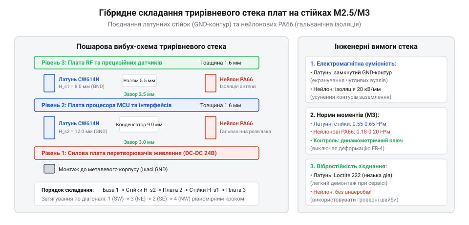

# Збирання багаторівневого стека плат із комбінованим заземленням та ізоляцією

<preknowlist>
- [Набори гвинтів М3 (шестигранник, потайні DIN7991)](root:cat-hw-parts/m3-screw-kits) — геометричні розміри та стандарти міцності метричного кріплення
- [Набір кріплення М2.5 (нікельований)](root:cat-hw-parts/m25-fastener-kit) — принципи ярусного монтажу плат
</preknowlist>

## Проблеми компактного компонування та перекоси

У сучасній приладовій схемотехніці жорсткі вимоги до мініатюризації корпусів змушують відмовлятися від моноплатного компонування на користь вертикальних багаторівневих систем — мезонінних стеків друкованих плат (англ. @@en|mezzanine stack@@). Спроба розмістити силовий перетворювач живлення, центральний мікроконтролерний модуль та чутливий радіотрансивер в одній площині призводить до збільшення площі шасі, ускладнення трасування високочастотних шин і критичного перегріву. Проте вертикальний монтаж на дистанційних стійках приховує комплекс взаємопов'язаних електрофізичних і механічних пасток, які за помилкового вибору кріплення руйнують прилад ще на етапі складального цеху.

Головною механічною загрозою щільного стека є просторовий перекіс і нерівномірний пружний прогин склотекстоліту FR-4. Кожна друкована плата під власною вагою, натягом монтажних джгутів та динамічними експлуатаційними вібраціями прогинається подібно до пружної балки. Якщо висота стійок підібрана «впритул» за кресленнями компонентів без урахування допусків висоти корпусу й вильоту пайки, високі деталі нижнього ярусу (електролітичні конденсатори, силові екрановані дроселі або роз'єми живлення) впираються безпосередньо в струмопровідні доріжки, перехідні отвори або гострі зрізи виводів THT верхньої плати. В умовах транспортної вібрації захисна паяльна маска миттєво протирається, що викликає міжплатне коротке замикання з вигорянням силових каскадів.

Не менш небезпечним наслідком довільного вибору дистанційних стійок є паразитна земляна петля (англ. @@en|ground loop@@). Коли всі яруси стека стягуються звичайними струмопровідними металевими стійками, виникає безліч замкнених паралельних контурів заземлення між цифровою, силовою та радіочастотною частинами. Імпульсні струми комутації DC-DC перетворювачів силової плати, протікаючи через латунні стійки, наводять значні падіння напруги на загальному сигнальному дроті мікроконтролера, збиваючи покази АЦП і викликаючи спонтанні перезавантаження процесора. Спроба ж повністю ізолювати всі плати пластиковими стійками позбавляє прилад захисного екрану від зовнішніх електромагнітних завад (EMI).

Єдиним надійним рішенням є проектування гібридного стека. У такій конструкції заздалегідь розмежовують струмопровідні латунні контури для цільового дренажу завад і діелектричні нейлонові бар'єри для розриву шумних паразитних зв'язків. Будь-який монтаж починається з точного аудиту компонувальної висоти кожного шару та геометричного запасу безпеки. Для надійного збереження різнотипного кріплення під час підготовки серійного складання застосовують спеціальний [органайзер для дрібних деталей](root:cat-hw-parts/parts-organizer), що виключає плутанину між металевими та поліамідними елементами.

## Розрахунок вертикального габариту міжплатних зазорів

Визначення мінімальної висоти міжплатної стійки базується на розрахунку найгіршого випадку (англ. @@en|worst-case analysis@@) геометричних вильотів усіх зустрічних об'ємів. Вертикальний простір між двома сусідніми платами має гарантовано вміщувати сумарну висоту деталей верхньої площини нижньої плати, виліт компонентів або паяних ніжок нижньої площини верхньої плати, нормативний повітряний ізоляційний зазор і запас на динамічний прогин текстоліту:

h_min = h_comp_top + h_comp_bottom + h_lead + h_air + delta_pcb

Тут h_comp_top — максимальна монтажна висота компонента на нижній платі (наприклад, висота алюмінієвого радіатора чи електролітичного конденсатора); h_comp_bottom — габарит планарних SMD-компонентів зворотного боку верхньої плати; h_lead — довжина виступання обрізаних паяних виводів THT (за стандартами IPC-A-610 зазвичай становить від 1.0 до 1.5 мм); h_air — регламентний діелектричний та вентиляційний зазор (мінімум 1.0–1.5 мм для уникнення іскрового пробою та забезпечення конвекції повітря); delta_pcb — сумарний максимальний пружний прогин обох плат у центральній зоні під час вібраційного прискорення, який для плат товщиною 1.6 мм розміром 100х100 мм приймається не менше 0.3–0.5 мм.

Отримане значення h_min округлюють у більший бік до найближчого значення зі стандартного виробничого ряду висот міжплатних стійок: 5.0, 6.0, 8.0, 10.0, 12.0, 15.0, 18.0, 20.0, 25.0 або 30.0 мм. Використання нестандартних розмірів є економічно невиправданим і затримує серійне виробництво.

Конструктивно стійки поділяються на два базові типи різьбового виконання: «тато-мама» (англ. @@en|male-female@@, зовнішня різьба з одного торця та внутрішня з іншого) та «мама-мама» (англ. @@en|female-female@@, внутрішня різьба з обох кінців). У багаторівневих конструкціях перевагу віддають стійкам типу «тато-мама». Хвостовик із зовнішньою різьбою пропускається крізь монтажний отвір друкованої плати та безпосередньо вкручується у внутрішню різьбу стійки попереднього ярусу. Така схема кардинально спрощує послідовне складання, усуваючи потребу в довгих прохідних гвинтах або шпильках, де вібраційний зсув однієї точки послаблює затиск усього стека. У той же час фіксація першого та фінішного шарів шасі надійно забезпечується за допомогою [наборів гвинтів М3](root:cat-hw-parts/m3-screw-kits) або спеціалізованих елементів [набору кріплення М2.5](root:cat-hw-parts/m25-fastener-kit).

## Гібридна схема заземлення та гальванічної ізоляції

Електромагнітна сумісність багатоплатного блоку вимагає суворого просторового розділення низькоомного опорного потенціалу сигнальної землі та ізоляції галасливих комутаційних струмів. Гібридна топологія об'єднує два протилежні за властивостями матеріали: шестигранні стійки зі свинцевої латуні CW614N (CuZn39Pb3) з захисним нікелевим покриттям та поліамідні стійки з ненаповненого нейлону марки PA66.

Латунь CW614N має питомий електричний опір близько 0.062 Ом·мм²/м і високу теплопровідність (понад 115 Вт/(м·К)). Нікельовані латунні стійки встановлюють на кутових кріпильних отворах між платою обробки даних (MCU) та платою радіотрансивера. Монтажні отвори цих плат оснащують широкими залудженими кільцевими контактними площадками, з'єднаними множинними перехідними отворами з внутрішніми екранними полігонами GND. Затягування латунної стійки створює надійний багатоточковий контакт із перехідним опором менше 3–5 мОм, утворюючи навколо сигнальних трактів суцільну екрануючу клітку Фарадея для придушення високочастотних перешкод.

Навпаки, між базовою силовою платою перетворювачів живлення (імпульсні стабілізатори 24 В / 5 В) та цифровим процесорним блоком встановлюють ізолювальні стійки з нейлону PA66. Поліамід PA66 є відмінним конструкційним діелектриком з електричною міцністю понад 20 кВ/мм та питомим об'ємним опором понад 10¹⁴ Ом·см. Застосування нейлонових стійок забезпечує повну гальванічну розв'язку: зворотні струми потужного індуктивного навантаження не можуть затекти в чутливий сигнальний контур через металеве шасі приладу. Якщо корпус пристрою вимагає герметизації від вологи, всередині встановлюють [вентиляційні захисні клапани ePTFE](root:cat-hw-parts/eptfe-protective-vents), які запобігають утворенню водяного конденсату на діелектричних поверхнях нейлону.

Взаємне просторове розташування компонентів, чергування провідних і діелектричних ярусів та контрольні розміри наведено на тривимірній вибух-схемі:

*Конструктивна вибух-схема трирівневого стека: поєднання латунних стійок для сигнального екранування та нейлонових елементів для ізоляції силового контуру.*

Для виключення випадкового електричного контакту голівки кріпильного металевого гвинта з міддю текстоліту на ізольованих ярусах обов'язково застосовують захисні шайби з поліаміду або фторопласту. Якщо ж кріплення здійснюється до несучого алюмінієвого фрезерованого шасі, для розподілу контактного тиску під головки підкладають пружні [болти М5/М6 і шайби М3/М4](root:cat-hw-parts/bolts-and-washers), що виключає розтріскування склотекстоліту навколо монтажного отвору.

## Порядок складання стека та різьбова фіксація

Складання багатоплатного стека виконується суворо ярусним методом за принципом знизу вгору. Порушення послідовності призводить до накопичення геометричних похибок позиціонування та перекошування міжплатних сигнальних роз'ємів:

1. Базова плата фіксується на опорній панелі шасі через первинний комплект опорних стійок. 2. У монтажні отвори базової плати вкручуються стійки першого міжплатного ярусу «тато-мама». Досягається надійне затягування нарізного з'єднання без перекосу шестигранника. 3. На виступаючі різьбові хвостовики стійок обережно опускається другий ярус друкованої плати. Одночасно контролюється точне співвісне входження міжплатних штирьових з'єднувачів (Board-to-Board коннекторів). 4. На різьбу, що виступає крізь плату, накручуються стійки наступного ярусу або встановлюються фіксуючі гайки. 5. Операція повторюється для третього функціонального шару.

Критичним параметром якості збирання є дотримання нормативного моменту затягування різьби. Механічні властивості латуні та поліаміду відрізняються майже на порядок: межа міцності латуні CW614N на розтяг становить близько 450 МПа, тоді як для нейлону PA66 вона не перевищує 75–85 МПа. Перевищення крутного моменту при закручуванні нейлонової стійки призводить до зрізання витків пластикової різьби або до виникнення залишкової пластичної деформації розтягу (англ. @@en|thread stripping@@). Регламентні значення моментів затягування становлять:

- Для латуні CW614N M2: рекомендований момент 0.20–0.22 Н·м (граничний — 0.28 Н·м). - Для латуні CW614N M3: рекомендований момент 0.50–0.58 Н·м (граничний — 0.70 Н·м). - Для нейлону PA66 M2: рекомендований момент 0.06–0.07 Н·м (граничний — 0.09 Н·м). - Для нейлону PA66 M3: рекомендований момент 0.16–0.18 Н·м (граничний — 0.24 Н·м).

Для запобігання перекосу плати та концентрації механічних напружень гвинти кожного ярусу затягують у два проходи за діагональною перехресною схемою (хрест-навхрест): спочатку всі чотири точки наживляють із зусиллям близько 50% від номіналу, і лише після візуальної перевірки посадки роз'ємів виконують остаточне динамометричне затягування до 100%.

В умовах тривалих вібраційних навантажень самовідкручування нарізних з'єднань запобігають використанням анаеробних різьбових фіксаторів. Для металевих латунних стійок застосовують рознімний синій фіксатор середньої міцності (типу Loctite 243). Одну мікрокраплю складу наносять на суху знежирену різьбу безпосередньо перед збиранням. Важливо пам'ятати: традиційні анаеробні герметики категорично заборонено наносити на пластикові стійки з нейлону PA66! Хімічні компоненти анаеробних акрилатів викликають у поліамідах швидке розтріскування під дією внутрішніх напружень (англ. @@en|environmental stress cracking@@). Для нейлонових стійок самозакручування блокують виключно пружними поліамідними контргайками або мікрокраплею нейтрального клею на силіконовій основі (за потреби екстреної фіксації технологічного оснащення використовують [ціаноакрилатний клей](root:cat-hw-parts/cyanoacrylate-glue)).

Для автоматизованого розрахунку міжплатних відстаней, перевірки колізій компонентів та валідації безпеки крутних моментів розроблено спеціалізовані модулі на мовах C та C++:

:::tabs
:::code proj-multi-board-stack-assembly/c/standoff_calc.h 26-43
:::code proj-multi-board-stack-assembly/c/standoff_calc.c 38-75
:::code proj-multi-board-stack-assembly/cpp/pcb_layer.hpp 25-42
:::code proj-multi-board-stack-assembly/cpp/stack_calculator.cpp 44-87
:::

Програмний комплекс дозволяє ще на стадії проектування верифікувати вертикальні габарити приладу, гарантуючи запас безпеки кожного ярусу з урахуванням прогину плат та захищаючи різьбові елементи від пластичного зриву під час складання.