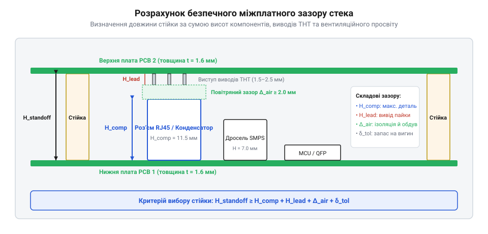
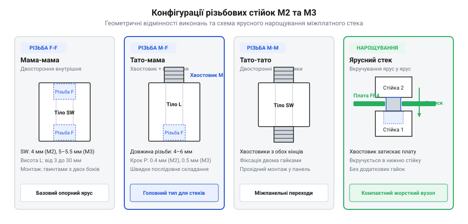
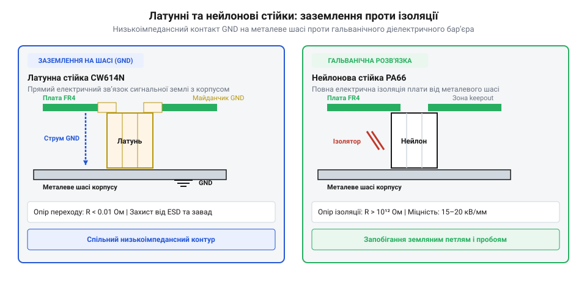

# Стійки М2/М3 (латунь, нейлон)

<preknowlist>
- [Набори гвинтів М3 (шестигранник, потайні DIN7991)](root:cat-hw-parts/m3-screw-kits) — принципи підбору сумісної різьби та типів голівок гвинтів для фіксації в стійках
- [Болти М5/М6 і шайби М3/М4](root:cat-hw-parts/bolts-and-washers) — призначення металевих та ізоляційних шайб М3 для розподілу навантаження й захисту текстоліту
</preknowlist>

## Чому плати не можна кріпити впритул

Коли на розкрученому робочому столі вперше з'єднуються готові друковані плати (англ. *Printed Circuit Board*, @@en|PCB@@) та металевий корпус, виникає спокуса прикрутити текстолітову пластину безпосередньо до металевої основи шасі. Проте безпосередній контакт друкованої плати з провідною або навіть ізольованою поверхнею — це прямий шлях до миттєвого виходу електроніки з ладу. На нижній стороні будь-якого електронного вузла виступають гострі паяні виводи елементів крізь отвори (англ. *Through-Hole Technology*, @@en|THT@@), металеві майданчики елементів поверхневого монтажу (англ. *Surface-Mount Device*, @@en|SMD@@) та відкриті контактні перехідні отвори.

Якщо притиснути плату впритул до металевого шасі, струмопровідні доріжки та виводи компонентів замкнуться між собою або на спільну масу корпусу. Виникає неконтрольоване коротке замикання (англ. *short circuit*, @@en|short circuit@@), яке випалює живильні провідники, пошкоджує чутливі мікроконтролери та створює пожежну небезпеку. Навіть коли основа корпусу виконана з діелектрика (пластику чи дикту), притискання плати впритул залишається небезпечним. Паяні виводи мають різну довжину й крихкі зрізи. При затягуванні кутових гвинтів поодинокі гострі стрижні виводів впираються в жорстку дну поверхню, працюючи як точкові опори. Це призводить до нерівномірного розподілу зусилля й локального вигину основи зі склотекстоліту (англ. *Flame Retardant 4*, @@en|FR-4@@).

Механічний згин плати створює високі напруження зсуву всередині матеріалу. В результаті шари текстоліту розшаровуються, а в крихких паяних з'єднаннях мікросхем у корпусах з масивом кулькових виводів (англ. *Ball Grid Array*, @@en|BGA@@) та дрібних SMD-конденсаторах виникають внутрішні мікротріщини. З часом під дією температурних коливань такі тріщини розривають електричний контакт, викликаючи плаваючі відмови пристрою. Щоб рівномірно розподілити зусилля на кутових кріпильних отворах і захистити матеріал плати від локальних продавлювань, під голівки гвинтів та під основи стійок завжди встановлюють металеві або [ізоляційні шайби](root:cat-hw-parts/bolts-and-washers).

Окрім електричного захисту та механічної цілісності, повітряний проміжок під платою відіграє вирішальну роль у теплообміні. Силові транзистори, диодні мости та процесори виділяють значну кількість тепла, яке розсіюється не лише у верхній простір, але й через мідні шари друкованої плати на її зворотний бік. Без повітряного зазору (англ. *clearance*, @@en|clearance@@) під платою утворюється замкнена теплова пастка: природна конвекція повітря повністю припиняється, температура плати зростає на 15–25 °C, що прискорює деградацію напівпровідникових кристалів та електролітичних конденсаторів. Для забезпечення стабільного охолодження та вирівнювання внутрішнього тиску в герметичних блоках додатково монтують [вентиляційні захисні мембрани](root:cat-hw-parts/eptfe-protective-vents).

Розрахунок безпечної висоти міжплатного або корпусного зазору виконують за геометричними габаритами найвищих виступаючих елементів. Повна висота зазору повинна враховувати висоту нижніх SMD-компонентів, технологічний виступ THT-виводів та необхідний запас для конвекційного потоку повітря.

Необхідну мінімальну висоту зазору `h_min` визначають як суму трьох складових: висоти найвищого компонента на зворотній стороні плати `h_comp`, максимальної довжини виступу паяних виводів `h_lead` та безпечного повітряного проміжку `h_air`:

```
h_min = h_comp + h_lead + h_air
```

Де:
- `h_min` — підсумкова мінімальна висота міжплатної дистанційної стійки (мм);
- `h_comp` — висота найвищого компонента, змонтованого на нижній площині верхньої плати (мм);
- `h_lead` — максимальна довжина виступів паяних виводів THT-компонентів після обрізки (мм);
- `h_air` — гарантований вентиляційний та ізоляційний зазор (мм), який для низьковольтних схем приймають не менше 1.5–2.0 мм.

Розглянемо практичний розрахунок зазору для силового платного стека.

**Розрахунок мінімальної висоти міжплатної стійки:**
```
h_comp = 3.2 мм      [висота SMD-індуктивності на нижній стороні верхньої плати]
h_lead = 1.8 мм      [виступ зрізаних виводів силового трансформатора]
h_air  = 2.0 мм      [мінімальний конвекційний повітряний зазор]
h_min  = 3.2 + 1.8 + 2.0
       = 7.0 мм      [необхідна стандартна висота дистанційної стійки]
```

Отримане значення `7.0 мм` округлюють до найближчої більшої стандартної висоти стійки (наприклад, 8.0 мм чи 10.0 мм). Це гарантує відсутність механічного торкання компонентів навіть при вібраціях або незначному прогині текстоліту. Щоб компенсувати динамічні удари та уникнути втомних руйнувань кріплення в рухомих або автомобільних системах, застосовують додаткову [амортизацію при вібраціях](root:hw-pcb/pcb-vibration-and-shock-mounting).


*Конструктивні зазори міжплатного стека та визначення мінімальної висоти дистанційної стійки.*

## Конструкції та конфігурації різьбових стійок

Для створення фіксованого зазору та надійного зв'язку між платами або корпусом використовують спеціалізовану різьбову фурнітуру — дистанційні стійки (англ. *stand off* — триматися на відстані, @@en|standoff@@). Стійка являє собою шестигранний або циліндричний пруток із геометрично точно нарізаною зовнішньою або внутрішньою метричною різьбою. Шестигранна форма корпусу обрана не випадково: вона дозволяє зручно утримувати стійку рожковим ключем або шестигранною торцевою головкою під час закручування гвинта, запобігаючи провертанню деталі на текстоліті.

За конфігурацією різьбових закінчень дистанційні стійки поділяють на три базові конструктивні типи:

1. **«Мама-мама»** (англ. @@en|Female-Female standoff@@) — стійка з внутрішньою різьбою з обох боків шестигранного тіла. Різьбовий отвір може бути наскрізним (для коротких стійок) або двох глухих зустрічних отворів (для довгих деталей). Стійки цього типу застосовують для фіксації плати між двома зовнішніми гвинтами, коли прикривання здійснюється як з боку корпусу, так і з боку плати. 2. **«Тато-мама»** (англ. @@en|Male-Female standoff@@) — стійка, що має внутрішню різьбу з одного торця та виступаючий різьбовий хвостовик (зовнішню різьбу) з протилежного торця. Ця конфігурація є найпопулярнішою для побудови багаторівневих стеків. Хвостовик нижньої стійки проходить крізь отвір плати й укручується безпосередньо у внутрішню різьбу наступної стійки верхнього поверху, що дозволяє нарощувати кількість плат без використання довгих шпильок. 3. **«Тато-тато»** (англ. @@en|Male-Male standoff@@) — стійка із зовнішньою різьбою на обох торцях. Застосовується рідше, переважно для з'єднання двох вузлів із внутрішньою різьбою, фіксації спецкронштейнів або монтажу в різьбові отвори товстостінних металевих панелей.


*Конструктивні типи різьбових стійок та їхні різьбові елементи.*

Еволюція міжплатного монтажу у радіоелектроніці пройшла шлях від об'ємного джгутового з'єднання блоків на громіздких металевих шасі до надкомпактних багаторівневих стеків друкованих плат. У середині XX століття електронні лампи та перші транзистори монтувалися на ізоляційних керамічних або гетинаксових стійках вручну, а з'єднання виконувалися гнучкими проводами. Із появою друкованого монтажу та масовим впровадженням мікросхем виникла потреба у жорсткій фіксації декількох паралельних плат у єдиний блок. Це спричинило стандартизацію метричних різьб `@@en|M2@@` (крок 0.4 мм) та `@@en|M3@@` (крок 0.5 мм) для дрібної фурнітури. Метрична різьба `@@en|M2@@` стала стандартом для портативної електроніки, безпілотників та польотних контролерів, тоді як `@@en|M3@@` закріпилася у персональних комп'ютерах, материнських платах та промислових контролерах. Створення уніфікованих геометрій «мама-мама», «тато-мама» та «тато-тато» дозволило інженерам легко балансувати між електричною ізоляцією, заземленням металевого корпусу та мініатюризацією міжплатних зазорів.

Для зручного підбору кріплення під час збирання багаторівневих блоків майстерні та лабораторії використовують спеціальний [органайзер для деталей](root:cat-hw-parts/parts-organizer), який запобігає перемішуванню дрібних металевих і пластикових елементів. При монтажі систем із підвищеними вимогами до компактності поруч із `@@en|M2@@` часто застосовують [набір кріплення M2.5](root:cat-hw-parts/m25-fastener-kit). Для більшості стаціонарних плат стандартним вибором залишаються [набори гвинтів M3](root:cat-hw-parts/m3-screw-kits), які ідеально підходять за кріпильними отворами до дистанційних стійок відповідного розміру.

Під час вибору геометричного розміру стійки критично важливо враховувати довжину зовнішнього різьбового хвостовика `L_stud` та глибину внутрішньої різьби `L_thread`. Якщо товщина друкованої плати становить 1.6 мм, а довжина хвостовика стійки — 6.0 мм, то при вкручуванні стійки «тато-мама» у нижню стійку з глибиною різьби 4.0 мм хвостовик упреться в дно отвору раніше, ніж шестигранна основа притисне текстоліт. Це призведе до люфту плати або зриву різьби. Точні геометричні допуски, глибину нарізання різьби та стандартні довжини хвостовиків містить [довідник геометричних параметрів](root:cat-hw-parts/standoffs/api-m2-m3-standoffs-spec.md).

Для запобігання самочинному відгвинчуванню стійок від вібрацій при експлуатації на різьбові з'єднання наносять анаеробні [фіксатори різьбових з'єднань](root:cat-hw-parts/thread-locking-methods). А розрахунок допустимого моменту затягування для запобігання зрізанню витків наведено у матеріалі про [розрахунок крутного моменту](root:cat-hw-parts/standoffs/math-standoff-mechanics-and-tolerances.md).

## Латунь чи нейлон для міжплатного монтажу

Окрім геометрії та типу різьби, принциповим критерієм вибору дистанційної стійки є матеріал, з якого її виготовлено. У сучасній радіоелектроніці панують два основні матеріали: латунь (англ. *brass*, давн.-англ. *bræs*, @@en|brass@@) та нейлон (поліамід PA66, грец. *poly* — багато та франц. *amide*, @@en|polyamide@@). Кожен із них має кардинально протилежні електричні, механічні та термічні властивості, що визначає сферу їх застосування.

Латунні стійки виготовляють із мідно-цинкового сплаву, найчастіше з покриттям нікелем для захисту від окиснення та корозії. Латунь має низький питомий електричний опір, високу механічну міцність і відмінну теплопровідність.

Головні переваги та особливості латунних стійок:
- **Електричне заземлення та ЕМП-екранування:** Металева стійка створює надійний низькоомний гальванічний контакт між заземлювальним кільцем (англ. @@en|GND ring@@) друкованої плати та металевим шасі корпусу. Це необхідно для скидання статичної електрики (англ. *Electrostatic Discharge*, @@en|ESD@@), відведення високочастотних струмів завад та створення суцільного екранованого контуру проти електромагнітних завад (англ. *Electromagnetic Interference*, @@en|EMI@@). - **Висока жорсткість та витривалість:** Латунь витримує значні механічні навантаження на розрив і зсув, не деформується з часом під дією постійного стискання та витримує сотні циклів повторного розбирання й збирання без пошкодження різьби. - **Теплопровідність:** Металева стійка працює як додатковий місток для відведення тепла від мідних контактних майданчиків плати на масивну металеву основу корпусу.

Нейлонові стійки виготовляють із технічного поліаміду PA66, іноді з додаванням скловолокна для підвищення жорсткості. Нейлон є високоякісним діелектриком із питомим об'ємним опором понад `10¹² Ω·cm`.

Головні переваги та особливості нейлонових стійок:
- **Повна гальванічна ізоляція:** Нейлонові стійки повністю виключають електричний контакт між платою та корпусом або між сусідніми платами у стекі. Це небажано для аналогових вимірювальних схем, де наявність спільних точок заземлення створює паразитні земляні петлі (англ. @@en|ground loop@@), які наводять мережеві завади та шуми на чутливі датчики. - **Мала маса:** Нейлон майже у 7 разів легший за латунь. У авіоніці, квадрокоптерах та переносних приладах використання нейлонових стійок дозволяє заощадити десятки грамів ваги. - **Хімічна інертність та корозійна стійкість:** Нейлон не піддається корозії у вологому або агресивному середовищі, не боїться солоного туману та хімічних реагентів. - **Амортизаційні властивості:** Завдяки відносній пружності полімеру нейлонові стійки частково поглинають високочастотні вібрації, запобігаючи передачі ударних навантажень на плату.

Разом із тим нейлон має суттєві обмеження: він розм'якшується при температурах понад 85–100 °C, має значно нижчий граничний крутний момент (англ. @@en|torque@@) затягування (різьба М3 в нейлоні зрізається вже при моменту близько 0.2–0.25 N·m) і схильний до пластичної повзучості (англ. @@en|creep@@) під постійним механічним напруженням.


*Електрична поведінка міжплатного вузла при використанні латунних та нейлонових стійок.*

У складних електронних приладах часто застосовують комбінований підхід: нижню силову плату монтують на латунних стійках для створення спільного заземлення з корпусом, а верхню аналогову або контролерну плату ізолюють нейлоновими стійками. Для детального вивчення правильної побудови таких систем рекомендується переглянути покроковий проект про [вирівнювання потенціалів корпусу](root:hw-pcb/pcb-grounding-and-chassis-bonding) та практичне [збирання міжплатного стека](root:cat-hw-parts/standoffs/proj-multi-board-stack-assembly.md).

У прототипах або лабораторіях для швидкого кріплення допоміжних платок замість різьбових стійок іноді тимчасово використовують [неодимові магніти](root:cat-hw-parts/neodymium-magnets), а для фіксації пластикових стійок на гладких поверхнях застосовують [ціаноакрилатний клей](root:cat-hw-parts/cyanoacrylate-glue). Для точного вибору геометричних параметрів і висоти сполучення міжплатних з'єднувачів перегляньте специфікацію на [міжплатні штирьові та гніздові роз'єми](root:cat-hw-parts/pin-headers-stacking-spec).

## Розрахунок висоти стійок і зазорів

Пряме розташування друкованих плат (@@en|PCB@@, від англ. *Printed Circuit Board* — плата з витравленими провідниками) одна над одною без урахування об'ємних габаритів створює ризик механічного заклинювання деталей та короткого замикання. Кожен електронний компонент має власну висоту корпусу, а монтажні ніжки та паяні контакти виступають з протилежного боку текстоліту. Міжплатна стійка (@@en|standoff@@, від англ. *stand off* — триматися на відстані) мусить забезпечувати таку висоту зазору, щоб між найвищим компонентом нижньої плати та найнижчою точкою виводів верхньої плати залишався безпечний повітряний проміжок (@@en|clearance@@, від англ. *clear* — вільний).


*Геометричний розподіл міжплатного зазору h_min та визначення необхідної висоти стійки.*

Мінімально допустима висота міжплатної стійки `h_min` складається з трьох фізичних величин та додаткового технологічного запасу. Перша величина — це висота найвищого компонента на нижній платі `h_comp`, виміряна від поверхні текстоліту до верхівки корпусу деталі (наприклад, електролітичного конденсатора чи силового індуктора). Друга величина — максимальна довжина виступів паяних виводів `h_lead` на нижній стороні верхньої плати. Третя величина — необхідний вентиляційний та ізоляційний проміжок `h_air`, який запобігає електричному пробою та створює канал для конвекційного відведення тепла. Для врахування відхилень товщини плат та допусків виготовлення додають сумарну похибку `Δh`.

Розрахунок мінімальної висоти стійки виконують за формулою:

h_min = h_comp + h_lead + h_air + Δh      [сумування висот компонентів та технологічних зазорів]

Значення `h_comp` визначають за кресленнями найвищих елементів на платі. Параметр `h_lead` для класичного монтажу в отвори становить від 1.5 мм до 2.5 мм, тоді як для поверхневого монтажу (SMD) цей параметр дорівнює нулю. Мінімальний повітряний зазор `h_air` обирають не менше 1.5–2.0 мм для пасивного охолодження. Похибка `Δh` зазвичай становить 0.3–0.5 мм.

Якщо в міжплатному просторі розміщено штирьові з'єднувачі (@@en|pin header@@, від англ. *pin header* — вилка роз'єму), висота стійки повинна чітко відповідати висоті з'єднаного стану вилки та гнізда, щоб відсутність співвісності не створювала вигинальних напружень у точках пайки. При наявності гарячих силових транзисторів або перетворювачів зазор `h_air` збільшують до 4–6 мм для запобігання утворенню теплової пастки. В обмежених герметичних корпусах для вирівнювання тиску та відведення вологи застосовують [захисні вентиляційні мембрани](root:cat-hw-parts/eptfe-protective-vents), які підтримують циркуляцію повітря.

Після розрахунку отримане значення `h_min` округлюють у більший бік до найближчого стандартного розміру. Стандартний ряд довжин для стійок М2 та М3 становить 4, 5, 6, 8, 10, 12, 15, 18, 20 мм. Точні геометричні розміри та довжини різьбових хвостовиків наведено в [специфікаціях різьбових стійок](root:cat-hw-parts/standoffs/api-m2-m3-standoffs-spec.md).

**Розрахунок висоти стійки для двоплатного стека живлення**

Потрібно обрати довжину стійок для з'єднання плати контролера з верхньою платою драйверів двигунів. На нижній платі встановлено силовий конденсатор заввишки `h_comp = 8.2 мм`. На зворотному боці верхньої плати є виводи роз'ємів завдовжки `h_lead = 1.8 мм`. Необхідний конвекційний зазор для охолодження становить `h_air = 2.5 мм`, а технологічний допуск `Δh = 0.5 мм`.

```
h_min = 8.2 + 1.8 + 2.5 + 0.5
      = 13.0 мм                    [мінімальна необхідна висота стійки]
```

Оскільки стійки заввишки 13.0 мм не належать до стандартного розмірного ряду, обираємо найближчу більшу стандартну стійку завдовжки 15 мм. Це забезпечує додатковий вентиляційний простір 2 мм і повністю виключає ризик механічного торкання компонентів.

## Монтаж стійок і запобігання деформаціям

Точні геометричні розрахунки не захистят електронний вузол від відмови, якщо під час складання виникнуть локальні механічні напруження або зіпсується різьба. Текстоліт друкованої плати має високу жорсткість на вигин, але під дією нерівномірного притискання кріплення вигинається. Це створює напруження в крихких керамічних конденсаторах та паяних кульках мікросхем, призводячи до появи мікротріщин.


*Послідовність затягування нарізного кріплення по діагоналі для запобігання перекосу плати.*

Затягування гвинтів на чотирьох або більше стійках за годинниковою стрілкою по черзі вигинає плату пропелером, оскільки перший кут фіксується жорстко, а протилежний піднімається. Щоб уникнути деформації, монтаж виконують у два етапи. На першому етапі всі гвинти закручують вручну до торкання голівки з платою. На другому етапі застосовують діагональну послідовність затягування: спочатку затягують один кут, потім діагонально протилежний, і лише після цього — інші два кути. Для розподілу тиску під голівки гвинтів та гайки обов'язково підкладають [металеві та ізоляційні шайби](root:cat-hw-parts/bolts-and-washers), які захищають маску плати від стирання.

Під час фіксації кріплення критично важливо дотримуватися допустимого крутного моменту (@@en|torque@@, від лат. *torquere* — скручувати). Для фіксації кріплення зручно використовувати [набори гвинтів М3](root:cat-hw-parts/m3-screw-kits) відповідної довжини. При перевищенні моменту у латунних стійках М2 або М3 зрізається зовнішнє різьблення, а в нейлонових стійках зминаються внутрішні витки поліаміду. Граничний момент затягування розраховують за виразом:

M_max = K · d · F_preload      [граничний крутний момент затягування різьби]

У цій формулі `K` — коефіцієнт тертя різьбової пари (0.15–0.20 для сухої латуні, 0.12–0.15 для поліаміду), `d` — номінальний діаметр різьби у метрах (0.002 м для М2 та 0.003 м для М3), а `F_preload` — допустиме осьове зусилля попереднього затягування (@@en|preload@@, від англ. *pre-load* — попереднє навантаження). Для нейлону М3 допустимий момент `M_max` не повинен перевищувати 0.18–0.20 Н·м, тоді як латунь М3 витримує до 0.55–0.60 Н·м. Детальні [механічні розрахунки затягування](root:cat-hw-parts/standoffs/math-standoff-mechanics-and-tolerances.md) дають змогу обрати точні моменти для кожного матеріалу.

Нейлонові стійки мають схильність до термічної плинності (@@en|creep@@, від англ. *creep* — повільне деформування під навантаженням). З часом під постійним стисканням поліамід релаксує, і осьовий притиск зменшується, що призводить до самовідкручування гвинтів при вібраціях. Для захисту від послаблення різьби в металевих стійках застосовують рідкі анаеробні [фіксатори різьбових з'єднань](root:cat-hw-parts/thread-locking-methods). Проте використовувати рідкі хімічні фіксатори на нейлонових стійках суворо заборонено: хімічні розчинники в їхньому складі руйнують структуру поліаміду, викликаючи його розтріскування. Нейлонові з'єднання фіксують виключно механічними засобами — самоконтруючими гайками з нейлоновим вкладишем або пружинними шайбами.

При побудові багатоярусних конструкцій використовують комбінацію стійок типу «мама-мама» та «тато-мама». Процес кріплення та правильне розведення контурів заземлення для усунення земляних петель (@@en|ground loop@@, від англ. *ground loop* — замкнений електричний контур) розкрито у практичному керівництві на [збирання багаторівневого стека](root:cat-hw-parts/standoffs/proj-multi-board-stack-assembly.md). Латунні стійки забезпечують низькоімпедансний електричний контакт із металевим шасі, реалізуючи [заземлення друкованих плат](root:hw-pcb/pcb-grounding-and-chassis-bonding) для екранування від електромагнітних завад. Якщо ж плата вимагає гальванічної розв'язки, використовують нейлонові стійки.

Для пристроїв, що працюють в умовах ударів та трясіння, стійки доповнюють гумовими або силікон-демпфуючими елементами. Заходи щодо захисту від механічних перевантажень деталізовано в матеріалі про [амортизацію платного стека](root:hw-pcb/pcb-vibration-and-shock-mounting).