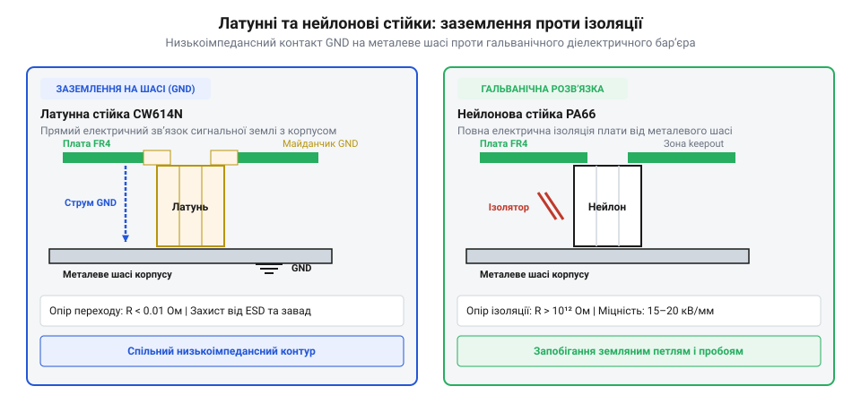

# Стійки М2/М3 (латунь, нейлон)

<preknowlist>
- [Набори гвинтів М3 (шестигранник, потайні DIN7991)](root:cat-hw-parts/m3-screw-kits) — типи метричної різьби та підбір сумісних гвинтів для нарізних отворів стійок
- [Болти М5/М6 і шайби М3/М4](root:cat-hw-parts/bolts-and-washers) — використання металевих та діелектричних шайб для рівномірного розподілу навантаження на текстоліт
</preknowlist>

## Небезпека кріплення плат упритул

Під час складання радіоелектронних пристроїв монтаж друкованої плати впритул до металевого шасі або сусідньої плати призводить до миттєвих аварій. Головна небезпека — електричне коротке замикання (від лат. *circuitus brevis*, @@en|short circuit@@). Гострі паяні виводи наскрізних компонентів (THT) та контактні площадки SMD-елементів на нижньому боці плати торкаються провідного металу корпусу, випалюючи доріжки живлення та напівпровідникові мікросхеми.

Другий фактор ризику — механічна деформація. Шасі приладу ніколи не є абсолютно плоским. Якщо притиснути склотекстоліт FR-4 гвинтами безпосередньо до площини, плата вигинається під напругою. Цей згин спричиняє мікротріщини у крихких багатошарових керамічних конденсаторах (MLCC) і відриває кулькові виводи BGA-чипів. Крім того, відсутність проміжку блокує вільний рух повітря. Без конвекції (від лат. *convectio* — перенесення, @@en|convection@@) тепло від стабілізаторів напруги та транзисторів накопичується під платою, спричиняючи локальний перегрів. Для усунення цих проблем застосовують дистанційні стійки (від англ. *stand off* — триматися на відстані, @@en|standoff@@), які формують фіксований повітряний проміжок.

## Конструкції стійок та вибір матеріалу

Дистанційні стійки різняться типом нарізної частини для одиночного кріплення або складання поверхових етажерок:

1. «Мама-мама» (англ. *female-female*, @@en|female-female standoff@@) — наскрізна або глуха внутрішня різьба з обох боків. Використовується для встановлення плати на шасі за допомогою двох окремих гвинтів. 2. «Тато-мама» (англ. *male-female*, @@en|male-female standoff@@) — зовнішній нарізний штифт з одного боку та внутрішнє гніздо з іншого. Це основний елемент для побудови вертикальних стеків із кількох плат, де штифт нижньої стійки вкручується у верхню. 3. «Тато-тато» (англ. *male-male*, @@en|male-male standoff@@) — зовнішня різьба з обох кінців під глухі отвори та гайки.

Вибір матеріалу визначає електромагнітні властивості вузла:

*Вибір матеріалу стійки: латунь забезпечує електричний контакт із шасі, а нейлон гарантує ізоляцію кіл.*

Нікельована латунь має високу механічну міцність, витримує вібрації та забезпечує електричний контакт. Її використовують для заземлення (англ. *grounding*, @@en|grounding@@) сигнальної або силової землі плати на металевий корпус, створюючи замкнений екран від електромагнітних завад (від англ. *Electromagnetic Interference*, @@en|EMI shielding@@). Нейлон PA66 (поліамід 66, @@en|nylon@@) є діелектриком. Нейлонові стійки забезпечують гальванічну ізоляцію (англ. *galvanic isolation*, @@en|galvanic isolation@@), усуваючи паразитні земляні петлі (@@en|ground loop@@) між чутливими аналоговими та шумними цифровими блоками. До того ж нейлон легкий, стійкий до корозії й немагнітний.

## Розрахунок зазору та правила монтажу

Висоту стійки `h_standoff` вибирають так, щоб найвищі елементи нижнього боку плати не торкалися поверхні основи:

    h_min = h_comp + h_lead + h_air

де `h_comp` — висота компонентів на зворотному боці плати, `h_lead` — технологічний виступ паяних виводів (зазвичай 1.5–2.0 мм), `h_air` — захисний зазор для ізоляції та вентиляції (2.0–3.0 мм). Отримане значення округлюють у більший бік до стандартного ряду висот: 5, 6, 8, 10, 12, 15 або 20 мм.

Монтаж виконують за такими правилами:

- Затягування гвинтів ведуть по діагоналі (хрест-навхрест) у два проходи, щоб уникнути перекосу текстоліту. - Під головки металевих гвинтів та гайок підкладають [болти та шайби М3](root:cat-hw-parts/bolts-and-washers), які захищають захисну паяльну маску від здирання. - Момент затягування суворо обмежують: для латунних стійок М3 — не більше 0.5–0.6 Н·м, а для нейлонових — 0.15–0.20 Н·м, оскільки пластикова різьба легко зривається. - Для фіксації нейлонових стійок категорично заборонено застосовувати рідкі анаеробні фіксатори різьби: хімічні розчинники розчиняють поліамід, викликаючи миттєве розтріскування. Для надійності використовують самоконтрувальні гайки з поліамідним кільцем або сумісні [набори гвинтів М3 з потайною головкою DIN7991](root:cat-hw-parts/m3-screw-kits).