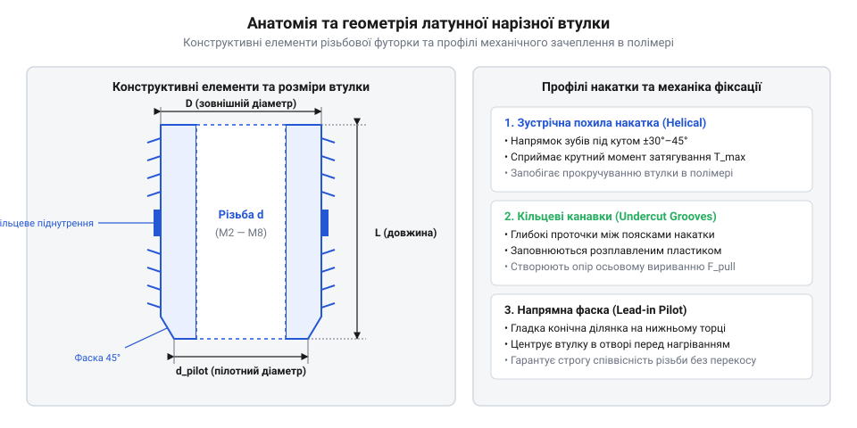
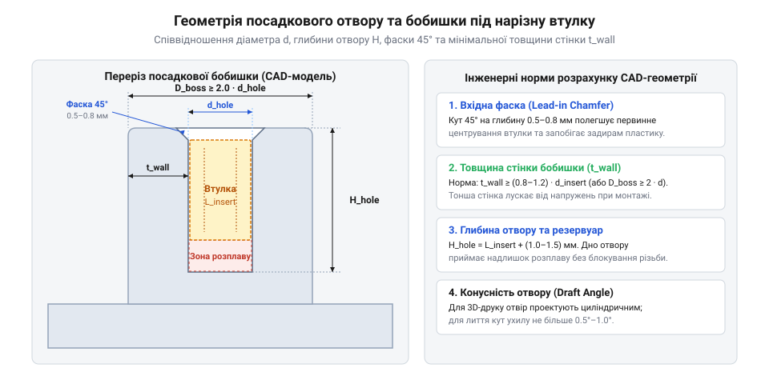
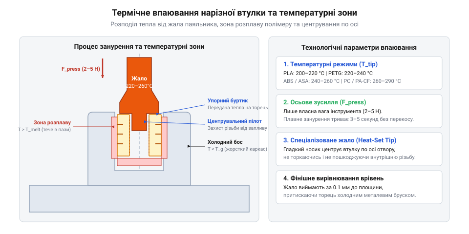
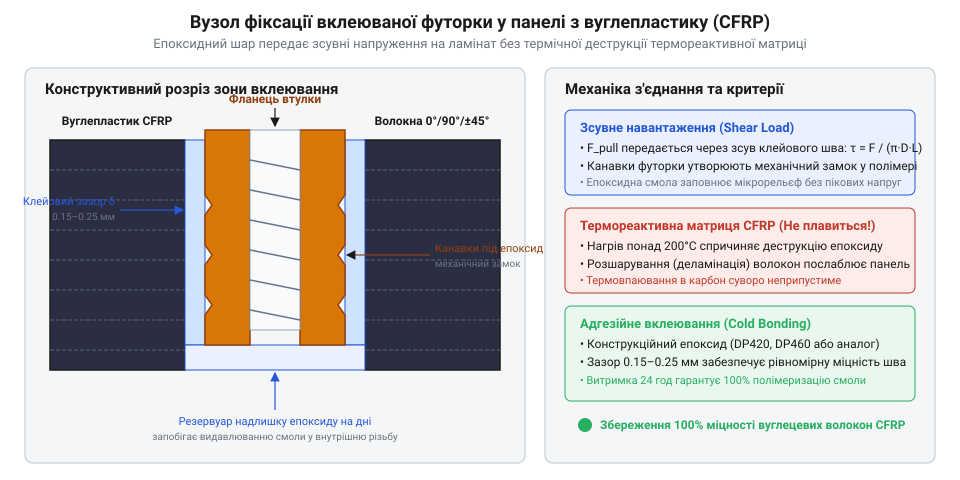

# Технічні специфікації, стандарти та посадкові розміри нарізних втулок

<preknowlist>
- [Класи міцності та матеріали кріплення: сталі 8.8–12.9, нержавійка A2/A4, титан Gr5 та задирання різьби](root:cat-hw-parts/fastener-strength-classes-and-materials) — механічні характеристики металевих різьбових елементів, розрахунок допустимих моментів затягування та міцність різьбових з'єднань при зовнішньому навантаженні
</preknowlist>

## Зрив різьби в пластикових корпусах

Пряме загвинчування @@en|fasteners@@ або формування внутрішньої різьби безпосередньо в полімерному елементі — такому як @@en|plastic boss@@ (від англійського @@en|plastic boss@@, циліндричний приплив корпусу або бос) — стає першопричиною швидкого механічного руйнування різьбового з'єднання при виниканні повторюваних @@en|assembly-disassembly cycles@@ (з англійської @@en|assembly-disassembly cycles@@, циклів збирання та розбирання). Конструктори та розробники приладових корпусів часто намагаються спростити технологічний процес і зменшити собівартість виробу, відмовляючись від металевих армуючих елементів на користь прямого нарізання витків у пластиковому масиві або застосування самонарізних гвинтів. Проте таке рішення створює критичне конструктивне вузьке місце, оскільки механічні характеристики в'язкопластичних термопластів фундаментально не узгоджуються з локальними напруженнями, які виникають під час затягування металевого різьбового метизу. У порівнянні з [високоміцними сталевими метизами](root:cat-hw-parts/fastener-strength-classes-and-materials), де межа міцності матеріалу вимірюється сотнями або тисячами мегапаскалів, міцність на зріз термопластичних матриць (PLA, PETG, ABS, полікарбонат @@en|polycarbonate@@ чи поліамід @@en|polyamide@@) перебуває в діапазоні від 20 до 80 МПа.

Під дією нормального @@en|tightening torque@@ (з англійської @@en|tightening torque@@, крутильного моменту затягування) у різьбовому зчепленні виникає значне @@en|axial tensile load@@ (з англійської @@en|axial tensile load@@, осьове розтягувальне зусилля). Це зусилля передається крізь візок внутрішньої різьби пластикового босу, викликаючи сильну концентрацію @@en|shear stress@@ (з англійської @@en|shear stress@@, дотичних напружень зрізу) на вершинах та западинах м'яких полімерних витків. Оскільки модуль пружності термопластів у десятки разів нижчий за модуль пружності сталі чи латуні, пластиковий виток зазнає пластичної деформації при досягненні критичного рівня навантаження. Постійне стискальне навантаження викликає специфічний фізичний процес — @@en|creep phenomenon@@ (з англійської @@en|creep phenomenon@@, повзучість полімеру), при якому пластикова матриця повільно деформується у часі навіть за незмінної сили затиску. Внаслідок цього виникає @@en|stress relaxation@@ (з англійської @@en|stress relaxation@@, релаксація напружень) і неминуча @@en|preload loss@@ (з англійської @@en|preload loss@@, втрата попереднього натягу) з'єднання, що призводить до самовільного послаблення кріплення, виникнення люфтів та мікрозміщень під дією вібрацій.

Спроба повторно затягнути гвинт або підтягнути ослаблене з'єднання неминуче завершується повним зрізанням витків полімеру. Металевий гвинт зрізає слабкі витки внутрішньої різьби, перетворюючи отвір у циліндричне розточування без жодного механічного зачеплення. Тонкостінний полімерний приплив зазнає незворотної [деформації пластикового босу](#plastic-boss-thread-stripping), що супроводжується появою радіальних тріщин уздовж твірної циліндра під дією @@en|hoop stress@@ (з англійської @@en|hoop stress@@, колових напружень розтягу). Циклічні механічні навантаження, температурні коливання та вплив вібраційних полів прискорюють утворення мікротріщин у зоні концентраторів напружень. В результаті корпусний елемент втрачає несучу здатність, а ремонт з'єднання без заміни всієї деталі стає неможливим.

Фізичну природу руйнування полімерної різьби описує співвідношення між осьовою силою затягування та площею зрізу витків. Середнє дотичне напруження зрізу в пластиковому витку обчислюється за формулою:

```
tau = F_a / (pi · d · h_e · k_m)
    = F_a / (3.1416 · d · h_e · 0.75)      [обчислення дотичного напруження зрізу в полімері]
```

Де `tau` — дотичне напруження зрізу (@@en|shear stress@@), `F_a` — осьове затискне зусилля (@@en|axial tensile load@@), `d` — зовнішній діаметр внутрішньої різьби (@@en|nominal diameter@@), `h_e` — глибина зачеплення різьби (@@en|engagement length@@), `k_m` — коефіцієнт повноти профілю зрізу полімеру (@@en|shear factor@@, що прийнято дорівнює 0.75 для зрізу полімерних витків).

Якщо розраховане напруження `tau` перевищує допустиму межу міцності термопласту на зріз `tau_ult`, відбувається катастрофічний зсув матеріалу — @@en|thread stripping@@ (з англійської @@en|thread stripping@@, зрив різьби).

Єдиним надійним інженерним розв'язком цієї проблеми є інтеграція металевих армуючих елементів — [нарізних втулок](root:cat-hw-parts/threaded-inserts-and-heat-set) (з англійської @@en|threaded inserts@@, металевих нарізних вставок або футорок). Металева втулка перерозподіляє високе локальне навантаження від сталевого гвинта на значно більшу зовнішню площу контакту з полімерною матрицею босу. Зовнішня поверхня втулки має спеціальну рельєфну структуру — @@en|knurling profile@@ (з англійської @@en|knurling profile@@, рифлення або накатку) та опорні канавки, які механічно блокують прокручування та осьове виривання втулки у пластику. Це дозволяє поєднати високу технологічність і малу вагу пластикового корпусу з міцністю та довговічністю класичного металевого різьбового з'єднання, витримуючи сотні @@en|assembly-disassembly cycles@@ без найменшої втрати попереднього натягу.

## Специфікація розмірних рядів нарізних втулок

Перехід від прямого нарізання різьби у полімері до застосування металевих армувальних вставок вимагає точного аналізу їхніх конструктивних параметрів та стандартизованих розмірних рядів. У сучасній приладобудівній галузі та 3D-друку найбільшого поширення набули латунні (з англійської @@en|brass inserts@@) та нержавіючі (з англійської @@en|stainless steel inserts@@) термовтулки (@@en|heat-set inserts@@). Обираючи втулку під проєктне навантаження, конструктор не повинен обмежуватися лише номінальним різьбовим діаметром гвинта. Слід обов'язково враховувати крок внутрішньої метричної різьби (@@en|thread pitch@@), зовнішній діаметр циліндричного тіла, довжину втулки, профіль зовнішньої накатки (@@en|knurling profile@@), а також наявність вхідних фасок та утримуючих кільцевих канавок.

Стандартний розмірний ряд охоплює діаметри внутрішньої різьби від M2 до M8 згідно з метричним стандартом ISO. Кожен типорозмір розробляється для забезпечення визначеної несучої здатності з'єднання. Нижче наведено основні параметри стандартизованих серій термовтулок, що застосовуються у корпусах електронних пристроїв, безпілотних апаратів та промислової автоматики:

```
[Позначення]   [Крок різьби P, мм]   [Зовнішній D_out, мм]   [Довжина L, мм]   [Діаметр фаски D_ch, мм]
M2             0.40                  3.2 - 3.6               3.0 - 4.0         3.0
M2.5           0.45                  4.0 - 4.2               4.0 - 5.7         3.8
M3             0.50                  4.2 - 4.6               3.0 - 6.0         4.0
M4             0.70                  5.4 - 6.0               4.0 - 8.1         5.2
M5             0.80                  6.4 - 7.2               5.8 - 9.5         6.2
M6             1.00                  8.0 - 8.8               6.0 - 12.7        7.8
M8             1.25                  10.0 - 10.8             8.1 - 12.7        9.6
```


*Конструктивні параметри та варіанти зовнішньої накатки термовтулок M2–M8, що визначають опори крученню й вириванню.*

Ключову роль у сприйнятті зовнішніх механічних зусиль відіграє профіль геометричного рельєфу на зовнішній поверхні термовтулки. Виробники застосовують три основні типи зовнішньої накатки: ромбічну сітчасту накатку (з англійської @@en|diamond knurling@@), протилежно спрямовану похилу накатку (з англійської @@en|opposing helical knurling@@) та поздовжню пряму накатку (з англійської @@en|straight knurling@@), поєднану з кільцевими проточками (з англійської @@en|undercut grooves@@). Ромбічна та похила накатки формують зустрічні виступи, в які під час впаювання затікає розплавлений термопласт. Після застигання пластикові мікроклини блокують будь-які кутові зміщення, забезпечуючи високу опірність з'єднання проти @@en|torsional torque@@ (з англійської @@en|torsional torque@@, крутильного моменту прокручування) під час затягування гвинта.

Глибокі кільцеві проточки (@@en|undercut grooves@@) створюють замкнені радіальні уступи на циліндричному тілі футорки. Коли розплавлена полімерна матриця заповнює ці канавки, створюється надійний механічний замок, який сприймає осьове @@en|pullout force@@ (з англійської @@en|pullout force@@, виривне зусилля). Розрахунок площі зовнішнього силового контакту металевої вставочки з пластиковим босом здійснюється за співвідношенням:

```
A_outer = pi · D_out · L_eff
        = 3.1416 · D_out · L_eff      [обчислення площі зовнішнього циліндричного контакту]
```

Де `A_outer` — площа зовнішнього контакту, `D_out` — зовнішній діаметр втулки по вершинах накатки (@@en|outer diameter@@), `L_eff` — ефективна робоча довжина втулки (@@en|effective length@@). Спираючись на геометрію та узагальнену структуризацію [розмірних рядів вставок](#insert-dimension-standards), інженер має можливість узгодити несучу спроможність вузла з характеристиками з'єднуваного металевого кріплення й підійти до моделювання посадкового місця в CAD-системі.

## Проєктування посадкових отворів у CAD

Отримавши специфікації обраного типорозміру нарізної втулки, інженер переходить до етапу конструювання посадкового припливу (босу) у середовищі @@en|CAD design@@ (з англійської @@en|CAD design@@, комп'ютерного тривимірного моделювання). Помилки в розрахунку геометричних розмірів посадкового отвору призводять до катастрофічних наслідків: занадто малий діаметр отвору викликає колосальні радіальні розпираючі напруження під час гарячого монтажу, що спричиняє @@en|boss cracking@@ (з англійської @@en|boss cracking@@, розтріскування стінок пластикового босу), тоді як занадто великий діаметр отвору зменшує об'єм розплавленого пластику, падає опір прокручуванню та вириванню, або виникає @@en|flash formation@@ (з англійської @@en|flash formation@@, утворення облою та запливання рідкого полімеру) у внутрішню різьбу M2-M8.

Основою проєктування отвору під термовтулку є точний розрахунок посадкового діаметра циліндричного розточування з урахуванням @@en|volumetric shrinkage@@ (з англійської @@en|volumetric shrinkage@@, об'ємної усадки полімеру). Номінальний діаметр отвору в CAD-моделі повинен дорівнювати середньому між зовнішнім діаметром тіла втулки по впадинах накатки та діаметром по вершинах рельєфу. Для виробу, який виготовляється методом @@en|injection molding@@ (з англійської @@en|injection molding@@, лиття під тиском), отвір виконується з технологічним ливарним ухилом — @@en|draft angles@@ (з англійської @@en|draft angles@@, ливарними ухилами) у 0.5°–1.0° на бік. Для деталей, що друкуються на 3D-принтері, діаметр отвору в CAD додають на 0.1–0.2 мм порівняно з ливарним допуском через розширювання нитки пластику.

Верхня кромка посадкового отвору обов'язково повинна мати вхідну фаску — @@en|lead-in chamfer@@ (з англійської @@en|lead-in chamfer@@, кут вхідної фаски). Геометрично фаска виконується під кутом від 8° до 15° (або фаска 45° на глибину 0.4–0.6 мм), а її більший діаметр має перевищувати діаметр вхідної фаски самої втулки. Це створює посадкове гніздо для совісного самоцентрування втулки перед подачею тепла, запобігаючи кутовим перекосам та відхиленням перпендикулярності різьбової осі відносно базової площини.

Глибина посадкового отвору в CAD-моделі повинна перевищувати загальну висоту втулки щонайменше на 0.5–1.5 мм (або на 15-20% довжини втулки). На дні отвору утворюється технологічна порожнина — @@en|melt reservoir@@ (з англійської @@en|melt reservoir@@, резервуар для збору розплаву полімеру). Під час занурення нагрітої термовтулки надлишок витісненого пластику стікає в цей резервуар, замість того щоб підніматися вгору й затікати у внутрішню метричну різьбу.

Зовнішній діаметр пластикового босу вираховується виходячи з необхідної товщини оточуючих стінок — @@en|boss wall thickness@@ (з англійської @@en|boss wall thickness@@, товщини стінки припливу). Загальне інженерне правило вимагає, щоб мінімальна радіальна товщина стінки дорівнювала від 0.8 до 1.0 зовнішнього діаметра термовтулки `D_out`. Розрахунок зовнішнього діаметра босу здійснюється за формулою:

```
D_boss = D_hole + 2 · t_wall
       = D_hole + 2 · (0.85 · D_out)      [розрахунок зовнішнього діаметра босу в CAD]
```

Де `D_boss` — зовнішній діаметр припливу (@@en|outer boss diameter@@), `D_hole` — діаметр посадкового отвору (@@en|hole diameter@@), `t_wall` — товщина стінки босу (@@en|boss wall thickness@@), `D_out` — зовнішній діаметр термовтулки.


*Геометричний профіль посадкового місця в CAD з урахуванням кута вхідної фаски, резервуара розплаву та товщини стінок босу.*

Нижче зведено рекомендовані посадкові геометричні параметри для CAD-моделювання припливів під термовтулки серії M2–M8 для стандартних термопластів (ABS, PETG, PLA, PC):

```
[Різьба]   [Зовнішній D_out, мм]   [Отвір D_hole (CAD), мм]   [Глибина H_hole, мм]   [Діаметр босу D_boss, мм]
M2         3.2                     3.0 - 3.1                  4.5                    6.0 - 6.4
M2.5       4.0                     3.7 - 3.8                  5.0                    7.5 - 8.0
M3         4.6                     4.2 - 4.3                  6.0                    8.4 - 9.2
M4         6.0                     5.4 - 5.5                  7.5                    11.0 - 12.0
M5         7.1                     6.4 - 6.5                  9.0                    13.0 - 14.2
M6         8.6                     7.8 - 7.9                  11.0                   16.0 - 17.2
M8         10.4                    9.4 - 9.5                  14.0                   20.0 - 20.8
```

Ретельне дотримання точних допусків та коректного зчитування [геометрії посадкового отвору](#landing-hole-cad-geometry) застереже конструкцію від виникнення внутрішніх напружень та підготує деталь до вибору оптимального технологічного процесу гарячого впаювання або адгезивної фіксації.

## Режими термічного впаювання термовтулок

Після завершення розрахунку геометричних параметрів посадкового місця в CAD-системі інженер переходить до безпосередньої технологічної операції встановлення металевої футорки у полімерну матрицю. На цьому етапі виникає високий ризик недотримання теплового балансу та кінематики занурення: неправильно обраний температурний режим або неспіввісне прикладання зусилля призводить до двох критичних дефектів — кутового перекосу поздовжньої осі різьби та термічного розкладу полімеру з подальшим запливанням рідкої маси у внутрішні витки M2–M8. Технологія гарячого монтування, відома як @@en|heat-setting@@ (з англійської @@en|heat-setting@@, термічне впаювання або гаряче встановлення), базується на передачі теплової енергії від нагрітого металевого інструмента до тіла втулки з подальшим розплавленням вузької пристінкової зони пластикового босу.

Передача тепла до втулки реалізується за допомогою спеціального обладнання. Найбільш поширеним рішенням для дрібносерійного виробництва та прототипування є паяльник з терморегулятором, оснащений спеціальною змінною бронзовою або латунною насадкою-термоголівкою, геометричний профіль якої точно відповідає внутрішньому конусу та діаметру різьби. У промисловому виробництві застосовують ультразвуковий інструмент — @@en|ultrasonic insertion tool@@ (з англійської @@en|ultrasonic insertion tool@@, ультразвуковий монтажний інструмент), який передає на втулку високочастотні акустичні коливання (частотою від 20 до 40 кГц). Внаслідок високочастотного тертя між металом і полімером виділяється локальне тепло, що розплавляє прилеглий шар за мікросекунди. Незалежно від джерела тепла, монтажний інструмент має бути закріплений на вертикальній стійці з направляючими для виключення ручного рухомого люфту та забезпечення суворої перпендикулярності занурення.

Фізико-механічна поведінка пластику під час впаювання визначається його молекулярною структурою та термодинамічними переходами. Недогрів втулки нижче температури плинності полімеру змушує оператора прикладати надмірне осьове зусилля, що викликає високі залишкові механічні напруження, вигинання босу та утворення мікротріщин. Навпаки, перегрів спричиняє термічну деструкцію — розрив полімерних ланцюгів, виділення газоподібних продуктів розкладу, обвуглювання матеріалу та катастрофічне падіння в'язкості. Кожен конструкційний полімер має чітко визначене температурне вікно монтажу:

1. @@en|PLA@@ (з англійської @@en|PLA@@, polylactic acid, полімолочна кислота) володіє низькою температурою склування (55–60 °C) та термопластичним вікном впаювання 180–210 °C. Через високу плинність розплаву перегрів PLA негайно призводить до витікання пластику поверх втулки. 2. @@en|PETG@@ (з англійської @@en|PETG@@, polyethylene terephthalate glycol, поліетилентерефталатгліколь) вимагає температури 210–235 °C. Матеріал має помірну в'язкість і потребує плавної постійної швидкості подачі інструмента без затримок. 3. @@en|ABS@@ (з англійської @@en|ABS@@, acrylonitrile butadiene styrene, акрилонітрилбутадієнстирол) — аморфний полімер із широким високоеластичним плато, що монтується при 235–265 °C. Розплавлений ABS рівномірно заповнює канавки зовнішньої накатки без утворення вторинних напружень. 4. Полікарбонат @@en|polycarbonate@@ (з англійської @@en|polycarbonate@@, полікарбонат, PC) характеризується високою термостійкістю й вимагає нагріву інструмента до 270–305 °C. Висока в'язкість розплаву PC вимагає підвищеного притискного зусилля та повільного занурення для відпалу внутрішніх напружень. 5. @@en|PA-CF@@ (з англійської @@en|PA-CF@@, polyamide carbon fiber, поліамід, армований коротким вуглеволокном) монтується у вузькому інтервалі 265–290 °C. Наявність коротких дискретних вуглецевих волокон підвищує ефективну в'язкість розплаву та теплопровідність композиту, вимагаючи точного утримання температури для локального розплавлення поліамідної матриці навколо волокон.

Тепловий баланс процесу термічного занурення визначає кількість енергії `Q_req`, необхідну для переведення об'єму полімерного шару `V_melt` у стан плинності:

```
Q_req = rho · V_melt · (c_p · (T_ins - T_env) + H_m)
      = 1.25 · V_melt · (1.8 · (240 - 20) + 0)      [обчислення необхідної теплової енергії для ABS]
```

Де `rho` — густина полімеру (г/см³), `V_melt` — об'єм розплавленого пристінкового шару (см³), `c_p` — питома теплоємність (Дж/(г·K)), `T_ins` — температура впаювання (°C), `T_env` — початкова температура деталі (°C), `H_m` — питома теплота плавлення кристалічної фази (Дж/г, для аморфних полімерів `H_m = 0`).

Нижче зведено нормативні технологічні параметри гарячого монтажу термовтулок для основних термопластів:

```
[Матеріал]   [Температура T_ins, °C]   [В'язкість розплаву]   [Осьове зусилля, Н]   [Час занурення, с]
PLA          180 - 210                 Низька                 10 - 20               0.5 - 1.0
PETG         210 - 235                 Середня                15 - 25               1.0 - 1.5
ABS          235 - 265                 Помірно-низька         15 - 30               1.0 - 2.0
PC           270 - 305                 Висока                 30 - 50               2.0 - 3.0
PA-CF        265 - 290                 Дуже висока            35 - 60               2.0 - 3.5
```


*Динаміка термічного впаювання термовтулки: розподіл температурних зон розплаву полімеру та відведення надлишків пластику у технологічний резервуар.*

Для запобігання запливанню рідкого пластику у внутрішню метричну різьбу термоголівка інструмента повинна мати уступ, який перекриває верхній отвір втулки, а CAD-геометрія посадкового місця має містити розраховану фаску та резервуар розплаву. Після повного занурення втулки урівень з торцем босу слідує коротка технологічна витримка тривалістю 0.2–0.5 секунди, після чого нагрівальний інструмент вертикально відводиться вгору. Дотримуючись оптимальних графіків, що описують [температурні режими впаювання](#heat-setting-thermal-profiles), інженер гарантує монолітність полімерного замка та бездоганний стан внутрішніх витків.

## Монтаж вклеюваних футорок у карбон

Опанувавши технологію термічного впаювання в термопластичні матриці, конструктор стикається з фундаментальним технологічним обмеженням при роботі з високоміцними елементами з вуглепластику — @@en|carbon fiber reinforced polymer@@ (з англійської @@en|carbon fiber reinforced polymer@@, CFRP, композиту на основі вуглецевих волокон та реактопластичної матриці). Вуглепластики виготовляються на основі термореактивних епоксидних або поліефірних смол, які під дією температури не переходять у стан розплаву, а зазнають незворотної деструкції та обвуглювання. Спроба гарячого впаювання металевої термовтулки у деталь з CFRP призводить до вигоряння сполучної смоли, деламінації (розшарування) вуглецевих тканин та повного руйнування несучої спроможності вузла.

Для створення високоміцних різьбових точок у композитних панелях застосовують спеціальні вклеювані футорки — @@en|press-fit epoxy inserts@@ (з англійської @@en|press-fit epoxy inserts@@, вклеювані нарізні втулки або композиційні футорки). На відміну від термовтулок з дрібною сітчастою накаткою, вклеювані футорки мають зовнішній рельєф у вигляді глибоких кільцевих канавок, великих похилих пазів або різьбоподібних макропроточок, призначених для заповнення рідким або пастоподібним адгезивом. Монтажний отвір у вуглепластиковій панелі отримують прецизійним свердлінням твердосплавним або алмазним інструментом з метою запобігання розщепленню крайніх шарів ламінату. Діаметр отвору розраховують із забезпеченням рівномірного радіального клейового зазору в межах 0.15–0.30 мм на бік.

Вирішальним чинником надійності з'єднання є вибір двокомпонентної епоксидної системи — @@en|epoxy resins@@ (з англійської @@en|epoxy resins@@, епоксидні смоли та структурні адгезиви). Епоксидна смола повинна відповідати суворим реологічним вимогам: рідкі малов'язкі смоли стікають під дією гравітації з вертикальних та стельових отворів, викликуючи голодування клейового шва. Для адгезивного монтування застосовують тиксотропні епоксидні пасти. Тиксотропний адгезив легко деформується під тиском під час запресування футорки, але миттєво відновлює високу в'язкість у стаціонарному стані, утримуючи футорку від зміщення до завершення первинної полімеризації.

Час життєздатності (@@en|pot life@@) двокомпонентного адгезиву обирається в діапазоні від 15 до 45 хвилин для забезпечення комфортного позиціонування групи вставок на складальному кондукторі. Повна полімеризація епоксидної матриці відбудеться за 24 години при 20 °C або за 1-2 години при термічному загартуванні при 60–80 °C, досягаючи межі міцності на зсув понад 25–35 МПа.

Механізм передачі навантаження від металевої футорки до композитного ламінату базується на зсувній деформації суцільного клейового прошарку. Максимальне дотичне напруження `tau_max` у клейовому зазорі при дії осьового виривного зусилля обчислюється за співвідношенням:

```
tau_max = F_pullout / (pi · D_hole · L_bond)
        = F_pullout / (3.1416 · D_hole · L_bond)      [розрахунок зсувного напруження в епоксидному шві]
```

Де `F_pullout` — розрахункове виривне зусилля (Н), `D_hole` — діаметр отвору в карбоновій панелі (мм), `L_bond` — ефективна довжина клейового контакту (мм).


*Конструкція вузла фіксації вклеюваної футорки в ламінаті CFRP: шар епоксидного адгезиву, макронасічки та зона передачі виривного навантаження.*

При проєктуванні з'єднань металу з вуглепластиком необхідно враховувати явище гальванічної корозії: вуглецеве волокно є електрохімічно благородним матеріалом, і його прямий контакт із звичайною конструкційною сталлю або алюмінієвими сплавами у вологому середовищі викликає швидке руйнування металу. Тому вклеювані футорки для CFRP виготовляють із аустенітної нержавіючої сталі A2/A4 або титанових сплавів, відповідаючи вимогам, що пред'являються до [класів міцності кріплення](root:cat-hw-parts/fastener-strength-classes-and-materials). Суцільний шар епоксидного адгезиву виконує додаткову роль диелектричного ізоляційного бар'єра. Конструктивні [особливості адгезивного монтування](#epoxy-press-fit-inserts) узгоджують з розрахованою [механікою виривного зусилля](root:cat-hw-parts/threaded-inserts-and-heat-set/math-insert-pullout-and-torque-mechanics), а підсумкову верифікацію міцності виконують за підтвердженою [технологією монтажу й випробувань](root:cat-hw-parts/threaded-inserts-and-heat-set/proj-heat-set-installation-and-testing).