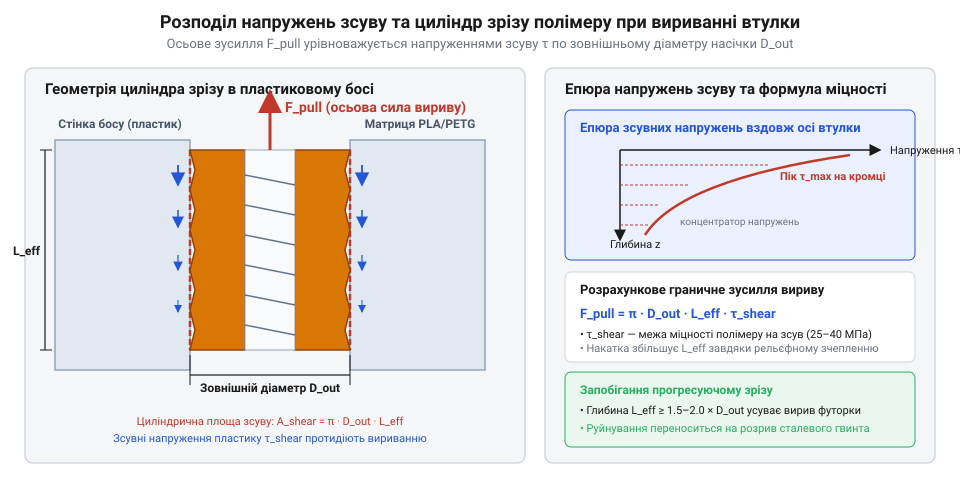
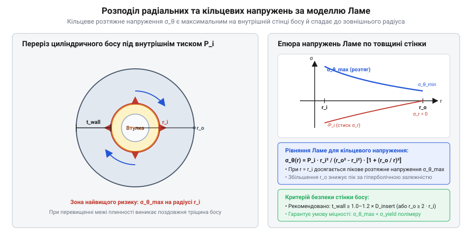

# Розрахунок механічної міцності нарізних втулок на виривання та прокручування

<preknowlist>
- [Класи міцності та матеріали кріплення: сталі 8.8–12.9, нержавійка A2/A4, титан Gr5 та задирання різьби](root:cat-hw-parts/fastener-strength-classes-and-materials) — механічні характеристики нарізних металевих метизів, розрахунок допустимих моментів затягування та міцність різьбових з'єднань при зовнішньому навантаженні
</preknowlist>

## Причини руйнування нарізних вузлів пластику

Спроба затягнути стандартний гвинт у пластиковий корпус із запресованою металевою втулкою часто завершується раптовим проворотом деталі навколо своєї осі або її повним вириванням разом із шматками полімеру. У практичному конструюванні інженери нервово сподіваються, що термовставка триматиме навантаження так само, як різьба у суцільній сталі чи латуні, спираючись на звичні розрахунки [класів міцності металевих метизів](root:cat-hw-parts/fastener-strength-classes-and-materials). Проте термопластична матриця поводиться принципово інакше: вона має значно нижчий модуль пружності, схильна до пластичного плину та легко зрізається під дією порівняно невеликих дотичних зусиль.

Основна фізична причина деструкції полягає у колосальній різниці між механічними характеристиками латуні чи сталі та полімерного середовища. Якщо металеве тіло втулки легко витримує напруження розтягу понад 300 МПа, то термопластична матриця руйнується при значно нижчих рівнях дотичних напружень. Внаслідок цього під дією зовнішнього осьового зусилля або монтажного крутного моменту руйнується не різьба метизу, а м'які полімерні ребра, які заповнюють зовнішній рельєф втулки.

У процесі експлуатації нарізного вузла в пластиковому корпусі виникає кілька специфічних механізмів деструкції:
- Зріз полімерної матриці вздовж зовнішнього циліндра накатки під дією поздовжньої вириваючої сили (@@en|pull-out force@@). - Зріз мікрорельєфу пластику під дією тангенціального моменту прокручування (@@en|torque-out@@) під час затягування гвинта. - Реологічна повзучість (@@en|creep@@, від англ. creep — повзучість) полімеру під тривалим статичним навантаженням, внаслідок якої в'язкопружні макромолекулярні ланцюги термопласту повільно переупорядковуються і ковзають один відносно одного, спричиняючи релаксацію напружень (@@en|stress relaxation@@, від лат. relaxatio — послаблення). Під дією постійної осьової сили попереднього затягування гвинта або радіального монтажного тиску канавок накатки полімерна матриця з часом незворотно деформується в напрямку прикладених сил. Підвищення робочої температури вузла експоненціально прискорює цей процес: при наближенні до температури склування (@@en|glass transition temperature@@) полімеру різко зростає теплова рухливість молекулярних сегментів, через що час релаксації скорочується на кілька порядків. У результаті монтажне зусилля затискання незворотно спадає, виступи полімерного рельєфу втрачають щільність зачеплення з накаткою втулки, що призводить до послаблення натягу та поступового зсуву термовставки під дією навантажень, які на початку експлуатації були цілком безпечними. - Радіальне розтріскування стінок босу через кільцеві напруження (@@en|hoop stress@@, від англ. hoop — обруч), що виникають під час термічного впаювання та затягування різьби.

Межа міцності на зсув (@@en|shear strength@@) для поширених конструкційних термопластів є критичним обмеженням:
- Полілактид (@@en|PLA@@): межа плинності на зсув `τ_y ≈ 30 - 35 МПа`. - Поліетилентерефталат-гліколь (@@en|PETG@@): `τ_y ≈ 20 - 25 МПа`. - Акрилонітрилбутадієнстирол (@@en|ABS@@): `τ_y ≈ 22 - 28 МПа`. - Поліамід із вуглеволокном (@@en|Nylon-CF@@): `τ_y ≈ 45 - 60 МПа`.

Для забезпечення надійності вузла, в якому використовуються металеві латунні нарізні втулки, неможливо покладатися на інтуїтивне підбирання розмірів. Потрібно глибинно осягнути [проблематику механічної деструкції](#plastic-fastening-failures) та збудувати точну фізико-математичну модель розподілу напружень зсуву (@@en|shear stress@@) і розтягу в матриці навколо зовнішнього рельєфу втулки.

## Математична модель зсуву та виривання

Під дією осьового вириваючого зусилля металева термовставка працює як жорсткий циліндричний поршень, який намагається зрізати навколишній шар термопласту. Оскільки механічна міцність латунного тіла втулки на декілька порядків перевищує міцність пластику, руйнування відбувається не по металевій різьбі, а у шарі полімеру безпосередньо за зовнішніми вершинами накатки. Зріз проходить по умовній циліндричній поверхні із зовнішнім діаметром `d_o` та довжиною залягання втулки `L`.

Ефективна площа зсуву `A_s` перевищує або поступається площі гладкого циліндра залежно від коефіцієнта ефективності зачеплення геометрії ребер `k_s`. Цей коефіцієнт враховує глибину профілю накатки, кут канавок та повноту заповнення рельєфу розплавленим полімером під час впаювання:

```
A_s = π × d_o × L × k_s         [формула ефективної площі зсуву полімеру]
```

де `d_o` — зовнішній діаметр втулки по вершинах накатки (в метрах), `L` — довжина контактної частини втулки в полімерній матриці (в метрах), а `k_s` — безрозмірний коефіцієнт ефективності геометрії зачеплення (типово `k_s = 0.65 - 0.85` для стандартних термовставок). Фізичний зміст коефіцієнта `k_s` полягає у визначенні частки ідеальної циліндричної площі `π × d_o × L`, яка реально бере участь у чиненні опору осьовому зсуву полімеру. Цей показник завжди менший за одиницю, оскільки рельєф накатки (@@en|knurling@@) утворює не суцільну циліндричну стінку, а дискретну систему виступів і канавок, де на гострих крайках виникає локальна концентрація напружень (@@en|stress concentration@@, від лат. concentratio — зосередження), а при впаюванні можливе недозаповнення мікропідрізів (@@en|undercut@@, від англ. undercut — підріз) розплавом. Вибір величини `k_s` залежить від конфігурації зовнішніх ребер втулки: для прямої поздовжньої накатки (@@en|straight knurling@@) `k_s ≈ 0.60 - 0.68`, оскільки її ребра орієнтовані вздовж вектора сили вириву (@@en|pull-out force@@) і чинять опір переважно прокручуванню (@@en|torque-out@@); для зустрічно-похилої шевральної накатки (@@en|herringbone knurling@@) `k_s ≈ 0.72 - 0.80` завдяки просторовому куту нахилу канавок, які одночасно сприймають тангенціальні та осьові напруження зсуву (@@en|shear stress@@); для термовставок із глибокими кільцевими канавками підрізу та ромбічною накаткою (@@en|diamond knurling@@) `k_s ≈ 0.80 - 0.88`, адже перпендикулярні кільцеві уступи формують суцільні полімерні шпонки. Крім геометрії, на `k_s` впливає реологія матеріалу корпусу: для невисоков'язких термопластів (@@en|PLA@@, @@en|PETG@@, @@en|ABS@@) приймають вищі значення діапазону, тоді як підвищена в'язкість (@@en|viscosity@@, від лат. viscosus — в'язкий) та наявність коротких волокон у композитах на кшталт @@en|Nylon-CF@@ погіршують заповнення мікрорельєфу, знижуючи `k_s` на 0.05–0.10 порівняно з незаповненими матрицями, що важливо враховувати так само, як і [механічні характеристики кріплення](root:cat-hw-parts/fastener-strength-classes-and-materials) при розрахунку загальної міцності вузла.

Знаючи ефективну площу зсуву та межу плинності матеріалу матриці на зсув `τ_y` (@@en|shear stress@@), критичне поздовжнє зусилля вириву (@@en|pull-out force@@) обчислюється за формулою:

```
F_pullout = A_s × τ_y
          = π × d_o × L × k_s × τ_y     [підстановка геометричних параметрів площини зрізу]
```


*Схема розподілу напружень зсуву на зовнішній поверхні нарізної втулки та формування циліндричної площини зрізу в полімері.*

**Розрахунок критичного зусилля виривання термовставки M3 в корпусі з PETG**

Розглянемо приклад розрахунку для стандартної латунної термовставки M3 із зовнішнім діаметром `d_o = 4.6 мм` (`0.0046 м`) та довжиною `L = 5.7 мм` (`0.0057 м`), встановленої в деталь із матеріалу `@@en|PETG@@` (`τ_y = 22 МПа = 22 × 10⁶ Па`). Коефіцієнт ефективності накатки приймаємо `k_s = 0.75`.

```
A_s = π × d_o × L × k_s
    = 3.14159 × 0.0046 × 0.0057 × 0.75               [обчислення ефективної площі зсуву]
    = 6.185 × 10⁻⁵ m²                                [площа зсуву полімерної матриці в м²]

F_pullout = A_s × τ_y
          = 6.185 × 10⁻⁵ × 22 × 10⁶                   [множення площі зсуву на межу міцності матеріалу]
          = 1360.7 N                                   [критичне поздовжнє зусилля вириву в ньютонах]
```

Отримане значення `F_pullout ≈ 1360.7 Н` (що еквівалентно навантаженню масою близько 138.7 кг) показує граничну межу міцності. Для забезпечення долговічності вузла з урахуванням температурних коливань та ефекту повзучості (@@en|creep@@) слід вводити коефіцієнт запасу міцності `SF = 2.0`, що дає максимально допустиме робоче навантаження `F_max = 680 Н`.

Для порівняння, аналогічна термовставка у корпусі з `@@en|PLA@@` (`τ_y = 32 МПа`) витримує критичне зусилля `F_pullout = 1979 Н`, а в корпусі з `@@en|Nylon-CF@@` (`τ_y = 50 МПа`) — `3092 Н`.

Математичний аналіз виведення [критичного зусилля вириву](#pull-out-force-formula) підводить до того, що поздовжня стійкість — це лише одна складова міцності. Під час монтажного затягування нарізного елемента на втулку діє значний обертальний момент, який намагається прокрутити її у посадковому отворі.

## Розрахунок моменту прокручування та накатки

Під час закручування гвинта із заданим моментом затягування тертя між головкою гвинта і підкладковою шайбою передає значне обертальне зусилля на металеву термовставку. Якщо опір прокручуванню (@@en|torque-out@@) полімерного зачеплення виявиться меншим за момент затягування гвинта, втулка зріже пластикові виступи накатки й почне вільно обертатися в корпусі, повністю втративши працездатність.

Опір обертанню забезпечується зовнішньою накаткою (@@en|knurling@@, від англ. knurl — випуклість, карб). Геометрія накатки буває трьох основних типів:
- Пряма поздовжня накатка (прямі шліци) — забезпечує високий опір прокручуванню, але слабку стійкість до виривання. - Похила накатка (спіральні канавки) — створює комбінований опір, де кут нахилу розподіляє навантаження між зсувом та вириванням. - Ромбічна або зустрічно-похила накатка (оппозитні канавки) — оптимальний варіант для [нарізних термовставок](root:cat-hw-parts/threaded-inserts-and-heat-set), де одна секція опирається прокручуванню за годинниковою стрілкою, а друга — проти.

Тангенціальна площа зсуву ребер накатки `A_torsion` визначається через діаметр `d_o`, довжину `L` та коефіцієнт форми кручення `k_t` (`k_t = 0.50 - 0.80`). Граничний крутний момент прокручування `T_torque` обчислюється як добуток дотичного зусилля на плече прикладання сили (радіус втулки `r_o = d_o / 2`):

```
A_torsion = π × d_o × L × k_t                             [формула тангенціальної площі зсуву]

T_torque = τ_y × A_torsion × (d_o ÷ 2)
         = τ_y × π × d_o² × L × k_t ÷ 2                    [граничний крутний момент прокручування]
```

**Розрахунок граничного моменту прокручування втулки M3 в корпусі з ABS**

Обчислимо опір прокручуванню для втулки M3 (`d_o = 4.6 мм = 0.0046 м`, `L = 5.7 мм = 0.0057 м`) у корпусі з `@@en|ABS@@` (`τ_y = 25 МПа = 25 × 10⁶ Па`) при коефіцієнті форми накатки `k_t = 0.65`.

```
A_torsion = π × d_o × L × k_t
          = 3.14159 × 0.0046 × 0.0057 × 0.65         [обчислення тангенціальної площі зсуву]
          = 5.36 × 10⁻⁵ m²                          [площа зрізу ребер накатки в м²]

T_torque = τ_y × A_torsion × (d_o ÷ 2)
         = 25 × 10⁶ × 5.36 × 10⁻⁵ × 0.0023          [обчислення моменту прокручування]
         = 3.082 N·m                                [граничний крутний момент у ньютон-метрах]
```

Розраховане значення `T_torque ≈ 3.08 Н·м` значно перевищує стандартний момент затягування сталевих гвинтів M3 класу міцності 8.8 (який становить близько `1.0 - 1.2 Н·м`). Це гарантує достатній запас міцності проти зрізу ребер накатки. Отриманий розрахунок значення [граничного крутного моменту](#torque-out-calculation) демонструє, що крім тангенціального зсуву, зовнішній рельєф втулки створює значний внутрішній радіальний тиск на стінки полімерного босу.

Під час термічного впаювання та наступного затягування гвинта розклинювальний ефект канавок накатки генерує внутрішній радіальний тиск `P_r`. За теорією товстостінних циліндрів Габрієля Ламе (@@en|thick-walled cylinder@@), цей тиск викликає в стінках посадкового босу розподіл двох видів напружень: радіальні напруження стиску `σ_r` та кільцеві напруження розтягу (@@en|hoop stress@@) `σ_θ`.

Найбільш небезпечними є кільцеві напруження розтягу `σ_θ` на внутрішній межі посадкового отвору (при `r = r_i = d_o / 2`):

```
σ_θ = P_r × (r_o² + r_i²) ÷ (r_o² - r_i²)                   [формула Ламе для кільцевих напружень розтягу]
```

де `r_i = d_o / 2` — внутрішній радіус босу (зовнішній радіус термовставки), `r_o = D_boss / 2` — зовнішній радіус посадкового босу, `D_boss` — зовнішній діаметр босу (@@en|boss diameter@@).


*Розподіл радіального тиску та кільцевих напружень розтягу по товщині стінки полімерного босу.*

Щоб запобігти радіальному розтріскуванню пластикового босу під час монтажу й експлуатації, максимальні кільцеві напруження `σ_θ` не повинні перевищувати межу міцності термопласту на розтяг `σ_y` з урахуванням коефіцієнта запасу `SF`:

```
σ_θ ≤ σ_y ÷ SF                                             [критерій міцності стінки босу]
```

Шляхом алгебраїчних перетворень формули Ламе виводиться математичне рівняння для розрахунку мінімально припустимого зовнішнього діаметра босу `D_boss`:

```
D_boss = d_o × √((σ_y + P_r) ÷ (σ_y - P_r))                [розрахунок мінімального діаметра босу]
```

На практиці для більшості конструкційних термопластів (@@en|PLA@@, @@en|PETG@@, @@en|ABS@@) значення радіального тиску `P_r` від термічного натягу та клинового розклинення становить близько `0.3 - 0.5` від `σ_y`. Підстановка цих співвідношень у формулу дає інженерне правило: товщина стінки босу `t_wall = (D_boss - d_o) / 2` повинна дорівнювати щонайменше зовнішньому діаметру втулки (`t_wall ≥ d_o`), що відповідає зовнішньому діаметру босу `D_boss ≥ 3 × d_o`.

Кількісний розрахунок геометричних параметрів посадкових місць та граничних навантажень дає інженеру математичну базу для спроектованих вузлів перед проведенням [практичного монтажу та випробувань](root:cat-hw-parts/threaded-inserts-and-heat-set/proj-heat-set-installation-and-testing).

## Математика кільцевих напружень стінок босу

Під час впаювання металевої термовставки у полімерну деталь її зовнішній рельєф та накатка @@en|knurling@@ витісняють розм'якшений термопласт, створюючи радіальний натяг після охолодження вузла. Конструктори часто недооцінюють небезпеку цього натягу, сприймаючи посадковий бос як суцільний масив пластику. Проте з точки зору опору матеріалів циліндрична стінка босу навколо металевої втулки являє собою товстостінний циліндр, що перебуває під дією внутрішнього радіального тиску `p`. Цей тиск виникає внаслідок натягу посадки, термічного усадження полімеру та додаткового розклинювання під час закручування гвинта, генеруючи у стінці розтягувальні кільцеві напруження (англ. *hoop stress*, від давньоангл. *hop* — обруч) @@en|hoop stress@@.

Розподіл напружень у стінці босу описується класичною теорією товстостінних циліндрів Габрієля Ламе. Внутрішній тиск `p` створює у матеріалі двовісний напружений стан: стискальні радіальні напруження `sigma_r` та розтягувальні кільцеві напруження `sigma_h`. На відміну від стискальних радіальних напружень, які швидко загасають углиб стінки, кільцеві напруження є розтягувальними й досягають свого абсолютного пікового значення безпосередньо на внутрішній межі посадкового отвору.

Аналітичний вираз для кільцевого розтягувального напруження `sigma_h(r)` на довільному радіусі `r` по товщині стінки має вигляд:

```
sigma_h(r)
= p * (r_i^2 / (r_o^2 - r_i^2)) * (1 + r_o^2 / r^2)    [рівняння Ламе для кільцевого напруження]
```

де `r_i = d_o / 2` — внутрішній радіус посадкового отвору (або ефективний зовнішній радіус втулки), а `r_o = D_boss / 2` — зовнішній радіус полімерного босу.

Щоб визначити найнебезпечніше напруження, підставимо значення внутрішнього радіуса `r = r_i = d_o / 2` у загальне рівняння Ламе:

```
sigma_h
= p * ((d_o / 2)^2 / ((D_boss / 2)^2 - (d_o / 2)^2)) * (1 + (D_boss / 2)^2 / (d_o / 2)^2)   [підстановка r = d_o / 2]
= p * (d_o^2 / (D_boss^2 - d_o^2)) * (1 + D_boss^2 / d_o^2)                                [скорочення множника 1/4]
= p * (d_o^2 / (D_boss^2 - d_o^2)) * ((d_o^2 + D_boss^2) / d_o^2)                          [зведення до спільного знаменника]
= p * (D_boss^2 + d_o^2) / (D_boss^2 - d_o^2)                                              [скорочення d_o^2]
```

Отримана формула показує, що максимальне кільцеве напруження `sigma_h` діє на внутрішній поверхні контуру впаювання. Графік [розподілу кільцевих напружень](#hoop-stress-distribution) показує стрімке падіння напружень від внутрішнього радіуса `r_i` до зовнішнього `r_o`. Якщо зовнішній діаметр босу @@en|boss diameter@@ `D_boss` вибрано недостатнім, знаменник `(D_boss^2 - d_o^2)` зменшується, що призводить до локального перевищення межі плинності @@en|yield strength@@ `sigma_y` конструкційного пластику (@@en|PLA@@, @@en|PETG@@, @@en|ABS@@, @@en|Nylon-CF@@). У результаті в уздовж осі втулки утворюються радіальні мікротріщини, які з часом розростаються й призводять до повного розколювання босу.

## Оптимізація геометрії босу та затягування

Для забезпечення довговічності нарізного вузла геометричні параметри посадкового місця повинні розраховуватися таким чином, щоб пикове кільцеве напруження `sigma_h` не перевищувало допустиме напруження матеріалу матриці при робочих температурах. Для запобігання пластичній деформації та розтріскуванню сформулюємо умову міцності `sigma_h <= sigma_y`, де `sigma_y` — межа плинності термопласту, а `p` — сумарний внутрішній радіальний тиск від термічної посадки втулки @@en|heat-set insert@@ та розклинювання.

Виведення підсумкової геометричної нерівності для розрахунку мінімального зовнішнього діаметра босу `D_boss` виконується за наступним математичним ланцюжком:

```
p * (D_boss^2 + d_o^2) / (D_boss^2 - d_o^2) <= sigma_y      [критерій міцності за межею плинності]
p * (D_boss^2 + d_o^2) <= sigma_y * (D_boss^2 - d_o^2)       [множення обох частин на (D_boss^2 - d_o^2)]
p * D_boss^2 + p * d_o^2 <= sigma_y * D_boss^2 - sigma_y * d_o^2 [розкриття дужок]
sigma_y * d_o^2 + p * d_o^2 <= sigma_y * D_boss^2 - p * D_boss^2 [групування доданків з D_boss та d_o]
d_o^2 * (sigma_y + p) <= D_boss^2 * (sigma_y - p)           [винесення спільних множників]
D_boss^2 >= d_o^2 * ((sigma_y + p) / (sigma_y - p))         [ізоляція квадрата зовнішнього діаметра]
D_boss >= d_o * √((sigma_y + p) / (sigma_y - p))             [добування квадратного кореня]
```

Отримана нерівність забезпечує [геометричну оптимізацію босу](#boss-geometry-optimization) проти радіального руйнування. Ми бачимо, що мінімальний діаметр босу прямо залежить від співвідношення внутрішнього тиску `p` до межі плинності `sigma_y`. Товщина стінки босу `t_wall` при цьому визначається як `t_wall = (D_boss - d_o) / 2`. Для ненаповнених конструкційних термопластів (@@en|PLA@@, @@en|PETG@@, @@en|ABS@@) з відносно низькою межею плинності розрахункове співвідношення становить `D_boss / d_o ≈ 2.0…2.5`. Застосування композитів з вуглеволокном (@@en|Nylon-CF@@), які мають високу межу плинності, дозволяє зменшити коефіцієнт до `1.8` без ризику утворення тріщин.

Окрім радіального тиску посадки, бос зазнає додаткових навантажень під час остаточного складання вузла. Закручування метизу створює осьове зусилля затискання `F_axial`, яке прагне витягнути термовставку з босу та створює складний напружений стан за критерієм фон Мізеса @@en|von Mises stress@@. Гранично припустимий робочий момент затягування @@en|tightening torque@@ `T_tightening` обчислюється через максимальне зусилля виривання @@en|pull-out force@@ `F_pullout_max`:

```
T_tightening
= F_axial_max * (0.5 * d_screw_pitch + mu * r_friction)     [залежність затяжного моменту від осьового зусилля]
<= F_pullout_max * (0.5 * d_screw_pitch + mu * r_friction)  [обмеження за граничною міцністю на вирив]
```

де `d_screw_pitch` — середній діаметр різьби гвинта, `mu` — коефіцієнт тертя в різьбовому з'єднанні, а `r_friction` — ефективний радіус тертя під головкою гвинта. Під час розрахунку вузла робочий момент затягування обирають із коефіцієнтом запасу міцності `1.5…2.0` відносно критичного моменту прокручування @@en|torque-out@@, не перевищуючи граничний затяжний момент, що визначають [класи міцності кріплення](root:cat-hw-parts/fastener-strength-classes-and-materials). Інтеграція розрахованого діаметра босу `D_boss` та моменту `T_tightening` гарантує міцність з'єднання при довготривалій експлуатації.