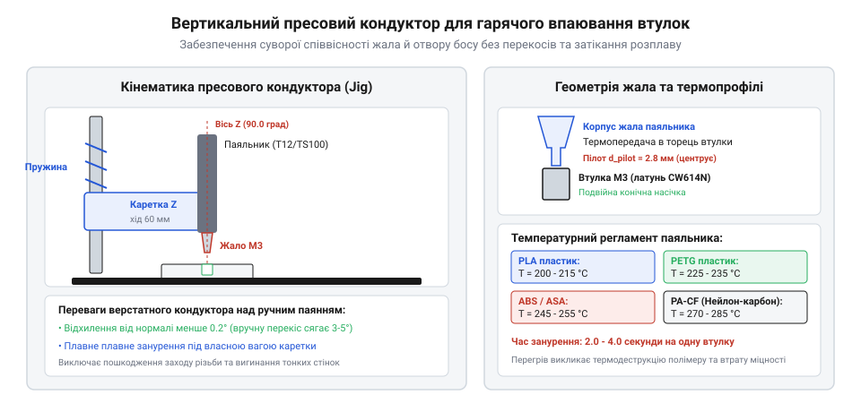
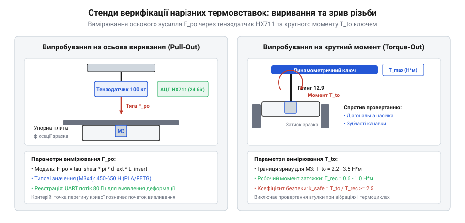

# Практичний монтаж термовтулок та випробування навантаженням

<preknowlist>
- [Класи міцності та матеріали кріплення: сталі 8.8–12.9, нержавійка A2/A4, титан Gr5 та задирання різьби](root:cat-hw-parts/fastener-strength-classes-and-materials) — класи міцності сталевих гвинтів, допустимі моменти затягування та механіку взаємодії металевої різьби з кріпленням
</preknowlist>

## Чому вириваються термовтулки з термопласту

У силових конструкціях із 3D-друкованих деталей — від корпусів польотних контролерів до променевих вузлів рам квадрокоптерів — нарізне кріплення сприймає знакозмінні ударні та вібраційні навантаження. Спроба нарізати різьбу безпосередньо в полімерному тілі або вкрутити саморіз приречена на швидку відмову: під дією попереднього натягу сталевого гвинта за [класами міцності 8.8–12.9](root:cat-hw-parts/fastener-strength-classes-and-materials) пластик зазнає холодної повзучості (англ. @@en|creep@@), витки зминаються, і з'єднання необоротно слабшає. Промисловим стандартом створення рознімних з'єднань є використання латунних [нарізних термовставок](root:cat-hw-parts/threaded-inserts-and-heat-set) (англ. @@en|heat-set inserts@@), оснащених зовнішніми кільцевими проточками та перехресною накаткою. Проте при кустарному ручному монтажі звичайним паяльником виникає цілий спектр прихованих дефектів, які призводять до раптового виривання втулки під навантаженням.

Першопричиною виривання є локальна термічна деструкція полімерної матриці. Якщо жало паяльника перегріте або утримується у втулці занадто довго, тепловий потік деструктурує довгі полімерні ланцюги навколишнього термопласту. У матеріалах @@en|PLA@@, @@en|PETG@@ та @@en|ABS@@ перегрів вище критичної межі викликає деполімеризацію, виділення газів та утворення мікропористої вуглистої піни навколо латунного корпусу замість щільного монолітного шару. У композитах на кшталт @@en|PA6-CF@@ (поліамід із рубаним вуглеволокном) надлишковий нагрів спричиняє термоокиснювальну деструкцію нейлонової зв'язки: матриця втрачає зчеплення з вуглеволокнами, перетворюючись на крихку масу. Коли до гвинта прикладається осьове зусилля виривання (англ. @@en|pull-out force@@), зріз відбувається не по максимальному діаметру зовнішніх ребер втулки, а по здеградованому прилеглому прошарку полімеру при навантаженнях у 2–3 рази нижчих за розрахункові за [моделлю механічного розрахунку](root:cat-hw-parts/threaded-inserts-and-heat-set/math-insert-pullout-and-torque-mechanics).

Другим критичним фактором є кутовий перекіс осі вставки відносно вертикалі посадкового босу (англ. @@en|boss@@). При ручному тиску паяльником відхилення навіть на 3–5 градусів створює асиметричний розподіл тиску розплаву: з одного боку втулки пластик повністю витісняється назовні, а з іншого залишається повітряна порожнина. Під час затягування кріплення гвинт перекошується, викликаючи вигин стрижня, розтріскування тонкої стінки бобишки через концентрацію тангенціальних напружень і заклинювання різьби. Крім того, неконтрольоване занурення призводить до затікання розплавленої полімерної маси всередину різьбового каналу через нижній торець втулки, що блокує закручування гвинта на розрахункову глибину.

## Теплові режими та геометрія жав

Надійне анкерування термовтулки вимагає швидкого і локалізованого розплавлення тонкого шару пластику завтовшки 0.2–0.4 мм, що безпосередньо контактує із зовнішнім рифленням, без прогріву всього об'єму бобишки. Цей процес визначається правильним температурним профілем (англ. @@en|temperature profile@@) нагрівача та швидкістю введення тепла. Температура жала встановлюється на 15–30 °C вище точки в'язкотекучого стану полімеру, враховуючи падіння температури під час контакту масивного латунного тіла втулки з холодним пластиком деталі:

- Полілактид (PLA): рекомендована температура монтажу 190–210 °C (температура склування Tg близько 60 °C; низька в'язкість розплаву вимагає швидкого введення). - Поліетилентерефталатгліколь (PETG): 225–240 °C (Tg близько 80 °C; помірна плинність, висока адгезія до латуні). - Акрилонітрилбутадієнстирол (ABS / ASA): 245–260 °C (Tg близько 105 °C; плавний перехід у розплав без різкого скидання в'язкості). - Вуглеволоконний поліамід (PA6-CF / PA12-CF): 270–290 °C (температура плавлення кристалічної фази 220 °C; вимагає підвищеного зусилля через високу в'язкість розплаву та опір армуючих волокон).

Застосування стандартних конічних паяльних жав для радіомонтажу є неприпустимим: конічне жало контактує з втулкою лише у вузькому кільці на верхній кромці отвору, що призводить до розвальцьовування вхідного отвору різьби та недостатнього прогріву нижньої частини. Для якісного монтажу використовують спеціалізовані адаптерні жала (англ. @@en|heat-set tips@@), що виготовляються з високочистої електротехнічної міді або латуні.

Геометрія такого жала включає циліндричний або злегка конічний напрямний хвостовик — пілот (англ. @@en|pilot tip@@), діаметр якого відповідає внутрішньому діаметру різьби під калібри від M2 до M5 за мінусом технологічного зазору 0.10–0.15 мм. Пілот вільно заходить усередину вставки на всю глибину різьби, забезпечуючи рівномірне прогрівання стінок зсередини за рахунок теплопровідності. Вище пілота розташований плаский опорний буртик, діаметр якого точно відповідає зовнішньому діаметру верхнього фланця втулки за стандартом [специфікацій нарізних вставок](root:cat-hw-parts/threaded-inserts-and-heat-set/api-threaded-inserts-hardware-spec). Цей буртик передає вертикальне зусилля притиску і дозволяє посадити втулку суворо врівень (англ. @@en|flush@@) із площиною деталі, не провалюючи її глибше посадкового місця.

## Конструювання вертикального пресового кондуктора

Навіть за ідеально налаштованої температури ручне впаювання не здатне забезпечити стабільну перпендикулярність осі вставки до поверхні деталі. Для усунення кутових перекосів застосовують вертикальний пресовий кондуктор (англ. @@en|vertical heat-set press jig@@). Його призначення — обмежити всі просторові ступені вільності паяльника, окрім строго прямолінійного вертикального переміщення за віссю Z.

Конструкція пресового кондуктора базується на жорсткій станині та рухомій каретці. Основою слугує важка алюмінієва або сталева опорна плита, на якій розміщуються деталь і фіксатори. Вертикальна колона виконується з двох циліндричних полірованих напрямних валів діаметром 10–12 мм із загартованої сталі або прецизійного алюмінієвого конструкційного профілю V-Slot / T-Slot. Каретка паяльника спирається на пару лінійних підшипників або колісних блоків із безлюфтовим регулюванням ексцентриків.

*Конструкція вертикального монтажного кондуктора: прецизійні лінійні напрямні та пружинне повернення гарантують сувору перпендикулярність впаювання.*

Ключовими вузлами кондуктора є:

1. Механізм пружинного розвантаження та повернення. Маса каретки разом із монтажним паяльником урівноважується циліндричною пружиною розтягу або противагою. Паяльник перебуває у верхній безпечній точці, а для опускання оператор прикладає мінімальне контрольоване зусилля (від 5 до 15 Н), спрямоване суворо вниз за допомогою важільного приводу. 2. Цанговий або затискний тримач ручки паяльника. Вузол кріплення виготовляється термостійким і забезпечує соосність осі жала із лінією переміщення каретки кондуктора з допуском не більше 0.05 мм на 100 мм ходу. 3. Регульований механічний упор глибини (обмежувач ходу). Гвинтовий упор із мікрометричною різьбою налаштовується на фіксовану глибину занурення, що виключає ризик продавлювання тонкого дна глухого отвору бобишки.

Процес монтажу на кондукторі проходить за фіксованим регламентом: втулку насаджують на напрямний пілот холодного або попередньо підігрітого до 100 °C жала, опускають каретку до торкання босу деталі та вмикають робочий нагрів. За рахунок маси каретки і легкого натиску важеля латунна втулка плавно і рівномірно занурюється в матеріал за 2–4 секунди. Щойно каретка доходить до нижнього механічного упору, контакт жала розривають підйомом каретки вгору. Деталь утримують нерухомо протягом 5–8 секунд до кристалізації полімеру, отримуючи ідеально перпендикулярну різьбову посадку з монолітним зчепленням.

## Вклеювання вставок у карбонові пластини

У конструкціях безпілотних літальних апаратів та прецизійних маніпуляторів силові каркаси виготовляють із листового вуглепластику (@@en|carbon fiber reinforced polymer@@). Карбонові пластини формуються на основі реактопластичної полімерної матриці — термореактивної епоксидної смоли (англ. @@en|epoxy resin@@), яка в процесі полімеризації утворює незворотну тривимірну сітку хімічних зв'язків. На відміну від лінійних термопластів, таку матрицю неможливо розплавити нагріванням: при спробі впаяти латунну втулку паяльником епоксидна основа карбону безповоротно вигорає та обвуглюється при температурі вище 250 °C, а вуглецеві волокна розшаровуються. Тому створення надійних різьбових вузлів у композитних панелях реалізують виключно методом структурного клейового монтажу.

Технологія монтажу розпочинається з прецизійної механічної обробки посадкового отвору. Оскільки композит складається з багатьох шарів різноспрямованої вуглецевої тканини, свердління виконують твердосплавними або алмазними кінцевими фрезами на високих обертах шпинделя з мінімальною вертикальною подачею, щоб уникнути міжшарового розшарування (@@en|delamination@@) на виході інструмента. Діаметр отвору узгоджують із зовнішнім діаметром нарізного елемента за [специфікаціями нарізних вставок](root:cat-hw-parts/threaded-inserts-and-heat-set/api-threaded-inserts-hardware-spec). Для забезпечення міцності клейового з'єднання радіальний проміжок між стінкою отвору та зовнішнім контуром вставки має становити 0.10–0.15 мм на бік, що відповідає оптимальній товщині шва конструкційного компаунда у 100–150 мкм.

Для композитного монтажу використовують спеціалізовані вставки, що мають глибокі кільцеві проточки, зворотні конуси та фланці, призначені для утворення монолітного адгезійного замка. Перед монтажем поверхню отвору у карбоновій пластині продувають сухим стисненим повітрям від мікропилу та знежирюють ізопропіловим спиртом. Внутрішню різьбу втулки перед нанесенням епоксидної суміші консервують високов'язким фторопластовим мастилом або захищають герметичним силіконовим корком, щоб рідкий клей не потрапив у робочу зону гвинта. 

Двокомпонентний тиксотропний епоксидний клей наносять тонким шаром на стінки отвору та зовнішнє рифлення втулки, після чого деталь плавно запресовують із легким прокручуванням для повного витіснення повітряних кишень. Полімеризацію проводять за кімнатної температури протягом 24 годин або піддають термічному постійному доведенню за температури 60 °C упродовж 2 годин, що підвищує температуру склування полімерного шва та збільшує опір зрізу.

## Розробка тензометричного випробувального стенду

Якісний монтаж у пластик або карбон потребує точної кількісної верифікації несучої здатності отриманого різьбового вузла. Допустимі навантаження визначаються двома критичними параметрами: граничним зусиллям осьового виривання (англ. @@en|pull-out force@@) та граничним крутним моментом зриву шліців у матриці (англ. @@en|torque-out@@). Для інженерного вимірювання цих показників розробляють випробувальний стенд на базі балкового тензодатчика (англ. @@en|load cell@@) та вимірювального мікроконтролерного блоку.

*Схема випробувального стенда: тензодатчик фіксує динаміку осьового зусилля, а калібрований динамометричний ключ вимірює момент зриву різьбової посадки.*

Механічна частина стенда складається з жорсткої рамної плити, на якій закріплено тензометричний датчик деформації та прецизійний гвинтовий механізм вертикального переміщення. Зразок із встановленою втулкою фіксується у нижній змінній оправці з центральним вікном, що виключає згинання пластини й дає змогу витягувати втулку без заклинювання. Усередину вставки закручується калібрований сталевий шток за [класами міцності 8.8–12.9](root:cat-hw-parts/fastener-strength-classes-and-materials) на повну глибину різьби. Верхній кінець штока з'єднується з тензодатчиком через сферичний радіальний наконечник, що компенсує несоосність і виключає виникнення паразитних згинальних моментів під час розтягу. Для вимірювання моменту зриву зразок затискають у лещатах, а зусилля прикладають за допомогою ручного динамометричного ключа (англ. @@en|torque wrench@@) із фіксацією пікових значень.

Вимірювальна електроніка стенда побудована навколо 24-бітного диференційного сигма-дельта аналогово-цифрового перетворювача @@en|HX711@@, що зчитує мікровольтовий розбаланс тензомосту. Програмна частина розбита на три функціональні шари: низькорівневий драйвер опитування сенсора на мові C, об'єктно-орієнтований контролер стенда на C++ та аналітичний інтерфейс збору даних і візуалізації на Python.

:::tabs
:::code proj-heat-set-installation-and-testing/c/include/hx711_pullout.h
:::code proj-heat-set-installation-and-testing/c/src/hx711_pullout.c
:::code proj-heat-set-installation-and-testing/c/src/main.c
:::code proj-heat-set-installation-and-testing/cpp/include/LoadCell.hpp
:::code proj-heat-set-installation-and-testing/cpp/include/PulloutTestRig.hpp
:::code proj-heat-set-installation-and-testing/cpp/src/PulloutTestRig.cpp
:::code proj-heat-set-installation-and-testing/cpp/src/main.cpp
:::code proj-heat-set-installation-and-testing/py/insert_test_logger.py
:::code proj-heat-set-installation-and-testing/py/yield_detector.py
:::code proj-heat-set-installation-and-testing/py/plot_pullout_curve.py
:::code proj-heat-set-installation-and-testing/py/main.py
:::

Мікроконтролерна частина у файлі `hx711_pullout.c` реалізує програмне тактування інтерфейсу датчика, віднімання апаратного зміщення тари та фільтрацію шумів методом експоненційного згладжування (@@en|EMA@@). Модуль C++ інкапсулює логіку автоматичного калібрування тензомоста й відстеження абсолютного піку навантаження. Скрипти на Python виконують безперервний збір потокової телеметрії через послідовний порт, чисельно визначають межу плинності посадки за падінням похідної жорсткості та будують криві деформації.

## Верифікація міцності та оптимізація друку

Проведення серії статичних випробувань на стенді дозволяє отримати реальні діаграми навантаження «зусилля–час», що відображають фізичну природу руйнування полімерної бобишки. Типова крива розтягу складається з трьох послідовних ділянок:

1. Зона пружної деформації: лінійне зростання зусилля, де пластик навколо втулки деформується за законом Гука без залишкових пошкоджень. 2. Межа плинності та початок зсуву: кутовий коефіцієнт кривої зменшується більш ніж на 40 %, що сигналізує про пластичну течію полімерних гребенів, розташованих між накаткою втулки. 3. Зріз і виривання: зусилля досягає абсолютного пікового максимуму, після чого відбувається крихкий зріз або зрив полімерного циліндра вздовж діаметра зовнішніх ребер, а зусилля падає до рівня залишкового сухого тертя ковзання.

Отримані експериментальні величини пікового зусилля порівнюють із теоретичними розрахунками за [моделлю механічного розрахунку](root:cat-hw-parts/threaded-inserts-and-heat-set/math-insert-pullout-and-torque-mechanics). Якщо реальне руйнування настає за зусиль, суттєво менших від розрахункового зрізу полімеру, причиною зазвичай є недостатній опір стінок бобишки радіальному тиску або низька якість міжшарової адгезії при 3D-друці.

Для оптимізації міцності деталей впроваджують коригування параметрів адитивного виробництва:

1. Кількість зовнішніх периметрів. Товщина стінки бобишки повинна становити щонайменше 1.5–2.0 діаметра самої втулки. У налаштуваннях слайсера бобишку повністю заповнюють суцільними контурами (4–6 периметрів), виключаючи використання пухкого внутрішнього заповнення (@@en|infill@@). Це унеможливлює розтріскування бобишки від тангенціальних напружень при затягуванні кріплення. 2. Орієнтація шарів відносно вектора навантаження. Якщо зусилля виривання спрямоване перпендикулярно до площини шарів друку, з'єднання працює на міжшаровий розрив, міцність якого на 30–50 % нижча за міцність монолітного матеріалу нитки. Розташування деталі на робочому столі обирають так, щоб вісь втулки лежала в площині шарів, або застосовують підсилені контури. 3. Температура екструзії та висота шару. Підвищення робочої температури сопла на 5–10 °C відносно базової та зменшення товщини шару до 0.16–0.20 мм максимізують взаємну дифузію розплаву між сусідніми доріжками, підвищуючи монолітність матриці навколо впаяної латунної втулки.