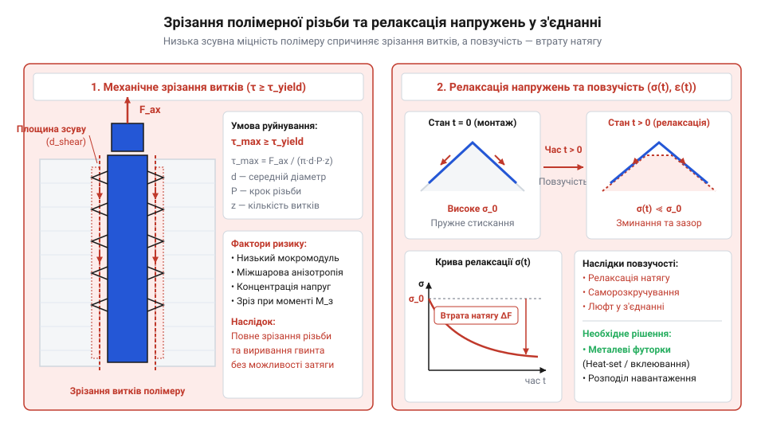
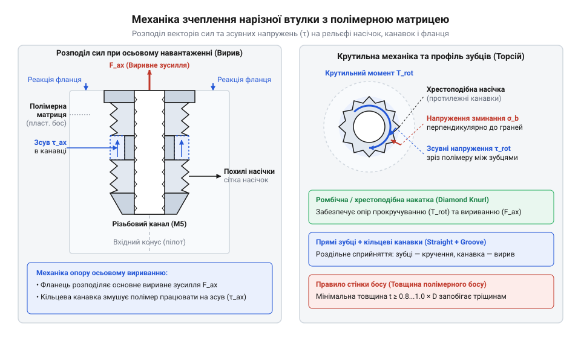
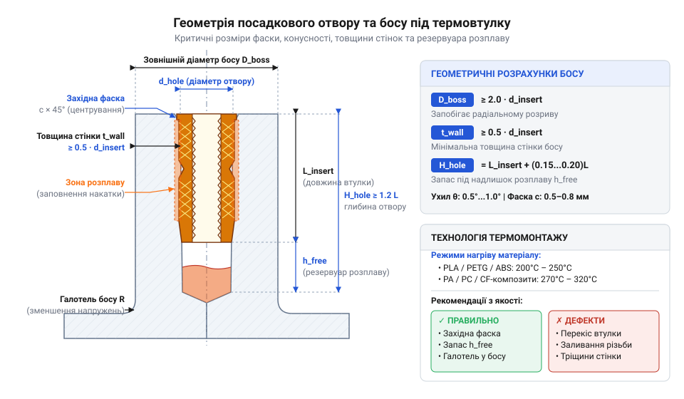
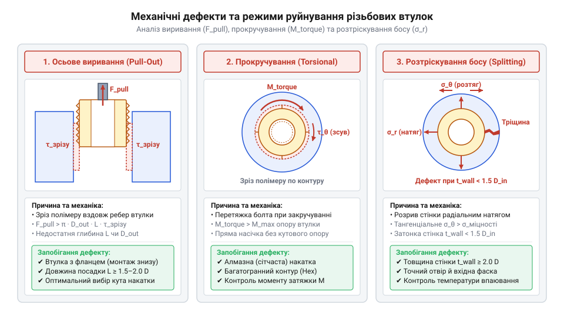
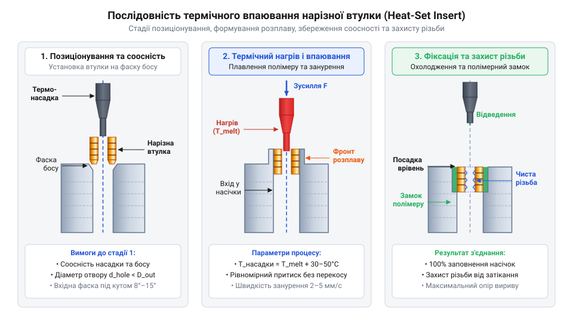

# Нарізні втулки та футорки: монтаж різьби в карбон, композити та термопласти 3D-друку

<preknowlist>
- [Класи міцності та матеріали кріплення: сталі 8.8–12.9, нержавійка A2/A4, титан Gr5 та задирання різьби](root:cat-hw-parts/fastener-strength-classes-and-materials) — Механічні характеристики нарізних гвинтів, класи міцності та ризики задирання різьбової пари «нержавійка–нержавійка»
- [Тросові та еластомірні віброізолятори: Wire Rope, силіконові демпфери та поглинання ударів](root:cat-hw-parts/wire-rope-isolators) — Динамічні вібраційні навантаження на корпус і вимоги до фіксації нарізних втулок у вібронавантажених вузлах
</preknowlist>

## Руйнування прямої різьби в полімерах

Під час збирання 3D-друкованого квадрокоптера чи кронштейна з термопласту спроба закрутити сталевий гвинт М3 безпосередньо у нарізаний чи віддрукований отвір спочатку створює відчуття щільної посадки. Однак варто застосувати номінальне зусилля затягування динамометричною викруткою, як опір виткам раптово зникає, гвинт починає вільно прокручуватися, а з отвору випадає дрібна полімерна стружка. В іншому випадку силовий вузол тримає навантаження перші кілька годин, але після серії вібраційних струсів або незначного нагріву корпусу з'єднання самовільно розхитується, втрачаючи затискну силу. Інженерна помилка полягає у припущенні, що термопластичні полімери (PLA, PETG, ABS, Nylon) чи композитні матеріали здатні сприймати локалізовані контактні напруження так само, як і конструкційні сталі. У реальності пряме нарізання різьби у полімерній матриці призводить до неминучого руйнування вузла за кількома фізичними механізмами.

Первинним чинником механічного руйнування є зрізання витків (англ. @@en|thread stripping@@, від @@en|strip@@ — зривати, оголювати). Сталевий гвинт стандарту М3 має основний крок різьби (`p = 0.5 мм`) та незначну висоту профілю витка (близько `0.27 мм`). Модуль пружності (англ. @@en|Young's modulus@@) для конструкційної сталі становить `E ≈ 200–210 ГПа`, тоді як для термопластів цей показник нижчий у десятки разів: `E_{PLA} ≈ 3.5 ГПа`, `E_{PETG} ≈ 2.1 ГПа`, `E_{Nylon} ≈ 1.8 ГПа`. Ще більша прірва спостерігається у межі міцності на зсув: сталь витримує `τ ≈ 300–400 МПа`, а полімерна матриця зрізається вже при `τ ≈ 25–40 МПа`. Під дією осьового розтягуючого навантаження тонкі полімерні гребені різьби деформуються й миттєво зрізаються циліндричною поверхнею, адже локалізований контактний тиск (англ. @@en|contact pressure@@) на бічних фасках витка 60° перевищує межу плинності полімеру.

Другим підступним фактором є в'язкопружність (англ. @@en|viscoelasticity@@, від лат. @@la|viscosus@@ — в'язкий та @@la|elasticus@@ — пружний) полімерних матеріалів. На відміну від металів, які у межах пружності поводяться за законом Гука, полімери під постійним напруженням виявляють часову деформацію — повзучість (англ. @@en|creep@@, від @@en|creep@@ — повзти). Коли гвинт затягують у пластиковий отвір, виникає сила попереднього затягування (англ. @@en|preload@@). Проте з часом високе локальне напруження змушує полімерні макромолекулярні ланцюги повільно зміщуватися й орієнтуватися уздовж напрямку сили. Відбувається релаксація напружень (від лат. @@la|relaxatio@@ — послаблення): попереднє натягнення з'єднання згасає за експоненційним законом без будь-якого зовнішнього відкручування гвинта. Підвищення робочої температури вузла навіть до `50–60 °C` наближає полімер до його [температури склування й повзучості](root:ph-thermodynamics/glass-transition-and-creep-in-polymers), що прискорює @@en|creep@@ у рази та призводить до повного розхитування з'єднання, особливо у вібронавантажених вузлах, де діють [тросові та еластомірні віброізолятори](root:cat-hw-parts/wire-rope-isolators).


*Схема механічного зрізання полімерних витків та часової деформації матриці під дією релаксації напружень і повзучості демонструє неминуче руйнування та розхитування прямого різьбового з'єднання в пластику.*

Окрему проблему становить структура матеріалів. У FDM 3D-друку міжшарова адгезія суттєво слабша за міцність уздовж мононитки. Нарізання різьби перпендикулярно до шарів друку створює концентратори напружень між треками розплаву, розклинюючи та розшаровуючи деталь. При роботі з вуглепластиковими ламінатами (CFRP) прямого нарізання різьби взагалі слід уникати: мікрофреза чи мітчик під час нарізання зрізає несучі карбонові волокна, залишаючи в отворі лише крихку епоксидну смолу. Під дією крутного моменту зсувні зусилля спричиняють деламінацію (англ. @@en|delamination@@, від лат. @@la|lamina@@ — пластинка) — розшарування композитного ламінату навколо отвору.

Усі ці фізичні обмеження вказують на неможливість прямого з'єднання сталевого гвинта з полімерною чи композитною матрицею у силово навантажених чи багаторазових вузлах. Виникає потреба в механічному розв'язувачі — проміжному металевому елементі, яким є нарізна втулка (англ. @@en|threaded insert@@, від @@en|insert@@ — вставляти). Металева втулка виконує роль трансформатора площі та механічних напружень: внутрішня сталева або латунна різьба витримує високий контактний тиск і багатократні цикли закручування сталевого гвинта, а її зовнішній геометричний рельєф зі збільшеним діаметром розподіляє те саме зусилля по суттєво більшій площі полімерного отвору, знижуючи зсувні напруження у матриці до безпечного рівня.

Щоб наочно оцінити різницю у тримальній спроможності, порівняємо граничне виривне зусилля для гвинта М3, вкрученого безпосередньо у деталь з PETG на глибину `L = 6 мм`, та того самого гвинта, зафіксованого через металеву футорку.

Розрахунковий діаметр зрізу внутрішньої різьби М3 становить `d_2 ≈ 2.67 мм`. Площу зрізу полімерних витків `A_{shear, direct}` обчислюємо з урахуванням коефіцієнта повноти профілю `0.75`:

```
A_{shear, direct} = π × d_2 × L × 0.75
= 3.14159 × 2.67 мм × 6.0 мм × 0.75    [множення периметра ділильного циліндра на глибину та повноту профілю]
= 37.74 мм²                            [площа зрізу прямої полімерної різьби М3]
```

Знаючи межу міцності PETG на зсув `τ_{PETG} = 30 Н/мм²`, знайдемо максимальне виривне зусилля `F_{direct}`:

```
F_{direct} = A_{shear, direct} × τ_{PETG}
= 37.74 мм² × 30 Н/мм²                 [підстановка площі зрізу та межі зсуву полімеру]
= 1132 Н                               [граничне виривне зусилля прямої різьби М3]
```

Водночас стандартний [сталевий гвинт класу 8.8](root:cat-hw-parts/fastener-strength-classes-and-materials) діаметром М3 має площу перерізу `A_s = 5.03 мм²` та межу плинності `R_e = 640 Н/мм²`, що відповідає граничному пружному зусиллю `F_{bolt} = 3219 Н`. Отже, пряма різьба в пластику руйнується при навантаженні, яке становить лише 35% від можливостей сталевого гвинта, тоді як установка втулки з зовнішнім діаметром `d_{ext} = 4.6 мм` розширює площу зрізу полімеру до `A_{ext} = π × 4.6 × 6.0 = 86.71 мм²`, що піднімає міцність з'єднання вище порогу плинності самого гвинта.

Історичний перехід від прямого загвинчування кріплення у пластмасові й м'які металеві корпуси до застосування спеціалізованих нарізних втулок розпочався у середині XX століття разом із бурхливим розвитком промислового лиття термопластів під тиском. З появою масових серійних бакелітових, а згодом поліамідних та АБС-корпусів електроніки виникла потреба в надійних різьбових точках, здатних витримувати багаторазове обслуговування. Початкові технології передбачали прямому закладанню латунних футорок у ливарну форму (англ. @@en|insert molding@@) перед уприскуванням розплаву. Проте це ускладнювало автоматизацію та збільшувало цикл лиття, що привело до винайдення методів ультразвукового запресування та гарячого термічного впаювання втулок у вже відформовані отвори. У XXI столітті з поширенням аддитивного FDM 3D-друку та застосуванням карбонових ламінатів у виробництві безпілотних літальних апаратів і робототехніки технологія використання @@en|threaded insert@@ пережила нову еволюцію. Спеціально під потреби розплавлюваних термопластів та крихких композитів було розроблено оптимізовані геометрії зовнішнього рельєфу: різноспрямовані спіральні насічки, глибокі кільцеві канавки для затікання полімерного розплаву та опорні фланці. Це дозволило створювати високонавантажені вузли в індивідуальних 3D-друкованих корпусах та композитних панелях без ризику деструкції полімерної матриці чи розшарування ламінату.

## Геометрія втулки та розподіл напружень

Ефективність передачі механічних зусиль від металевої втулки до полімерної матриці повністю визначається геометрією її зовнішньої поверхні. Коли до встановленої втулки прикладається зосереджене розтягуюче виривне зусилля (англ. @@en|pullout force@@) або закручувальний крутний момент (англ. @@en|torque@@, від лат. @@la|torquere@@ — скручувати), на межі розділу «метал–полімер» виникають складні зсувні та стискаючі напруження. Суцільний циліндричний гладкий стержень тримався б у пластику виключно за рахунок сил тертя й усадочного радіального тиску полімеру, що давало б вкрай низьку міцність. Щоб створити механічний зачеп (англ. @@en|interlock@@), зовнішню поверхню втулки оснащують спеціальним макрорельєфом, який розбігається на три основні геометричні елементи: кільцеві канавки, бічну насічку та опорний фланець.

Кільцеві канавки та піднутрення ортогональні до поздовжньої осі втулки. Під час термічного впаювання або лиття розплавлений полімер затікає в ці канавки, утворюючи після охолодження тверді полімерні кільця. Під дією @@en|pullout force@@ ці кільця працюють на чистий зсув по циліндричних зрізах полімерної матриці, блокуючи поздовжній зсув втулки. Для опори крутному моменту @@en|torque@@ призначений бічний зовнішній рельєф — насічка (англ. @@en|knurling@@, від @@en|knurl@@ — шишка, виступ). Пряма поздовжня насічка (англ. @@en|straight knurling@@) забезпечує максимальний опір прокручуванню (крутильному зсуву `τ_{\theta}`), але зовсім не чинить опору вириванню. Діагональна або ромбічна насічка має похилі виступи, які протидіють як обертанню, так і осьовому зсуву. Найбільш досконалою є подвійна спіральна насічка (англ. @@en|helical knurling@@) з протилежними кутами нахилу (наприклад, +45° та -45°), розташована на окремих поясках втулки. Така геометрія компенсує результуючі осьові сили під час загвинчування гвинта: один поясок створює осьовий виштовхувальний вектор, а другий — втягувальний, що запобігає самозакручуванню втулки вглиб пластику при високих моментах затяжки. Окрему роль відіграє опорний фланець (від нім. @@de|Flansch@@ — буртик, край). Якщо @@en|pullout force@@ спрямована у бік поверхні введення, втулка з фланцем, встановлена з протилежного (навантаженого) боку деталі, повністю усуває небезпеку вириву: фланець спирається безпосередньо на зовнішню поверхню босу, перетворюючи зсувні напруження в матриці на напруження прямого стиску полімеру.


_Профіль зовнішнього рельєфу нарізної втулки з протилежними спіральними поясками насічки, кільцевими канавками та фланцем: показано орієнтацію векторів сил виривання й кручення та зони зсуву полімерної матриці._

Геометричне проектування посадкового отвору та навколишнього босу (англ. @@en|boss@@ — потовщення, виступ) вимагає суворого дотримання розрахункових співвідношень. Якщо бос буде надто тонким, то під час монтажу термовтулки розплав полімеру та радіальний тиск створять високі колові напруження (англ. @@en|hoop stress@@, від @@en|hoop@@ — обруч), що перевищать межу міцності полімеру на розтяг та призведуть до поздовжнього розтріскування стінки.

Розглянемо ключові геометричні параметри посадкової зони:
1. **Товщина стінки босу (`t_{wall}`):** Мінімальна радіальна товщина пластику навколо втулки повинна становити не менше зовнішнього діаметра втулки: `t_{wall} ≥ 1.0 × d_{ext}`. Для високоміцних з'єднань у Nylon чи ABS рекомендують `t_{wall} = 1.2–1.5 × d_{ext}`. Отже, загальний зовнішній діаметр босу має задовольняти умові `D_{boss} ≥ 3.0 × d_{ext}`. 2. **Західна фаска (`α_{chamfer}`):** Верхній край отвору повинен мати фаску з кутом 60°–90° та глибиною `0.5–0.8 мм`. Вона слугує напрямною для первинного центрування втулки, забезпечуючи сувору соосність металевої різьби відносно осі отвору та запобігаючи перекосу під час впаювання. 3. **Конусність отвору (`θ_{taper}`):** Отвір може виконуватися прямолінійним циліндричним або з легким конусом (1°–2°), що відповідає технологічному ухилу конічних термовтулок. Конічні втулки легше позиціонуються у віддрукованому отворі, проте прямолінійні циліндричні футорки забезпечують більш рівномірний розподіл зсувних напружень по всій довжині `L`. 4. **Резервуар розплаву (`H_{melt}`):** Глибина отвору `H_{hole}` повинна перевищувати довжину втулки `L` щонайменше на `0.5–1.0 мм`. Цей додатковий простір на дні отвору виконує роль глухого резервуара, куди видавлюється надлишок розплавленого полімеру під час монтажу. Якщо резервуар відсутній, розплавнений пластик під тиском видавлюється вгору через внутрішній отвір втулки й затікає у металеву різьбу, незворотно псуючи її.


_Геометрія посадкового босу та отвору в розрізі: показано співвідношення товщини стінки t_{wall} ≥ d_{ext}, конусність, напрямну фаску та вільний резервуар розплаву на дні отвору._

Для розрахунку граничного виривного зусилля `F_{pullout}` втулки без фланця використовують модель зрізу полімерного циліндра по зовнішньому діаметру рельєфу `d_{ext}` на довжині зачеплення `L`. Перед обчисленням визначимо параметри: `d_{ext}` — зовнішній діаметр втулки по вершинах канавок, `L` — робоча довжина втулки, `τ_{shear}` — межа міцності полімерної матриці на зсув.

Обчислимо граничну виривну силу `F_{pullout}` для втулки М3 (`d_{ext} = 4.6 мм`, `L = 5.7 мм`) у деталі з PETG (`τ_{shear} = 30 Н/мм²`):

```
F_{pullout} = π × d_{ext} × L × τ_{shear}
= 3.14159 × 4.6 мм × 5.7 мм × 30 Н/мм²     [підстановка зовнішнього діаметра, довжини втулки та межі зсуву PETG]
= 2468 Н                                   [граничне виривне зусилля без урахування фланця]
```

Отримане значення `2468 Н` (приблизно 252 кгс) більш ніж удвічі перевищує міцність прямої різьби в пластику (`1132 Н`) і наближається до межі плинності самого сталевого гвинта. Якщо ж застосувати втулку з фланцем діаметром `D_{flange} = 7.0 мм`, встановлену з зворотного боку, виривна міцність визначатиметься площею прямого стиску полімеру під фланцем, що піднімає несучу спроможність до `3500–4000 Н`.

Аналогічно розраховують граничний крутний момент прокручування `M_{torque}`. Опір обертанню створюється зсувом полімеру на зовнішньому радіусі `d_{ext} / 2` під дією насічки. У формулу вводиться безрозмірний коефіцієнт ефективності рельєфу `k_{knurl}`, який для якісної подвійної спіральної насічки становить `k_{knurl} ≈ 0.8–0.9`.

Обчислимо граничний момент `M_{torque}` для тієї самої втулки М3 у PETG при `k_{knurl} = 0.85`:

```
M_{torque} = π × (d_{ext})² × L × k_{knurl} × τ_{shear} ÷ 2
= 3.14159 × (4.6 мм)² × 5.7 мм × 0.85 × 30 Н/мм² ÷ 2   [обчислення моменту опору ромбічно-спіральної насічки]
= 1478 Н·мм                                            [значення моменту в ньютон-міліметрах]
= 1.48 Н·м                                             [граничний крутний момент до прокручування втулки]
```

Значення `1.48 Н·м` значно перевищує стандартний затягувальний момент для сталевих гвинтів М3 (який зазвичай становить `0.9–1.1 Н·м`), що гарантує надійність вузла при збиранні. Докладний математичний аналіз тривісного напруженого стану та розрахунок градієнтів зсуву містить [математична модель виривання](root:cat-hw-parts/threaded-inserts-and-heat-set/math-insert-pullout-and-torque-mechanics.md) втулок у полімерних матрицях.

Точні геометричні допуски натягу посадки, рекомендовані діаметри свердел і віддрукованих отворів під стандарти від М2 до М8 зведено у [технічні специфікації футорок](root:cat-hw-parts/threaded-inserts-and-heat-set/api-threaded-inserts-hardware-spec.md) для термопластів. Практичну методику налаштування термопосадочних паяльних станцій, вибір фасонних насадок та випробування виривним навантаженням на випробувальному стенді розкрито у [практикумі з монтажу термовтулок](root:cat-hw-parts/threaded-inserts-and-heat-set/proj-heat-set-installation-and-testing.md) у 3D-друковані деталі та композити.

## Розрахунок посадкових босів та отворів

Проектування 3D-друкованих корпусів, силових кронштейнів чи деталей робототехніки вимагає точного математичного підбору геометрії посадкової зони. Спроба встановити термовтулку (англ. @@en|heat-set insert@@) або впресовувану втулку (англ. @@en|press-fit insert@@) у випадково вибраний отвір неминуче призводить до одного з двох технологічних браків. Якщо внутрішній діаметр посадкового отвору виявиться надто малим, то під час гарячого занурення металеве тіло футорки витіснить надмірний об'єм полімерного розплаву, створивши в охолодженому матеріалі високі колові напруження (англ. @@en|hoop stress@@, від @@en|hoop@@ — обруч). Цей радіальний розпір (англ. @@en|radial expansion@@) у поєднанні з температурною усадкою розклинює деталь, спричиняючи розтріскування босу (англ. @@en|boss splitting@@) уздовж міжшарових границь 3D-друку. Натомість надто широкий отвір залишає зазори між зовнішнім рельєфом та стінкою, через що розплав не здатний повністю заповнити насічки. Втрата механічного зачепу (англ. @@en|interlock@@) призводить до того, що втулка виривається при незначному осьовому навантаженні або вільно прокручується під час затягування гвинта.

Фізичною основою для розрахунку посадкового отвору є посадка з натягом (англ. @@en|interference fit@@, від @@en|interference@@ — перекриття, втручання). Величина натягу `Δ = d_{ext} - d_{hole}` визначається різницею між зовнішнім діаметром втулки по вершинах насічки `d_{ext}` та діаметром отвору `d_{hole}`. Оптимальний натяг залежить від реологічних та механічних властивостей полімерної матриці: модуля пружності `E`, коефіцієнта теплового розширення (англ. @@en|coefficient of thermal expansion@@, від @@en|thermal expansion@@ — теплове розширення), температури склування (англ. @@en|glass transition temperature@@) та в'язкості розплаву.

Різні типи полімерів вимагають індивідуального корегування посадкового натягу:
1. **Полілактид (PLA):** Володіє високою жорсткістю (`E ≈ 3.5 ГПа`), але підвищеною крихкістю та низькою температурою склування (`T_g ≈ 60 °C`). Схильний до крихкого тріщиноутворення під дією @@en|hoop stress@@. Для втулки М3 (`d_{ext} = 4.6 мм`) вимагає збільшеного діаметра отвору (`d_{hole} = 4.35–4.40 мм`) з помірним натягом `Δ ≈ 0.20–0.25 мм`. 2. **Поліетилентерефталат-гліколь (PETG):** В'язкий та пластичний полімер (`E ≈ 2.1 ГПа`, `T_g ≈ 80 °C`). Добре компенсує внутрішні напруження за рахунок локальної пластичної деформації, що дозволяє застосовувати натяг `Δ ≈ 0.30–0.35 мм` (`d_{hole} = 4.25–4.30 мм`) для максимального заповнення канавок. 3. **Акрилонітрилбутадієнстирол (ABS / ASA):** Аморфний термопласт (`E ≈ 2.3 ГПа`, `T_g ≈ 105 °C`) із високим рівнем об'ємної термічної усадки (`1.0–1.5%`). Під час охолодження полімер щільно обтискає металеву футорку. Оптимальний діаметр отвору під М3 становить `d_{hole} = 4.20–4.25 мм` (`Δ ≈ 0.35–0.40 мм`). 4. **Поліамід (Nylon / PA6 / PA66):** Напівкристалічний конструкційний полімер (`E ≈ 1.5–1.8 ГПа` у ненаповненому стані, `T_g ≈ 70 °C`). Володіє винятковою в'язкістю та стійкістю до тріщин. Дозволяє створювати щільний натяг `Δ ≈ 0.35–0.45 мм` (`d_{hole} = 4.15–4.20 мм`), однак вимагає вищої температури монтажу через високу в'язкість розплаву. 5. **Композити з вуглеволокном (CF-PETG, PA-CF):** Наповнення короткими карбоновими волокнами підвищує модуль пружності (`E ≈ 6.0–9.0 ГПа`), але суттєво знижує поперечну деформаційність матриці. Вуглеволокна протидіють виривному зусиллю, проте роблять бос чутливим до розклинювання. Отвір розраховують із мінімальним натягом `Δ ≈ 0.20–0.25 мм`, компенсуючи опір підвищеною товщиною стінки.

Розрахунок оптимального діаметра отвору `d_{hole}` виконують на основі зовнішнього діаметра рельєфу `d_{ext}` та діаметра западин насічки — впадинного діаметра (англ. @@en|root diameter@@) `d_{root}`. Об'єм витісненого полімеру повинен дорівнювати об'єму вільних канавок насічки з урахуванням коефіцієнта заповнення розплавом `k_{fill} ≈ 0.4–0.6`:

```
d_{hole} = d_{root} + k_{fill} × (d_{ext} - d_{root})
```

Розглянемо практичний приклад розрахунку посадкового отвору для латунної термовтулки М3 із параметрами `d_{ext} = 4.6 мм`, `d_{root} = 4.0 мм` та довжиною `L = 5.7 мм` під посадку в деталь із PETG (`k_{fill} = 0.5`):

```
d_{hole} = d_{root} + k_{fill} × (d_{ext} - d_{root})
= 4.0 мм + 0.5 × (4.6 мм - 4.0 мм)      [обчислення глибини заповнення канавок розплавом]
= 4.0 мм + 0.5 × 0.6 мм                  [множення коефіцієнта заповнення на висоту насічки]
= 4.30 мм                                [оптимальний розрахунковий діаметр отвору]
```

Для визначення мінімальної радіальної товщини стінки босу `t_{wall}` скористаємося адаптованим рівнянням теорії товстостінних циліндрів (англ. @@en|thick-walled cylinder theory@@, від @@en|cylinder theory@@ — теорія циліндрів). Щоб колові напруження @@en|hoop stress@@ не перевищили межу плинності полімеру на розтяг `σ_y`, товщина стінки повинна задовольняти співвідношенню `t_{wall} ≥ k_{mat} × d_{ext}`, де `k_{mat}` — коефіцієнт матриці (`k_{mat} = 1.0` для PETG/ABS, `k_{mat} = 1.2` для PLA, `k_{mat} = 1.3–1.5` для композитів CF та FDM-друку з малим числом периметрів).

Обчислимо товщину стінки `t_{wall}` та зовнішній діаметр босу (англ. @@en|boss@@) `D_{boss}` для втулки М3 (`d_{ext} = 4.6 мм`) у композитному поліаміді PA-CF (`k_{mat} = 1.35`):

```
t_{wall} = k_{mat} × d_{ext}
= 1.35 × 4.6 мм                          [множення коефіцієнта матеріалу на зовнішній діаметр втулки]
= 6.21 мм ≈ 6.2 мм                      [мінімальна радіальна товщина стінки босу]

D_{boss} = d_{ext} + 2 × t_{wall}
= 4.6 мм + 2 × 6.2 мм                   [додавання подвійної товщини стінки до діаметра втулки]
= 17.0 мм                               [мінімальний зовнішній діаметр посадкового босу]
```

Крім діаметра та товщини стінки, геометрія посадкової зони включає три обов'язкові елементи:
1. **Західна фаска:** Верхня частина отвору повинна мати фаску з кутом `α_{chamfer} = 60°–90°` і глибиною `0.6–0.8 мм`. Вона співпадає з направляючим носком (англ. @@en|lead-in pilot@@) втулки, забезпечуючи сувору первинну соосність (англ. @@en|coaxiality@@) при позиціонуванні. 2. **Конусність:** Для конічних втулок (англ. @@en|tapered insert@@) отвір виконують із ухилом `θ_{taper} = 1.5°–2.0°`, що повторює кут футорки й полегшує рівномірний контакт по всій довжині. 3. **Резервуар розплаву:** Глибина отвору `H_{hole}` має перевищувати довжину втулки `L` на величину резервуара розплаву (англ. @@en|melt reservoir@@) `H_{melt} = 0.6–1.0 мм`. При відсутності цього глухий отвір закорковується, і розплавлений пластик під дією гідростатичного тиску видавлюється вгору крізь внутрішній різьбовий канал, забруднюючи сталеві витки.


_Характерні види дефектів посадки нарізних втулок у полімерний бос: поздовжнє розтріскування стінки через перевищення колових напружень, осьове виривання зі зрізом полімеру та прокручування при перевищенні затягувального моменту._

Аналіз представлених дефектів дозволяє сформулювати їхні фізичні причини та профілактичні заходи:
- **Розтріскування стінки босу (англ. @@en|boss splitting@@):** Виникає при недостатній товщині стінки `t_{wall} < 1.0 × d_{ext}` або малому діаметрі отвору. Детальнішу математичну модель [колових напружень у пластиках](root:hw-pcb/boss-geometry-and-hoop-stress-in-plastics) розраховують з урахуванням анізотропії шарів друку. У FDM-друку причиною також є мала кількість суцільних ліній периметра (менше 3–4 контурів). - **Виривання втулки зі зрізом полімеру (англ. @@en|pullout failure@@):** Відбувається при малій глибині посадки або використанні гладких футорок без кільцевих канавок. Під дією розтягуючого навантаження зрізається зовнішній циліндр полімерної матриці. - **Прокручування втулки (англ. @@en|spin-out failure@@):** Спостерігається при занадто великому отворі `d_{hole}`, неповному заповненні насічки розплавом або перевищенні допустимого моменту затягування гвинта. - **Затікання розплаву в різьбу (англ. @@en|thread clogging@@):** Викликано відсутністю резервуара розплаву `H_{melt}` або надмірним тиском насадкою паяльника при впаюванні.

Для точного підбору стандартних посадкових допусків під конкретні різьбові метизи від М2 до М8 слід використовувати [технічні специфікації розмірів футорок](root:cat-hw-parts/threaded-inserts-and-heat-set/api-threaded-inserts-hardware-spec.md). Математичний аналіз граничного виривного зусилля та моменту прокручування наведено у вставці [розрахунок механічної міцності](root:cat-hw-parts/threaded-inserts-and-heat-set/math-insert-pullout-and-torque-mechanics.md), а вибрати оптимальний [сталевий гвинт необхідного класу міцності](root:cat-hw-parts/fastener-strength-classes-and-materials) можна у відповідному розділі.

## Технології термічного впаювання та вклеювання

Після розрахунку геометрії посадкової зони визначальним чинником надійності вузла стає технологія монтажу. Навіть ідеально віддрукований бос буде зіпсований, якщо термовтулку (англ. @@en|heat-set insert@@) занурювати під перекошеним кутом, із недостатнім нагрівом чи надмірним зусиллям. Для термопластичних полімерів використовують процес термічного впаювання (англ. @@en|heat-set insertion@@, від @@en|heat-set@@ — термічна посадка), під час якого металева втулка нагрівається й локально розплавляє тонку пристінкову зону полімерного отвору. Проте для реактопластів та композитних матеріалів — таких як вуглепластикові ламінати (CFRP) чи склопластик (GFRP) — термічний монтаж принципово неможливий, оскільки епоксидна смола (англ. @@en|epoxy resin@@) не плавиться, а зазнає необоротної термічної деструкції (англ. @@en|thermal degradation@@, від @@en|degradation@@ — руйнування, виродження). У таких конструкціях застосовують адгезійне вклеювання (англ. @@en|adhesive bonding@@) спеціальними конструкційними клеями.

Оснащення робочого місця для термічного впаювання починається з вибору інструменту та оснастки:
1. **Фасонні термопосадочні насадки (англ. @@en|heat-set tip@@):** Стандартні конічні сопла паяльників торкаються внутрішньої різьби футорки, що призводить до деформації витків та нерівномірного прогреву. Спеціалізована насадка @@en|heat-set tip@@ має гладкий циліндричний направляючий штифт, діаметр якого відповідає внутрішній різьбі, та плаский опорний уступ. Уступ передає теплову енергію безпосередньо на торцеве кільце втулки, забезпечуючи високу ефективність теплопровідності (англ. @@en|thermal conduction@@). 2. **Напрямна стійка (англ. @@en|vertical drill press stand@@):** Монтаж паяльником "від руки" створює кутовий перекіс (англ. @@en|angular misalignment@@) у `2°–5°`. Перекошена втулка викликає нерівномірний розподіл напружень, вигинання сталевого гвинта та передчасне виривання. Використання вертикальної зсувної стійки або 3D-друкованої направляючої каретки з противагою гарантує сувору соосність (англ. @@en|coaxiality@@) втулки відносно осі босу під кутом 90°.

Температурний режим `T_{nozzle}` регулюють відповідно до технологічного вікна плавлення матеріалу деталі. Температура насадки має перевищувати температуру плавлення або склування полімеру, але бути нижчою за поріг термічної деструкції:
- **PLA:** `190–210 °C` (низька теплоємність, швидке пом'якшення пристінкового шару). - **PETG:** `220–240 °C` (помірний реологічний перебіг розплаву). - **ABS / ASA:** `245–260 °C` (вимагає стабільного прогріву для відсутності внутрішніх напружень). - **Nylon (PA6 / PA12-CF):** `270–295 °C` (висока температура плавлення `T_m ≈ 220–260 °C` та підвищена в'язкість розплаву).

Порушення температурного вікна призводить до двох крайніх дефектів. За занадто низької температури (`T_{nozzle} < T_{melt}`) втулка затискається в отворі за рахунок механічного витискання холодного пластику. Виникає високе розклинювальне зусилля, деталь зазнає мікротріщин, а канавки насічки залишаються порожніми. Натомість при перегріві (`T_{nozzle} > T_{deg}`) відбувається фізико-хімічна деструкція полімерних макромолекул з виділенням газів та утворенням пористого нагару. Детальніше про механізми [термічної деструкції полімерів](root:ph-mechanics/thermal-degradation-and-rheology-of-polymers) йдеться у матеріалознавчому огляді. Межа міцності полімеру на зсув `τ_{shear}` у деградованій зоні падає на `40–60%`, а рідкий розплав безконтрольно затікає у внутрішню різьбу.

Динамічний процес термічного впаювання складається з чотирьох послідовних фаз:
1. **Центрування та первинний прогрів:** Втулку надівають на направляючий штифт насадки й установлюють у фаску посадкового отвору. Протягом `2–3 с` відбувається кондуктивна передача тепла від латуні до полімеру. 2. **Занурення та формування розплаву:** Під дією помірного осьового зусилля `F_{press} ≈ 10–20 Н` та зі швидкістю `1–2 мм/с` втулка занурюється в деталь. Перед фронтом втулки утворюється тонка зона розплаву (англ. @@en|melt zone@@), який затікає у спіральні насічки та кільцеві канавки. 3. **Посадкова фіксація в заподлице:** Занурення зупиняють, коли верхній край втулки опиняється на `0.1–0.2 мм` вище поверхні босу. Після цього коротким фінальним притиском втулку вирівнюють заподлице з поверхнею. Надлишок розплаву стікає в резервуар розплаву (англ. @@en|melt reservoir@@) на дні отвору. 4. **Видалення інструменту та кристалізація:** Паяльник швидко піднімають вертикально вгору, запобігаючи зсуву втулки. Вузол охолоджується на повітрі до температури нижче `T_g`. Категорично заборонено примусово охолоджувати вузол водою чи закручувати гвинт до повного охолодження, оскільки релаксація та кристалізація полімеру вимагають стабільного теплового стану.


_Послідовність термічного монтажу термовтулки в бос термопласту: соосне позиціонування насадкою, прогрів із утворенням фронту розплаву, посадкова фіксація та чисте видалення насадки._

Для монтажу нарізних елементів у реактопластичні карбонові ламінати (CFRP) застосовують технологію клейової посадки:
1. **Механічна обробка отвору без деламінації:** Механічне свердління карбонових пластин виконують твердосплавними або алмазними зенкерними свердлами (англ. @@en|brad-point drill@@) на високих обертах (`3000–6000 об/хв`) із малою подачею. З зворотного боку пластини обов'язково підкладають жертовну підкладку (англ. @@en|backing plate@@), яка підтримує нижні шари волокна й запобігає бічній деламінації (англ. @@en|exit delamination@@). 2. **Очищення та активація поверхні:** Отвір та металеву втулку знежирюють ізопропіловим спиртом (англ. @@en|isopropyl alcohol@@) або ацетоном. Зовнішню поверхню втулки піддають піскоструминній обробці (англ. @@en|grit blasting@@) для збільшення вільної поверхневої енергії (англ. @@en|surface free energy@@) та утворення мікрошорсткості. 3. **Заповнення конструкційним клеєм:** У розточений отвір подають двокомпонентну конструкційну епоксидну смолу (англ. @@en|structural epoxy@@) або тиксотропний метакрилатний клей (англ. @@en|methacrylate adhesive@@). Втулку з фланцем (англ. @@en|flanged insert@@) занурюють із прокручуванням для рівномірного видалення повітряних бульбашок. Клейовий зазор товщиною `0.15–0.25 мм` після полімеризації створює монолітний зачеп, який рівномірно розподіляє навантаження по всіх шарах вуглеволокна без локальних концентраторів напружень.

Докладний практикум із випробування з'єднань на виривному стенді та виготовлення оснастки міститься у [практичному керівництві з монтажу термовтулок](root:cat-hw-parts/threaded-inserts-and-heat-set/proj-heat-set-installation-and-testing.md). При підборі кріплення для вібронавантажених вузлів та електронних блоків рекомендується поєднувати різьбові втулки з [тросовими та еластомірними віброізоляторами](root:cat-hw-parts/wire-rope-isolators), а для силових кіл — з [роз'ємами XT](root:cat-hw-parts/xt-connectors).

## Матеріали футорок та запобігання дефектам

Надійність різьбового з'єднання в полімерних та композитних деталях залежить не лише від точного розрахунку отвору чи технологічного режиму впаювання, а й від правильного вибору сплаву металевої футорки. Матеріал втулки визначає її теплопровідність, коефіцієнт тертя в різьбовому контакті, стійкість до зрізання витків та хімічну сумісність із полімерною чи вуглепластиковою матрицею. Використання невідповідного сплаву або ігнорування фізико-хімічних дефектів монтажу призводить до передчасного руйнування вузла ще на стадії збирання або під час експлуатації під дією вібрацій і температурних коливань.

Конструкційні матеріали нарізних втулок поділяють на три основні групи:

1. **Латунні сплави (англ. @@en|brass@@, від давн.-англ. @@ang|bræs@@):** Найпоширенішим матеріалом для термовтулок є автоматна латунь (марки CW614N / CuZn39Pb3). Вона володіє високим коефіцієнтом теплопровідності (`λ ≈ 110–120 Вт/(м·К)`), що забезпечує швидке й рівномірне передавання теплової енергії від фасонної насадки паяльника до пристінкового шару полімеру. Це дає змогу швидко сформувати тонку зону розплаву без локального перегріву інструмента. Крім того, латунь вирізняється високою оброблюваністю різанням (англ. @@en|machinability@@), що дозволяє виготовляти складний зовнішній рельєф із гострими кільцевими канавками та накатною насічкою з точними допусками. Для захисту від окислення та зменшення тертя латунні втулки піддають нікелюванню (англ. @@en|nickel plating@@). Основним обмеженням латуні є її помірна межа текучості (`σ_y ≈ 250–350 МПа`): при надмірному моменті затягування сталевих гвинтів високих класів міцності витки внутрішньої різьби можуть зрізатися. Також латунь схильна до корозійного розтріскування під напруженням (англ. @@en|stress corrosion cracking@@) в аміаковмісних та агресивних хімічних середовищах.

2. **Нержавіюча сталь (англ. @@en|stainless steel@@):** Втулки зі сталей марок AISI 303 (аустенітна технологічна), AISI 304 та AISI 316 (кислотостійка) застосовують у вузлах із підвищеними вимогами до механічної міцності (`σ_y ≈ 450–600 МПа`), корозійної стійкості та зносостійкості при багаторазовому збиранні-розбиранні. Головна особливість нержавіючої сталі — низька теплопровідність (`λ ≈ 15 Вт/(м·К)`), яка майже у 8 разів менша за латунь. Під час термічного впаювання паяльником сталева втулка повільно прогрівається по всій довжині, через що поверхневі насічки не встигають розплавити пластик, створюючи надмірне механічне зусилля занурення й розклинюючи бос. Для монтажу нержавіючих термовтулок вимагається підвищена температура насадки (на `20–30 °C` вище норми) або застосування ультразвукового занурення. Крім того, при закручуванні гвинтів із нержавіючої сталі A2 або A4 у нержавіючу втулку виникає ризик задирання різьби (англ. @@en|galling@@) — холодного зварювання витків під дією тиску й тертя. Запобігти цьому дозволяє використання гвинтів із протизадирними покриттями чи мастилами, як деталізовано у огляді [матеріалів та класів міцності](root:cat-hw-parts/fastener-strength-classes-and-materials).

3. **Алюмінієві та титанові сплави (англ. @@en|aluminum insert@@ / @@en|titanium insert@@):** Використовуються в аерокосмічній техніці, робототехніці та БПЛА, де критичною є маса конструкції. Алюмінієві втулки (сплави 7075-T6, 6061-T6) мають густину `ρ ≈ 2.7 г/см³` (проти `8.5 г/см³` у латуні), проте вимагають обов'язкового анодування (англ. @@en|anodizing@@) або клейової ізоляції при контакті з карбоновими композитами (CFRP). Без ізолюючого прошарку між вуглеволокном (яке має високий позитивний електрохімічний потенціал `+0.1 В`) та алюмінієм (`-0.76 В`) виникає інтенсивна гальванічна корозія (англ. @@en|galvanic corrosion@@), яка за кілька місяців повністю руйнує посадкове гніздо. У таких вузлах оптимально застосовувати титанові втулки (Grade 5 / Ti-6Al-4V) або нержавіючу сталь AISI 316.

Навіть при вірно вибраному матеріалі футорки в процесі виробництва та експлуатації можуть виникати дефекти посадки. Для їхнього швидкого виявлення та усунення застосовують систематичний аналіз фізичних причин браку:

- **Прокручування втулки під дією моменту (англ. @@en|spin-out failure@@):** Виникає при перевищенні допустимого моменту затягування `M_{torque}`, використанні отвору з недостатнім натягом посадки або у разі застосування втулок із прямою насічкою замість сітчастої (алмазної) чи спіральної. Під дією дотичних напружень відбуваються зсувні деформації полімерних мікрошпонок, сформованих у канавках насічки. Для запобігання дефекту застосовують втулки з протилежно спрямованими спіральними насічками, фланцеві футорки та контроль моменту затягування динамометричним викрутковим інструментом. Докладний математичний аналіз винесено у вставку [розрахунок механічної міцності](root:cat-hw-parts/threaded-inserts-and-heat-set/math-insert-pullout-and-torque-mechanics.md).

- **Осьове виривання втулки (англ. @@en|pullout failure@@):** Причиною є діюче розтягувальне зусилля `F_{pullout}`, яке перевищує зсувну міцність циліндричної поверхні полімеру по зовнішньому діаметру канавок. Найпоширеніша технологічна помилка — встановлення втулки з боку дії навантаження, коли сила затягування гвинта прагне витягти футорку з отвору. Для усунення браку втулку із фланцем (англ. @@en|flanged insert@@) встановлюють із протилежного боку конструкційної пластини, щоб робоче зусилля притискало фланець до тіла деталі. Геометричні допуски та стандарти посадкових фланців містять [технічних специфікаціях втулок](root:cat-hw-parts/threaded-inserts-and-heat-set/api-threaded-inserts-hardware-spec.md).

- **Затікання розплаву у внутрішню різьбу (англ. @@en|thread clogging@@):** Відбувається внаслідок відсутності резервуара розплаву на дні глухого отвору, перевищення температури монтажного сопла або занадто сильного осьового притиску паяльника. Рідкий полімер під гідростатичним тиском витісняється вгору чи вниз крізь різьбовий канал, закупорюючи витки. Запобігання полягає у дотриманні глибини отвору `H_{hole} ≥ L + (0.6...1.0) мм`, використанні фасонних насадок із герметичним опорним уступом та застосуванні прохідних мітчиків для прочищення різьби в разі аварійного затікання.

- **Залишкові напруження та в'язкопружна повзучість (англ. @@en|residual stress@@ / @@en|creep@@):** При занадто швидкому охолодженні або надмірному посадковому натязі у босі виникають високі початкові колові напруження. Під дією робочої температури чи тривалого статичного навантаження проявляється в'язкопружна релаксація (англ. @@en|viscoelastic relaxation@@): полімер повільно деформується, призводячи до втрати сили попереднього затягування гвинта або утворення тріщин під дією довкілля (англ. @@en|environmental stress cracking@@). Запобігти цьому дозволяє термовідпал (англ. @@en|annealing@@) віддрукованих деталей після гарячого монтажу для зняття внутрішніх напружень.

| Вид дефекту | Фізична причина браку | Спосіб діагностики | Технологічний захід усунення |
| :--- | :--- | :--- | :--- |
| **Прокручування (@@en|spin-out failure@@)** | Завеликий отвір, перегрів полімеру, пряма насічка | Обрив опору при закручуванні гвинта | Зменшити `d_{hole}`, зменшити `T_{nozzle}`, перейти на спіральну насічку |
| **Виривання (@@en|pullout failure@@)** | Мала глибина посадки, монтаж "не з того боку" | Витягування втулки разом із циліндром пластику | Застосувати фланцеву втулку, монтувати з протилежного боку деталі |
| **Затікання різьби (@@en|thread clogging@@)** | Відсутність резервуара розплаву, надмірний тиск | Заклинювання гвинта при вкручуванні | Збільшити `H_{hole}`, застосувати фасонну насадку з уступом |
| **Розтріскування босу (@@en|boss splitting@@)** | Замалий отвір, тонка стінка `t_{wall}`, високий натяг | Поздовжні тріщини на зовнішній поверхні босу | Збільшити товщину стінки `t_{wall} ≥ 1.2 × d_{ext}`, проконтролювати натяг |
| **Гальванічна корозія (@@en|galvanic corrosion@@)** | Прямий контакт алюмінієвої втулки з CFRP | Білий порошковий наліт та руйнування смоли | Застосувати нержавіючу сталь 316 / титан або епоксидний клейовий бар'єр |

Особливу увагу слід приділяти вузлам, що працюють у умовах інтенсивних динамічних навантажень. У мобільній робототехніці та безпілотних літальних апаратах різьбові з'єднання піддаються постійній вібрації від електродвигунів. Для запобігання самовідкручуванню та деградації посадкового гнізда металеві втулки у поєднанні з гвинтами необхідно доповнювати [тросовими та еластомірними віброізоляторами](root:cat-hw-parts/wire-rope-isolators). Окрім цього, при монтажі силової електроніки, де застосовуються [силові роз'єми XT](root:cat-hw-parts/xt-connectors) або [сигнальні кабелі JST-GH](root:cat-hw-parts/jst-gh-cable), механічна надійність втулкового кріплення запобігає виникненню мікрозсувів плати, упереджуючи коротке замикання та фретинг-зношування контактних груп.

Практичну методику випробувань міцності з'єднань на розривному стенді наведено в [практичному керівництві з монтажу](root:cat-hw-parts/threaded-inserts-and-heat-set/proj-heat-set-installation-and-testing.md).