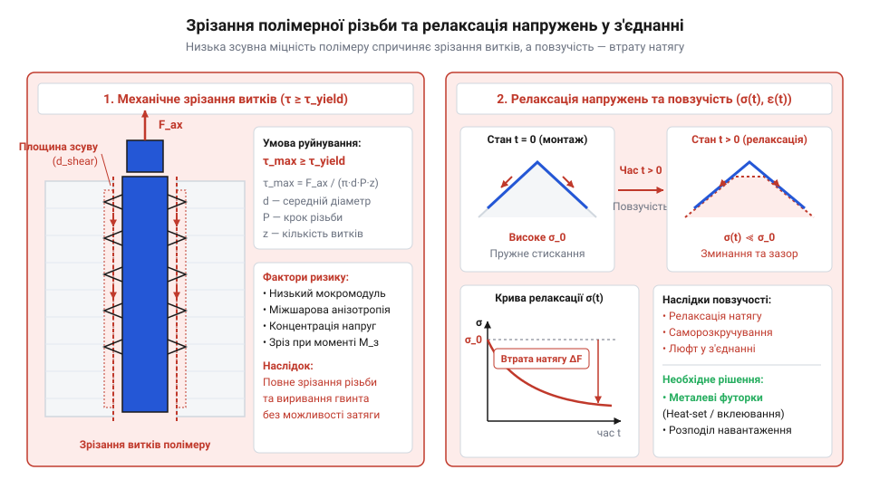
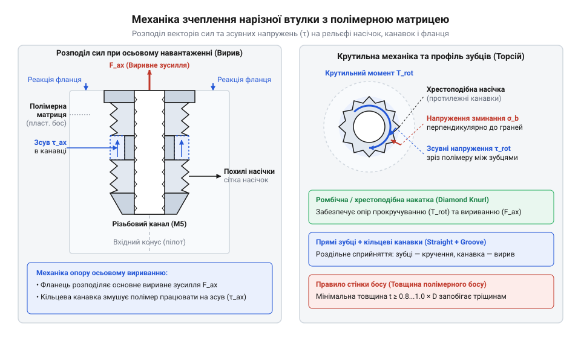
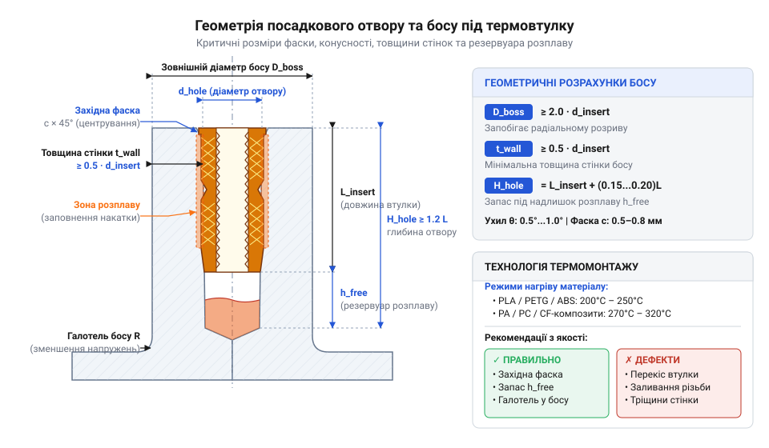
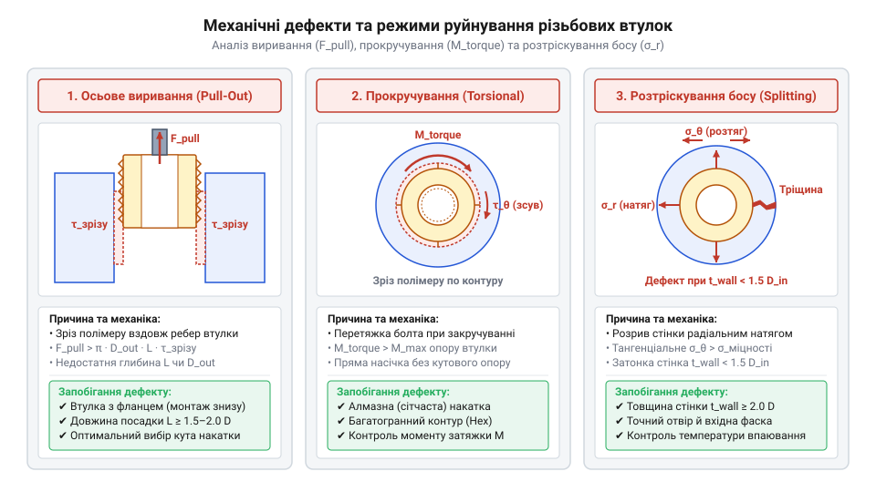
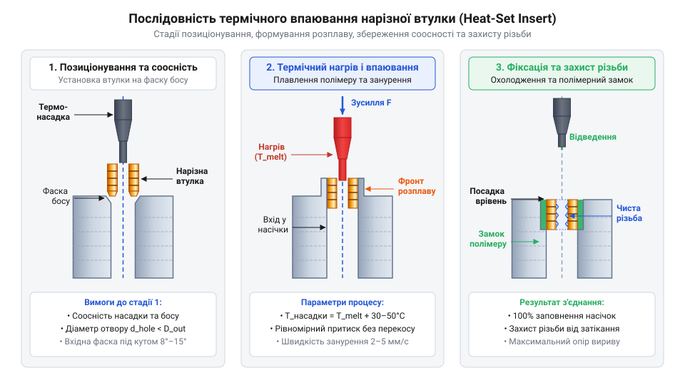

# Нарізні втулки та футорки: монтаж різьби в карбон, композити та термопласти 3D-друку

<preknowlist>
- [Класи міцності та матеріали кріплення: сталі 8.8–12.9, нержавійка A2/A4, титан Gr5 та задирання різьби](root:cat-hw-parts/fastener-strength-classes-and-materials) — механічні характеристики нарізних гвинтів, класи міцності сталей та механізм задирання нержавіючих різьбових пар
- [Тросові та еластомірні віброізолятори: Wire Rope, силіконові демпфери та поглинання ударів](root:cat-hw-parts/wire-rope-isolators) — вплив динамічних вібраційних навантажень на вузол та вимоги до фіксації втулок у вібронавантажених деталях
</preknowlist>

## Руйнування прямої різьби в полімерах

Пряме закручування металевого гвинта в деталь із полімеру чи композитного ламінату (лат. @@la|lamina@@ — пластина) призводить до незворотного руйнування вузла. Головна причина полягає в суттєвій відмінності механічних властивостей матеріалів: модуль Юнга (@@en|Young's modulus@@) сталі становить близько 200 ГПа, тоді як у термопластів — лише 2–3 ГПа. Під дією затягування витки пластику зазнають зрізання витків (@@en|thread stripping@@), оскільки межа міцності полімерної матриці на зсув у десятки разів нижча за сталеву.


*Механізми зрізання витків і релаксації сили попереднього затягування в полімерній матриці під впливом статичного навантаження.*

З часом у полімерній матриці проявляється в'язкопружна повзучість (@@en|creep@@). Під постійним напруженням молекулярні ланцюги повільно деформуються, викликаючи релаксацію сили попереднього затягування (@@en|preload@@) та розхитування з'єднання. Для вирішення цієї проблеми застосовують металеву нарізну втулку (@@en|threaded insert@@), або футорку (нім. @@de|Futter@@ — підкладка). Вона працює як механічний трансформатор площі: сприймає високий контактний тиск (@@en|contact pressure@@) від гвинта внутрішньою різьбою та перерозподіляє його зовнішньою поверхнею великої площі на м'який полімер.

## Геометрія втулки та розподіл напружень

Макрорельєф зовнішності футорки забезпечує перерозподіл механічних навантажень. Опорний фланець та кільцеві канавки сприймають осьове виривне зусилля (@@en|pullout force@@), а протилежно спрямована спіральна насічка (@@en|helical knurling@@) чи прямолінійне карбування (@@en|knurling@@) блокують закручувальний момент (@@en|torque@@) під час затягування гвинта.


*Функціональне призначення конструктивних елементів зовнішності футорки для перерозподілу осьових і крутильних сил.*

Посадкове місце має вигляд циліндричного босу (@@en|boss@@) з напрямною фаскою та резервуаром розплаву (@@en|melt reservoir@@) на дні отвору для збору витісненого пластику.


*Співвідношення зовнішнього діаметра втулки, товщини стінок босу та глибини резервуара для пластикового розплаву.*

Гранична сила вириву залежить від площі зсуву полімерного циліндра:

```
F_pull = π · D_out · L_eff · τ_shear
```

де `D_out` — зовнішній діаметр по насічці, `L_eff` — ефективна довжина контакту, `τ_shear` — межа міцності полімеру на зсув. Закручувальний момент обчислюють через плече сили:

```
M_torque = π · (D_out / 2)² · L_eff · τ_shear
```

## Розрахунок посадкових босів та отворів

Діаметр отвору задає натяг посадки (@@en|interference fit@@). Його брак спричиняє виривання втулки, а надлишок — колові напруження (@@en|hoop stress@@) та розтріскування босу (@@en|boss splitting@@). Для термопластів (PLA, PETG, ABS, Nylon) і композиту PA-CF діаметр отвору розраховують через впадинний діаметральний розмір насічки (@@en|root diameter@@):

```
d_hole = d_root + k_fill · (d_knurl - d_root)
```

де `d_root` — діаметр втулки по впадинах, `d_knurl` — по вершинах насічки, `k_fill` — коефіцієнт заповнення канавок розплавом (0.4–0.6).


*Характерні дефекти монтажу: розтріскування босу, прокручування втулки в гнізді та затікання розплаву в різьбову канавку.*

Помилки розрахунку викликають прокручування (@@en|spin-out failure@@) футорки чи затікання різьби (@@en|thread clogging@@) розплавом.

## Технології термічного впаювання та вклеювання

Основним методом монтажу термовтулок у термопласти є соосне термічне впаювання (@@en|heat-set insertion@@). Нагрівальна фасонна насадка (@@en|heat-set tip@@) розігріває втулку до 200–280 °C; під легким осьовим тиском вона занурюється в отвір, а розплавлений пластик заповнює насічку. Точний температурний контроль запобігає термічній деструкції (@@en|thermal degradation@@) полімеру, що деталізує [методика термічного монтажу](root:cat-hw-parts/threaded-inserts-and-heat-set/proj-heat-set-installation-and-testing.md).


*Покрокова послідовність нагріву, введення футорки в посадковий отвір та природного охолодження для відновлення міцності.*

Після занурення полімер кристалізується під час природного охолодження. Для неплавких термореактивних вуглепластиків (CFRP) застосовують адгезійне вклеювання (@@en|adhesive bonding@@) конструкційними епоксидними смолами (@@en|structural epoxy@@).

## Матеріали футорок та запобігання дефектам

Автоматна латунь забезпечує високу теплопровідність для термічного монтажу. Нержавіючу сталь обирають для високонавантажених вузлів, однак ризик задирання різьби (@@en|galling@@) вимагає узгоджувати [матеріали та класи міцності](root:cat-hw-parts/fastener-strength-classes-and-materials) кріплення.

Алюмінієво-титанові сплави застосовують у полегшених конструкціях. Контакт алюмінію з карбоновим композитом викликає гальванічну корозію (@@en|galvanic corrosion@@), яку нейтралізують анодуванням чи ґрунтуванням, а для віброзахисту застосовують [віброізолятори у силових вузлах](root:cat-hw-parts/wire-rope-isolators).