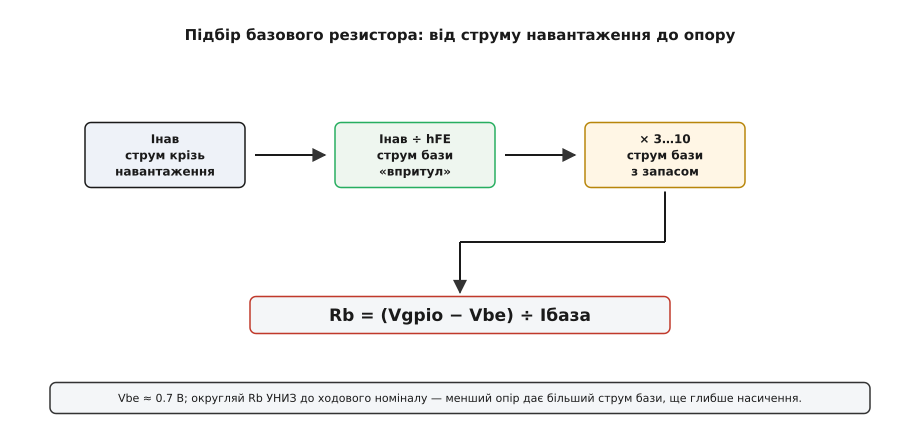
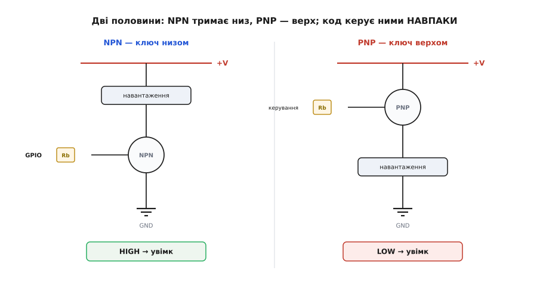

# ⚙️ API транзисторного ключа: від задачі до робочого коду

Транзистор із набору сам по собі — мертва «пігулка». Оживає він тоді, коли крізь нього тече струм навантаження, а керує цим струмом вивід мікроконтролера. І тут виникає прикра асиметрія праці: **апаратна** частина ключа вимагає уваги — базовий резистор, діод-гасник, правильна розпіновка, — а **програмна** зводиться до одного рядка «виставити на піні одиницю». Новачок, побачивши цей однорядковий код, робить хибний висновок, що ключ — тривіальна річ, і забуває резистор або гасник. Тому корисно зібрати весь ключ в один невеликий, але **чесний** шматок коду-обгортки: такий, що самою своєю формою нагадує, які апаратні рішення вже ухвалено, і не дає забути жодного.

Мета цього тексту — саме така обгортка. Не «моргни світлодіодом», а невеличка бібліотека керування ключем, яку не соромно вкласти в реальний проєкт: з підбором базового резистора під конкретне навантаження, з окремим типом для індуктивного навантаження (щоб гасник не забувся), з керуванням комплементарною парою NPN/PNP і з окремим варіантом на MOSFET, де базового резистора немає взагалі. Мова тут — C/C++ під мікроконтролер: ключ живе в прошивці, смикає піни й регістри таймерів, і жодна «висока» мова тут не доречна — це доменно-замкнений код заліза.

> 🔧 **Навіщо це.** Обгортка над одним `digitalWrite` здається зайвиною — але вона розв'язує реальну проблему. Коли в проєкті три ключі (реле насоса, підсвітка, вентилятор), голе «виставити на виводі одиницю» — байдуже, чи записане воно як `digitalWrite(5, HIGH)`, `gpio_set_level(GPIO_NUM_5, 1)` чи `HAL_GPIO_WritePin(GPIOB, GPIO_PIN_5, GPIO_PIN_SET)` — розсипане по коду не каже **нічого** про те, чи стоїть на цьому виводі NPN низом, PNP верхом, чи MOSFET, і чи є там гасник. Іменований тип `Switch relay(5)` із методами `on()`/`off()` робить намір видимим, а неправильне вживання — важчим. Це той випадок, коли крихітна абстракція коштує кількох рядків, а економить години плутанини.

## Задача, яку розв'язує ключ

Сформулюймо чітко, бо від формулювання залежить увесь код. Є **слабке джерело команд** — цифровий вивід мікроконтролера, що вміє видати «0» чи «1» і віддати при цьому лічені міліампери. Є **сильне навантаження** — реле, лампа, моторчик, стрічка світлодіодів, — якому треба десятки чи сотні міліампер, а живиться воно часто від окремої, вищої напруги (5 В, 12 В). Між ними прірва: вивід фізично не потягне навантаження напряму, а навантаження не вміє слухати логічний рівень.

Транзистор — міст через цю прірву. Малий струм у базу (або напруга на затворі MOSFET) «прочиняє» великий струм між колектором і емітером, і навантаження вмикається. Код при цьому лише керує тим малим струмом — виставляє рівень на виводі. Уся хитрість — щоб цей рівень надійно **насичував** транзистор (загнав його у стан «повністю відкритий»), а не лишав на межі, де він гріється й ледь тягне.

Отже, обгортка мусить уміти чотири речі, і саме їх ми й закодуємо:

```
1. Ініціалізувати вивід       — перевести в режим ВИХОДУ, гарантований стан «вимкнено»
2. Увімкнути / вимкнути        — on() / off(), з урахуванням полярності (NPN vs PNP)
3. Плавно керувати            — PWM: пригасити лампу, збавити оберти мотора
4. Не забути залізо            — базовий резистор і гасник заведені в конструктор/тип
```

Порахуймо спершу єдине число, без якого код безглуздий, — базовий резистор.

## Базовий резистор: формула, яку не можна «прикинути на око»

База біполярного транзистора — це, по суті, [прямозміщений діод](root:hw-components/diode-bias): між базою й емітером «сідає» майже стала напруга, для кремнію ≈ 0.7 В, і скільки струму крізь неї пропустити, задає зовнішній резистор. Без нього струм бази обмежений лише опором виводу й злітає в неконтрольовані сотні міліампер, спалюючи і перехід, і сам GPIO. Тож `Rb` обов'язковий, і його треба **порахувати**, а не поставити «яке під руку трапилось».

Логіка розрахунку — причинно-наслідковий ланцюжок, а не набір формул. Ми хочемо пропустити крізь навантаження струм `Iнав`. Щоб транзистор його пропустив у активному режимі, у базу треба щонайменше `Iнав ÷ hFE` — це струм бази «впритул». Але ключу впритул не годиться: при точно такому струмі транзистор сидить на **межі** насичення, будь-яке коливання hFE — і він недовідкрився. Тому струм бази беруть **із запасом**, у 3–10 разів більший; тоді транзистор іде глибоко в насичення, на ньому лишаються десяті вольта, і рівно скільки там hFE — уже байдуже. Знаючи потрібний струм бази, законом [Ома](root:hw-analog/ohms-law) знаходимо опір: напруга на резисторі (рівень GPIO мінус 0.7 В на базі) поділена на цей струм.


*Струм навантаження задає струм бази «впритул» (÷ hFE); множення на запас 3…10 заганяє транзистор у глибоке насичення; закон Ома перетворює потрібний струм бази на опір. Vbe ≈ 0.7 В.*

Зберемо це в код — не в «магічну сталу 1 кОм», а в чесну функцію, що з параметрів навантаження й транзистора рахує опір. Тоді, змінивши струм чи транзистор, ви одразу бачите новий `Rb`, а не гадаєте:

:::code api-transistor-switch/c/bazovyi-rezystor-formula.c

**Ключ на 5-вольтове реле, 100 мА, керування з піна 3.3 В.**
```c
float rb = base_resistor(0.100f,  // Iнав = 100 мА
                         100.0f,  // hFE(min) = 100 — беремо НИЖНІЙ край даташита
                         3.3f,    // Vgpio = 3.3 В
                         5.0f);   // запас ×5
// i_base = (0.1 / 100) · 5 = 0.005 А = 5 мА
// v_rb   = 3.3 − 0.7 = 2.6 В
// rb     = 2.6 / 0.005 = 520 Ом
```

Результат — 520 Ом; ставимо найближчий менший ходовий номінал (470 Ом), бо менший опір дає трохи більший струм бази, тобто ще глибше насичення — це безпечний бік округлення. Функція заразом ловить першу пастку: у неї передають `hfe_min`, а не «типовий» hFE, бо конкретна «пігулка» з пакетика може мати підсилення на нижньому краї, і схема, порахована на оптимістичне значення, просто не насититься під навантаженням.

Але є друга, підступніша пастка — **вивід МК теж має віддати цей струм бази**, а він обмежений. Тому чесна функція мусить не лише порахувати `Rb`, а й перевірити, що GPIO цей струм потягне:

:::code api-transistor-switch/c/bazovyi-rezystor-formula-2.c

Ось чому «просто постав 1 кОм» — не таке вже безглузде правило: при 1 кОм струм бази ≈ 2.6 мА, виводу дрібниця, а транзистора вистачить на сотню-дві міліампер навантаження. Але щойно навантаження росте й `Rb` доводиться зменшувати, ця перевірка рятує вивід від перевантаження. [Про власне обмеження струму піна](root:hw-digital/slew-rate-gpio) — окрема тема; тут досить пам'ятати, що стеля є і її видно у функції.

> 🔧 **Навіщо це.** Винести `Rb` у функцію, а не в сталу, змушує вас **назвати всі чотири величини, від яких він залежить**: струм навантаження, мінімальний hFE, напругу логіки й запас насичення. Половина «мертвих» ключів на транзисторах — це саме забуті або переплутані величини: узяли hFE «типовий» замість мінімального, забули, що логіка 3.3 В, а не 5, чи не перевірили стелю піна. Функція не дає забути жодну — і це головна її користь, а не самі обчислення.

## Обгортка ключа: тип `Switch`, який знає свою полярність

Тепер сам ключ. З боку коду це вивід, який треба ініціалізувати у безпечний стан і потім вмикати/вимикати. Але є нюанс, через який голе виставляння рівня — хоч `digitalWrite`, хоч `gpio_set_level`, хоч `HAL_GPIO_WritePin` — небезпечне: **полярність залежить від того, NPN це чи PNP**. Для NPN-ключа низом `HIGH` вмикає навантаження; для PNP-ключа верхом усе навпаки — `LOW` вмикає, бо PNP керується мінусом. Якщо цю різницю тримати в голові й розсипати по коду сирі рівні, рано чи пізно переплутаєш. Тому полярність варто **сховати в тип** — хай `on()` завжди означає «увімкнути», хоч би що там під ним було.

:::tabs
:::code api-transistor-switch/c/arduino/obhortka-kliucha-typ.ino
:::code api-transistor-switch/c/esp-idf/obhortka-kliucha-typ.c
:::code api-transistor-switch/c/stm32/obhortka-kliucha-typ.c
:::

Зверніть увагу на дві навмисні деталі. Перша — `begin()` **завжди** починає з `off()`: поки код не сказав інакше, навантаження вимкнене. Це не дрібниця. Пін мікроконтролера після скидання часто перебуває у стані «вхід» і плаває; якщо на ньому висить база транзистора, ключ може випадково прочинитися на старті, і реле клацне, а мотор смикнеться ще до того, як ваша програма прокинулась. Явний `off()` у `begin()` прибиває цей стан. Друга — конструктор бере `Polarity`, тому один і той самий клас обслуговує і NPN низом, і PNP верхом; код, що вмикає навантаження, виглядає однаково, а різницю знає лише тип.

Вживається це прозоро:

:::tabs
:::code api-transistor-switch/c/arduino/obhortka-kliucha-typ-2.ino
:::code api-transistor-switch/c/esp-idf/obhortka-kliucha-typ-2.c
:::code api-transistor-switch/c/stm32/obhortka-kliucha-typ-2.c
:::

## Плавно: PWM — апаратний таймер замість рівня

Часто треба не просто «увімк/вимк», а **напівтони** — пригасити лампу, збавити оберти мотора, зробити дихальну підсвітку. Тут грає сильна риса транзистора-ключа: він перемикається дуже швидко, тож замість тримати його напіввідкритим (де він гріється) його **швидко-швидко смикають** — широтно-імпульсна модуляція (PWM). Навантаження за інерцією бачить лише **середнє**: якщо ключ відкритий половину часу, лампа світить приблизно впівсили, мотор крутиться на пів-обертів. Транзистор при цьому весь час або повністю відкритий, або повністю закритий — тобто холодний, як і має бути ключ. [Докладніше про сам PWM](root:hw-arch/pwm-on-mcu) — окремо; тут важливо, що ключ до нього ідеально пасує.

Напівтон у будь-якому мікроконтролері робить **апаратний таймер**: він сам смикає вивід із заданою шпаруватістю, а код лише пише число в регістр порівняння. Різняться самі обгортки над цим числом: на класичному Arduino-ядрі це один виклик `analogWrite(pin, duty)`, де `duty` від 0 (завжди вимкнено) до 255 (завжди ввімкнено); в ESP-IDF шпаруватість приймає драйвер LEDC, у STM32 HAL — макрос запису в регістр порівняння таймера:

:::tabs
```arduino
// Метод у наш клас: плавне керування, 0…255.
// Працює на пінах, здатних до PWM (на класичному AVR — позначені ~).
void Switch::analog(uint8_t duty8) {
    // для ACTIVE_LOW інвертуємо: 0 має лишатись «вимкнено»
    analogWrite(pin_, active_low_ ? (255 - duty8) : duty8);
}
```
:::code api-transistor-switch/c/esp-idf/plavno-pwm-aparatnyi.c
```stm32
// Те саме на STM32 HAL: шпаруватість — це число в регістрі порівняння каналу.
// Розрядність тут задає не константа, а період таймера (ARR), тож 0…255 масштабуємо.
void sw_analog(sw_t *s, TIM_HandleTypeDef *htim, uint32_t channel, uint8_t duty8) {
    // для active_low інвертуємо: 0 має лишатись «вимкнено»
    uint32_t d   = s->active_low ? (uint32_t)(255 - duty8) : duty8;
    uint32_t top = __HAL_TIM_GET_AUTORELOAD(htim);                // період у тіках
    __HAL_TIM_SET_COMPARE(htim, channel, d * top / 255);
}
```
:::

:::tabs
```arduino
Switch lamp(9);   // пін 9 уміє PWM

void loop() {
    for (int d = 0; d <= 255; d++) { lamp.analog(d); delay(6); }  // розгоряння
    for (int d = 255; d >= 0; d--) { lamp.analog(d); delay(6); }  // згасання
}
```
:::code api-transistor-switch/c/esp-idf/plavno-pwm-aparatnyi-2.c
```stm32
static sw_t lamp = { GPIOB, GPIO_PIN_9, false };
extern TIM_HandleTypeDef htim4;   // канал уже запущений: HAL_TIM_PWM_Start(&htim4, TIM_CHANNEL_4)

void lamp_breathe(void) {
    for (int d = 0; d <= 255; d++) { sw_analog(&lamp, &htim4, TIM_CHANNEL_4, d); HAL_Delay(6); }
    for (int d = 255; d >= 0; d--) { sw_analog(&lamp, &htim4, TIM_CHANNEL_4, d); HAL_Delay(6); }
}
```
:::

Зверніть увагу: у методі `analog()` для `ACTIVE_LOW` ми **інвертуємо шпаруватість** (`255 - duty8`), інакше нуль означав би «повністю ввімкнено» — та сама пастка полярності, що й з `on()/off()`, лише в аналоговій подобі. Тип знову ховає її від того, хто пише `lamp.analog(0)` очікуючи темряву.

На сучасних контролерах на кшталт ESP32 функції `analogWrite` у звичному вигляді немає — там PWM дає окремий периферійний блок **LEDC** (LED Control), який треба спершу налаштувати: прив'язати вивід до каналу, задати частоту й розрядність. Починаючи з версії 3.x ядра Arduino-ESP32, старі `ledcSetup()`/`ledcAttachPin()` замінені одним викликом `ledcAttach(pin, freq, resolution)`, а шпаруватість пишеться `ledcWrite(pin, duty)` — канал прив'язується автоматично (перевірено за міграційним гайдом Espressif). Загальне правило звідси й видно: перш ніж писати шпаруватість, PWM треба **налаштувати** — задати частоту й розрядність і прив'язати до них вивід. Різниця лише в тому, скільки викликів на це йде:

:::tabs
:::code api-transistor-switch/c/arduino/plavno-pwm-aparatnyi.ino
:::code api-transistor-switch/c/esp-idf/plavno-pwm-aparatnyi-3.c
:::code api-transistor-switch/c/stm32/plavno-pwm-aparatnyi.c
:::

Вибір частоти — не дрібниця. Для лампи згодиться будь-яка вища за 100 Гц (око не бачить мерехтіння). Для мотора чи реле частоту беруть **вище звукового діапазону** (18–20 кГц і вище), інакше котушка починає тихо, але прикро **пищати** на частоті PWM — вона ж механічно вібрує в такт. П'ять кілогерців — компроміс для навчального прикладу; для мотора підняли б до 20 кГц.

## Індуктивне навантаження: гасник, який не можна забути

Реле й мотор — **індуктивні**: усередині котушка. А котушка не терпить різкого обриву струму: коли ключ закривається, вона намагається продовжити струм і викидає на своїх кінцях величезний стрибок напруги зворотної полярності — десятки, а то й сотні вольтів. Цей викид б'є прямо в колектор транзистора й пробиває його — не одразу, то за десятки перемикань. Ліки одні: **діод-гасник** (зворотний, freewheeling) паралельно навантаженню, катодом до плюса. У нормі він закритий; у мить викиду відмикається й дає струму котушки безпечно стекти по колу, погасивши стрибок.

Гасник — суто апаратна деталь, коду про неї нема. Але саме тому її **найлегше забути**: у прошивці ніщо про неї не нагадує. Пропущений діод на реле — одна з найчастіших причин, чому ключ на транзисторі «раптом здох». Тож зробімо так, щоб код **нагадував** сам: окремий тип `InductiveSwitch`, у конструкторі якого стоїть обов'язковий прапорець-нагадування. Компілятор не перевірить, чи ви справді впаяли діод, — але сам факт, що для реле й мотора ви **мусите** взяти інший тип, змушує згадати про гасник у момент написання коду.

:::tabs
:::code api-transistor-switch/c/arduino/induktyvne-navantazhennia.ino
:::code api-transistor-switch/c/esp-idf/induktyvne-navantazhennia.c
:::

:::tabs
```arduino
InductiveSwitch relay(7);   // реле: тип КРИЧИТЬ «не забудь гасник»
Switch          led(8);     // світлодіод із резистором — резистивне, гасник НЕ потрібен

void setup() { relay.begin(); led.begin(); }
```
```esp-idf
static ind_sw_t relay = { { .pin = GPIO_NUM_7, .active_low = false } };  // тип КРИЧИТЬ «гасник!»
static sw_t     led   = {   .pin = GPIO_NUM_8, .active_low = false   };  // резистивне: гасник НЕ потрібен

void app_main(void) {
    ESP_ERROR_CHECK(ind_sw_begin(&relay));
    ESP_ERROR_CHECK(sw_begin(&led));
}
```
:::

Правило-мнемоніка залишається залізним: **комутуєш котушку — став гасник**. Реле, мотор, соленоїд, електромагніт — усе індуктивне, усе бере `InductiveSwitch` і фізичний діод. Резистивне навантаження (лампа розжарення, світлодіод із резистором, нагрівач) гасника не потребує — там нема чому викидати, і звичайний `Switch` доречний. Розділивши це на два типи, ви переносите правило з голови в структуру коду.

> 🔧 **Навіщо це.** Тип, який нічого не додає до поведінки (`InductiveSwitch` робить те саме, що `Switch`), може здатися безглуздим. Але його роль — **семантична**, не поведінкова: у момент, коли ви пишете `InductiveSwitch relay(7)`, вам доводиться усвідомити, що навантаження індуктивне, а отже треба діод. Це той самий прийом, що й іменовані одиниці виміру в типах: код стає документом, який змушує подумати про фізику до того, як щось згорить. Дешевий трюк — велика економія спалених транзисторів.

## Комплементарна пара: низ на NPN, верх на PNP

У наборі транзистори лежать [парами-двійниками](root:hw-components/pnp-high-side-driver): під кожен NPN є дзеркальний PNP тих самих параметрів. Навіщо? Бо NPN зручно ставити **знизу** навантаження (між навантаженням і землею), а PNP — **зверху** (між плюсом живлення й навантаженням), і разом вони дають повний контроль над обома «кінцями» навантаження. Найпростіший корисний випадок — коли треба, скажімо, комутувати саме **плюс** живлення (спільна земля має лишатись під'єднаною), тоді потрібен PNP-ключ верхом; а десь поруч NPN-ключ смикає землю іншого навантаження.

Ключова відмінність для коду вже названа: **полярність керування протилежна**. NPN відкривається, коли база **вища** за емітер (тобто `HIGH` на GPIO вмикає); PNP відкривається, коли база **нижча** за емітер, а емітер у нього на плюсі — отже базу треба притягнути до низу, і `LOW` вмикає. Наш клас `Switch` уже вміє обидва режими через `Polarity`, тож комплементарна пара кодується без нового коду — лише правильним вибором полярності на кожному ключі:


*NPN сидить між навантаженням і землею — HIGH на виводі його вмикає. PNP сидить між плюсом і навантаженням — його вмикає LOW. Код керує двома половинами дзеркально; клас ховає цю різницю за однаковим on().*

:::tabs
:::code api-transistor-switch/c/arduino/komplementarna-para-nyz-na.ino
:::code api-transistor-switch/c/esp-idf/komplementarna-para-nyz-na.c
:::code api-transistor-switch/c/stm32/komplementarna-para-nyz-na.c
:::

Тут видно всю вигоду абстракції над полярністю. Читаючи `low_side.on()` і `high_side.on()`, ви думаєте про **намір** («увімкнути обидва»), а не про те, що на одному піні при цьому `HIGH`, а на іншому `LOW`. Спробуйте написати те саме голими викликами запису рівня — і рано чи пізно на PNP поставите «1», вимкнувши його там, де хотіли ввімкнути.

Одне застереження про залізо, якого код не покриває: керувати базою PNP напряму з 3.3-вольтового піна, коли навантаження живиться від 12 В, **не можна** — пін не підтягне базу до 12 В, і PNP не закриється повністю. Для верхнього ключа з вищою напругою живлення між GPIO і базою PNP ставлять ще один дрібний NPN-транзистор-«драйвер»; тоді логіка керування знову інвертується. Це вже [схемотехніка верхнього ключа](root:hw-components/pnp-high-side-driver) — там і про драйвер докладно; у коді ж це зміниться лише вибором `Polarity` під конкретну схему.

## Варіант на MOSFET: `2N7000` без базового резистора

У мішаних наборах трапляється `2N7000` — маленький N-канальний [MOSFET](root:hw-components/mosfet-switch) у тому ж корпусі TO-92. Він розв'язує ту саму задачу ключа, але **іншою ручкою**: керується не струмом у базу, а **напругою на затворі**, і в сталому стані затвор струму майже не бере (він ізольований). Практичний наслідок для коду й схеми — **базового резистора немає взагалі**. Затвор можна вести майже прямо на пін (інколи через дрібний резистор 100–220 Ом, що гасить дзвін на фронтах і бере на себе кидок заряду затвора), плюс підтяжка затвора до землі резистором ~100 кОм, щоб у стані «пін як вхід» затвор не плавав і ключ не прочинявся сам.

З боку коду MOSFET-ключ керується так само, як NPN низом: `HIGH` на затворі відкриває канал, `LOW` закриває. Тобто наш клас `Switch` із полярністю `ACTIVE_HIGH` підходить без змін:

:::tabs
:::code api-transistor-switch/c/arduino/variant-na-mosfet-2n7000.ino
:::code api-transistor-switch/c/esp-idf/variant-na-mosfet-2n7000.c
:::code api-transistor-switch/c/stm32/variant-na-mosfet-2n7000.c
:::

Код тривіальний — але з `2N7000` є пастка, яку жоден код не покриє, і про неї треба сказати прямо. **Поріг затвора в нього високуватий.** За даташитами (Vishay, ON Semiconductor, Microchip) напруга відмикання `Vgs(th)` лежить у діапазоні 0.8…3.0 В — це напруга, за якої канал **починає** проводити, а не за якої він повністю відкритий. Повне насичення (мале опору каналу) datasheet нормує аж при `Vgs = 4.5 В` і вище — там `Rds(on)` спадає до кількох ом. Це усталений факт із документації, і з нього випливає прикрий висновок:

```
2N7000, ключове з даташита:
   Vgs(th)  = 0.8 … 3.0 В    ← поріг: канал ЛИШЕ починає відкриватися
   Rds(on)  нормують при Vgs = 4.5 В   ← повне відкриття тут, не при 3.3 В

Наслідок:
   від 5.0 В на затворі — відкривається надійно ✓
   від 3.3 В на затворі — може НЕ насититися, гріється, ледь тягне ✗
```

Тобто `2N7000` добре працює ключем від **5-вольтової** логіки, а з **3.3-вольтового** піна легко недовідкривається: конкретний екземпляр може мати поріг близько до 3 В, і 3.3 В на затворі його ледь прочинять — канал матиме великий опір, транзистор грітиметься й не потягне номінального струму. Для надійного керування слабкою 3.3-вольтовою логікою беруть спеціальні [логічні MOSFET](root:hw-components/logic-level-mosfet) (позначені *logic-level*), що повністю відкриваються вже від 2.5–3 В. Тому корисно завести в код і цю перевірку — не обчислення, а чесний вартовий, що не дасть тихо поставити `2N7000` на 3.3 В:

```c
// Чи надійно відкриється цей MOSFET від наявного рівня логіки.
// v_gs_full — напруга ПОВНОГО відкриття з даташита (для 2N7000 — 4.5 В),
// НЕ поріг Vgs(th).
bool mosfet_drive_ok(float v_gpio, float v_gs_full) {
    return v_gpio >= v_gs_full;
}
// 2N7000 від 5.0 В:  mosfet_drive_ok(5.0, 4.5) == true   ✓
// 2N7000 від 3.3 В:  mosfet_drive_ok(3.3, 4.5) == false  ✗  → бери logic-level MOSFET
```

> 🔧 **Навіщо це.** Пастка `2N7000` — тонка, бо він **начебто працює**: від 3.3 В канал прочиняється, світлодіод світить, і здається, що все гаразд. Проблема вилазить під навантаженням — на кількох сотнях міліампер недовідкритий MOSFET гріється й провалює напругу, і схема поводиться «якось мляво». Легко списати це на слабке живлення чи поганий контакт, а винен лише поріг затвора проти рівня логіки. Тому різницю між `Vgs(th)` (де канал **починає** відкриватися) і напругою **повного** відкриття треба тримати в голові свідомо — саме її й фіксує `mosfet_drive_ok`.

## Складність і пастки: де насправді горить

Код ключа простий — уся підступність у стиках коду й заліза. Зберемо разом чотири пастки, на яких губиться найбільше часу, бо кожна дає **не явну поломку**, а мляву, оманливу поведінку, яку легко списати не на ту причину.

**Оптимістичний hFE.** Найпоширеніша помилка розрахунку — узяти в `base_resistor()` «типовий» hFE (300) замість мінімального (100). Тоді `Rb` виходить утричі більшим, струму бази втричі менше, і транзистор сідає на **межу** насичення. Симптом: під малим навантаженням усе гаразд, а під повним — транзистор гріється, на ньому падає зайвий вольт-другий, навантаження недоотримує напруги. Ліки — завжди мінімальний hFE з даташита й запас насичення ×5. У коді за це відповідає параметр `hfe_min`, названий так навмисно.

**Забутий гасник.** Друга класика: ключ на реле чи моторі без діода-гасника. Працює тижнями, потім транзистор пробиває індуктивний викид, і ключ «раптом здихає» без видимої причини. Симптом підступний саме відкладеністю — між помилкою й поломкою десятки чи сотні перемикань. Ліки — тип `InductiveSwitch` як нагадування й фізичний `1N4148`/`1N4007` катодом до плюса паралельно кожній котушці.

**Слабкий GPIO.** Третя пастка — забути, що вивід МК має **сам віддати** струм бази, і поставити `Rb` замалим (сотня ом при 5 В — це 26 мА з піна, за стелею). Симптом: працює один ключ, а коли їх кілька й усі ввімкнені, мікроконтролер перегрівається чи скидається, бо сумарний струм пінів вибиває бюджет. Ліки — перевірка `gpio_can_drive()` і здорове правило «Rb рідко менший за кілька сотень ом при керуванні з піна».

**Переплутана розпіновка.** Четверта, найпідступніша з усіх, і суто апаратна: колектор із емітером переплутані місцями, бо `BC547` має дзеркальну до `2N3904` розводку при однаковому корпусі. Симптом — транзистор «начебто трохи працює», але з жалюгідним підсиленням (hFE у зворотному ввімкненні падає в рази), гріється й поводиться незрозуміло. Жоден код цього не бачить. Ліки одні: **перед паянням звірити розпіновку саме цього номера з даташитом**, а не сусіднього.

```
Пастка                Симптом                              Ліки
──────────────────────────────────────────────────────────────────────────────
Оптимістичний hFE     гріється під повним навантаженням    hfe_min + запас ×5
Забутий гасник        «раптом здох» за десятки клацань      InductiveSwitch + 1N4148
Слабкий GPIO          МК скидається на кількох ключах       gpio_can_drive(), Rb ≳ сотні Ом
Переплутана ніжка     «начебто працює», але кволо й гаряче  даташит САМЕ цього номера
2N7000 від 3.3 В      мляво тягне під навантаженням         logic-level MOSFET / 5 В на затвор
```

Помітьте закономірність: **три з п'яти пасток код бачить, а дві — ні**. Обгортка `Switch` ловить оптимістичний hFE (параметром), слабкий GPIO (перевіркою) і поріг MOSFET (вартовим), нагадує про гасник (окремим типом) — але переплутану ніжку не побачить ніколи, бо це фізика паяння, а не логіка програми. Саме тому чесна обгортка не претендує замінити розуміння схеми: вона переносить у код те, що **можна** перенести, і голосно нагадує про решту. Зібрати весь ключ у кілька іменованих типів варто не заради краси, а щоб у момент написання коду вас **змусило** подумати про кожну з цих пасток — до того, як щось згорить на столі.
