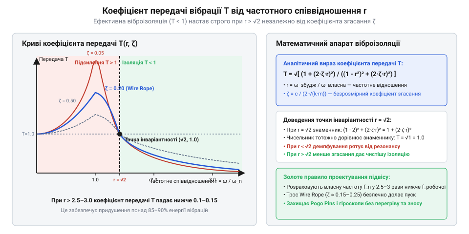
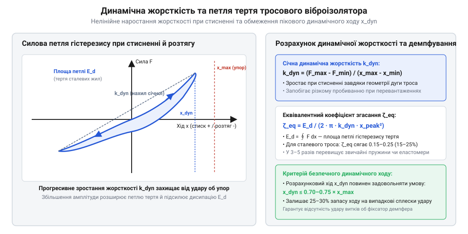
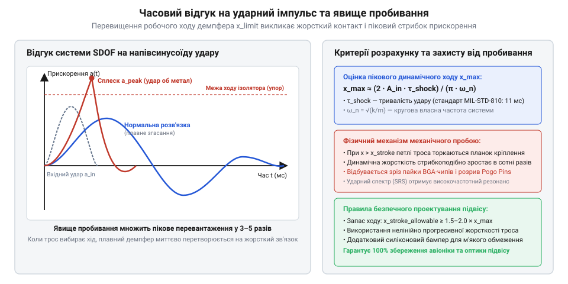

# Динаміка віброізоляції: розрахунок власної частоти, передавального відношення та згасання

<preknowlist>
- [Пружинні контакти Pogo Pins: механіка притиску, фретинг-корозія та вібростійкість](root:cat-hw-parts/pogo-pins) — критичні значення контактного притиску та механізми виникнення мікророзривів електричного кола під дією вібраційних перевантажень
- [Класи міцності та матеріали кріплення: сталі 8.8–12.9, нержавійка A2/A4, титан Gr5 та задирання різьби](root:cat-hw-parts/fastener-strength-classes-and-materials) — механічні властивості конструкційних сталей, границя текучості та стійкість металевих метизів до циклічних динамічних навантажень
</preknowlist>

## Вібраційні відмови бортової електроніки дронів

Політ сучасного безпілотного літального апарата супроводжується інтенсивним кінематичним збудженням (від англ. @@en|kinematic excitation@@), джерелами якого є високочастотне дисбалансне обертання безколекторних електродвигунів, лопатева частота проходження повітряного потоку та аеродинамічна турбулентність. Ці механічні коливання генерують широкосмугову випадкову вібрацію (від англ. @@en|random vibration@@), яка безперешкодно передається через жорсткі елементи рами на політний контролер, інерціальні модулі вимірювання (@@en|IMU@@), оптичні сенсори та системи зв’язку. За відсутності спеціального механічного захисту вібраційна енергія викликає небезпечні динамічні напруження в електронних компонентах, що призводить до катастрофічних відмов апаратури безпосередньо у повітрі.

Найбільш вразливими до вібраційних перевантажень є елементи поверхневого монтажу та плаваючі механічні з’єднання. Під дією постійних значних значень спектральної щільності прискорення у паяних з'єднаннях балових виводів та мікрокульках @@en|BGA@@-корпусів виникає значна знакозмінна деформація, яка запускає процес втоми металу. Це призводить до утворення мікротріщин у структурі припою, збільшення електричного опору контактів і подальшого повного відриву планарних компонентів від друкованої плати. Паралельно з цим вібрація руйнівно впливає на рознімні з'єднання. Наприклад, коливання рами створюють високочастотні відносні зсуви контактних поверхонь, що у [пружинних контактах Pogo Pins](root:cat-hw-parts/pogo-pins) викликає явище фретинг-корозії та призводить до моментних мікророзривів електричного кола. У момент, коли динамічне прискорення перевищує попереднє механічне стискання внутрішньої пружини, контакт штифта тимчасово втрачає фізичний зв’язок із контактною площадкою, спричиняючи збої у передачі даних та скидання живлення мікроконтролерів.

Намагання вирішити проблему шляхом підвищення конструктивної жорсткості рами або застосування високоміцних кріпильних металевих деталей, таких як [класи міцності металевих метизів](root:cat-hw-parts/fastener-strength-classes-and-materials), захищає від механічного руйнування саму несучу структуру дрона, але не усуває передачу вібраційних навантажень. Жорстке болтове з’єднання повністю транслює амплітуду коливань рами на друковану плату, а на певних частотах за рахунок збігу зі власними частотами вигину плати додатково підсилює її.

Для забезпечення надійної роботи бортової електроніки необхідно перейти від жорсткого закріплення до застосування віброізоляційного підвісу (від лат. @@en|vibration isolation@@, vibro — коливатися, insula — острів). Створення ефективної розв'язки вимагає глибокого розуміння фізико-математичних законів передачі коливальної енергії у механічних системах. Інженер має відмовитися від емпіричного підбору амортизаторів і побудувати точну розрахункову модель, яка дасть змогу обчислити власну частоту системи та передавальне відношення у всьому діапазоні робочих частот збудження.

## Математична модель одномасової системи віброізоляції

Динаміка механічної системи з віброізоляційним підвісом описується математичною моделлю із зосередженими параметрами. Найпростішим базовим розрахунковим еквівалентом є одномасова система (від англ. @@en|SDOF@@, Single Degree of Freedom — один ступінь свободи), яка складається з абсолютно жорсткої маси корисного навантаження `m`, що спирається на пружний елемент із жорсткістю `k` та паралельно підключений в’язкий демпфер із коефіцієнтом згасання `c` (від англ. @@en|damping coefficient@@, Dämpfung — згасання).

Нехай `x(t)` визначає кінематичне зсунення основи (рами дрона), а `y(t)` — абсолютне зсунення маси корисного навантаження (політного контролера). Закони ньютонівської механіки дозволяють скласти рівняння рівноваги сил, що діють на масу `m`. На масу діє відновлювальна сила пружності, пропорційна відносному зсуву `(y - x)`, та сила в'язкого тертя, пропорційна відносній швидкості `(ẏ - ẋ)`. Диференціальне рівняння руху системи в абсолютній системі координат має вигляд:

m · ÿ + c · (ẏ - ẋ) + k · (y - x) = 0

Для практичних розрахунків зручніше перейти до відносної координати `z(t) = y(t) - x(t)`, яка описує деформацію віброізолятора. Виражаючи абсолютне прискорення через відносне `ÿ = z̈ + ẍ` та переносячи відоме кінематичне збудження в праву частину, дістаємо класичне рівняння вимушених коливань:

m · z̈ + c · ż + k · z = -m · ẍ
= z̈ + (c / m) · ż + (k / m) · z = -ẍ              [ділення лівої та правої частини на масу m]

З отриманого рівняння безпосередньо випливають два фундаментальних динамічних параметри механічної системи. Першим є колова власна частота (від англ. @@en|natural frequency@@) `ω_n` незатухаючих коливань, яка визначає внутрішню частотну характеристику підвісу:

ω_n² = k / m
= ω_n = √(k / m)                                 [взяття квадратного кореня]

Перехід від колової частоти `ω_n` (рад/с) до циклічної власної частоти `f_n`, вираженої в герцах (Гц), виконується через співвідношення:

f_n = ω_n / (2 · π)
= (1 / (2 · π)) × √(k / m)                        [підстановка виразу колової власної частоти]

Другим параметром є безрозмірний коефіцієнт згасання `ζ` (дзета), який характеризує здатність демпфера розсіювати кінетичну енергію коливань. Він визначається як відношення реального коефіцієнта в'язкого демпфування `c` до критичного значення `c_c`, при якому коливальний процес перетворюється на аперіодичний:

c_c = 2 × √(k × m)
= 2 × m × ω_n                                    [визначення критичного демпфування]

ζ = c / c_c
= c / (2 × √(k × m))                             [вивід безрозмірного коефіцієнта згасання]

Під час польоту основа піддається гармонічному збудженню виду `x(t) = X₀ × sin(ω · t)`, де `X₀` — амплітуда переміщення рами, а `ω` — колова частота збудження від обертання двигунів. Прискорення рами становить `ẍ(t) = -X₀ × ω² × sin(ω · t)`.

У реальних бортових конструкціях підвіс має декілька ступенів свободи (поступальні зсуви вздовж трьох осей та поступально-кутові коливання). У цьому випадку динамічна модель розширюється до багатомасової системи (від англ. @@en|MDOF@@, Multiple Degrees of Freedom — множинні ступені свободи), яка у матричному вигляді описується системою зв'язаних диференціальних рівнянь:

[M] · {z̈} + [C] · {ż} + [K] · {z} = -[M] · {ẍ}

тут `[M]` — інерційна матриця мас, `[C]` — матриця демпфування, `[K]` — матриця жорсткості структури, а `{z}` — вектор узагальнених відносних координат.

При проектуванні розв'язки важливо враховувати, що до рухомої маси підключаються зовнішні провідники. Щоб запобігти виникненню додаткової неконтрольованої жорсткості, [сигнальні кабелі JST-GH](root:cat-hw-parts/jst-gh-cable) та гнучкий [монтажний провід відповідного перерізу](root:cat-hw-parts/hookup-wire) повинні укладатися з компенсаційними петлями сервісної слабини. Це гарантує збереження розрахованої власної частоти `f_n` та відсутність передачі паразитної високочастотної вібрації вхідними шлейфами.

## Коефіцієнт передачі та зони віброізоляції

Головним критерієм ефективності віброізоляційного підвісу є коефіцієнт передачі (від лат. @@en|transmissibility@@, transmissio — пересилання, передача) `T`, який показує, яка частка вібраційного прискорення основи передається на захищуване корисне навантаження. Розв'язуючи диференціальне рівняння руху @@en|SDOF@@-системи для усталеного гармонічного режиму через метод комплексних амплітуд, отримуємо вираз для амплітуди відносного зсуву `Z₀` та коефіцієнта передачі прискорення `T`.

Ввівши безрозмірне частотне співвідношення `r = f / f_n = ω / ω_n`, що описує відношення частоти збудження `f` до власної частоти системи `f_n`, виводимо підсумкову формулу амплітудно-частотної характеристики:

T = Ÿ₀ / Ẍ₀
= √((1 + (2 × ζ × r)²) / ((1 - r²)² + (2 × ζ × r)²))   [розрахунок коефіцієнта передачі при кінематичному збудженні]

Математичний аналіз функції `T(r, ζ)` дозволяє чітко виділити чотири характерні динамічні зони поведінки механічної системи:

1. Зона жорсткого зв'язку (`0 ≤ r < 1`): На дуже низьких частотах, коли частота збудження значно менша за власну частоту (`r → 0`), значення `T → 1`. Це означає, що віброізолятор поводиться як абсолютно жорстке тіло, і маса `m` повністю повторює всі рухи рами без підсилення та без ослаблення.

2. Зона резонансного підсилення (від лат. @@en|resonance zone@@, resono — відгукуватися, лунати) (`r ≈ 1`): При наближенні частоти збудження до власної частоти системи значення знаменника `(1 - r²)` прямує до нуля. У точці резонансу `r = 1` формула коефіцієнта передачі спрощується до вигляду:

T_res = √((1 + (2 × ζ)²) / (4 × ζ²))
= √(1 + 1 / (4 × ζ²))                          [вираження резонансного піка через коефіцієнт згасання]

За низького демпфування (наприклад, при `ζ = 0.05`) коефіцієнт передачі досягає значення `T ≈ 10`, що означає десятикратне підсилення віброперевантажень на платі контролера порівняно з рамою дрона. Збільшення коефіцієнта згасання `ζ` ефективно знижує амплітуду резонансного піка.

3. Гранична умова переходу (`r = √2 ≈ 1.414`): Для визначення межі, з якої починається реальне приглушення вібрацій, знайдемо співвідношення частот `r`, при якому `T = 1`:

1 + (2 × ζ × r)² = (1 - r²)² + (2 × ζ × r)²    [прирівняння T до одиниці]
= (1 - r²)² = 1                                [скорочення однакових доданків з демпфуванням]
= 1 - r² = -1                                  [вибір від'ємного значення для умови r > 0]
= r² = 2                                       [перенесення доданків]
= r = √2 ≈ 1.414                               [екзактне значення точки інваріантності]

Точка `r = √2` є точкою інваріантності: при цьому частотному співвідношенні коефіцієнт передачі дорівнює одиниці незалежно від величини коефіцієнта згасання `ζ`.

4. Зона ефективної віброізоляції (`r > √2`): При співвідношенні частот `r > √2` знаменник виразу для `T` стає більшим за чисельник, внаслідок чого `T < 1`. У цій області амплітуда коливань корисного навантаження стає меншою за амплітуду збудження рами. На високих частотах (`r >> √2`) коефіцієнт передачі спадає пропорційно `1 / r²`, що відповідає ефективності гасіння `-40 dB/декаду` (`-12 dB/октаву`).

*Залежність коефіцієнта передачі T від частотного співвідношення r при різних значеннях коефіцієнта згасання ζ, що демонструє граничне значення r = √2 та розмежування зон резонансу й віброізоляції.*

Аналіз характеристик показує наявність інженерної дилеми демпфування (від англ. @@en|damping compromise@@). Високе значення `ζ` необхідне для обмеження амплітуди коливань під час проходження резонансу при запуску двигунів, проте у зоні віброізоляції (`r > √2`) підвищення `ζ` призводить до погіршення гасіння, збільшуючи передачу високочастотних завад.

Ефективним способом вирішення цього компромісу є використання нелінійних елементів, таких як тросові віброізолятори. Завдяки міжпасмовому гістерезисному тертю (від грец. @@en|hysteresis friction@@, hysteresis — відставання) вони забезпечують високе еквівалентне демпфування при великих резонансних амплітудах і низький опір при малих високочастотних зсувах.

*Силова характеристика тросового віброізолятора з петлею гістерезису сухого тертя між пасмами каната, яка визначає еквівалентне згасання та піковий динамічний хід демпфера.*

Для надійного кріплення кронштейнів тросових віброізоляторів до карбонових променів рами застосовують [латунні нарізні втулки](root:cat-hw-parts/threaded-inserts-and-heat-set), які угвинчуються або вплавляються у композитні елементи, гарантуючи стабільність розрахованих механічних параметрів підвісу під час тривалої експлуатації.

## Динаміка короткочасного ударного імпульсу

Перехід від неперервних гармонічних або випадкових вібрацій до перехідних процесів вимагає аналізу поведінки віброізолятора під дією короткочасного ударного збудження (англ. @@en|shock impulse@@, від лат. @@la|impulsus@@ — поштовх). Ударні навантаження виникають під час посадочних торкань безпілотних літальних апаратів, жорсткого розкриття парашутних систем або пікового скидання вантажу. На відміну від стаціонарного резонансу, ударний процес є нестійким транзієнтом, у якому основна енергія передається структурі протягом проміжку часу, порівняного або меншого за власний період коливань системи.

Розглянемо механічну систему з одним ступенем свободи (англ. @@en|SDOF@@) масою `m`, що піддається кінематичному ударному прискоренню основи `z''(t)`. Відносне переміщення корисного навантаження `x(t) = y(t) - z(t)` описується диференціальним рівнянням руху:

m · x''(t) + c · x'(t) + k · x(t) = -m · z''(t)
= x''(t) + 2 · ζ · ω_n · x'(t) + ω_n² · x(t) = -z''(t)      [ділення на масу m]

де `ω_n = √(k / m)` — власна колова частота системи, а `ζ = c / (2 · m · ω_n)` — коефіцієнт згасання (англ. @@en|damping ratio@@).

У разі дії стандартного напівсинусоїдального ударного імпульсу прискорення (англ. @@en|half-sine pulse@@) з амплітудою `A_0` та тривалістю `t_d`:

z''(t) = A_0 · sin(π · t / t_d)      [при 0 ≤ t ≤ t_d]
z''(t) = 0                           [при t > t_d]

Аналітичний розв'язок для відносного зсуву `x(t)` визначається через інтеграл Дюамеля (англ. @@en|Duhamel integral@@):

x(t) = (1 / ω_d) · ∫₀ᵗ -z''(τ) · exp(-ζ · ω_n · (t - τ)) · sin(ω_d · (t - τ)) dτ

де `ω_d = ω_n · √(1 - ζ²)` — згасаюча власна колова частота.

Характер динамічного відгуку визначається співвідношенням тривалості імпульсу `t_d` до власного періоду системи `T_n = 2 · π / ω_n`. У діапазоні спектра ударного відгуку (англ. @@en|Shock Response Spectrum@@, @@en|SRS@@) пікове значення відносного динамічного зсуву `x_max = max(|x(t)|)` досягає максимуму при `t_d / T_n ≈ 0.5...0.8`, утворюючи коефіцієнт динамічного підсилення удару `A_q = x_max / x_stat`, де `x_stat = m · A_0 / k`.

Кожен механічний демпфер має граничний допустимий робочий хід `x_adm` (англ. @@en|allowable stroke@@). Якщо обчислений піковий зсув перевищує геометричний зазор ізолятора (`x_max ≥ x_adm`), виникає жорстке механічне пробивання (англ. @@en|bottoming out@@). У момент пробивання витка чи пружного елемента жорсткість системи стрибкоподібно зростає в сотні разів, перетворюючи пружний підвіс на суцільний металевий упор. Це спричиняє ударне пікове прискорення на корисне навантаження, що перевищує вхідне збудження `A_0` у кілька разів, руйнує конструкційні елементи, зрізає кріпильні гвинти ([класи міцності кріплення](root:cat-hw-parts/fastener-strength-classes-and-materials)) та викликає розрив електричного кола в [пружинних контактах Pogo Pins](root:cat-hw-parts/pogo-pins).

Щоб запобігти механічному пробиванню, мінімальний розрахунковий хід віброізолятора `x_req` розраховують із урахуванням коефіцієнта інженерного запасу `k_sf` (типово `k_sf = 1.3...1.5`):

x_req = k_sf · x_max

*Часовий відгук SDOF системи на напівсинусоїдальний ударний імпульс із демонстрацією перевищення допустимого ходу та виникнення механічного пробивання.*

Розраховане значення `x_req` задає геометричні вимоги до ходу демпфера, що є вихідною точкою для моделювання віброізоляторів із нелінійною характеристикою жорсткості.

## Розрахунок нелінійних тросових віброізоляторів

Лінійні моделі віброізоляції надають точний розрахунок лише при малих амплітудах коливань. У реальних умовах експлуатації ефективний захист забезпечують металеві тросові віброізолятори (англ. @@en|wire rope isolators@@, від англ. @@en|wire rope@@ — сталевий трос), пружні елементи яких мають виражену нелінійну жорсткість та сухе гістерезисне демпфування.

Силова характеристика тросової петлі поєднує прогресивне ущільнення жорсткості (англ. @@en|stiffness hardening@@) при стисненні та розтягуванні з м'якою характеристикою при зсуві. Кубічна апроксимація відновлювальної пружної сили `F_el(x)` має вигляд:

F_el(x) = k_0 · x · (1 + α · x²)

де `k_0` — початкова лінійна жорсткість (Н/м), `α` — коефіцієнт нелінійного ущільнення (м⁻²), `x` — миттєвий зсув відносно стану рівноваги. Під дією статичної маси корисного навантаження `m` початкова статична осадка `x_stat` визначається з умови `k_0 · x_stat · (1 + α · x_stat²) = m · g`.

Власна частота нелінійного демпфера `f_n(X)` перестає бути константою й стає функцією амплітуди коливань `X`:

f_n(X) = (1 / (2 · π)) · √((k_0 / m) · (1 + (3 / 4) · α · X²))

Демпфування в тросовому віброізоляторі виникає не через в'язке тертя рідини, а внаслідок сухого тертя Кулона (англ. @@en|Coulomb friction@@) між окремими жилками високоміцного сталевого троса при деформації петлі. Цей процес моделюється за допомогою [моделями гістерезисного тертя](root:cat-hw-parts/wire-rope-isolators/math-wire-rope-hysteresis-models.md). Енергія `ΔW`, яка розсіюється за один період коливань, дорівнює площі замкненої гістерезисної петлі на діаграмі «сила — зсув»:

ΔW = 4 · F_fric · (X - x_slip)

де `F_fric` — сумарна сила тертя між жилками троса, а `x_slip` — поріг мікроковзання. Зрівнюючи розсіяну енергію `ΔW` з енергією еквівалентного в'язкого демпфера `ΔW = π · c_eq · ω · X²`, отримуємо вираз для еквівалентного коефіцієнта згасання `ζ_eq`:

c_eq = ΔW / (π · ω · X²)
= ζ_eq = c_eq / (2 · m · ω_n) = ΔW / (2 · π · k_eq · X²)      [еквівалентний коефіцієнт згасання]

*Діаграма силово-деформаційної характеристики тросового віброізолятора з виділенням площі гістерезисної петлі розсіювання енергії та ущільнення жорсткості.*

Із формули видно фундаментальну властивість [тросових віброізоляторів](root:cat-hw-parts/wire-rope-isolators): при великих амплітудах коливань у зоні резонансу еквівалентне демпфування зростає до `ζ_eq ≈ 0.15...0.25`, ефективно обмежуючи резонансний пік. Натомість при малих високочастотних амплітудах тертя між жилками «заклинює», і значення `ζ_eq` зменшується до `0.03...0.05`, що забезпечує глибоку вібророзв'язку у робочій зоні.

Геометричний розрахунок спірального тросового ізолятора з кількістю петель `N`, діаметром троса `d` та діаметром петлі `D` визначає початкову вертикальну жорсткість:

k_0 = (E · d⁴ · N) / (c_g · D³)

де `E ≈ 1.3 × 10¹¹` Па — модуль пружності сталевого авіаційного троса, `c_g ≈ 0.4...0.6` — геометричний коефіцієнт форми. Фіксація петель у платинах виконується затискними плашками, які прикручуються гвинтами, що відповідають вимогам [класи міцності кріплення](root:cat-hw-parts/fastener-strength-classes-and-materials), для запобігання послабленню натягу від циклічних гістерезисних нагрівів.

## Синтез підвісу корисного навантаження

Підсумковий синтез системи віброізоляції полягає в оптимізації просторової схеми розв'язки та виборі параметрів демпферів для захисту чутливого [підвісу корисного навантаження](root:cat-hw-parts/wire-rope-isolators/proj-payload-vibration-mount-design.md) (оптико-електронних систем, оптичних знімачів, оптичних інерціальних блоків IMU та польотних контролерів).

У багатомасових системах (англ. @@en|MDOF@@) важливо усунути зв'язок між поступальними коливаннями та модами тангажу й рискання. Для цього точки кріплення віброізоляторів розташовують симетрично відносно центра мас (англ. @@en|center of gravity@@, @@en|CG@@) корисного навантаження. Застосування 45-градусної похилої компоновки тросових ізоляторів дозволяє збалансувати вертикальну жорсткість стиснення та горизонтальну жорсткість зсуву, вирівнюючи власні частоти вздовж усіх трьох осей `f_n,z ≈ f_n,x ≈ f_n,y`.

Інженерний алгоритм синтезу підвісу складається з п'яти послідовних кроків:

1. **Аналіз спектра збудження**: визначення робочого діапазону частот збудження `f_exc` (від обертів роторів та безколекторних моторів БПЛА), спектральної щільності прискорення (англ. @@en|PSD@@, у `g²/Hz`) та амплітуди посадочного удару `A_shock`. 2. **Вибір цільової власної частоти**: забезпечення умови віброізоляції `r = f_exc_min / f_n ≥ 2.5`. Якщо мінімальні оберти двигуна створюють частоту `f_exc = 35` Гц, розрахункову власну частоту підвісу обирають у межах `f_n = 10...12` Гц. 3. **Розрахунок необхідної жорсткості**: сумарна вертикальна жорсткість підвісу задається масою вантажу `m_p`:

k_total = (2 · π · f_n)² · m_p

При використанні `N_iso` однакових тросових ізоляторів жорсткість одного елемента дорівнює `k_iso = k_total / N_iso`.

4. **Перевірка ударного ходу**: обчислення динамічного зсуву при ударному імпульсі `x_shock = A_shock / (2 · π · f_n)²`. Геометричний зазор підвісу повинен задовольняти умову `x_adm > 1.4 · x_shock`. 5. **Контроль залишкового прискорення та контактів**: перевірка залишкового перевантаження на електронних платах `a_res = T(r, ζ_eq) · G_rms`.

Залишкове прискорення `a_res` не повинно викликати дріботіння й мікророзривів (англ. @@en|chatter@@) у з'єднаннях. У платах із міжплатними роз'ємами на [пружинних контактах Pogo Pins](root:cat-hw-parts/pogo-pins) сила попереднього притиску пружини `F_contact` повинна перевищувати максимальну інерційну силу маси контакту:

F_contact > m_pin · a_res_max

Якщо ця умова порушується, контактний тиск падає до нуля, спричиняючи високочастотні збої шин даних та фретинг-корозію контактних поверхонь.

Крім того, кабельні з'єднання, що виходять за межі віброізольованого контейнера, — такі як лінії для [сигнальних кабелів JST-GH](root:cat-hw-parts/jst-gh-cable) або силові провідники на [силових роз'ємах XT](root:cat-hw-parts/xt-connectors), — не повинні створювати паразитних жорсткісних містків. Жорсткі натягнуті кабелі додають свою згинальну жорсткість до `k_total`, зміщуючи власну частоту вбік резонансу. Для збереження розрахункової віброізоляції кабельні траси формують у вигляді гнучких компенсаційних петель (англ. @@en|strain relief loop@@), фіксованих за допомогою [органайзерів гнучких кабелів](root:cat-hw-parts/cable-organizer).

*Компонувальна схема просторового підвісу корисного навантаження із 45-градусним розташуванням тросових ізоляторів та компенсаційними кабельним петлями.*

Синтезований за цим алгоритмом підвіс гарантує захист бортової апаратури від руйнівного впливу вібрацій та ударів у найжорсткіших умовах експлуатації.