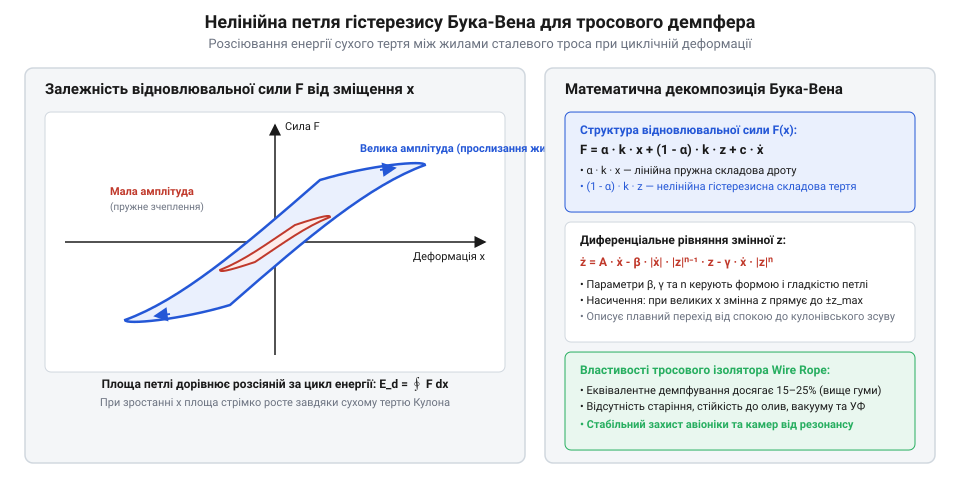
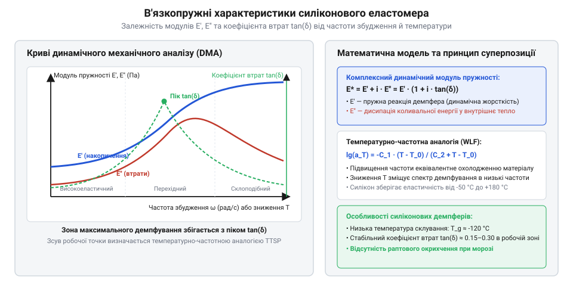

# Математичні моделі сухого тертя у тросах та в'язкопружності еластомерів

<preknowlist>
- [Пружинні контакти Pogo Pins: механіка притиску, фретинг-корозія та вібростійкість](root:cat-hw-parts/pogo-pins) — чутливість електричного контакту до кінематичних вібраційних перевантажень та вимоги до гасіння відносних амплітуд зміщення
- [Класи міцності та матеріали кріплення: сталі 8.8–12.9, нержавійка A2/A4, титан Gr5 та задирання різьби](root:cat-hw-parts/fastener-strength-classes-and-materials) — механічні характеристики нержавіючих сталей та межі пружної деформації конструкційних матеріалів петель троса
</preknowlist>

## Нелінійна відмова демпферів при зсуві

Під час проектировання віброзахисних систем бортового обладнання інженери часто застосовують класичний лінійний математичний апарат, розглядаючи амортизатори як ідеальні елементи з постійною жорсткістю `k` та коефіцієнтом в'язкого згасання `c`. Проте в умовах інтенсивних гармонічних збуджень та ударних перевантажень лінійна модель дає критичний збій: розраховані резонансні частоти зміщуються, а амплітуди коливань бортової апаратури значно перевищують допустимі межі. Джерелом цього розходження є нелінійна динаміка міжжильного тертя (англ. @@en|inter-wire friction@@), яку демонструють суцільнометалеві підпружинені елементи, як-от [тросові віброізолятори](root:cat-hw-parts/wire-rope-isolators).

Конструктивно тросовий вібродемпфер утворений петлями сталевого кабеля, звитого з десятків окремих дротів з нержавіючої сталі. При деформації витка в напрямку зсуву, стиску чи розтягу відбувається згин та відносне зміщення окремих дротів у пучку. За малих амплітуд динамічного зміщення сили тертя між жилами перевищують зсувні напруження, і трос деформується як суцільне пружне тіло з високою початковою жорсткістю `k_0`. Цей режим називається мікрозсувом (англ. @@en|microslip@@). У режимі мікрозсуву розсіювання енергії є мінімальним, а силова характеристика залишається майже лінійною.

Зі зростанням амплітуди збудження зсувні зусилля між окремими дрітовими жилами перевищують силу статичного притиску, створену попереднім натягом під час звивки кабеля. Виникає макрозсув (англ. @@en|macroslip@@) — масштабне відносне ковзання сотень контактних точок між окремими дротами. Перехід від мікрозсуву до макрозсуву викликає два нелінійні ефекти: пом'якшення жорсткості (зменшення дотичного модуля) та різке зростання площі розсіяної енергії деформації. Силовий відгук демпфера починає суттєво залежати від преісторії деформування та напрямку руху під час завантаження або розвантаження.

Спроба описати таку систему класичним коефіцієнтом в'язкого демпфування `c · dx/dt` призводить до значних помилок, оскільки сила опору міжжильного тертя практично не залежить від швидкості деформації `dx/dt`, а визначається амплітудою зміщення `x` та нормальним тиском у контактних зонах. Фізична неминучість нелінійного гістерезисного тертя вимагає відмови від лінійних рівнянь і переходу до феноменологічного диференціального опису силового відгуку ізолятора для точного прогнозування вібронавантаженості.

## Кулонівське тертя та модель Бука-Вена

Основою механізму розсіювання енергії у металевих тросах є сухе кулонівське тертя (від прізвища фізика Ш. Кулона; англ. @@en|Coulomb friction@@) між суміжними жилами. У класичному формулюванні Кулона сила тертя дорівнює `F_f = μ · N · sgn(dx/dt)`, де `μ` — коефіцієнт сухого тертя сталі по сталі, `N` — результуюча нормальна сила притиску дротів, а `sgn(dx/dt)` — функція знака швидкості відносного зсуву. Однак математичний оператор `sgn(dx/dt)` має скачкоподібну розривність у точці зміни напрямку руху `dx/dt = 0`. Це створює високу чисельну нестабільність під час інтегрування диференціальних рівнянь у часовій області та не дає змоги гладко описати плавну зміну стану від мікрозсуву до макрозсуву.

Для усунення математичної розривності та точного відтворення гладкої нелінійної характеристики використовується модель Бука-Вена (англ. @@en|Bouc-Wen model@@). У цій феноменологічній моделі повна відновлювальна сила (англ. @@en|restoring force@@) `F(x, t)` тросового віброізолятора розкладається на дві паралельні складові: лінійну пружну частину та нелінійну гістерезисну частину:

```
F(x, t) = α · k_0 · x(t) + (1 - α) · k_0 · z(t)
```

де `k_0` — початкова пружна жорсткість ізолятора при мікрозсуві (Н/м), `α` — безрозмірний коефіціент відношення післяплинної жорсткості до початкової жорсткості (`0 < α < 1`), `x(t)` — відносне зміщення ізолятора (м), а `z(t)` — внутрішня гістерезисна змінна (англ. @@en|hysteretic internal variable@@), яка має розмірність довжини та описує стан міжжильного тертя.

Динамічна еволюція внутрішньої гістерезисної змінної `z(t)` описується нелінійним диференціальним рівнянням першого порядку:

```
dz/dt = dx/dt · [ A - |z|ⁿ · (β · sgn(dx/dt · z) + γ) ]
```

де `A` — безрозмірний параметр, що задає початкову амплітуду змінної `z` (найчастіше приймається `A = 1`), `β` та `γ` — безрозмірні параметри керування формою петлі гістерезису, що визначають співвідношення між розсіюванням енергії та пом'якшенням характеристики, а `n` — безрозмірний показник ступеня, який задає різкість переходу від пружного мікрозсуву до пластичного ковзання дротів.

Параметри `β` та `γ` забезпечують гнучке налаштування симетрії та площі петлі. Для сталевого троса умова `β + γ > 0` відповідає збереженню стійкості петлі гістерезису. Коли показник `n` прямує до нескінченності (`n → ∞`), модель Бука-Вена асимптотично наближається до ідеального сухого кулонівського тертя @@en|Coulomb friction@@ зі строгим порогом зсуву.


*Силова характеристика відновлювальної сили F від деформації x для тросового віброізолятора з нелінійною петлею гістерезису Бука-Вена.*

На графіку відновлювальної сили чітко видно замкнену петлю, утворену траєкторіями завантаження та розвантаження. При малих амплітудах зміщення `x` внутрішня змінна `z` знаходиться в межах `-1 < z < 1`, і відновлювальна сила `F(x, t)` поводиться як майже лінійна пружна характеристика. Зі збільшенням зміщення `x` змінна `z` виходить на насичення (`z ≈ ±1`), а сила `F(x, t)` зростає зі зменшеним нахилом `α · k_0`. Ширина петлі вздовж осі сили визначає величину утримуваної сили сухого тертя між жилами.

## Енергія розсіювання та еквівалентне демпфування

Маючи виведене диференціальне рівняння відновлювальної сили моделі Бука-Вена @@en|Bouc-Wen model@@, розрахуємо геометричні та енергетичні характеристики нелінійної петлі гістерезису (грец. hystēresis — відставання; англ. @@en|hysteresis loop@@) в координатах сила-зміщення `(F - x)`. Головним показником ефективності віброгасіння є розсіяна енергія деформації (англ. @@en|energy dissipation per cycle@@) `W_d`, яка чисельно дорівнює площі замкненого контуру петлі гістерезису за один повний цикл гармонічних коливань `x(t) = X_m · sin(ω · t)` з амплітудою `X_m` та коловою частотою `ω`.

Розрахунок розсіяної енергії деформації `W_d` здійснюється шляхом контурного інтегрування відновлювальної сили по переміщенню за період коливань `T = 2π / ω`:

```
W_d = ∮ F(x, dx/dt) dx
    = ∫₀ᵀ F(x(t), dx/dt(t)) · (dx/dt) dt              [перехід до інтегрування по часу]
    = (1 - α) · k_0 · ∫₀ᵀ z(t) · (dx/dt) dt            [підстановка сили моделі Бука-Вена]
```

Оскільки лінійна пружна складова `α · k_0 · x(t)` є консервативною і її контурний інтеграл за замкнений цикл дорівнює нулю, вся розсіяна енергія `W_d` генерується виключно нелінійним гістерезисним додаванням з внутрішньою змінною `z(t)`.

Для співвіднесення нелінійного тертя з лінійними методами розрахунку віброзахисту визначають максимальну потенційну енергію деформації `U`, збережену в ізоляторі при максимальному відхиленні `X_m`:

```
U = (1 / 2) · k_eq · X_m²
```

де `k_eq = F_max / X_m` — еквівалентна динамічна жорсткість (січна жорсткість петлі гістерезису).

Для ідеального лінійного в'язкого демпфера з коефіцієнтом опору `c_eq` енергія, розсіяна за один цикл гармонічних коливань, обчислюється як `W_visc = π · c_eq · ω · X_m²`. Прирівнюючи енергію розсіювання нелінійного гістерезисного тертя `W_d` до в'язкої енергії `W_visc`, отримуємо коефіцієнт еквівалентного лінійного демпфування (англ. @@en|equivalent linear damping@@) `c_eq`:

```
c_eq = W_d / (π · ω · X_m²)
```

Відповідний коефіцієнт згасання (англ. @@en|equivalent damping ratio@@) `ζ_eq` розраховується через відношення розсіяної енергії `W_d` до потенційної енергії `U`:

```
ζ_eq = W_d / (4 · π · U)
```

Отримане рівняння для `c_eq` розкриває принципову відмінність тросових вібродемпферів від в'язких демпферів: еквівалентне демпфування `c_eq` є обернено пропорційним частоті коливань `ω` та залежить від амплітуди `X_m`. При збільшенні амплітуди `X_m` коефіцієнт згасання `ζ_eq` зростає до максимуму в зоні макрозсуву, забезпечуючи ефективне обмеження резонансних піків.

Обчислені значення `c_eq` та `ζ_eq` дають змогу виконати подальший аналіз розрахунку [динаміки віброізоляції](root:cat-hw-parts/wire-rope-isolators/math-vibration-isolation-dynamics.md) бортового обладнання, а також провести порівняльний розрахунок альтернативних [механізмів розсіювання енергії](root:cat-hw-parts/wire-rope-isolators/dissipation-mechanisms-comparison.md) при розробці систем підвісу.

## Комплексний модуль пружності силіконових еластомерів

При високих амплітудах кінематичного збудження металеві тросові конструкції забезпечують стабільне розсіювання енергії через міжжильне @@en|Coulomb friction@@. Однак під час мініатюризації приладів або при роботі в зоні малих амплітуд деформації сухого мікрозсуву жил стають недостатніми для розсіювання кінетичної енергії. У таких умовах виникає потреба у використанні високомолекулярних силіконових еластомерів, де розсіювання енергії відбувається не за рахунок суцільнометалевого поверхневого тертя, а внаслідок внутрішнього міжмолекулярного тертя полімерних ланцюгів. Для опису динамічного відгуку таких демпферів класичний закон Гука виявляється недостатнім, оскільки напруження в еластомері випереджає деформацію за фазою.

Розглянемо гармонічне деформування еластомерного елемента з часовою залежністю відносної деформації `ε(t)`:

```
ε(t) = ε₀ · sin(ω · t)
```

де `ε₀` — амплітуда відносної деформації, `ω` — кругова частота збудження в рад/с, `t` — час у секундах. Через внутрішній опір в'язкого перегрупування макромолекул механічне напруження `σ(t)` у матеріалі описується часовим зсувом на фазовий кут `δ`:

```
σ(t) = σ₀ · sin(ω · t + δ)
```

де `σ₀` — амплітуда напруження, `δ` — кут механічних втрат. Застосовуючи тригонометричне розкладання для синуса суми кутів, отримуємо двохкомпонентний вираз:

```
σ(t) = σ₀ · sin(ω · t) · cos(δ) + σ₀ · cos(ω · t) · sin(δ)
```

Перший доданок перебуває в однаковій фазі з деформацією і відповідає за консервативне накопичення пружної енергії, а другий доданок зсунутий на 90 градусів і відповідає за необоротну дисипацію енергії у вигляді тепла.

Використовуючи комплексну форму запису гармонічних коливань `ε(t) = ε₀ · exp(i · ω · t)` та `σ(t) = σ₀ · exp(i · (ω · t + δ))`, математичний зв'язок формалізується через @@en|complex modulus@@ (англ. *complex*, від лат. *complexus* — поєднаний) `E*`:

```
E* = σ(t) / ε(t)
   = (σ₀ / ε₀) · exp(i · δ)                      [перехід до комплексної амплітуди]
   = (σ₀ / ε₀) · (cos(δ) + i · sin(δ))           [формула Ейлера]
   = E' + i · E''                                [розділення на дійсну та уявну частини]
```

Дійсна частина виразу являє собою модуль накопичення @@en|storage modulus@@ `E'`, який характеризує пружну жорсткість демпфера:

```
E' = (σ₀ / ε₀) · cos(δ)
```

Уявна частина виразу визначена як модуль втрат @@en|loss modulus@@ `E''`, що пропорційний розсіяній енергії за цикл:

```
E'' = (σ₀ / ε₀) · sin(δ)
```

Співвідношення між модулем втрат і модулем накопичення визначає коефіцієнт механічних втрат @@en|loss factor@@ `tan(δ)`:

```
tan(δ) = E'' / E'
```

Завдяки цьому @@en|complex modulus@@ зручно записувати в множинній формі через коефіцієнт втрат `E* = E' · (1 + i · tan(δ))`.

Для еластомерного демпфувального елемента площею поперечного перерізу `A` та висотою `h` комплексне зусилля `F*(t)` пов'язане з комплексною деформацією `x*(t)` через комплексну динамічну жорсткість `K*`:

```
K* = (A / h) · E*
   = (A / h) · E' + i · (A / h) · E''            [лінійна геометрична масштабованість]
   = K' + i · K''                                [визначення динамічних компонент]
```

де `K'` — динамічна пружна жорсткість у Н/м, `K''` — квазів'язка жорсткість втрат у Н/м. Еквівалентний коефіцієнт в'язкого згасання `c_eq` у Н·с/м обчислюється шляхом прирівнювання енергії, дисипованої в'язким демпфером `W_d = π · c_eq · ω · x₀²`, до енергії втрат еластомера за один цикл коливань `W_d = π · K'' · x₀²`:

```
c_eq = K'' / ω
     = (A · E'') / (h · ω)                       [визначення через геометричні параметри]
     = (A · E' · tan(δ)) / (h · ω)               [вираження через коефіцієнт втрат]
```


*Графік спектральної залежності динамічного модуля накопичення E' та модуля втрат E'' силіконового демпфера від частоти та температурного режиму.*

Обчислені значення `K'` та `c_eq` є базовими величинами для прямого порівняння з характеристиками, які забезпечують суцільнометалеві [тросові віброізолятори](root:cat-hw-parts/wire-rope-isolators), що дозволяє провести глибокий аналіз [механізмів розсіювання енергії](root:cat-hw-parts/wire-rope-isolators/dissipation-mechanisms-comparison.md) при проектуванні комбінованого підвісу.

## Температурно-частотна аналогія та динамічна жорсткість

На відміну від суцільнометалевих тросових елементів, у яких сухе @@en|Coulomb friction@@ між сталевими дротами має високу стабільність у широкому інтервалі від мінус 60 до плюс 150 градусів Цельсія, силіконові еластомери демонструють критичну залежність механічних властивостей від температури. Зміна температури середовища зумовлює масштабну перебудову релаксаційного спектра полімерних ланцюгів: при охолодженні еластомер склоується та втрачає еластичність, а при нагріванні розм'якшується зі зниженням коефіцієнта згасання. Для точного передбачення динамічної жорсткості еластомерного амортизатора на довільній частоті та робочій температурі застосовують принцип температурно-частотної аналогії @@en|frequency-temperature superposition principle@@.

Сутність принципу полягає в тому, що вплив підвищення температури `T` на динамічні модулі еластомера еквівалентний зміщенню частотного спектра збудження `f` у бік нижчих частот, і навпаки — зниження температури еквівалентне зростанню частоти. Зв'язок між реальними умовами `(f, T)` і базовими ізотермічними умовами `(f_r, T_r)` за опорної температури `T_r` задається через безрозмірний температурний фактор зсуву `a_T`:

```
f_r = f · a_T
```

де `f_r` — приведена частота в Гц. Значення температурного фактора зсуву `a_T` у високоеластичному стані полімеру розраховується за допомогою рівняння Вільямса-Ланделла-Феррі @@en|WLF equation@@ (від прізвищ авторів @@en|Williams-Landel-Ferry equation@@):

```
lg(a_T) = -C₁ · (T - T_r) / (C₂ + T - T_r)
```

де `C₁` та `C₂` — емпіричні константи конкретної марки силіконового еластомеру (типові значення для силоксанових каучуків становлять `C₁ ≈ 8.86` та `C₂ ≈ 101.6` К при опорній температурі скловання `T_r`).

Проведемо покроковий розрахунок температурного фактора зсуву `a_T` при зниженні робочої температури амортизатора від опорної `T_r = 293.15` К (20 °C) до від'ємної `T = 253.15` К (мінус 20 °C):

```
ΔT = T - T_r
   = 253.15 - 293.15                             [обчислення температурної різниці]
   = -40 К

lg(a_T) = -8.86 · (-40) / (101.6 + (-40))
        = 354.4 / 61.6                           [арифметичне спрощення]
        = 5.753                                  [логарифм фактора зсуву]

a_T = 10^(5.753)
    ≈ 5.66 × 10⁵                                 [фактор зсуву частотного спектра]
```

Отримане значення `a_T ≈ 5.66 × 10⁵` показує, що зниження температури на 40 градусів зміщує механічну релаксацію еластомера так, ніби частота збудження зросла більш ніж у півмільйона разів.

Завдяки фактору зсуву `a_T` значення модуля накопичення @@en|storage modulus@@ `E'` та модуля втрат @@en|loss modulus@@ `E''` при довільній температурі `T` обчислюються безпосередньо з узагальненої кривої, побудованої за опорної температури:

```
E'(f, T) = E'(f · a_T, T_r)
E''(f, T) = E''(f · a_T, T_r)
```

Унаслідок цього при від'ємних температурах модуль накопичення `E'` зростає в кілька разів, перетворюючи м'який амортизатор на жорстку конструкцію з високою власною частотою, що призводить до втрати ефективності віброізоляції у низькочастотному діапазоні. При підвищених температурах (понад 80 °C) модуль втрат `E''` стрімко падає, знижуючи здатність розсіювати кінетичну енергію ударів.

З огляду на це, при проектуванні бортових систем виникає потреба порівнювати стабільність демпферів: суцільнометалеві елементи демонструють практично незмінну жорсткість, тоді як еластомерні вимагають обов'язкового врахування температурного дрейфу. Якщо в системі використовуються електронні плати, які також монтуються через [пружні контакти pogo](root:cat-hw-parts/pogo-pins), температурний дрейф жорсткості еластомерів може спричинити критичні кінематичні зміщення та розмикання електричних кіл. Також температурне розширення вузлів вимагає підбору матеріалів і перевірки [класів міцності кріплення](root:cat-hw-parts/fastener-strength-classes-and-materials) для запобігання послабленню натягу болтів при термічних циклах.

## Моделювання просторового силового відгуку віброізолятора

У реальних експлуатаційних умовах вібраційне навантаження рідко діє вздовж однієї виділеної осі. Вузли підвісу зазнають одночасного впливу просторової вібрації та лінійних прискорень, що викликає комбіновані деформації тросових петель або еластомерних блоків. Для побудови адекватної динамічної моделі необхідно формалізувати просторову матрицю жорсткості та векторизувати нелінійний відновлювальний силовий відгук віброізолятора за трьома поступальними та трьома обертальними ступенями вільностей.

Розглянемо просторовий демпфувальний елемент у локальній декартовій системі координат `(X, Y, Z)`, де вісь `Z` спрямована вздовж головної осі стиску-розтягу, вісь `X` — вздовж поздовжнього зсуву, а вісь `Y` — вздовж поперечного зсуву. Вектор просторового зміщення `u_vec = [u_x, u_y, u_z, θ_x, θ_y, θ_z]ᵀ` викликає вектор відновлювальних сил та моментів `F_vec = [F_x, F_y, F_z, M_x, M_y, M_z]ᵀ`.

Для суцільнометалевого тросового ізолятора силовий відгук уздовж осі `Z` виявляє суттєву асиметрію між стиском та розтягом. При стиску (`u_z < 0`) радіус кривизни тросових петель зменшується, дроти щільніше притискаються один до одного, що викликає прогресивне зростання пружної жорсткості `K_z,comp(u_z)`. При розтягу (`u_z > 0`) петля випрямляється, жорсткість дещо знижується (`K_z,tens(u_z)`). Зсувні жорсткості `K_x` та `K_y` суттєво менші за вертикальну жорсткість стиску `K_z`, що зумовлено високою зсувною гнучкістю витих сталевих тросів.

Формалізуємо просторову матрицю динамічної жорсткості `K_matrix` розміром 6×6, недіагональні елементи якої описують перехресну зв'язаність деформацій:

```
K_matrix(u_vec) = 
[ K_xx     0       K_xz     0       K_xθy   0     ]
[ 0        K_yy    0        K_yθx   0       0     ]
[ K_zx     0       K_zz     0       K_zθy   0     ]
[ 0        K_θx y  0        K_θxθx  0       0     ]
[ K_θy x   0       K_θy z   0       K_θyθy  0     ]
[ 0        0       0        0       0       K_θzθz]
```

де `K_zz` — асиметрична жорсткість стиску-розтягу, `K_xx` та `K_yy` — зсувні жорсткості, `K_xz = K_zx` — коефіцієнт перехресного зв'язку між зсувом та стиском, який виникає через зміну кута нахилу петель троса при деформації.

Повний вектор відновлювальних сил `F_vec(t)` складається з потенційної пружної сили, в'язкого згасання та гістерезисної складової нелінійного тертя. Для кожної поступальної компоненти `j ∈ {x, y, z}` рівняння відновлювальної сили згортається у вираз:

```
F_j(t) = K_jj(u_j) · u_j(t) + c_eq,j · (du_j / dt) + Z_hyst,j(t)
```

де `Z_hyst,j(t)` — гістерезисна змінна сухого тертя, яка обчислюється шляхом чисельного інтегрування нелінійного диференціального рівняння Бука-Вена за відповідною віссю:

```
dZ_hyst,j / dt = A_bw · (du_j / dt) - β_bw · |du_j / dt| · |Z_hyst,j|^(n-1) · Z_hyst,j - γ_bw · (du_j / dt) · |Z_hyst,j|^n
```

де `A_bw`, `β_bw`, `γ_bw` та `n` — безрозмірні параметри форми петлі гістерезису Бука-Вена за відповідним просторовим напрямком.

Врахування перехресного зв'язку між осями дозволяє будувати математичні моделі високої точності для чисельного розрахунку [динаміки віброізоляційних систем](root:cat-hw-parts/wire-rope-isolators/math-vibration-isolation-dynamics.md). Отримані рівняння просторового силового відгуку дають можливість проводити системні розрахунки при виконанні комплексного інженерного завдання з розрахунку та проектування [підвісу корисного навантаження](root:cat-hw-parts/wire-rope-isolators/proj-payload-vibration-mount-design.md) для бортового обладнання, забезпечуючи захист від просторових вібраційних та ударних перевантажень.