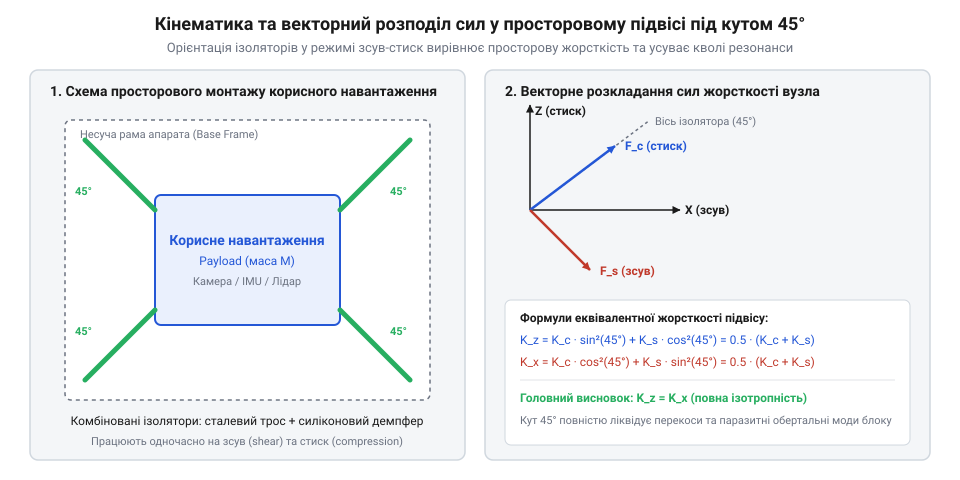
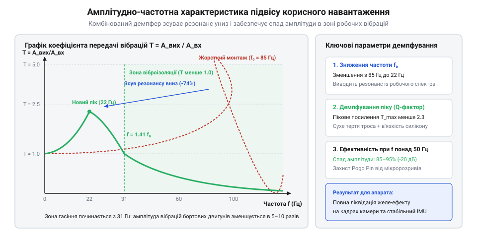

# Розрахунок та конструювання підвісу з тросовими та силіконовими віброізоляторами для корисного навантаження

<preknowlist>
- [Пружинні контакти Pogo Pins: механіка притиску, фретинг-корозія та вібростійкість](root:cat-hw-parts/pogo-pins) — критерії вібростійкості контактної групи, механіка притиску та умови виникнення мікророзривів у сигнальних колах при вібраційних перевантаженнях
- [Нарізні втулки та футорки: монтаж різьби в карбон, композити та термопласти 3D-друку](root:cat-hw-parts/threaded-inserts-and-heat-set) — геометрія посадкових отворів, температурні режими впресування втулок у термопласти та композити
- [Класи міцності та матеріали кріплення: сталі 8.8–12.9, нержавійка A2/A4, титан Gr5 та задирання різьби](root:cat-hw-parts/fastener-strength-classes-and-materials) — механічні характеристики сталей класів 8.8–12.9, граничні зсувні навантаження та вибір моментів затягування для запобігання самовідгвинчуванню
</preknowlist>

## Руйнівний вплив вібрацій на бортове обладнання

Експлуатація безпілотних авіаційних комплексів, мобільних наземних роботів та стабілізованих платформ супроводжується інтенсивними вібраційними впливами. Джерелами механічних збурень виступають безколекторні електродвигуни, аеродинамічна турбулентність гвинтів, незбалансовані обертові маси та різкі ударні перевантаження під час маневрів чи жорсткої посадки. Частотний спектр цих коливань перекриває широкий діапазон від одиниць герц до кількох кілогерц з амплітудами прискорень від 2 G до понад 15 G. Жорстке кріплення прецизійної апаратури безпосередньо до силового набору корпусу неминуче призводить до функціональних збоїв та механічного руйнування компонентів.

Найбільш вразливою ланкою є корисне навантаження (англ. @@en|payload@@), до складу якого входять оптико-електронні гіростабілізовані камери, тепловізори, інерціальні вимірювальні модулі (англ. @@en|IMU@@) та чутливі радіоелектронні блоки. Для оптичних систем кутові та лінійні мікровібрації несучої рами спричиняють розмиття експозиції, дрижання зображення та виникнення характерних хвилеподібних спотворень кадру (@@en|jello effect@@) у сенсорах із рядковим затвором (@@en|rolling shutter@@). Вбудовані механізми стабілізації матриці не здатні компенсувати високочастотні завади з частотою вище 50–80 Гц через обмежену смугу пропускання приводів.

У модулях @@en|IMU@@ мікроелектромеханічні сенсори кутової швидкості й лінійного прискорення (@@en|MEMS@@) відчувають механічний резонанс мікроструктур чутливих кремнієвих балок. Вібраційні перевантаження викликають асиметричне випрямлення високочастотного сигналу (@@en|vibration rectification error@@), що генерує хибний постійний зсув нуля акселерометрів. У результаті алгоритми розширеного фільтра Калмана (@@en|EKF@@) у системі навігації накопичують катастрофічну похибку визначення просторової орієнтації, призводячи до втрати керованості апарата.

Не менш руйнівним є вплив вібрацій на контактні інтерфейси. Під час використання швидкознімних модулів навантаження живлення й передача сигналів часто виконуються через [пружинні контакти Pogo Pins](root:cat-hw-parts/pogo-pins). Під дією циклічних прискорень сили інерції рухомого контакту долають попередній натяг пружини, що викликає динамічні мікророзриви електричного кола тривалістю від сотень наносекунд до кількох мікросекунд. Такі імпульсні переривання струму скидають мікроконтролери та спричиняють фретинг-корозію золотого покриття. Водночас жорсткі болтові вузли зазнають значних знакозмінних напружень зсуву, що веде до послаблення нарізного з'єднання навіть за умови застосування кріплення високих [класів міцності](root:cat-hw-parts/fastener-strength-classes-and-materials). Для забезпечення працездатності систем необхідне створення високоефективного багатокоординатного підвісу.

## Просторове розміщення ізоляторів під кутом 45°

Реальні механічні навантаження, що передаються від рами носія до підвішеного блоку, не є одноосьовими. Вони є суперпозицією просторових зсувних коливань у горизонтальній площині XY, вертикальних поштовхів вздовж осі Z та перекидних кутових моментів тангажу й крену. Одноосьові демпфери, зорієнтовані суворо вертикально, мають високу податливість на стиск, проте надзвичайно вразливі до бічного вигину, що викликає паразитне розгойдування та крен камери під час поворотів.

Оптимальним інженерним вирішенням є просторове симетричне розташування чотирьох ізоляторів під кутом 45° до площини основи. Така просторова конфігурація змушує будь-яке зовнішнє збурення одночасно деформувати демпферний елемент як на стиск, так і на зсув — реалізується режим суміщеного навантаження (англ. @@en|shear-compression mode@@).

*Просторове компонування підвісу: нахил опор під кутом 45° забезпечує рівножорсткість системи за осями зсуву та стиску, усуваючи паразитний крен.*

Для математичного опису просторової кінематики розглянемо одиничну демпферну опору, орієнтовану під кутом `θ` до горизонту. Власна жорсткість ізолятора вздовж поздовжньої осі при стиску позначається як `k_c` (Н/м), а поперечна жорсткість на зсув — як `k_s` (Н/м).

Векторна проєкція жорсткості однієї похилої опори на вертикальну вісь Z становить:

        k_v
        = k_c · sin²(θ) + k_s · cos²(θ)      [векторна декомпозиція жорсткості]

Аналогічно, поздовжня проєкція жорсткості на горизонтальну вісь у площині деформації становить:

        k_h
        = k_c · cos²(θ) + k_s · sin²(θ)      [векторна декомпозиція жорсткості]

Для кута нахилу `θ = 45°` тригонометричні коефіцієнти набувають значення `sin²(45°) = cos²(45°) = 0.5`. Отже, жорсткість опори набуває симетричного вигляду:

        k_v = 0.5 · (k_c + k_s)
        k_h = 0.5 · (k_c + k_s)

У симетричній системі з чотирьох однакових опор, розташованих по периметру підвішуваної рами, сумарна вертикальна еквівалентна жорсткість дорівнює сумі чотирьох вертикальних компонент:

        K_z
        = 4 · k_v                            [суперпозиція паралельних пружних елементів]
        = 2 · (k_c + k_s)                    [підстановка симетричного кута 45 градусів]

У горизонтальній площині для довільного напрямку (осі X або Y) дві протилежні опори деформуються у поздовжній площині з жорсткістю `k_h`, а дві інші — у перпендикулярній площині чистого зсуву з жорсткістю `k_s`. Сумарна горизонтальна жорсткість складає:

        K_xy
        = 2 · k_h + 2 · k_s                  [сумарна реакція чотирьох просторових опор]
        = (k_c + k_s) + 2 · k_s              [перетворення проекцій]
        = k_c + 3 · k_s                      [зведення подібних доданків]

Оскільки у типових пружних елементах осьова жорсткість на стиск перевищує зсувну приблизно у 2.5–3 рази (`k_c ≈ 3 · k_s`), отримана рівність `K_z = 2 · (4 · k_s) = 8 · k_s` та `K_xy = 3 · k_s + 3 · k_s = 6 · k_s` дає близьке до одиниці відношення жорсткостей. Це забезпечує просторову рівножорсткість підвісу без переважного напрямку вібраційного резонансу.

Власна резонансна частота навантаженої системи масою `m` (кг) згідно з [динамікою віброізоляції](root:cat-hw-parts/wire-rope-isolators/math-vibration-isolation-dynamics.md) визначається виразом:

        f₀
        = 1 / (2 · π) · √(K_z / m)           [формула власної частоти гармонічного осцилятора]

Ефективне згасання коливань починається на частотах збурення, що перевищують `f_iso = √2 · f₀ ≈ 1.41 · f₀`. На всіх вищих частотах коефіцієнт передатності вібрацій падає значно нижче одиниці.

## Розрахунок жорсткості та запобігання пробиванню

Для побудови надійного підвісу застосовують комбінацію суцільнометалевих [тросових віброізоляторів](root:cat-hw-parts/wire-rope-isolators) (англ. @@en|wire rope isolator@@) та високодемпферних силіконових вкладишів. Сталевий трос, навитий у просторову спіраль із нержавіючого дроту, має високу стійкість до агресивного середовища та температурних перепадів. Розсіювання коливальної енергії в тросі здійснюється за рахунок сухого кулонівського тертя між окремими жилами при взаємному ковзанні під час вигину, що описується в рамках [моделей гістерезисного тертя](root:cat-hw-parts/wire-rope-isolators/math-wire-rope-hysteresis-models.md). Силіконовий компаунд доповнює систему високоефективною в'язкопружною дисипацією на мікроамплітудах, що детально розглядає [порівняння механізмів дисипації](root:cat-hw-parts/wire-rope-isolators/dissipation-mechanisms-comparison.md).

Критичною небезпекою при проєктуванні підвісу є явище механічного пробивання демпфера (англ. @@en|bottoming out@@). Воно виникає, коли ударний імпульс або пікове квазістатичне прискорення `a_shock` викликає динамічне зміщення корисного навантаження `Δz`, яке перевищує допустимий конструктивний зазор між рухомою та нерухомою частинами підвісу.

Якщо демпфер повністю вибирає робочий хід `z_max`, відбувається жорсткий удар металу об метал або обмежувальні упори. При цьому динамічна передатність стрибкоподібно зростає в десятки разів, а пікове прискорення на чутливому блоці сягає понад 100 G, викликаючи руйнування сенсорів або зрив кріплення з [нарізних термовтулок](root:cat-hw-parts/threaded-inserts-and-heat-set).

Розрахунок динамічного ходу при дії перевантаження `n_g` у одиницях G (де `g = 9.81` м/с²) виконується за формулою пружного відгуку:

        Δz
        = (m · n_g · g) / K_z                [закон Гука для динамічної сили інерції]

Для запобігання аварійному пробиванню висувають суворий критерій запасу ходу: розрахунковий динамічний хід за максимального розрахункового перевантаження не повинен перевищувати 80 % від граничного механічного ходу демпфера:

        Δz ≤ 0.80 · z_max

Програмний розрахунок кінематики, тривісної жорсткості та верифікації динамічного запасу ходу на мові C представлено у модулі `wire_rope_kinematics`:

:::code proj-payload-vibration-mount-design/c/include/wire_rope_kinematics.h 20-41
:::code proj-payload-vibration-mount-design/c/src/wire_rope_kinematics.c 22-37
:::code proj-payload-vibration-mount-design/c/src/wire_rope_kinematics.c 39-50

Функція `spatial_mount_init` автоматично виконує розклад жорсткостей опор за осями та обчислює власні частоти системи. Функція `spatial_mount_calculate_dynamic_stroke` розраховує переміщення підвісу при пікових ударних навантаженнях, сигналізуючи про необхідність коригування жорсткості або збільшення кліренсу задовго до виготовлення дослідного зразка.

## Конструювання вузлів кріплення та вибір метизів

Надійність роботи підвісу в умовах тривалих вібраційних навантажень визначається не лише пружними властивостями демпферів, але й конструктивною міцністю вузлів механічного сполучення. Елементи просторової рами та кронштейни кріплення ізоляторів виготовляють із конструкційного авіаційного алюмінію (сплави Д16Т або 6061-T6), фрезерованого вуглепластику або друкують на 3D-принтері з композитів, армованих рубаним вуглеволокном (@@en|PA6-CF@@, @@en|PC-CF@@).

Пряме нарізання різьби у пластикових чи композитних кронштейнах є неприпустимим: під дією циклічних знакозмінних зусиль полімерні витки швидко зминаються і зриваються. У вузлах сполучення застосовують прецизійний монтаж латунних [нарізних термовтулок](root:cat-hw-parts/threaded-inserts-and-heat-set) (англ. @@en|heat-set inserts@@) із косими насічками. Втулки впаюють вертикальним пресовим кондуктором або вклеюють структурним епоксидним компаундом у карбонові пластини, що гарантує сувору соосність отвору та усуває концентратори напружень.

Особливі вимоги висуваються до нарізних метизів. Під дією вібраційного прискорення гвинти зазнають комбінованого навантаження на зріз і розтяг. Використання звичайних гвинтів низької міцності класів 4.8 чи 8.8 призводить до їхньої втомної пластичної деформації та ослаблення попереднього натягу. Для складання підвісу використовують високоміцні гвинти з легованої загартованої сталі за [класами міцності](root:cat-hw-parts/fastener-strength-classes-and-materials) 10.9 або 12.9 з антикорозійним цинк-ламельним або оксидним покриттям.

Для запобігання самовідгвинчуванню під дією поперечних коливань (ефект Юнкера) стандартні пружинні розрізні шайби Гровера виявляються неефективними, оскільки вони швидко втрачають пружність. Надійну фіксацію різьби забезпечують два взаємодоповнюючі методи:

1. Застосування тиксотропних анаеробних фіксаторів різьби середньої міцності (синій герметик типу Loctite 243), які полімеризуються в різьбовому зазорі без доступу повітря у контакті з металом, виключаючи мікрорухи у витках. 2. Використання клинових стопорних шайб парної конструкції (система @@en|Nord-Lock@@). Радіальні клинові виступи на внутрішніх поверхнях шайб мають кут підйому більший за кут підйому різьби, тому будь-яка спроба самовідкручування гвинта викликає механічне розклинювання та збільшення сили затиску.

Монтаж гвинтів обов'язково здійснюють динамометричним ключем із контролем крутного моменту: для гвинтів M3 класу 10.9 у латунних втулках номінальний момент затягування витримують у діапазоні 0.55–0.60 Н·м, що забезпечує стабільне притискання фланців демпфера без ризику виривання втулки з бобишки.

## Експериментальне вимірювання АЧХ та верифікація

Після фізичного виготовлення та складання просторового підвісу проводять експериментальну верифікацію його динамічних властивостей. Головною метою випробувань є визначення реальної резонансної частоти системи, оцінка еквівалентного коефіцієнта демпфування та побудова амплітудно-частотної характеристики (@@en|frequency response function@@).

Вимірювальний стенд включає електродинамічний збуджувач коливань (вібростенд) та два прецизійні тривісні акселерометри. Перший акселерометр встановлюється на рухомому столі вібростенда для вимірювання вхідного віброприскорення основи `a_base(f)`. Другий сенсор монтується безпосередньо на центрі мас підвішеного блоку корисного навантаження для реєстрації вихідного прискорення `a_payload(f)`. Вібростенд генерує гармонічний сигнал змінного синуса (@@en|sine sweep@@) у діапазоні частот від 5 до 300 Гц із постійною амплітудою збурення 1.0 G.

Коефіцієнт передатності вібрацій визначається як безрозмірне відношення амплітуд:

        T(f)
        = a_payload(f) / a_base(f)           [визначення передатності осцилятора]

*Амплітудно-частотна характеристика підвісу: на власній частоті 11.5 Гц передатність становить T=2.8 завдяки кулонівському тертю в тросах, а вище 16 Гц забезпечується згасання коливань на 18–24 дБ.*

На резонансній частоті підвісу амплітуда передатності досягає максимуму, проте енергія коливань активно розсіюється тертям між сталевими пасмами тросів та в'язким опором силікону. Це обмежує динамічну добротність системи значенням `Q ≤ 3.0` (що еквівалентно відносному коефіцієнту згасання `ζ ≈ 0.18`), запобігаючи неконтрольованому розгойдуванню навантаження. За межею віброізоляції `f > 16` Гц передатність стрімко спадає, і на робочих частотах моторів (100–250 Гц) прискорення на камері зменшується у 8–15 разів відносно вібрацій рами.

Під час частотного сканування також контролюють стабільність електричного контакту в роз'ємах живлення. Завдяки зниженню високочастотних прискорень до величин менше 0.3 G динамічні сили інерції рухомих контактних пінів у [пружинних контактах Pogo Pins](root:cat-hw-parts/pogo-pins) не перевищують силу пружинного підтискання (0.6–0.8 Н), завдяки чому мікророзриви сигналу повністю зникають.

Програмний комплекс для реєстрації телеметрії та розрахунку передатності реалізовано на мовах C++ та Python:

:::tabs
:::code proj-payload-vibration-mount-design/cpp/include/VibrationTelemetry.hpp
:::code proj-payload-vibration-mount-design/cpp/include/VibrationMonitor.hpp
:::code proj-payload-vibration-mount-design/cpp/src/VibrationMonitor.cpp
:::code proj-payload-vibration-mount-design/cpp/src/main.cpp
:::code proj-payload-vibration-mount-design/py/spatial_mount_kinematics.py
:::code proj-payload-vibration-mount-design/py/transmissibility_analyzer.py
:::code proj-payload-vibration-mount-design/py/optimize_mount.py
:::

Клас `VibrationMonitor` на C++ у реальному часі буферизує відліки акселерометра, фільтрує високочастотний шум, обчислює діючі середньоквадратичні значення (@@en|RMS@@) прискорень та передатність, генеруючи попередження при перевищенні порогів безпеки. Скрипт на Python виконує числове моделювання просторової кінематики, оптимізує кути нахилу та виводить текстову або графічну діаграму АЧХ, завершуючи інженерний цикл проєктування підвісу.