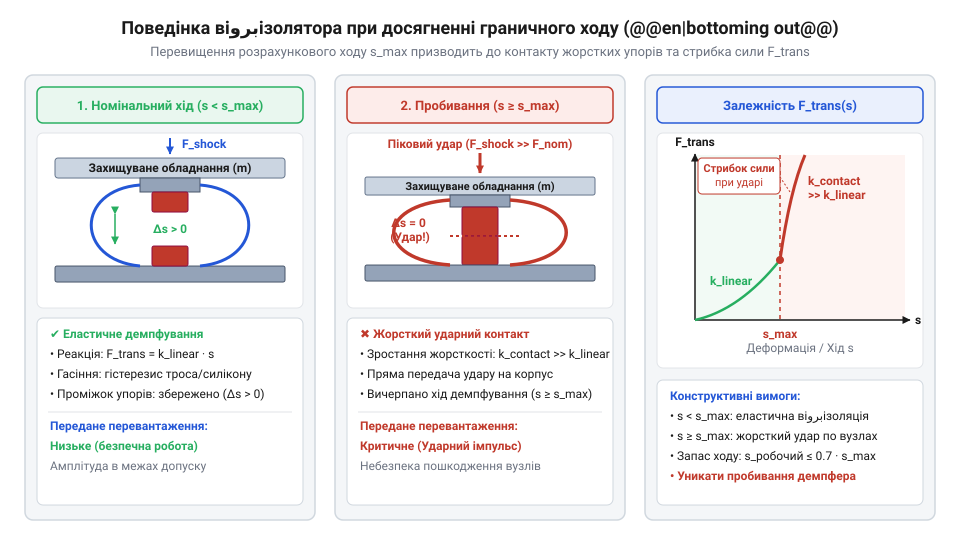
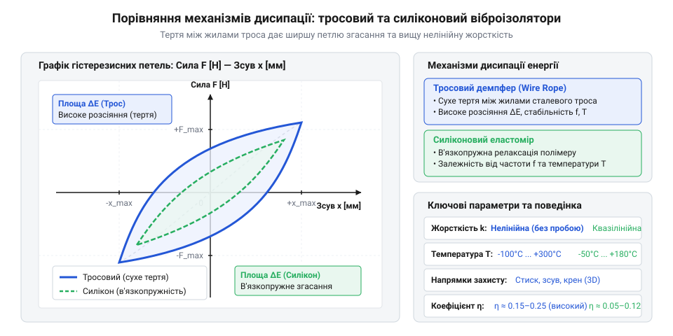
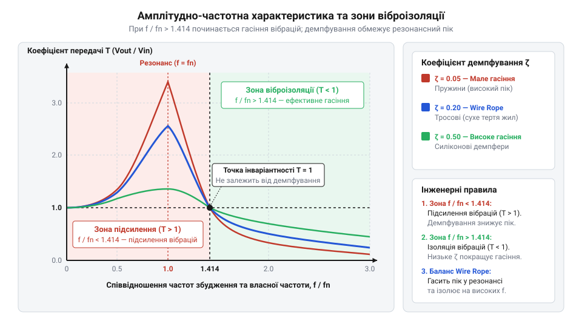
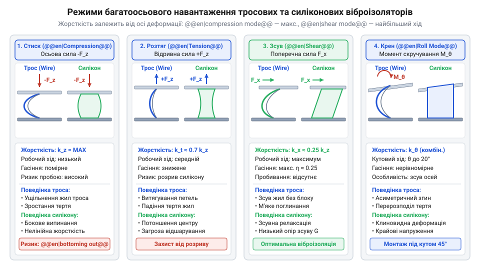

# Тросові та еластомірні віброізолятори: Wire Rope, силіконові демпфери та поглинання ударів

<preknowlist>
- [Пружинні контакти Pogo Pins](root:cat-hw-parts/pogo-pins) — механізми виникнення фретинг-корозії та деградації контактів під дією мікропереміщень від вібрації
- [Нарізні втулки та футорки](root:cat-hw-parts/threaded-inserts-and-heat-set) — прийоми надійного монтування різьбових закладнок у композити та пластики для сприйняття реакцій віброізоляторів
- [Класи міцності та матеріали кріплення](root:cat-hw-parts/fastener-strength-classes-and-materials) — принципи вибору класів міцності та матеріалів гвинтів для відвернення зрізу та розхитування різьбових з'єднань під дією динамічних ударів
</preknowlist>

## Руйнування обладнання від вібрацій та ударів

Бортовий радіоелектронний блок, змонтований на жорсткій рамі безпілотного літального апарата чи колісної бронемашини, під час руху зазнає постійного впливу кінетичних збуджень. Двигун внутрішнього згоряння, високообертові безколекторні мотори, ротори або нерівності рельєфу генерують безперервну спектральну вібрацію (лат. @@la|vibratio@@ — коливання), яка крізь жорсткі металеві стійки передається безпосередньо на друковану плату ( @@en|printed circuit board@@ ). Зовні пристрій здається нерухомим і цілісним, проте на мікроскопічному рівні кожна деталь перебуває під дією циклічних змінних напружень, що призводять до накопичення втоми матеріалів ( @@en|material fatigue@@ ). Без віبروізолювальної розв'язки енергія механічних коливань практично без перешкод потрапляє всередину корпусу, спричиняючи приховане руйнування компонентів ще до закінчення гарантованого ресурсу експлуатації.

Першими під удар потрапляють зони паяних з'єднань електронних компонентів та роз'ємні контакти. Під дією високочастотної вібрації масивні поверхнево-монтовані елементи ( @@en|SMD@@ ) та корпуси з масивами кулькових виводів ( @@en|BGA@@ ) зазнають мікроскопічних зсувних деформацій відносно текстолітової основи. Укриті мікротріщинами припаї кришаться під циклічним зсувом, після чого електричний контакт остаточно розривається. Паралельно у роз'ємних з'єднаннях виникає фретинг-корозія (англ. @@en|fretting corrosion@@ — стирання від мікрозсувів), опис якої детально висвітлюють [пружинні контакти Pogo Pins](root:cat-hw-parts/pogo-pins) у контексті деградації покриття та виникнення спорадичних відмов. Коли золочене чи нікелеве покриття контакту стирається до основного металу через постійне мікротремтіння, окиснений шар різко збільшує перехідний опір, викликаючи збої в лініях живлення й передачі даних.

Не менш вразливою ланкою є нарізні кріплення корпусу та внутрішніх модулів. Постійні знакові динамічні навантаження послаблюють попереднє затягування гвинтів, вимиваючи тертя у різьбі та спричиняючи самовідгвинчування. Цю проблему вивчають [нарізні з'єднання та фіксатори](root:cat-hw-parts/threaded-fasteners-vibration-locking), оскільки втрата затиску нарізного з'єднання перетворює локальний вібраційний вузол на ударний механізм: люфт між деталями призводить до розбивання монтажних отворів і зрізу гвинтів.

Крім фізичного руйнування конструкції, невідфільтрована вібрація критично деградує функціональність вимірювальних систем. Оптичні камери втрачають чіткість зображення через змазування кадру ( @@en|motion blur@@ ), а інерціальні вимірювальні модулі ( @@en|IMU@@ ) на базі мікроелектромеханічних систем ( @@en|MEMS@@ ) починають видавати хибні покази. Спектральні піки механічних коливань збігаються з власними частотами внутрішніх чутливих кремнієвих балок акселерометрів і гіроскопів, викликаючи насичення ( @@en|saturation@@ ) аналогово-цифрових перетворювачів. Щоб вчасно виявити такі небезпечні спектральні компоненти, застосовують [вимірювання вібрацій акселерометрами](root:hw-sensing/accelerometer-vibration-measurement-analysis), що дозволяє побудувати спектральну щільність потужності ( @@en|Power Spectral Density, PSD@@ ) та оцінити ризик резонансного підсилення.

Якщо вібрація діяла безперервно і призводила до накопичення втоми, то поодинокий механічний удар ( @@en|shock load@@ ) — наприклад, жорстка посадка безпілотника, постріл гармати або вибухова хвиля — діє миттєво. Під час імпульсу прискорення короткочасно зростає на порядки (до сотень `g`), створюючи величезні інерційні сили `F = m · a`. Якщо жорсткість демпфувального елемента підібрана неправильно або амплітуда удару перевищує розрахований конструктивний хід ізолятора, відбувається пробивання демпфера (англ. @@en|bottoming out@@ — вичерпання ходу).


*Схема деформації віброізолятора під дією ударного імпульсу: перехід від пружної амортизації до пробивання демпфера через вичерпання робочого ходу.*

У момент пробивання демпфера пружний елемент повністю стискається до стану монолітного блоку, після чого коефіцієнт передачі жорсткості стрибкоподібно зростає. Усі накопичені інерційні сили передаються на корпус приладу практично без згасання, що призводить до деформації шасі, відриву важких трансформаторів чи конденсаторів та тріщин у друкованих платах.

Потреба у захисті чутливої апаратури від одночасного впливу постійної вібрації та руйнівних поодиноких ударів призвела до створення спеціалізованих ізоляторів у середині XX століття. Початково для підвішування суднової та авіаційної електроніки застосовували звичайні сталеві виті пружини, проте вони мали критичний недолік — практично нульове внутрішнє тертя, через що на власній частоті виникав небезпечний резонанс із багатократним підсиленням амплітуди. Суворі військово-морські та аерокосмічні специфікації, які згодом оформилися у стандарти на кшталт MIL-STD-810 та MIL-S-901, висунули вимогу щодо створення пристроїв із високим дисипативним згасанням. Це стимулювало розробку тросових ( @@en|Wire Rope@@ ) ізоляторів на основі плетених сталевих канатів, а пізніше — високостабільних силіконових еластомерних демпферів (нім. @@de|Dämpfer@@ — демпфер). Нові конструкції забезпечили багаторазове поглинання пікових ударних навантажень без залишкової деформації та гарантували стабільність параметрів у широкому діапазоні температур.

Усі згадані руйнівні чинники та нормативи випробувань деталізують [методики випробувань MIL-STD-810](root:hw-components/vibration-and-shock-testing-mil-std), які оцінюють витривалість бортових систем. Для інженера-розробника розуміння симптоматики — від розхитаних гвинтів та фретинг-корозії до пробивання демпфера — створює чітку вимогу: між джерелом механічного збудження та чутливим вузлом обов'язково має стояти віброізолятор із розрахованим механізмом дисипації енергії.

## Фізика дисипації енергії в ізоляторах

Віброізолятор — це не просто м'яка прокладка або пружина, а механічний фільтр і перетворювач енергії. Закон збереження енергії вимагає, щоб кінетична енергія рухомого шасі чи корпусу, яка передається на підвішений прилад, була частково відбита, а частково перетворена на теплову енергію ( @@en|heat dissipation@@ ). Процес розсіювання кінетичної енергії називають дисипацією (лат. @@la|dissipatio@@ — розсіювання). Залежно від фізичного матеріалу демпфера дисипація здійснюється за двома принципово різними механізмами: через сухе тертя ( @@en|dry friction@@ ) між окремими металевими дротинами або через в'язкопружний гістерезис (грец. @@el|hysteresis@@ — запізнення) у полімерній матриці.

Тросовий віброізолятор ( @@en|Wire Rope isolator@@ ) складається зі багатожильного сталевого троса, сформованого у вигляді петель або спіралей та затиснутого між двома алюмінієвими чи сталевими планками. Сам трос сплетено з десятків або сотень тонких дротин із нержавіючої сталі. Коли ізолятор зазнає деформації під дією зовнішньої сили, петля змінює свою геометрію. Оскільки радіус вигину внутрішніх і зовнішніх жил у тросі різний, між суміжними дротинами виникає відносне зсувне мікропереміщення. Тонкі дротинки труться одна об одну, створюючи Кулонівське сухое тертя ( @@en|Coulomb friction@@ ). Внаслідок цього механічна робота зовнішніх сил перетворюється на мікроскопічний нагрів сталевих жилок.

Силіконовий еластомірний демпфер ( @@en|silicone elastomer damper@@ ) працює за зовсім іншим принципом. Його основу становить синтетичний полімерний еластомер (грец. @@el|polymeres@@ — той, що складається з багатьох частин) з високою довжиною макромолекулярних ланцюгів. Під дією динамічного навантаження еластомер проявляє в'язкопружність ( @@en|viscoelasticity@@ ) — поєднання властивостей пружного твердого тіла та в'язкої рідини. Коли матеріал деформується, довголанцюгові молекули силікону зміщуються і орієнтуються вздовж напрямку сили, долаючи міжмолекулярне тертя. Під час зняття навантаження полімерні ланцюги повертаються до вихідного стану із запізненням за часом.


*Гістерезисні петлі на графіку сила-деформація: прямокутна площа сухого тертя троса проти еліптичної петлі в'язкопружного силікону.*

Різницю між цими двома механізмами дисипації наочно демонструє гістерезисна петля ( @@en|hysteresis loop@@ ) на графіку залежності сили від деформації. Площа всередині замкненої петлі дорівнює кількості енергії, розсіяній за один цикл коливання. Для тросового ізолятора характерна прямокутно-кутова петля Кулонівського тертя: сила тертя майже не залежить від швидкості деформації, але зберігає високе значення навіть при малих амплітудах, забезпечуючи високий коефіцієнт демпфування `ζ ≈ 0.15 ... 0.25`. Силіконовий ізолятор утворює гладку еліптичну петлю в'язкопружного тертя, де сила опору пропорційна швидкості деформації (Ньютонівське в'язке тертя), а коефіцієнт демпфування становить `ζ ≈ 0.05 ... 0.15`. Детальний математичний опис цих явищ розкривають [математичні моделі сухого тертя](root:cat-hw-parts/wire-rope-isolators/math-wire-rope-hysteresis-models.md), де порівнюються моделі Бука-Вена та класичні в'язкопружні елементи Максвелла-Кельвіна.

Щоб розрахувати, наскільки ефективно ізолятор захищає обладнання від коливань, будують математичну модель одномасової системи. Маса захищуваного приладу `m` спирається на ізолятор із жорсткістю `k` та коефіцієнтом демпфування `c`. Власна частота такої механічної системи `f₀` обчислюється у герцах.

Обчислимо власну частоту механічної системи `f₀` через жорсткість ізолятора `k` (у ньютонах на метр, Н/м) та масу корисного навантаження `m` (у кілограмах, кг):

```
f₀ = (1 / (2 · π)) · √(k / m)      [визначення власної частоти одномасової системи]
```

З цього виразу видно, що для зниження власної частоти системи `f₀` необхідно або зменшувати жорсткість підвісу `k`, або збільшувати масу ізольованого блоку `m`.

Далі визначимо безрозмірне співвідношення частот `r`, де `f` — частота зовнішнього збудження (наприклад, частота обертання колінчастого вала двигуна):

```
r = f / f₀                         [відносне частотне співвідношення]
```

Основним показником ефективності віبروізоляції є коефіцієнт передачі вібрації `T` (англ. @@en|transmissibility@@), що показує відношення амплітуди сили, яка передається на прилад, до амплітуди вхідного збудження. Також введемо відносний коефіціент згасання `ζ = c / (2 · √(k · m))`. Значення `T` залежить від `r` та `ζ`:

```
T = √((1 + (2 · ζ · r)²) / ((1 - r²)² + (2 · ζ · r)²))      [коефіцієнт передачі вібрації]
```


*Амплітудно-частотна характеристика віبروізоляції: зони квазістатики, резонансу та віبروізоляції при різних рівнях демпфування.*

Аналіз амплітудно-частотної характеристики `T(r)` виявляє три фундаментальні зони поведінки системи:

1. Квазістатична зона (`r < 1` або `f < √2 · f₀`): коефіцієнт передачі `T ≈ 1`. Ізолятор поводиться як жорстке тіло і передає усі коливання на прилад без змін.

2. Зона резонансу (`r ≈ 1`): знаменник виразу прямує до нуля, і значення `T` різко зростає (`T >> 1`). Без демпфування (`ζ = 0`) амплітуда прямує до нескінченності. Високий коефіцієнт згасання `ζ` у тросових ізоляторах обмежує резонансний пік до безпечних значень `T ≈ 2 ... 3`, тоді як у силіконових демпферах резонансний пік вищий (`T ≈ 4 ... 6`).

3. Зона ізоляції (`r > √2` або `r > 1.414`): чисельник стає меншим за знаменник, і `T < 1`. Коливання поглинаються ізолятором і не доходять до приладу. Що вища частота збудження `f` відносно `f₀`, то ефективніший захист. Проте придушення високочастотних гармонік краще відбувається за малого демпфування `ζ`, що показує класичний інженерний компроміс між обмеженням резонансу та глибиною віبروізоляції.

Більш складні математичні розрахунки багатовузлових систем містить [розрахунок динаміки віبروізоляції](root:cat-hw-parts/wire-rope-isolators/math-vibration-isolation-dynamics.md), де показано аналіз випадкових вібрацій через спектральну щільність.

У реальних умовах прилад зазнає просторового збудження одночасно за трьома осями. Механічна поведінка ізоляторів суттєво відрізняється залежно від напрямку прикладання навантаження: стиск ( @@en|compression@@ ), розтяг ( @@en|tension@@ ), зсув ( @@en|shear@@ ) та крен або кручення ( @@en|roll@@ ).


*Характер деформацій та зміни жорсткості тросових і силіконових демпферів при просторовому багатоосьовому навантаженні.*

Тросовий ізолятор демонструє виражену нелінійну жорсткість: при стиску жорсткість витків швидко зростає за прогресивним законом, захищаючи від пробивання, тоді як при зсуві та розтязі трос м'якший, що забезпечує низьку власну частоту підвісу. Силіконові ізолятори мають більш ізотропну (однакову за напрямками, грец. @@el|isos@@ — однаковий + @@el|tropos@@ — напрямок) жорсткість, проте при тривалому зсуві або розтязі схильні до повзучості ( @@en|creep@@ ) та тертя об монтувальні елементи.

Практичний вибір конкретної конфігурації підвісу, розрахунок допустимого ходу демпфування та розташування ізоляторів відносно центра мас пристрою детально висвітлює [конструювання демпферного підвісу](root:cat-hw-parts/wire-rope-isolators/proj-payload-vibration-mount-design.md). Порівняльний аналіз показав, що тросові ізолятори незамінні для важкого обладнання, жорстких температурних умов та сильних поодиноких ударів, тоді як силіконові демпфери краще підходять для високочастотної віبروізоляції легких сенсорних блоків у компактному об'ємі.

## Динаміка системи та обчислення резонансу

Установка чутливого електронного блоку чи оптичної камери на жорстку раму без віброізолятора піддає пристрій нищівним динамічним навантаженням. Проте довільний вибір демпфера без попереднього обчислення частот може зробити ситуацію ще гіршою: при збігу частоти збудження двигунів чи механізмів із власною частотою підвісу виникає @@en|resonance@@ (від лат. @@la|resonare@@ — відгукуватися). У цій зоні амплітуда коливань не зменшується, а зростає в кілька разів, що призводить до руйнування паяних з'єднань, хибних показників сенсорів бортового контролера, який живиться та обмінюється даними через [надійний кабель Pixhawk](root:cat-hw-parts/jst-gh-cable), та фізичного удару корпусу об основу (@@en|bottoming out@@). Щоб ізолятор дійсно послаблював вібрацію, систему розраховують так, аби її власна частота була значно нижчою за роботу робочого спектра.

Для первинного аналізу динаміки захищуване обладнання моделюють як одномасову систему з однією ступенем вільності, що складається з маси `m` (в кілограмах) та еквівалентної суммарної жорсткості віброізоляторів `k` (у ньютонах на метр). Власна частота системи `f₀` (у герцах) виражає природний ритм, з яким маса коливається після поодинокого поштовху, і визначається за формулою:

```
f₀ = (1 / (2 × π)) × √(k / m)      [визначення власної частоти одномасової системи]
```

У цій формулі `k` — це сумарна жорсткість усіх паралельно встановлених віброізоляторів вздовж осі коливань, `m` — повна маса ізольованого блоку, а `π ≈ 3.14159`. З формули видно: збільшення маси пристрою `m` зменшує власну частоту `f₀`, а використання жорсткіших елементів `k` її підвищує.

Ефективність захисту оцінюють за допомогою безрозмірного коефіцієнта передачі вібрацій `T` (від англ. @@en|transmissibility@@), який показує відношення амплітуди прискорення, що пройшло на корисне навантаження, до амплітуди вхідного збудження основи. Величина `T` залежить від відношення частоти збудження `f` до власної частоти `f₀`, тобто від частотного коефіцієнта `r = f / f₀`, та від коефіцієнта відносного згасання `ζ` (грец. @@el|ζῆτα@@, далі — @@en|damping ratio@@):

```
T = √((1 + (2 × ζ × r)²) / ((1 - r²)² + (2 × ζ × r)²))      [коефіцієнт передачі вібрацій для системи з демпфуванням]
```


*Коефіцієнт передачі вібрацій визначає межі між квазістатичною зоною, резонансним підсиленням та ефективною віброізоляцією.*

Аналіз залежності `T(r)` виділяє три чіткі фізичні зони поведінки системи:

1. Квазістатична зона (`r < √2 ≈ 1.414`, зокрема `r ≪ 1`): пристрій рухається синхронно з основою. Коефіцієнт передачі `T ≈ 1`, тобто вібрація передається 1:1 без підсилення та без гасіння. 2. Зона резонансу (`r ≈ 1`): дільник під коренем прямує до мінімуму, і амплітуда коливань різко зростає. Пікове значення `T_max ≈ 1 / (2 × ζ)` визначається внутрішньою дисипацією матеріалу. Для тросових віброізоляторів (@@en|wire rope isolator@@), де дисипація відбувається через @@en|dry friction@@ між сталевими жилами, коефіцієнт згасання становить `ζ ≈ 0.15–0.25`, що обмежує резонансний пік на рівні `T_max ≈ 2.0–3.3`. У силіконових еластомірних демпферах `ζ ≈ 0.05–0.15`, тому підсилення на резонансі може досягати `T_max ≈ 3.3–10.0`. Математичний опис нелінійного гістерезису тросових елементів деталізовано в окремому матеріалі, що описує [модель нелінійного тертя](root:cat-hw-parts/wire-rope-isolators/math-wire-rope-hysteresis-models.md). 3. Зона віброізоляції (`r > √2 ≈ 1.414`): лише в цій області коефіцієнт передачі падає нижче одиниці (`T < 1`), починаючи реально ізолювати обладнання. Щоб досягти зменшення вібрацій на 80–90% (`T ≤ 0.1–0.2`), робочу частоту збудження `f` обирають у діапазоні `r ≥ 3–5`, тобто власна частота системи `f₀` має бути в 3–5 разів нижчою за найнижчу частоту робочих роторів чи двигунів.

Однак вибір надто м'яких ізоляторів задля мінімізації `f₀` породжує небезпеку надмірного статичного та динамічного прогину. Під дією постійної сили тяжіння або лінійного прискорення носій м'який віброізолятор деформується на величину статичного прогину `δ_st` (у метрах):

```
δ_st = (m × g) / k      [статичний прогин під дією гравітації]
= g / (4 × π² × f₀²)    [зв'язок статичного прогину з власною частотою]
```

Тут `g ≈ 9.81 м/с²` — прискорення вільного падіння. Якщо обрати `f₀ = 5 Гц`, статичний прогин становитиме `δ_st ≈ 9.81 / (4 × 3.14159² × 25) ≈ 0.0099 м = 9.9 мм`. При імпульсному ударі у `10 g` амплітуда зміщення перевищить `10 см`, що спричинить повне стискання ізолятора й жорсткий удар металу об метал (@@en|bottoming out@@). Тому під час розрахунку шукають компроміс: власна частота має бути достатньо низькою для віброізоляції на робочих частотах, але достатньо високою, щоб витримати пікові імпульсні удари без пробивання.

Додатковим чинником, який необхідно враховувати в еластомірних силіконових ізоляторах, є ефект динамічного згрубіння (@@en|dynamic stiffening@@). При високих частотах збудження `f ≫ f₀` в'язкопружний полімер не встигає повністю релаксувати, через що його динамічна жорсткість `k_dyn` перевищує статичну жорсткість `k_stat` у 1.5–2.5 рази. Це зміщує реальну власну частоту вгору і дещо погіршує ефективність гасіння на високих частотах порівняно з ідеальною моделлю.

Для багатокомпонентних систем із кількома ступенями вільності, де враховуються взаємопов'язані зсувні та обертальні коливання, застосовують [детальний математичний розрахунок](root:cat-hw-parts/wire-rope-isolators/math-vibration-isolation-dynamics.md).

Паразитним шляхом передачі вібрацій в обхід ізоляторів нерідко стають жорсткі електричні кабелі та шлейфи, приєднані до приладу. Якщо від ізольованого блоку відходить товстий [мережевий кабель RJ45](root:cat-hw-parts/ethernet-cable) або негнучкий [кабель живлення приладу](root:cat-hw-parts/hookup-wire), їхня власна механіка додається паралельно до жорсткості віброізоляторів (@@en|parasitic stiffness@@). Це підвищує систему `f₀` і передає високочастотні вібрації безпосередньо на корпус. Для запобігання цьому кабелі формують у вигляді гнучких петель-серпентинів, фіксують їх за допомогою [нейлонової органайзер-стрічки](root:cat-hw-parts/cable-organizer) та закріплюють пластиковими [стяжками для кабелів](root:cat-hw-parts/cable-ties) на проміжних опорних точках рами.

## Багатоосьова поведінка та схеми монтажу

У реальних умовах експлуатації на безпілотних літальних апаратах, колісній техніці чи морських суднах вібраційні та ударні впливи ніколи не обмежені лише однією вертикальною віссю. Динамічне навантаження є просторовим і має шість ступенів вільності (6 @@en|degrees of freedom@@, 6 DOF): три поступальні осі (`X`, `Y`, `Z`) та три обертальні — крен (@@en|roll@@), тангаж (@@en|pitch@@) і рискання (@@en|yaw@@). Якщо віброізолятори розмістити невірно, поступальний поштовх уздовж горизонтальної осі спричинить сильний обертальний нахил блоку, викличе паразитна зв'язаність частот і прискорить знос вузлів.

Головна особливість тросових віброізоляторів (@@en|wire rope isolator@@) полягає в їхній механічній анізотропії (від грец. @@el|ἀνισοτροπία@@ — нерівномірність властивостей). Трос має різну жорсткість залежно від напрямку прикладання сили:

- Стиск (@@en|compression@@): жорсткість `k_c` є найвищою. Трос чинить високий опір деформації, підтримуючи статичне навантаження, але має найвищу власну частоту. - Зсув (@@en|shear@@): жорсткість `k_s` становить від `1/4` до `1/2` від жорсткості на стиск `k_c`. Під час зсуву жили троса активно ковзають одна відносно одної, забезпечуючи максимальне дисипування енергії за рахунок @@en|dry friction@@. - Розтяг (@@en|tension@@): жорсткість `k_t` спочатку близька до зсувної, але при значних подовженнях виникає нелінійне згрубіння (@@en|stiffening effect@@), яке запобігає розриву елемента при сильній віддачі.

Силіконові еластомірні демпфери, залежно від геометрії (симетричні циліндри, конуси або чашкові опори), можуть бути як ізотропними, так і мати спеціально задане співвідношення між поздовжньою та зсувною жорсткістю.

Щоб забезпечити стійкість приладу та відсутність небезпечних обертальних коливань під дією багатоосьових вібрацій, обирають одну з трьох базових просторових схем монтажу:


*Конфігурація розташування віброізоляторів визначає збіг центру еластичності з центром ваги та рівень обертально-поступального зв'язування.*

1. Базовий планарний монтаж (опори під днищем): віброізолятори встановлюються горизонтально під нижньою площиною обладнання. Така схема найпростіша в реалізації, проте центр ваги (@@en|center of gravity@@, CG) опиняється суттєво вище площини еластичності демпферів. У результаті будь-яке горизонтальне прискорення викликає перекидальний момент (тангаж або крен), що створює низькочастотні обертальні коливання та може призвести до контактного замикання в роз'ємах. 2. Похилий фокусований монтаж (опори під кутом 45°): віброізолятори встановлюються під кутом (зазвичай 45°) таким чином, щоб лінії дії їхніх нормальних жорсткостей перетиналися в центрі ваги обладнання. Цей прийом вирівнює підсумкову жорсткість системи вздовж вертикальної та горизонтальних осей (`k_z ≈ k_x`), повністю розв'язуючи поступальні та обертальні моди коливань. 3. Симетричний підвіс у площині центру ваги: віброізолятори розміщуються з боків корпусу точно на висоті центру ваги приладу. При такій геометрії горизонтальні та вертикальні сили не створюють обертальних моментів, завдяки чому пристрій зміщується лише паралельно осі впливу без перекосів.

Важливим аспектом багатоосьової експлуатації є температурна стабільність матеріалів. Сталеві тросові ізолятори з нержавіючої сталі (марки 316) зберігають постійні пружні властивості `k_c`, `k_s`, `k_t` у широкому діапазоні від `-100 °C` до `+300 °C`. Силіконові ж еластомери при температурах нижче `-40 °C` піддаються склуванню, різко підвищуючи жорсткість, а при високих температурах понад `+150 °C` м'якшають, що вимагає розрахунку робочих температурних меж для збереження просторового балансу.

Під час вибору просторової схеми необхідно розраховувати не лише динамічні характеристики ізоляторів, але й надійність різьбових з'єднань, що сприймають реакції демпферів. Під дією вібрацій стандартний гвинт може викрутитися або зрізатися. Тому для фіксації ізоляторів до металевих кронштейнів обирають [високоміцний метизний кріпеж](root:cat-hw-parts/fastener-strength-classes-and-materials) (нержавіючі сталі A2/A4 або класи міцності 8.8–10.9) та застосовують хімічні або механічні засоби через [стопоріння різьбових з'єднань](root:cat-hw-parts/threaded-fasteners-vibration-locking). Якщо монтаж здійснюється у тонкостінний корпус з вуглепластику чи термопласту, попередньо встановлюють [різьбові втулки у пластик](root:cat-hw-parts/threaded-inserts-and-heat-set).

Покроковий приклад практичного розрахунку, вибору типорозміру та випробувань багатоосьового підвісу для підвісного контейнера з оптико-електронною камерою висвітлено у матеріалі [практичний проєкт підвісу](root:cat-hw-parts/wire-rope-isolators/proj-payload-vibration-mount-design.md).

Завершальним етапом розробки є підтвердження якості віброізоляції на випробувальному стенді (вібростенді). Система піддається дії випадкової вібрації із заданим спектром спектральної щільності потужності (@@en|Power Spectral Density@@, PSD) та одиночних ударних імпульсів. Тестування проводять за методиками MIL-STD-810, деталізованими у статті про [стандарти вібраційних випробувань](root:hw-components/vibration-and-shock-testing-mil-std). Вимірювання прискорень на основі та на захищеному приладі здійснюють триосьовими датчиками з подальшим [аналізом спектрів вібрацій](root:hw-sensing/accelerometer-vibration-measurement-analysis).

## Вибір ізолятора під умови експлуатації

Теоретичний розрахунок резонансних частот і коефіцієнтів згасання є лише першим кроком у розробці захищеного приладу. Справжні проблеми виникають тоді, коли математична модель стикається з реальними умовами експлуатації: температурними коливаннями від -50 °C до +100 °C, впливом пально-мастильних матеріалів, солоним туманом та ультрафіолетом. Помилка у виборі матеріалу чи динамічної жорсткості призводить до того, що підвіс корисного навантаження (англ. *payload*, від *pay* — плата та *load* — вантаж) або втрачає пружність і згрубіває на морозі, переміщуючи власну частоту в зону робочої вібрації двигунів, або хімічно деградує й руйнується за декілька місяців.

Підбір віброізолятора починають із визначення маси корисного навантаження `m` та кількості опорних точок `N`. У більшості приладових підвісів застосовують симетричне розташування чотирьох опор. Необхідна статична жорсткість однієї опори `k_i` розраховується виходячи із бажаної власної частоти системи `f_n`, яка повинна бути щонайменше у `√2` рази нижчою за найнижчу робочу частоту збудження `f_ex`. Статичний прогин підвісу `δ_st` та загальна жорсткість `k_total` пов'язані з прискоренням вільного падіння `g ≈ 9.81` м/с².

Щоб знайти необхідну жорсткість однієї з чотирьох опор `k_i` для сумарної маси `m = 3.2` кг і цільової власної частоти `f_n = 12` Гц, розрахунок виконують послідовно:

```
k_total = (2 · π · f_n)² · m
= (2 · 3.14159 · 12)² · 3.2      [підстановка частоти 12 Гц та маси 3.2 кг]
= (75.398)² · 3.2                 [обчислення кутової частоти ω = 75.4 рад/с]
= 5684.9 · 3.2                    [піднесення до квадрата]
= 18191.7 Н/м                     [суммарна вертикальна жорсткість]

k_i = k_total ÷ 4
= 18191.7 ÷ 4                     [поділ на 4 симетричні опори]
= 4547.9 Н/м                      [жорсткість однієї опори k_i ≈ 4.55 Н/мм]
```

Отримане значення `k_i ≈ 4.55` Н/мм виступає базовим критерієм для пошуку відповідної моделі в каталозі виробника. Щоб детальніше оцінити амплітуду зсуву та коефіцієнт згасання під випадковою вібрацією, виконують [динамічні обчислення віброізоляції](root:cat-hw-parts/wire-rope-isolators/math-vibration-isolation-dynamics.md) для багатовимірної системи.

Наступним кроком є вибір матеріалу демпфувального елемента, де ключове значення мають температурний діапазон і хімічна агресивність довкілля. Для цього порівнюють дві основні категорії ізоляторів: тросові (англ. *wire rope isolator*, від *wire* — дріт, *rope* — трос та лат. *isolatio* — відокремлення) та силіконові еластомірні (англ. *silicone elastomer*, від кремній, грец. *elastikos* — пружний та грец. *meros* — частина).


*Залежність допустимого температурного діапазону та механічної стійкості від типу згашувального елемента віброізолятора.*

Тросові віброізолятори @@en|Wire Rope@@ складаються з багатожильного троса з нержавіючої сталі (марки A2 або A4) та алюмінієвих чи сталевих планок (англ. *shackle*, від давньоангл. *scacul* — затискач). Вони володіють винятковою термостійкістю від -100 °C до +300 °C, не чутливі до олив, пального, розчинників, солоного туману та ультрафіолетового випромінювання. Сухе тертя між жилами троса забезпечує стабільний коефіцієнт згасання. Для більш глибокого аналізу фрикційного гістерезису варто застосовувати [моделі сухого тертя](root:cat-hw-parts/wire-rope-isolators/math-wire-rope-hysteresis-models.md) у розрахунковому комплексі.

Силіконові демпфери виготовляють із синтетичного еластомеру, твердість якого вимірюють за шкалою дюрометра Шора A (англ. *Shore A durometer*, від прізвища *Shore* та лат. *durus* — твердий). Стандартний силікон зберігає в'язкопружні властивості в межах від -60 °C до +150 °C і надає чудове високоефективне демпфування на високих частотах. Проте при контакті з бензином або технічними оливами звичайний силікон набухає та втрачає міцність. Для жорстких мотивно-паливних умов застосовують [фторсиліконові віброізолятори](root:cat-hw-parts/fluorosilicone-vibration-dampers), які комбінують термостійкість силікону з хімічною інертністю фторопластів.

Після вибору моделі віброізолятора необхідно оцінити його конструктивне сполучення з корпусом. Опорні металеві планки кріпляться гвинтовими з'єднаннями. Під час монтажу демпферів у пластикові або композитні корпуси з вуглеволокна критично важливо закладати [стійкі нарізні втулки](root:cat-hw-parts/threaded-inserts-and-heat-set), оскільки циклічні динамічні зсуви швидко виривають різьбу, нарізану безпосередньо в полімері. Для забезпечення надійності болтового з'єднання в умовах постійної вібрації обов'язково розраховують [класи міцності гвинтів](root:cat-hw-parts/fastener-strength-classes-and-materials) (наприклад, застосовуючи сталь класу 8.8 або нержавійку A4-80), запобігаючи зрізу металу при пікових бічних прискореннях.

Окрему увагу приділяють паразитній жорсткості (англ. *parasitic stiffness*, від грец. *parasitos* — утриманець), яку створюють кабелі та шлейфи, що з'єднують підвішений блок із нерухомою рамою. Якщо до ізольованого блоку підключити жорсткий джгут живлення через [силові роз'єми XT60](root:cat-hw-parts/xt-connectors), цей кабель працюватиме як паралельна пружина. Вона здатна збільшити загальну жорсткість системи в кілька разів і зсунути власну частоту в зону резонансу. Щоб уникнути цього ефекту, сигнальні лінії підключають через гнучкий [сигнальний кабель JST-GH](root:cat-hw-parts/jst-gh-cable) з обов'язковим формуванням сервісної петлі послаблення.

## Запобігання пробиванню та критичним помилкам

Навіть якщо віброізоляційна система ідеально розрахована для стаціонарного режиму вібрацій, вона залишається вразливою до одиночних ударних імпульсів великої амплітуди. Під час жорсткого заземлення БПЛА, падіння контейнера або наїзду транспортного засобу на перешкоду підвішений блок зазнає значного динамічного зсуву. Якщо амплітуда цього зсуву перевищує максимальний конструктивний хід віброізолятора, відбувається явище пробивання демпфера (англ. *bottoming out*, від *bottom* — дно). Витки сталевого троса повністю змикаються або монолітний силіконовий блок стискається до стану майже нестисливої рідини.

У момент пробивання динамічна жорсткість опори миттєво зростає в десятки й сотні разів. Замість плавної дисипації енергії весь ударний імпульс безпосередньо передається на електронний модуль, викликаючи прискорення в 50–100 `g`. Такий жорсткий удар миттєво руйнує вразливі елементи: вириває паяні кульки @@en|BGA@@-мікросхем, деформує внутрішні [пружинні контактні групи](root:cat-hw-parts/pogo-pins) та викликає тріщини в керамічних конденсаторах.

Для запобігання пробиванню розраховують максимальне динамічне зміщення `Δx_max` при заданому піковому прискоренні удару `a_shock` (вираженому в м/с²) або енергії удару. Необхідний робочий хід віброізолятора `Δx_req` повинен перевищувати розраховане зміщення із коефіцієнтом запасу `SF ≥ 1.5`:

```
Δx_max = (m · a_shock) ÷ k_total
= (3.2 · 196.2) ÷ 18191.7          [підстановка маси 3.2 кг та прискорення 20 g = 196.2 м/с²]
= 627.84 ÷ 18191.7                 [обчислення пікової сили удару F_shock = 627.8 Н]
= 0.0345 м                         [максимальне динамічне зміщення Δx_max = 34.5 мм]

Δx_req = Δx_max · SF
= 0.0345 · 1.5                     [застосування коефіцієнта запасу 1.5]
= 0.0518 м                         [необхідний робочий хід демпфера Δx_req = 51.8 мм]
```

Значення `Δx_req ≈ 51.8` мм показує мінімальний вільний зазор між корпусом приладу та захисною рамою. Якщо конструктивні габарити пристрою не дозволяють забезпечити такий хід, у систему інтегрують спеціальні [пружні обмежувачі ходу](root:cat-hw-parts/vibration-snubbers-and-stops) (англ. *snubber*, від *snub* — зупиняти), які плавно гасять надлишкову кінетичну енергію до змикання витків троса.


*Схема деформації віброізолятора при штатному робочому ході, під час пробивання та при спрацюванні пружного обмежувача ходу.*

Другою поширеною помилкою є нехтування анізотропією жорсткості та виникненням нерозрахованих зсувних деформацій (англ. *shear deformation*, від *shear* — зсув та лат. *deformatio* — спотворення). Якщо точки кріплення віброізоляторів розміщені поза площиною, що проходить через центр ваги (англ. *center of gravity*) корисного навантаження, лінійне вертикальне прискорення викликає перекидальний момент (англ. *overturning moment*, від *overturn* — перевертати). Це призводить до появи зсувного напруження (англ. *shear stress*, від *stress* — напруження), під дією якого тросові ізолятори викручуються, а еластомірні демпфери зазнають повторно-змінної зсувної втоми й розриваються по межі склеювання з армувальними пластинами.

Третя група помилок виникає при неналежному монтажі кабельних трас та кріпильних елементів:
1. **Жорсткі кабельні містки**: Якщо прокласти жорсткий [під'єднувальний Ethernet кабель](root:cat-hw-parts/ethernet-cable) або [зовнішній USB кабель](root:cat-hw-parts/usb-cables) між платою та корпусом без вільного вигину, кабель шунтує віброізолятор. Щоб зберегти рухливість підвісу, усі кабелі затискають у [еластичний органайзер кабелів](root:cat-hw-parts/cable-organizer) та формують S-подібні петлі слабини. 2. **Розкручування різьбових з'єднань**: Постійна вібрація в зоні кріплення демпфера створює мікрозсуви, які викручують навіть затягнуті болти. Для гарантії надійності слід застосовувати перевірені [методи фіксації різьби](root:cat-hw-parts/threaded-fasteners-vibration-locking) — анаеробні фіксатори або самоконтрні гайки з нейлоновим кільцем. 3. **Відсутність емпіричної перевірки**: Будь-який розрахунок підвісу потребує підтвердження на практиці. Лише провівши [комплексні стендові випробування](root:hw-components/vibration-and-shock-testing-mil-std) за стандартами серії MIL-STD-810 можна виявити приховані резонанси та переконатися у відсутності пробивання.

Завершеним прикладом проектування та повного розрахунку підвісу для чутливої електроніки є розробка підвісу за матеріалами розділу [конструювання підвісу з віброізоляторами](root:cat-hw-parts/wire-rope-isolators/proj-payload-vibration-mount-design.md).