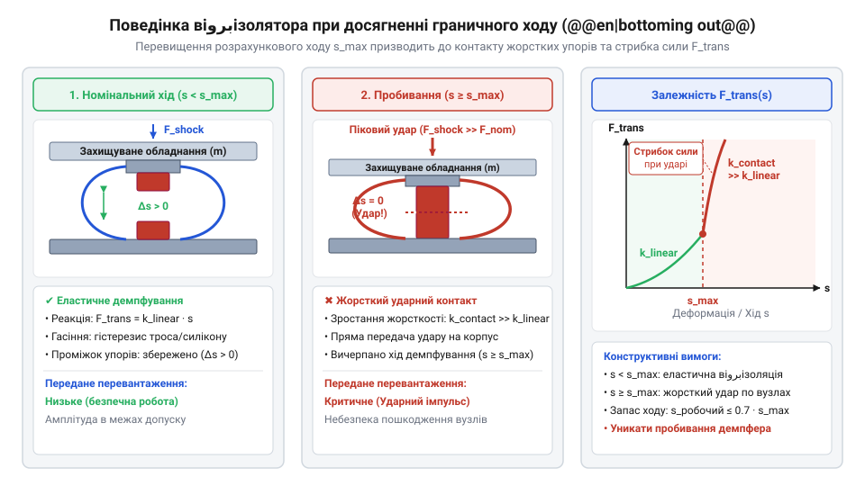
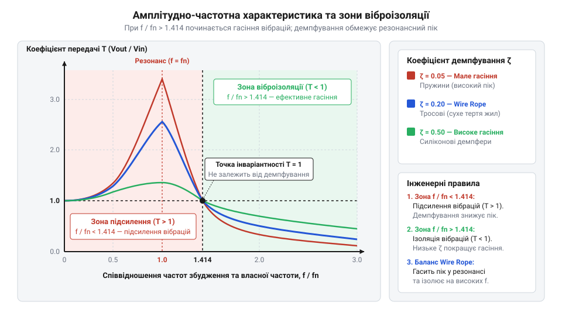

# Тросові та еластомірні віброізолятори: Wire Rope, силіконові демпфери та поглинання ударів

<preknowlist>
- [Пружинні контакти Pogo Pins](root:cat-hw-parts/pogo-pins) — механізми виникнення фретинг-корозії та деградації контактів під дією мікропереміщень від вібрації
- [Нарізні втулки та футорки](root:cat-hw-parts/threaded-inserts-and-heat-set) — прийоми надійного монтування різьбових закладнок у композити та пластики для сприйняття реакцій віброізоляторів
- [Класи міцності та матеріали кріплення](root:cat-hw-parts/fastener-strength-classes-and-materials) — принципи вибору класів міцності та матеріалів гвинтів для відвернення зрізу та розхитування різьбових з'єднань під дією динамічних ударів
</preknowlist>

## Руйнування обладнання від вібрацій та ударів

Жорстке закріплення бортових приладів на носійних рамах наражає електроніку на дію кінетичних збуджень. Тривалі коливання викликають накопичення втоми матеріалів (лат. *fatigatio* — виснаження) @@en|material fatigue@@ у провідниках плат і кронштейнах. Найбільш вразливими є паяні з'єднання @@en|SMD@@ та @@en|BGA@@ компонентів, де виникають мікротріщини в шарах інтерметалідів. У роз'ємних з'єднаннях мікропереміщення викликають фретинг-корозію (англ. *fretting* — стирання) @@en|fretting corrosion@@ контактних поверхонь, яку висвітлюють [пружинні контакти Pogo Pins](root:cat-hw-parts/pogo-pins). Одночасно зсувні зусилля спричиняють самовідгвинчування кріплень, а високочастотні коливання — насичення @@en|MEMS@@-сенсорів.

На відміну від тривалої вібрації, поодинокий ударний імпульс діє з високою амплітудою прискорення. За недостатнього запасу ходу підвісу виникає пробивання демпфера (англ. *bottoming out*) @@en|bottoming out@@, при якому рухома частина блоку досягає механічного обмежувача. Жорсткість підвісу стрибкоподібно зростає, і кінетична енергія удару безпосередньо передається на електронний модуль, спричиняючи руйнування корпусу або зріз кріплень.


*Деформація віброізолятора під ударним імпульсом показує перехід від пружного демпфування до жорсткого удару при вичерпанні робочого ходу.*

## Механізми дисипації та розрахунок віброізоляції

Дисипація кінетичної енергії коливань спирається на два фізичні принципи. У тросових віброізоляторах (англ. *wire rope*) @@en|Wire Rope isolators@@ Кулонівське сухе тертя (лат. *frictio* — тертя) @@en|dry friction@@ між жилами каната забезпечує згасання незалежно від температури. У силіконових демпферах в'язкопружний гістерезис (грецьк. *hysteresis* — запізнення) @@en|viscoelasticity@@ перетворює енергію деформації на тепло через фазовий зсув між напруженням і деформацією.

Для оцінки ефективності захисту розглядають одномасову систему з масою `m` та жорсткістю `k`. Власну частоту `f₀` в Гц обчислюють через статичний прогин `δ_st` у метрах:

```
f₀ = (1 / (2 × π)) × √(k / m)
= (1 / (2 × π)) × √(g / δ_st)           [через статичний прогин]
≈ 4.98 / √δ_st                           [з урахуванням g ≈ 9.81]
```

Амплітудно-частотна характеристика визначає коефіцієнт передачі вібрації (англ. *transmissibility*) @@en|transmissibility@@ `T` як функцію відношення частоти збудження `f` до власної частоти `f₀` (`r = f / f₀`) та коефіцієнта згасання `ζ`:

```
T = √((1 + (2 × ζ × r)²) / ((1 - r²)² + (2 × ζ × r)²))
```

У квазістатиці (`r < 0.5`) вібрація передається повністю (`T ≈ 1`). У резонансі (`r ≈ 1`) коефіцієнт сягає максимуму `T_max ≈ 1 / (2 × ζ)`, що вимагає високого згасання для обмеження амплітуд. Зона ефективної віброізоляції починається за умови `r > √2` (понад `1.414`), де `T < 1` спадає пропорційно `1 / r²`.


*Залежність коефіцієнта передачі вібрації від співвідношення частот висвітлює межу ефективної ізоляції при r більше ніж корінь з двох.*

## Просторові схеми монтажу та кабельні петлі

Через шість ступенів вільності обладнання тросові елементи проявляють нелінійну анізотропію: жорсткість на стиск `k_z` перевищує жорсткість на розтяг і зсув `k_x`, `k_y`. Для запобігання кутовим коливанням центр еластичності підвісу узгоджують із центром ваги. Площинний монтаж створює зв'язаність поступальних та обертальних мод, яку нейтралізують похилим під кутом 45° або симетричним розташуванням ізоляторів із перетином векторів жорсткості в центрі ваги.


*Просторова організація точок підвісу демонструє збіг центра еластичності з центром ваги для відвернення перекосів.*

Паразитна жорсткість (англ. *parasitic stiffness*) @@en|parasitic stiffness@@ негнучких кабелів шунтує віброізолятори та передає вібрацію вхідними коламі. Її нейтралізують сервісними петлями з гнучких [монтажних проводів 18 AWG](root:cat-hw-parts/hookup-wire), зафіксованих [пластиковими хомутами](root:cat-hw-parts/cable-ties) та [кабельними органайзерами](root:cat-hw-parts/cable-organizer). Ізолятори монтують у корпус через [нарізні втулки та футорки](root:cat-hw-parts/threaded-inserts-and-heat-set) з урахуванням [класів міцності кріплення](root:cat-hw-parts/fastener-strength-classes-and-materials) для сприйняття динамічних реакцій.

## Вибір ізоляторів та запобігання пробиванню

Типорозмір ізолятора обирають за вагою обладнання та довкіллям. Суцільнометалеві @@en|Wire Rope isolators@@ працюють від -100 °C до +300 °C, стійкі до радіації та хімікатів. Силіконові демпфери обмежені інтервалом від -50 °C до +180 °C, проте мають високе згасання.


*Діаграма вибору матеріалу віброізолятора визначає межі застосування металевих канатів та силіконових матриць.*

Статичний прогин `δ_st` і робочий хід `Δx_req` для `N` ізоляторів при масі `m` та перевантаженні `n` (`a_peak = n × g`) визначають за формулами:

```
δ_st = (m × g) / (N × k_v)
Δx_req = n × δ_st
```

Щоб уникнути @@en|bottoming out@@, допустимий хід `Δx_max` повинен мати запас:

```
Δx_max ≥ 1.3 × Δx_req
```

За дефіциту простору додають пружні обмежувачі ходу, які плавно підвищують жорсткість і гасять залишок енергії удару.