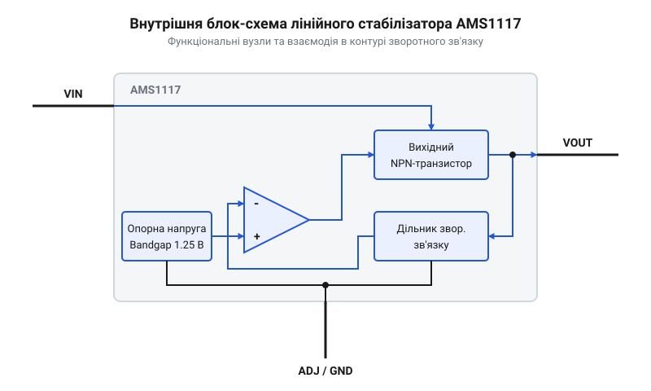
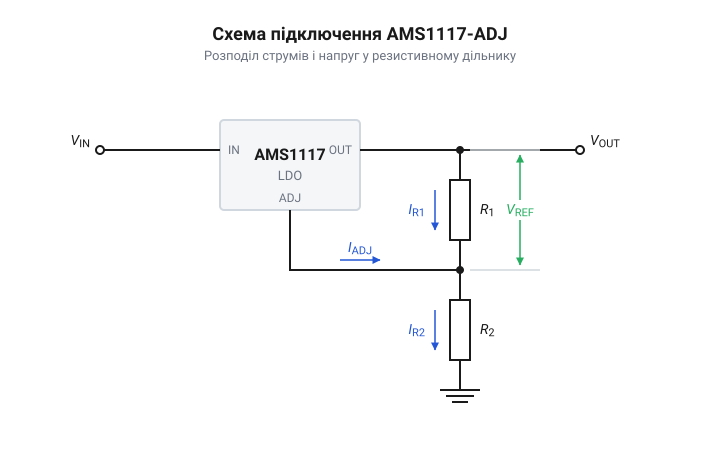
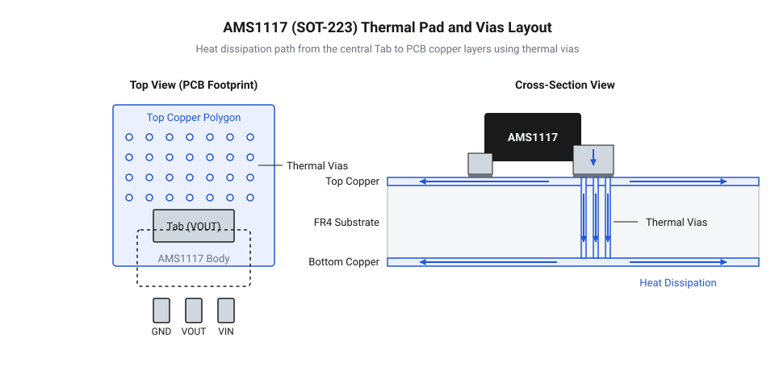
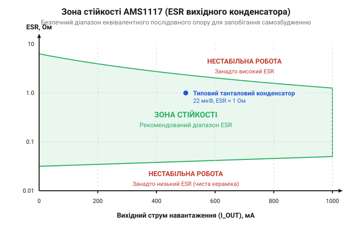
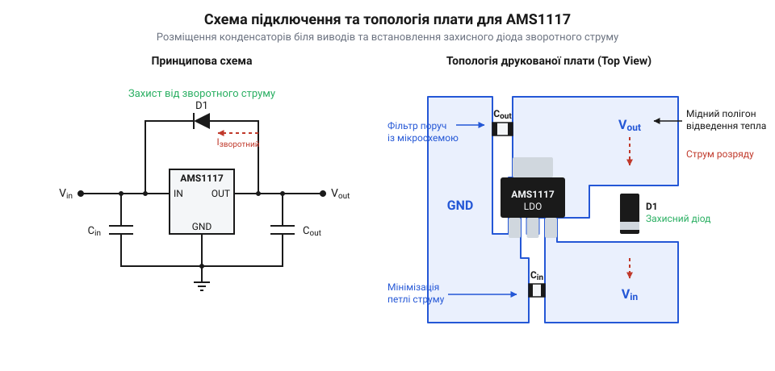

# AMS1117 — лінійний стабілізатор з малим падінням напруги (LDO)

<preknowlist>
- [XC6206 (662K) — LDO-регулятор 3.3 В](root:cat-hw-power/xc6206) — особливості використання LDO-стабілізаторів на CMOS-структурах із низьким власним струмом споживання та відмінності їхніх характеристик від NPN-регуляторів
- [TL431](root:cat-hw-power/tl431) — принципи побудови прецизійних джерел опорної напруги на основі Bandgap і роботу підсилювача помилки в замкнених контурах стабілізації
</preknowlist>

## Падіння напруги живлення та вихід LDO

Уявіть типову інженерну ситуацію: ви розробляєте пристрій на базі сучасного 3.3-вольтового мікроконтролера або бездротового модуля Wi-Fi, а первинним джерелом живлення у вашій системі є шина 5 В від USB-порту або стандартного мережевого адаптера. Перша думка, яка може спасти на думку інженеру-початківцю для пониження напруги з 5 В до 3.3 В, — використати найпростіший пасивний резистивний дільник із двох резисторів. Проте спроба заживити активну цифрову схему від резистивного дільника миттєво зазнає краху.

Причина полягає у фізичній природі споживання струму цифровими мікросхемами. У режимі очікування мікроконтролер споживає мікроампери, а під час виконання обчислень або увімкнення радіопередавача струм зростає до сотень міліампер. З еквівалентної схеми дільника випливає, що його вихідний опір становить паралельне з'єднання двох резисторів `R_out = R_1 ∥ R_2`. Якщо розрахувати дільник на вихідний струм 100 мА, то номінали резисторів будуть малими (одиниці Ом), що спричинить колосальне марне розсіювання енергії у спокійному стані. Якщо ж взяти резистори більшого опору (наприклад, сотні Ом), то при просіданні струму споживання до 1 мА напруга на виході дільника підскочить майже до вхідних 5 В, що виведе з ладу чутливий мікроконтролер. І навпаки, при раптовому піку споживання напруга на виході дільника просяде значно нижче мінімально допустимих 3.0 В, спричиняючи постійний аварійний скид (англ. *brown-out reset*) процесора.

Розуміючи непридатність пасивних дільників через варіативність внутрішнього опору навантаження, розробник звертається до класичних лінійних стабілізаторів напруги, таких як мікросхема серії 7805 (або її 3.3-вольтовий аналог 78L03) та регульований стабілізатор LM317. Але й тут виникає жорстке фізичне обмеження — занадто висока напруга падіння (англ. *dropout voltage*, від *drop* — падати, *out* — випадати, тобто @@en|падіння напруги@@).

@@en|Падіння напруги@@ стабілізатора — це мінімально необхідна різниця між вхідною напругою `V_in` та вихідною напругою `V_out`, за якої мікросхема ще здатна підтримувати заданий вихідний рівень із регламентованою точністю. Для класичних стабілізаторів серії 78xx та LM317 ця величина становить від 2.0 В до 2.5 В залежно від струму навантаження та температури кристала.

Обчислимо мінімально необхідну вхідну напругу `V_in(min)` для отримання вихідного рівня `V_out = 3.3 В` при використанні класичного стабілізатора LM317:

```
V_in(min) [LM317] = V_out + V_drop
= 3.3 + 2.2                [де V_drop = 2.2 В при струмі 800 мА]
= 5.5 В                    [мінімальна вхідна напруга]
```

Отже, при спробі подати на вхід LM317 напругу 5 В реальна різниця становитиме лише `5.0 - 3.3 = 1.7 В`, що менше за необхідні 2.2 В. В результаті внутрішній регулювальний транзистор повністю відкривається, виходить з @@en|режиму лінійного регулювання@@ в @@en|режим насичення@@, і мікросхема втрачає здатність стабілізувати напругу. Вихідний рівень починає просідати слідом за навантаженням та повторювати всі мережеві пульсації вхідного джерела.

Еволюція лінійних регуляторів: від серій 78xx до AMS1117 розкриває історичний шлях подолання цього схемотехнічного бар'єра. Класичні стабілізатори серій 78xx та LM317 розроблялися на початку 1970-х років і будувалися на вихідній @@en|парі Дарлінгтона@@ (англ. *Darlington pair*) з двох послідовно ввімкнених NPN-транзисторів у конфігурації емітерного повторювача. Така схема вимагала підсумовування напруги двох p-n переходів база-емітер (`2 × 0.7 В = 1.4 В`) та напруги насичення керуючого транзистора, що фундаментально обмежувало падіння напруги на рівні понад 2 В. Поява стабілізаторів із малим падінням напруги (англ. *low dropout*, від *drop* — падати, *out* — випадати, або @@en|LDO-регуляторів@@) стала можливою завдяки зміні топології вихідного каскаду. Впровадження квазі-LDO схемотехніки на потужному вихідному NPN-транзисторі з керуючим PNP-драйвером дозволило знизити падіння напруги до 1.1–1.3 В при струмах навантаження до 1 А. Завдяки цьому мікросхема AMS1117 стала загальноприйнятим промисловим стандартом у компактному поверхнево-монтованому корпусі SOT-223 для живлення низьковольтних мікроконтролерних систем, плат Arduino, модулів ESP8266/ESP32 та периферійних пристроїв.

Розрахуємо мінімальну вхідну напругу для стабілізатора AMS1117 при вихідному рівні `V_out = 3.3 В`:

```
V_in(min) [AMS1117] = V_out + V_drop
= 3.3 + 1.1                [де V_drop = 1.1 В при струмі 800 мА]
= 4.4 В                    [мінімальна вхідна напруга]
```

Порівняльний аналіз показує, що при стандартній вхідній напрузі 5 В стабілізатор AMS1117 має технічний запас різниці напруг у 0.6 В (`5.0 - 4.4 = 0.6 В`). Цей запас гарантує надійну та безперебійну роботу цифрової схеми навіть при зниженні напруги шини USB до нижньої допустимої межі 4.75 В. Крім того, активний контур стабілізатора забезпечує високий коефіцієнт пригнічення пульсацій живлення (англ. *Power Supply Rejection Ratio*, PSRR) на рівні 60–75 дБ, ефективно відфільтровуючи низькочастотні завади вхідної лінії.

Використання AMS1117 суттєво спрощує проєктування живильних вузлів електронних пристроїв. Повну інженерну довідку щодо графічної цокольовки виводів, різновидів корпусів SOT-223, TO-252 та SO-8, а також граничних електричних параметрів наведено у матеріалі про [залізний інтерфейс AMS1117](root:cat-hw-power/ams1117-linear-regulator/api-ams1117-hardware-pinout-and-wiring.md). Практичний приклад розробки компактної плати перетворювача з розрахунком фільтрів висвітлено у проекті про [модуль живлення 3.3 В](root:cat-hw-power/ams1117-linear-regulator/proj-ams1117-5v-to-3v3-power-module.md).

Водночас біполярна LDO-архітектура AMS1117 має власні специфічні особливості. На відміну від CMOS-стабілізаторів, такі як [альтернативні LDO-регулятори](root:cat-hw-power/xc6206) серії XC6206 із власне споживаним струмом у одиниці мікроампер, біполярний регулятор AMS1117 вимагає постійного струму бази для утримання силового NPN-транзистора у відкритому стані. Внаслідок цього його @@en|струм спокою@@ (англ. *quiescent current*) становить від 5 мА до 10 мА незалежно від наявності зовнішнього навантаження. Крім того, різниця напруг між входом і виходом при протіканні струму навантаження перетворюється на теплову потужність `P = (V_in - V_out) × I_out`, що вимагає належного розрахунку охолодження. Для ефективної експлуатації мікросхеми необхідно докладно вивчити її внутрішню будову та принцип роботи керуючого контуру.

## Внутрішня архітектура та контур зворотного зв'язку

Для забезпечення високої точності стабілізації вихідного рівня при динамічних стрибках навантаження усередині мікросхеми AMS1117 функціонує замкнений аналоговий @@en|контур зворотного зв'язку@@ (англ. *feedback loop*). Внутрішня блок-схема мікросхеми містить чотири основні функціональні блоки: термокомпенсоване джерело опорної напруги Bandgap, високочутливий підсилювач помилки, дільник напруги зворотного зв'язку та вихідний силовий NPN-транзистор, а також додаткові кола захисту від перегріву та перевантаження за струмом.


*Функціональна блок-схема внутрішньої структури AMS1117: підсилювач помилки порівнює сигнал з дільника зворотного зв'язку з опорною напругою Bandgap 1.25 В і керує потужним вихідним NPN-транзистором.*

Еталоном точності всього стабілізатора є внутрішнє @@en|джерело Bandgap@@ (англ. *bandgap reference*, від *band* — зона, *gap* — щілина, тобто ширина забороненої зони кремнію). Цей вузол виробляє високостабільну опорну напругу `V_ref = 1.25 В` (із допуском від 1.225 В до 1.275 В). Принцип дії джерела Bandgap базується на фізичному поєднанні двох напівпровідникових елементів з протилежними температурними коефіцієнтами:
1. Напруга база-емітер p-n переходу `V_be` має від'ємний температурний коефіцієнт (близько `-2 мВ/°C`). 2. Різниця напруг база-емітер двох транзисторів `ΔV_be`, що працюють при різній щільності струмів, має додатний температурний коефіцієнт, пропорційний абсолютній температурі.

При масштабуванні та підсумовуванні цих двох напруг температурні дрейфи взаємно компенсуються, створюючи опорний рівень 1.25 В, який залишається стабільним у діапазоні температур від 0 °C до +125 °C. Докладний аналіз фізики та схемотехніки подібних опорних джерел наведено у матеріалі про [регульований стабілізатор TL431](root:cat-hw-power/tl431).

Другим основним компонентом контуру є @@en|підсилювач помилки@@ (англ. *error amplifier*). Це диференційний підсилювач із великим коефіцієнтом підсилення за напругою. На його інвертуючий вхід подається еталонна опорна напруга `V_ref = 1.25 В` від Bandgap-джерела, а на неінвертуючий вхід — напруга зворотного зв'язку `V_fb`, знята з дільника напруги. Вихідний сигнал підсилювача помилки регулює струм бази потужного NPN-транзистора.

Розглянемо послідовність процесів у контурі регулювання при динамічному стрибку струму споживання:

1. **Стрибок навантаження**: При раптовому зростанні струму навантаження вихідна напруга `V_out` починає незначно знижуватися через внутрішній опір вихідного каскаду. 2. **Формування неузгодження**: Падіння `V_out` викликає пропорційне зниження напруги `V_fb` на неінвертуючому вході підсилювача помилки нижче опорного рівня `V_ref = 1.25 В`. 3. **Реакція підсилювача**: Диференційна різниця на входах підсилювача викликає зростання його вихідної напруги, що збільшує струм бази вихідного NPN-транзистора. 4. **Відновлення напруги**: Потужний транзистор відкривається сильніше, опір його переходу колектор-емітер зменшується, і вихідна напруга `V_out` повертається до заданого значення.

Завдяки високому коефіцієнту підсилення підсилювача помилки реакція контуру відбувається за мікросекунди, утримуючи вихідну напругу в межах ±1% від номіналу. Для захисту кристала від аварійних режимів у схему вбудовано вузол теплового відключення (англ. *thermal shutdown*), який автоматично вимикає вихідний транзистор при розігріві кристала понад +165 °C, та схему обмеження струму (англ. *current limit*) на рівні близько 1.5 А.

Мікросхема AMS1117 виготовляється у двох конструктивних модифікаціях: із фіксованою вихідною напругою (1.8 В, 2.5 В, 3.3 В, 5.0 В) та регульованій AMS1117 ADJ (англ. *adjustable*, регульований).


*Схема включення регульованого стабілізатора AMS1117 ADJ: вихідна напруга задається співвідношенням опорів R1 і R2 з урахуванням вихідного струму виводу Adjustment.*

У фіксованих модифікаціях резистивний дільник зворотного зв'язку інтегровано безпосередньо у кристал мікросхеми, а вивід Ground служить спільним контактом для внутрішніх кіл. У версії AMS1117 ADJ вивід Ground замінено виводом Adjustment (ADJ), підключеним напряму до входу підсилювача помилки. Це дозволяє користувачеві самостійно програмувати вихідну напругу від 1.25 В до 13.8 В за допомогою зовнішніх резисторів `R_1` та `R_2`.

Резистор `R_1` вмикається між виводами VOUT та ADJ і утримує на собі фіксовану опорну напругу `V_ref = 1.25 В`. Резистор `R_2` встановлюється між виводом ADJ та Землею.

Математична формула для обчислення вихідної напруги регульованої модифікації має вигляд:

```
V_out = V_ref × (1 + R_2 / R_1) + I_adj × R_2    [формула вихідної напруги ADJ]
```

Параметр `I_adj` позначає власний струм виводу Adjustment, який витікає зі входу підсилювача помилки й становить від 50 мкА до 120 мкА. Щоб мінімізувати вплив розкиду `I_adj` на точність напруги, струм через резистор `R_1` обирають значно більшим за струм `I_adj` (зазвичай обирають `R_1 = 120 Ом`, що дає струм дільника близько 10.4 мА). Повний інженерний алгоритм вибору номіналів, розрахунок температурної нестабільності та оцінку похибок наведено у матеріалі про [розрахунок дільника ADJ](root:cat-hw-power/ams1117-linear-regulator/math-ams1117-adj-divider-calculation.md). Практичну схему побудови настільного джерела живлення з використанням модифікації ADJ описано у проекті про [лабораторний стабілізатор](root:cat-hw-power/ams1117-linear-regulator/proj-ams1117-adjustable-bench-supply.md).

Слід підкреслити, що для надійної роботи регульованої версії через стабілізатор завжди має протікати мінімальний струм навантаження (типово 5–10 мА). Якщо зовнішнє навантаження відсутнє, саме струм дільника `R_1/R_2` виконує роль мінімального струму навантаження, запобігаючи неконтрольованому зростанню вихідної напруги `V_out`.

## Фіксовані модифікації та обрахунок версії ADJ

У практичній схемотехніці цифрових пристроїв виникає потреба як у стандартних фіксованих рівнях живлення (наприклад, 1.2 В, 1.8 В, 2.5 В, 3.3 В або 5.0 В), так і у специфічних напругах, відсутніх у стандартному ряді виробників. Лінійний стабілізатор @@en|AMS1117@@ виробляється у двох основних варіантах виконання: з фіксованою вихідною напругою та з можливістю довільного регулювання @@en|ADJ@@ (англ. *adjust* — налаштовувати, коригувати). Розуміння внутрішніх відмінностей між цими версіями дозволяє не лише правильно обрати компонент під завдання, а й уникнути грубих помилок під час розрахунку зовнішньої обв'язки.

У фіксованих модифікаціях (таких як AMS1117-1.8, AMS1117-3.3 чи AMS1117-5.0) внутрішній резистивний дільник зворотного зв'язку сформовано безпосередньо на кремнієвому кристалі мікросхеми. Верхнє та нижнє плечі дільника виготовлені за допомогою прецизійного напилення резисторів із підгонкою під час виготовлення. Вихід дільника підключено до інвертуючого входу підсилювача помилки, а нижнє плече з'єднано з виводом @@en|GND@@. Оскільки відношення опорів дільника жорстко зафіксоване, контур регулювання підтримує на виході стабільне значення напруги без використання будь-яких зовнішніх навісних резисторів. Наприклад, для підключення мікроконтролерів із напругою 3.3 В найпростішим рішенням є застосування готового інтегрального стабілізатора, про розробку якого розповсюджено інформацію при створенні [компактного модуля 3.3 В](root:cat-hw-power/ams1117-linear-regulator/proj-ams1117-5v-to-3v3-power-module.md), де відсутня потреба у додаткових компонентах дільника.

Регульована модифікація AMS1117 ADJ відрізняється тим, що внутрішній резистивний дільник відсутній, а вивід @@en|GND@@ замінено на вивід керування @@en|Adjustment@@ (на схемах позначений як ADJ). Інвертуючий вхід внутрішнього диференційного підсилювача помилки виведено безпосередньо на цей вивід. Внутрішній термокомпенсований елемент @@en|Bandgap@@ (англ. *band* — зона, *gap* — щілина, заборонена зона) створює опорний потенціал `V_ref = 1.25 В` між виходом стабілізатора `V_out` та виводом @@en|Adjustment@@. Оскільки внутрішня структура використовує [схему опорного джерела](root:cat-hw-power/tl431) bandgap для досягнення високої термостабільності, контур зворотного зв'язку прагне безперервно підтримувати різницю потенціалів між виводом `V_out` та виводом ADJ на рівні точно 1.25 В.

Щоб задати потрібну вихідну напругу `V_out`, вищу за опорний рівень 1.25 В, до мікросхеми підключають два зовнішні резистори: `R_1` підключають між виводом `V_out` та виводом @@en|Adjustment@@, а `R_2` — між виводом @@en|Adjustment@@ та спільною шиною @@en|GND@@. Через резистор `R_1` протікає струм `I_R1 = V_ref / R_1`. У вузлі з'єднання виводу @@en|Adjustment@@ цей струм сумується зі власним вихідним струмом керуючого виводу мікросхеми, який називається струмом налаштування `I_adj`. Сумарний струм протікає через нижній резистор `R_2` на землю. Завдяки цьому вихідна напруга є сумою падіння напруги на резисторі `R_1` (яке дорівнює `V_ref`) та падіння напруги на резисторі `R_2`.

Для математичного виведення вихідної напруги `V_out` запишемо баланс напруг на зовнішньому дільнику:

```
V_out
= V_ref + (V_ref / R_1 + I_adj) × R_2          [сума напруг на R1 та R2]
= V_ref + V_ref × (R_2 / R_1) + I_adj × R_2    [розкриття дужок]
= V_ref × (1 + R_2 / R_1) + I_adj × R_2        [винесення V_ref за дужки]
```

У наведеному виразі символ `V_out` позначає підсумкову вихідну напругу стабілізатора у вольтах, `V_ref` — внутрішню опорну напругу джерела bandgap (типове значення 1.25 В), `R_1` — опір верхнього резистора дільника в омах, `R_2` — опір нижнього резистора в омах, а `I_adj` — вихідний струм виводу @@en|Adjustment@@ в амперах. З вираженої формули видно, що вихідна напруга складається з двох частин: основного регульованого додатка `V_ref × (1 + R_2 / R_1)` та паразитного додатка `I_adj × R_2`.

Наявність паразитного додатка `I_adj × R_2` створює похибку у вихідній напрузі. За даними технічного опису (англ. @@en|datasheet@@ — аркуш технічних даних) струм `I_adj` для мікросхеми @@en|AMS1117@@ лежить у межах від 50 мкА до 120 мкА залежно від екземпляра мікросхеми, температури кристала та струму навантаження. Оскільки значення `I_adj` не є суворо константним, його протікання через резистор `R_2` зумовлює додаткове падіння напруги, яке змінюється разом із нагріванням стабілізатора. Щоб мінімізувати вплив цієї похибки, струм через верхній резистор `I_R1` обирають значно більшим за струм `I_adj` (зазвичай у 50–200 разів). 

Виробники мікросхеми @@en|AMS1117@@ рекомендують обирати номінал верхнього резистора `R_1 = 120 Ом` (або `R_1 = 240 Ом`). При `R_1 = 120 Ом` струм через верхнє плече становить `I_R1 = 1.25 В / 120 Ом ≈ 10.4 мА`. Порівняно з цим значенням, вихідний струм `I_adj ≈ 55 мкА` (0.055 мА) становить лише 0.5% від основного струму дільника, що робить його вплив на вихідну напругу незначним. Крім того, лінійний регулятор @@en|AMS1117@@ має критичну схемотехнічну особливість: для забезпечення стійкості внутрішнього контуру регулювання та збереження режиму стабілізації йому необхідний мінімальний струм навантаження (англ. minimum load current) порядку 5–10 мА. Вибір номіналу `R_1 = 120 Ом` автоматично гарантує споживання струму 10.4 мА безпосередньо через дільник зворотного зв'язку, що позбавляє потреби додавати окремий баластний резистор на виході схеми. Для детального розбору впливу розкиду параметрів компонента під час розрахунку скористайтеся [математичним розрахунком регульованого дільника](root:cat-hw-power/ams1117-linear-regulator/math-ams1117-adj-divider-calculation.md), у якому наведено оцінку граничних відхилень.

**Обчислення опору резистора R2 для вихідної напруги 5.0 В:**

```
V_ref = 1.25 В
R_1 = 120 Ом
I_adj = 0.000055 А  (55 мкА)
V_out_target = 5.0 В

1. Струм через верхнє плече R_1:
   I_R1 = V_ref / R_1
        = 1.25 / 120
        ≈ 0.010417 А  (10.42 мА)

2. Розрахунок R_2 без урахування I_adj (теоретичний орієнтир):
   R_2_ideal = R_1 × (V_out / V_ref - 1)
             = 120 × (5.0 / 1.25 - 1)
             = 120 × (4 - 1)
             = 360 Ом

3. Обчислення точного значення V_out при R_2 = 360 Ом з урахуванням I_adj:
   V_out_exact = V_ref × (1 + R_2 / R_1) + I_adj × R_2
               = 1.25 × (1 + 360 / 120) + 0.000055 × 360
               = 1.25 × 4 + 0.0198
               = 5.0 + 0.0198
               = 5.0198 В

4. Абсолютна та відносна похибка від струму I_adj:
   V_error = 0.0198 В  (19.8 мВ)
   Error_rel = (0.0198 / 5.0) × 100% ≈ 0.396%
```

Розрахований опір `R_2 = 360 Ом` належить до стандартного ряду Е24, що дозволяє легко реалізувати схему з похибкою менше ніж 0.4%, зумовленою струмом `I_adj`. Якщо ж обрати `R_1 = 1 кОм`, то струм `I_R1` становитиме лише 1.25 мА, і внесок `I_adj` призведе до похибки вже у кілька відсотків, а мікросхема без зовнішнього навантаження втратить стабільність регулювання. Практичне застосування регульованої версії регулятора для побудови лабораторного джерела із можливістю плавного вибору напруг висвітлено у [проєкті лабораторного джерела](root:cat-hw-power/ams1117-linear-regulator/proj-ams1117-adjustable-bench-supply.md) живлення.

Графічні позначення та електричні обмеження виводів корпусів @@en|SOT-223@@ та @@en|TO-252@@ наведено у [довіднику залізного інтерфейсу](root:cat-hw-power/ams1117-linear-regulator/api-ams1117-hardware-pinout-and-wiring.md), де вказано граничні значення напруг і струмів. На відміну від [малопотужних CMOS регуляторів](root:cat-hw-power/xc6206), де власний струм спокою вимірюється мікроамперами, @@en|AMS1117@@ вимагає чіткого розрахунку теплового балансу, оскільки струм дільника та власні втрати створюють суттєве теплове навантаження на корпус.

## Тепловий баланс та проектування тепловідводу

Під час роботи лінійного стабілізатора @@en|AMS1117@@ вся надлишкова електрична потужність, яка виникає через різницю між вхідною та вихідною напругою, перетворюється безпосередньо на теплову енергію на силовому вихідному @@en|NPN@@-транзисторі. При високих струмах навантаження (до 1 А) або значному падінні напруги на регуляторі кристал мікросхеми швидко розігрівається. Якщо згенероване тепло не відводиться у навколишнє середовище, температура напівпровідникового переходу перевищує критичну межу, зумовлюючи спрацьовування внутрішнього теплового захисту (англ. thermal shutdown) або незворотний тепловий пробій кристала.

Розрахунок теплового балансу починається з визначення розсіюваної теплової потужності `P_D`. Повна потужність, що перетворюється на тепло у мікросхемі, складається із теплоти від протікання струму навантаження та теплоти від власного струму спокою мікросхеми:

```
P_D
= (V_in - V_out) × I_out + V_in × I_q    [повне розсіювання потужності]
≈ (V_in - V_out) × I_out                [спрощення через малий струм I_q]
```

У цій формулі `P_D` позначає розсіювану теплову потужність у ватах, `V_in` — вхідну напругу у вольтах, `V_out` — вихідну стабілізовану напругу у вольтах, `I_out` — струм навантаження в амперах, а `I_q` — власний струм спокою стабілізатора в амперах. Оскільки власний струм спокою @@en|AMS1117@@ становить близько 5–10 мА, доданок `V_in × I_q` зазвичай є незначним порівняно з основним силовим потоком, тому у практичних інженерних розрахунках використовують спрощену формулу `P_D ≈ (V_in - V_out) × I_out`.

Тепловий потік від нагрітого кристала до довкілля долає послідовність матеріальних шарів, кожен із яких чинить опір поширенню тепла. Термодинамічний аналіз здійснюється за допомогою аналогії із законом Ома: теплова потужність `P_D` виконує роль струму, різниця температур `ΔT` — роль напруги, а тепловий опір `R_th` (англ. *thermal resistance*) — роль електричного опору. Для обчислення температури напівпровідникового переходу (кристала) `T_j` використовують співвідношення:

```
T_j
= T_a + ΔT                              [температура довкілля плюс перегрів]
= T_a + P_D × R_th(j-a)                 [заміна ΔT через тепловий опір]
```

У наведеному виразі `T_j` позначає температуру напівпровідникового переходу (англ. junction) у градусах Цельсія (°C), `T_a` — температуру навколишнього середовища (англ. ambient) у градусах Цельсія (°C), а `R_th(j-a)` — повний тепловий опір кристал-середовище в градусах Цельсія на ват (°C/Вт). Повний тепловий опір `R_th(j-a)` є сумою двох основних складових: теплового опору від кристала до корпусу `R_th(j-c)` та теплового опору від корпусу до довкілля `R_th(c-a)` (або `R_th(s-a)` для тепловідводу).

Конструктивне виконання корпусу мікросхеми безпосередньо визначає її здатність відводити тепло. Стабілізатор @@en|AMS1117@@ найчастіше постачається у корпусах для поверхневого монтажу @@en|SOT-223@@ та @@en|TO-252@@ (також відомому як @@en|DPAK@@):

1. Корпус @@en|SOT-223@@ — компактний пластмасовий корпус із трьома виводами та великим металевим тепловідвідним контактним майданчиком (англ. @@en|thermal pad@@ — теплова площадка), з'єднаним із виводом `V_out`. Внутрішній тепловий опір кристал-корпус становить `R_th(j-c) ≈ 15 °C/Вт`. Проте якщо корпус запаяний на плату без розширеного мідного полігону, тепловий опір кристал-середовище `R_th(j-a)` досягає 90–110 °C/Вт, що обмежує граничну розсіювану потужність значенням усього 0.8–1.0 Вт при температурі 25 °C.

2. Корпус @@en|TO-252@@ (DPAK) — масивніший корпус із більшою площею металевого прапорця. Внутрішній тепловий опір кристал-корпус становить `R_th(j-c) ≈ 6 °C/Вт`. Завдяки більшій площі контакту з друкованою платою корпус TO-252 здатний ефективно відводити до 2.5–3.0 Вт потужності за наявності відповідного охолоджувального полігону.

Оскільки корпуси SOT-223 та TO-252 не передбачають встановлення зовнішніх радіаторів із притискними гвинтами, основним елементом пасивного охолодження виступає мідне покриття друкованої плати (англ. @@en|PCB@@ — друкована плата). Металевий прапорець корпусу запаюється безпосередньо на мідний полігон верхнього шару плати. Для підвищення ефективності тепловідводу на нижній шар плати під прапорцем розміщують масив наскрізних теплових отворів (англ. @@en|thermal vias@@ — теплові перехідні отвори).


*Топологія друкованої плати для корпусу SOT-223 з розширеним мідним полігоном та масивом перехідних отворів Vias, що забезпечує зниження теплового опору кристал-середовище.*

Створений мідний полігон площею від 250 мм² до 600 мм² з товщиною фольги 35 мкм (1 oz) дозволяє знизити опір `R_th(j-a)` для корпусу SOT-223 з 90 °C/Вт до 45–50 °C/Вт. Наявність теплових отворів Vias діаметром 0.3–0.4 мм із кроком 1.0–1.2 мм під з'єднувальним майданчиком передає тепловий потік на суцільний шар землі або живлення на зворотному боці плати, що суттєво прискорює конвекцію. Для обчислення необхідних габаритів плати застосовують [розрахунок площі тепловідводу](root:cat-hw-power/ams1117-linear-regulator/math-ams1117-thermal-dissipation-calculation.md) на основі допустимої температури переходу.

**Розрахунок граничного струму навантаження для AMS1117 в корпусі SOT-223:**

```
V_in = 12.0 В
V_out = 3.3 В
T_a = 25.0 °C
T_j_max = 125.0 °C
R_th_ja = 50.0 °C/Вт  (плата з мідним полігоном площею 500 мм²)

1. Максимально допустиме перевищення температури кристала:
   ΔT_max = T_j_max - T_a
          = 125.0 - 25.0
          = 100.0 °C

2. Максимально допустима розсіювана теплова потужність:
   P_D_max = ΔT_max / R_th_ja
           = 100.0 / 50.0
           = 2.0 Вт

3. Падіння напруги на регуляторі:
   V_drop = V_in - V_out
          = 12.0 - 3.3
          = 8.7 В

4. Граничний струм навантаження I_out_max:
   I_out_max = P_D_max / V_drop
             = 2.0 / 8.7
             ≈ 0.2299 А  (близько 230 мА)
```

Практичний розрахунок показує важливе обмеження: незважаючи на те, що в специфікаціях заявлено максимальний вихідний струм до 1 А, при падінні напруги `V_in - V_out = 8.7 В` мікросхема у корпусі SOT-223 зможе віддати у навантаження лише 230 мА. Спроба зняти струм 1 А при напрузі входу 12 В призвела б до генерування потужності 8.7 Вт, що розігріло б кристал до температури понад 460 °C і викликало б негайне спрацьовування теплового захи захисту. Конкретні значення теплового опору для корпусів SOT-223 та TO-252 зведено в [електричних характеристиках корпусу](root:cat-hw-power/ams1117-linear-regulator/api-ams1117-hardware-pinout-and-wiring.md), які регламентують максимальний струм залежно від геометрії тепловідвідної площадки.

## Вимоги до ESR та стійкість контуру

Усі електричні розрахунки виконано, вихідну напругу задано дільником, а мідний полігон плати забезпечує надійне відведення тепла. Інженер збирає перший прототип живильного вузла на мікросхемі @@en|AMS1117@@, підключає на вихід сучасний компактний керамічний конденсатор ємністю 22 мкФ та вмикає живлення. Проте замість ідеально чистої постійної напруги осцилограф показує спонтанну високочастотну генерацію — синусоїдальні або пилоподібні амплітудні пульсації розмахом у сотні мілівольт на частотах від 100 кГц до 2 МГц. При цьому стабілізатор помітно нагрівається навіть без зовнішнього навантаження, а підключений мікроконтролер постійно перезавантажується через спрацьовування захисту від просідання живлення (англ. @@en|brown-out reset@@).

Причина цієї несподіваної нестабільності полягає ухворобі багатьох імпульсних та лінійних стабілізаторів — нехтуванні специфікою фазового запасу контуру зворотного зв'язку квазі-@@en|LDO@@ топології. На відміну від класичних стабілізаторів серії 78xx, вихідний каскад @@en|AMS1117@@ побудовано на потужному @@en|NPN@@-транзисторі, який керується внутрішнім @@en|PNP@@-драйвером. Динамічна стійкість такого замкненого контуру аналогового регулювання фундаментально залежить від імпедансу вихідного конденсатора на високих частотах.

За критерієм стійкості Баркхаузену (англ. *Barkhausen stability criterion*), якщо у замкненому контурі зворотного зв'язку підсилювача сумарний фазовий зсув сигналу досягає -180° на частоті, де коефіцієнт підсилення контуру дорівнює або перевищує одиницю (0 дБ), негативний зворотний зв'язок перетворюється на позитивний. В результаті система втрачає стабільність і перетворюється на високочастотний генератор.

У внутрішньому контурі регулювання @@en|AMS1117@@ виникають два основні полюси (англ. *poles* — частоти, на яких фаза запізнюється додатково на -90°):
1. Внутрішній домінантний полюс `f_P1`, сформований високим вихідним опором внутрішнього підсилювача помилки та його коригувальною ємністю. 2. Вихідний полюс `f_P2`, утворений вихідним опором навантаження `R_load` та ємністю вихідного фільтрувального конденсатора `C_out`.

Формула частоти вихідного полюса має вигляд:

```
f_P2
= 1 / (2 × π × R_load × C_out)    [частота вихідного полюса контуру]
```

У наведеному виразі `f_P2` позначає частоту вихідного полюса в герцах, `R_load` — еквівалентний опір навантаження в омах, а `C_out` — ємність вихідного конденсатора у фарадах. Оскільки обидва полюси `f_P1` та `f_P2` знаходяться всередині робочої смуги частот підсилювача помилки, їхній сумарний внесок спричиняє набіг фазового запізнення майже до -180°. За відсутності спеціальної компенсації запас за фазою (англ. @@en|Phase Margin@@ — запас за фазою) падає до нуля раніше, ніж коефіцієнт підсилення контуру знизиться до 0 дБ, що робить стабілізатор схильним до спонтанного самозбудження.

Порятунок стійкості контуру забезпечує реальний фізичний параметр вихідного конденсатора — його еквівалентний послідовний опір (англ. @@en|ESR@@, від *Equivalent Series Resistance* — еквівалентний послідовний опір). Внутрішній опір @@en|ESR@@ послідовно з ємністю `C_out` створює у передавальній функції контуру так званий диференціювальний нуль (англ. *zero* — нуль передавальної функції):

```
f_Z
= 1 / (2 × π × ESR × C_out)    [частота компенсаційного нуля ESR]
```

На відміну від полюса, який затримує фазу на -90°, нуль передавальної функції додає випередження фази на +90° (англ. *phase lead*), починаючи з частоти `f_Z`. Якщо частота нуля `f_Z` розташована нижче за частоту одиничного підсилення контуру, він ефективно компенсує фазовий зсув від другого полюса `f_P2`. Це піднімає загальний запас за фазою до безпечного рівня 45°–60°, гарантуючи стійку роботу стабілізатора під будь-яким навантаженням.

Трагедія сучасного інженера полягає у застосуванні низькоімпедансних керамічних конденсаторів (англ. @@en|MLCC@@ — *Multi-Layer Ceramic Capacitor*). Керамічні конденсатори мають надзвичайно малий опір @@en|ESR@@ — від 0.001 Ом до 0.01 Ом (1–10 мОм). При підключенні керамічного конденсатора 22 мкФ частота нуля `f_Z` зміщується у область кількох мегагерц — далеко за межі смуги пропускання підсилювача помилки. У результаті компенсаційний нуль не встигає підняти фазу у критичній зоні, запас за фазою обвалюється, і регулятор @@en|AMS1117@@ самозбуджується.

**Обчислення частоти компенсаційного нуля ESR для різних типів вихідних конденсаторів:**

```
C_out = 22 мкФ (0.000022 Ф)

1. Випадок із танталовим конденсатором (ESR = 0.3 Ом):
   f_Z_tantalum
   = 1 / (2 × π × ESR × C_out)
   = 1 / (2 × 3.14159 × 0.3 × 0.000022)
   = 1 / 0.00004147
   ≈ 24115 Гц  (24.1 кГц)

2. Випадок із керамічним конденсатором MLCC (ESR = 0.005 Ом):
   f_Z_ceramic
   = 1 / (2 × π × ESR × C_out)
   = 1 / (2 × 3.14159 × 0.005 × 0.000022)
   = 1 / 0.000000691
   ≈ 1446863 Гц  (1.45 МГц)
```

Математичний розрахунок наочно показує різницю: танталовий конденсатор формує нуль на частоті 24.1 кГц, що ідеально потрапляє у зону зрізу підсилювача помилки @@en|AMS1117@@ і підтримує фазовий запас. Натомість керамічний конденсатор зсуває нуль на 1.45 МГц, позбавляючи контур компенсації на низьких і середніх частотах.

З іншого боку, використання занадто старих або висохлих алюмінієвих електролітичних конденсаторів з @@en|ESR@@ понад 3–5 Ом також є неприпустимим. Надмірний опір @@en|ESR@@ призводить до появи значних амплітудних сплесків напруги `V_spike = ΔI_out × ESR` при динамічних стрибках струму споживання, погіршуючи якість стабілізації та пригнічення вхідних пульсацій (англ. @@en|Ripple Rejection@@).


*Графік залежності стійкості контуру зворотного зв'язку AMS1117 від ESR вихідного конденсатора: стабільна робота забезпечується лише в межах зони допустимого опору (типово від 0.1 Ом до 1 Ом).*

Для забезпечення абсолютної стійкості мікросхеми @@en|AMS1117@@ опір @@en|ESR@@ вихідного конденсатора має перебувати у чітко визначеному «вікні стійкості» — від **0.1 Ом до 1.0 Ом** (максимум до 2.0 Ом при малих струмах) для ємності 22 мкФ. Стандартним і найбільш оптимальним рішенням є використання танталового конденсатора (англ. @@en|tantalum capacitor@@) ємністю 22 мкФ (або 47 мкФ) з робочою напругою не менше 6.3 В або 10 В.

Якщо специфіка проекту вимагає використання виключно керамічних конденсаторів @@en|MLCC@@ (наприклад, через обмеження за висотою або вимоги до автоматизованого поверхневого монтажу), послідовно з керамічним конденсатором необхідно впаяти постійний резистор номіналом 0.47–1.0 Ом. Цей резистор штучно створює необхідне значення @@en|ESR@@ для формування компенсаційного нуля. Натомість новітні [CMOS LDO-стабілізатори](root:cat-hw-power/xc6206) серії XC6206 мають внутрішню нуль-полюсну компенсацію (англ. @@en|Zero-Pole Compensation@@) і є повністю стабільними з низькоімпедансною керамікою без додаткових резисторів. Практичні рекомендації щодо вибору номіналів та типів фільтрувальних конденсаторів для конкретного модуля наведено у [проєкті модуля живлення 3.3 В](root:cat-hw-power/ams1117-linear-regulator/proj-ams1117-5v-to-3v3-power-module.md).

## Трасування друкованої плати та діагностика вузла

Збагнувши вимоги до електричної обв'язки, розрахувавши площу мідного тепловідводу та забезпечивши стійкість контуру вибором правильного конденсатора, розробник підходить до завершального етапу — трасування друкованої плати (англ. @@en|PCB@@ — *Printed Circuit Board*) та практичного налагодження вузла живлення. Навіть ідеально розрахована принципова схема може працювати нестабільно або вийти з ладу в перші секунди після ввімкнення, якщо при розміщенні компонентів не враховано паразитичні індуктивності провідників, ризики зворотного струму та правила заземлення.

Першим непорушним правилом компонування плати є розміщення фільтрувальних конденсаторів безпосередньо біля виводів мікросхеми @@en|AMS1117@@. Вхідний конденсатор `C_in` (ємністю не менше 10 мкФ) та вихідний конденсатор `C_out` (танталовий 22 мкФ у паралель із керамічним 0.1 мкФ) мають встановлюватися на відстані не більше 2–5 мм від відповідних виводів `VIN`, `VOUT` та `GND`/`ADJ`.

Причина полягає у паразитній індуктивності (англ. @@en|parasitic inductance@@) довгих мідних доріжок друкованої плати, яка становить приблизно 1 нГн на кожен міліметр довжини. Під час швидких динамічних змін струму навантаження `dI/dt` паразитна індуктивність створює імпульсні напругові сплески `V = L × (dI/dt)`. Якщо вихідний конденсатор віднесено далеко від мікросхеми, ці сплески проникають у контур зворотного зв'язку, провокуючи просідання напруги та високочастотні наводки на цифрові шини.

Силові провідники входу `VIN` та виходу `VOUT` повинні мати достатню ширину (не менше 0.8–1.5 мм для струмів до 1 А) для мінімізації омічного опору. Для виводу @@en|GND@@ (або @@en|Adjustment@@ у версії @@en|ADJ@@) застосовують принцип зіркоподібного заземлення (англ. @@en|star ground@@) або підключають його коротким перехідним отвором до суцільного внутрішнього шару Землі. Це запобігає накладанню потужних зворотних струмів навантаження на опорну потенціальну точку підсилювача помилки.

Окрему увагу слід приділити електричній ізоляції тепловідвідного майданчика. У корпусах @@en|SOT-223@@ та @@en|TO-252@@ металевий прапорець (Tab / Pin 2) внутрішньо з'єднаний із виводом вихідної напруги `VOUT`, а не з Землею! Тому мідний полігон тепловідводу під мікросхемою має бути підключений до електричного кола `VOUT`. Грубою помилкою є з'єднання цього полігону з загальною шиною @@en|GND@@, що призводить до прямого короткого замикання виходу стабілізатора на Землю.

Під час експлуатації стабілізатора @@en|AMS1117@@ існує критична аварійна ситуація — виникнення зворотного струму при вимкненні вхідного живлення. Якщо вхідне джерело `V_in` раптово знеструмлюється або коротко замикається на Землю, напруга на вході миттєво падає до 0 В. Проте великі вихідні танталові або електролітичні конденсатори `C_out` залишаються зарядженими до робочої напруги (3.3 В або 5.0 В).

У цей момент на силовиму @@en|NPN@@-транзисторі виникає зворотна різниця потенціалів `V_out > V_in`. Зворотний струм розряду вихідних конденсаторів починає протікати у зворотному напрямку через внутрішні напівпровідникові `p-n` переходи кристала мікросхеми. Оскільки внутрішній кристал не розрахований на зворотній струм понад десятки міліампер, відбувається незворотний електричний пробій регулювального транзистора, і мікросхема виходить з ладу.

Для захисту від зворотного струму паралельно стабілізатору вмикають зовнішній захисний діод (англ. @@en|protection diode@@), такий як 1N4007 або випрямляч Шотткі (англ. @@en|Schottky@@) 1N5819. Анод захисного діода підключають до виводу `VOUT`, а катод — до виводу `VIN`.


*Принципова схема та варіант розводки друкованої плати AMS1117: показано розміщення фільтрувальних конденсаторів безпосередньо біля виводів мікросхеми та включення захисного діода зворотного струму.*

У нормальному режимі роботи (`V_in > V_out`) захисний діод закритий і не впливає на роботу схеми. Коли ж вхідна напруга падає нижче вихідної (`V_in < V_out`), діод відкривається і безпечно скидає струм розряду вихідної ємності вхідною шиною в обхід кристала мікросхеми.

При використанні регульованої версії @@en|AMS1117@@ ADJ із шунтувальним конденсатором `C_adj = 10 мкФ` на виводі налаштування (для додаткового пригнічення пульсацій на 15 дБ) додають другий захисний діод: анодом до виводу @@en|Adjustment@@, а катодом до виводу `VOUT`. Це забезпечує безпечний розряд конденсатора `C_adj` при короткому замиканні виходу на Землю. Повний схемотехнічний варіант реалізації захисту наведено у [проєкті лабораторного джерела](root:cat-hw-power/ams1117-linear-regulator/proj-ams1117-adjustable-bench-supply.md).

Для швидкої діагностики несправностей змонтованого вузла живлення @@en|AMS1117@@ рекомендується дотримуватися систематичного алгоритму пошуку причин відхилень від норми:

1. **Високочастотні пульсації або шум на виході (амплітуда 50–300 мВ, частота 100 кГц – 2 МГц)**:
   - *Симптом*: Осцилограф у режимі вимірювання змінного струму (англ. @@en|AC@@ coupling) показує стійку синусоїду або пилку. - *Причина*: Некоректний вибір вихідного конденсатора — використано керамічний конденсатор @@en|MLCC@@ із нульовим @@en|ESR@@ або старий електроліт із високим опором. - *Дія*: Замінити вихідну ємність на танталовий конденсатор 22 мкФ (з @@en|ESR@@ = 0.2–0.5 Ом) або додати послідовний резистор 0.5 Ом до керамічного конденсатора.

2. **Просідання вихідної напруги під навантаженням (наприклад, з 3.3 В до 2.6 В при зростанні струму до 400 мА)**:
   - *Симптом*: Мультиметр фіксує падіння `V_out` пропорційно струму навантаження. - *Причина*: Недостатній запас вхідної напруги `V_in - V_out < 1.1 В` через падіння на вузьких доріжках плати або просідання первинного джерела живлення; або спрацьовування внутрішнього обмеження струму (англ. *current limit*) при короткому замиканні. - *Дія*: Виміряти напругу безпосередньо між виводами `VIN` та `GND` мікросхеми під повним навантаженням. Переконатися, що різниця напруг становить не менше 1.1–1.3 В. Збільшити ширину доріжок плати.

3. **Циклічне зникнення напруги (циклічний скид V_out до 0 В із відновленням через кілька секунд)**:
   - *Симптом*: Стабілізатор працює 5–10 секунд, розігрівається до високої температури, вимикає вихідну напругу, остигає і знову вмикається. - *Причина*: Спрацьовування системи теплового відключення (англ. @@en|thermal shutdown@@) через перевищення допустимої розсіюваної потужності `P_D = (V_in - V_out) × I_out` та недостатню площу мідного тепловідводу. - *Дія*: Збільшити площу мідного полігону навколо прапорця корпусу, додати теплові перехідні отвори (англ. @@en|thermal vias@@) на нижній шар плати або зменшити вхідну напругу `V_in`.

4. **Вихідна напруга дорівнює вхідній (V_out ≈ V_in)**:
   - *Симптом*: Стабілізація повністю відсутня, на виході присутня повна вхідна напруга (наприклад, 5.0 В замість 3.3 В), що загрожує випалюванням навантаження. - *Причина*: Пробій силового @@en|NPN@@-транзистора через відсутність захисного діода при зворотному струмі або електростатичний розряд (англ. @@en|ESD@@ — *Electrostatic Discharge*). - *Дія*: Замінити мікросхему @@en|AMS1117@@ та обов'язково встановити захисний діод 1N5819 між виводами `VOUT` та `VIN`.

Графічне розташування виводів для різних типів корпусів та гранично допустимі значення електричних параметрів наведено у [довіднику залізного інтерфейсу](root:cat-hw-power/ams1117-linear-regulator/api-ams1117-hardware-pinout-and-wiring.md). Ретельно виконане трасування друкованої плати та врахування умов стійкості гарантують довговічну та надійну роботу живильного вузла електронного пристрою.