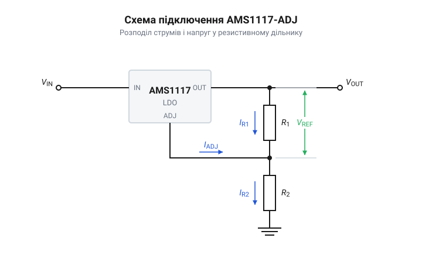

# AMS1117 — лінійний стабілізатор з малим падінням напруги (LDO)

<preknowlist>
- [TL431](root:cat-hw-power/tl431) — принцип дії підсилювача помилки та опорного джерела Bandgap
</preknowlist>

## Проблема падіння напруги стабілізатора

Класичні лінійні стабілізатори потребують значної різниці між вхідною та вихідною напругою, щоб працювати стабільно. Якщо спробувати отримати 3.3 В з 5 В за допомогою звичайного стабілізатора, схема не зможе підтримувати потрібний рівень — їй просто не вистачить «запасу» напруги для власної роботи. Цей мінімальний запас називають напругою падіння.

Щоб живити сучасні цифрові мікросхеми, яким часто потрібні саме 3.3 В від USB або 5-вольтового джерела, з'явилися стабілізатори з малим падінням напруги — @@en|Low Drop-Out@@ (LDO). Якщо класичні стабілізатори використовують на виході складений транзистор Дарлінгтона, який через свою будову «з'їдає» принаймні 2 В, то в LDO його замінили на одиночний прохідний транзистор. За такої схеми увімкнення втрати обмежуються лише напругою насичення самого транзистора у відкритому стані. Мікросхема AMS1117 є типовим представником LDO. Їй достатньо перевищення вхідної напруги над вихідною лише на 1–1.3 В. Завдяки цій здатності перетворювати 5 В на 3.3 В без збоїв, AMS1117 стала негласним стандартом для живлення логіки.

## Принцип роботи та версії мікросхеми

Будь-який лінійний стабілізатор утримує вихідну напругу, порівнюючи її зі зразковою. Всередині AMS1117 є джерело опорної напруги та підсилювач помилки. Підсилювач постійно вимірює напругу на виході й, якщо вона відхиляється від потрібної, привідкриває або прикриває внутрішній прохідний транзистор. Цей контур зворотного зв'язку реагує на зміну навантаження миттєво, зберігаючи напругу стабільною.

Мікросхема випускається у двох варіантах. Фіксовані версії (наприклад, AMS1117-3.3 або AMS1117-5.0) мають дільник напруги вже всередині корпусу — їх достатньо просто підключити. Регульована версія (ADJ) дозволяє задати будь-яку вихідну напругу за допомогою двох зовнішніх резисторів.

*Підключення AMS1117-ADJ: зовнішні резистори створюють дільник, з якого мікросхема зчитує рівень для підтримання потрібної напруги.*

## Охолодження та обмеження вихідного струму

Лінійний стабілізатор працює як керований опір: він зрізає зайву напругу, перетворюючи всю різницю між входом і виходом на тепло. Чим більший струм споживає навантаження і чим вища вхідна напруга, тим сильніше гріється мікросхема.

У характеристиках AMS1117 заявлено максимальний струм до 1 А, але на практиці це значення досяжне лише за ідеального охолодження. Мікросхема не має власного радіатора — вона відводить тепло у мідні доріжки друкованої плати через широку контактну площадку. Якщо майданчик охолодження недостатній, від струму в 500 мА стабілізатор перегріється і внутрішній захист вимкне його, спричиняючи циклічні перезавантаження пристрою.

## Вимоги до конденсаторів та стабільність

Контур зворотного зв'язку AMS1117 проєктувався в часи, коли основними конденсаторами були танталові. Щоб підсилювач помилки всередині мікросхеми працював стійко і не входив у самозбудження, йому потрібен невеликий опір послідовно з конденсатором на виході — еквівалентний послідовний опір (@@en|ESR@@).

Сучасні багатошарові керамічні конденсатори мають майже нульовий ESR. Якщо поставити таку кераміку на вихід AMS1117 без додаткового резистора, стабілізатор може перетворитися на генератор високочастотних коливань — замість постійних 3.3 В напруга почне стрибати, і живлена схема зависне. Тому на виході цієї мікросхеми слід використовувати саме танталові конденсатори.