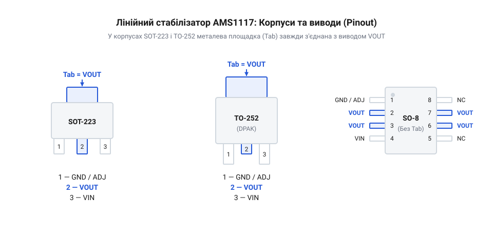
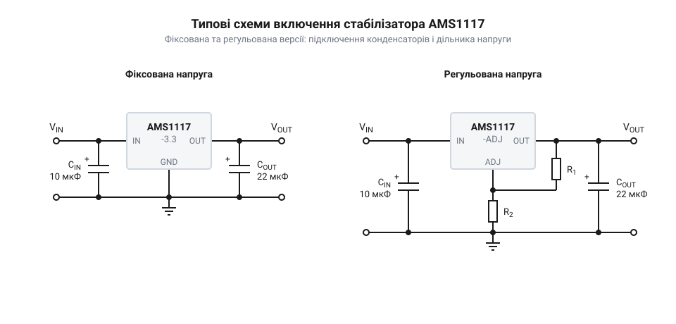

# Залізний інтерфейс AMS1117: цокольовка, корпуси, електричні параметри та схемне підключення

## Призначення виводів та корпуси

Коли ви розробляєте пристрій, якому потрібне стабільне живлення, мікросхема має бути зручною для монтажу та відведення тепла. Лінійний стабілізатор AMS1117 випускається у трьох основних корпусах: SOT-223, TO-252 (DPAK) та SO-8. Усі вони призначені для поверхневого монтажу (SMD), але відрізняються розмірами й здатністю розсіювати тепло. Найпоширенішим є SOT-223 — він компактний, але має достатньо велику мідну площадку (Tab) для тепловідведення.


*Корпуси AMS1117 з нумерацією виводів. Видно, що масивна площадка Tab завжди дублює вихідний контакт VOUT для кращого відведення тепла.*

Мікросхема має три основні робочі контакти. Другий вивід (VOUT) завжди є виходом стабілізованої напруги, а третій (VIN) — входом живлення. Їхнє розташування незмінне для всіх типів корпусів. Особливість криється в першому виводі, призначення якого залежить від версії стабілізатора. У моделях із фіксованою вихідною напругою (наприклад, AMS1117-3.3 або AMS1117-5.0) перший пін підключається до землі (GND). У регульованій версії (AMS1117-ADJ) цей самий контакт стає входом регулювання (ADJ). До нього підключається резистивний дільник, який задає потрібну вихідну напругу. Щоб не сплутати ці дві версії під час монтажу і не подати на схему хибну напругу, їх розрізняють за маркуванням на самому корпусі: після імені мікросхеми вказується або номінал виходу (наприклад, 3.3), або літери ADJ. Радіаторна площадка (Tab) зверху корпусу електрично з'єднана з виходом (VOUT), тому її не можна заземлювати.

## Напруга падіння та струм

Будь-який лінійний стабілізатор перетворює зайву напругу на тепло, тому вхідна напруга завжди має бути вищою за вихідну. Різниця між ними, за якої мікросхема ще здатна підтримувати стабільний вихід, називається напругою падіння (@@en|dropout voltage@@). Для AMS1117 ця величина становить типово 1.1 В, а максимально може сягати 1.3 В при повному навантаженні.

Це означає, що для отримання стабільних 3.3 В на виході при повному струмі, на вхід потрібно подати щонайменше 4.4–4.6 В. Проте напруга падіння не є сталою: вона прямо залежить від навантаження. Що менший струм споживає схема, то менша напруга втрачається на внутрішньому транзисторі, тому при струмі в кількадесят міліампер для стабілізації вистачить і 1 В різниці. Якщо ж вхідна напруга опуститься нижче цього порогу, стабілізатор «випаде з режиму» (@@en|drop out@@): вихідна напруга почне неконтрольовано падати слідом за вхідною, що може призвести до перезавантаження мікроконтролера або некоректної роботи датчиків. Тому, якщо ви живите схему на 3.3 В від літій-іонного акумулятора, напруга якого падає до 3.0 В по мірі розряду, AMS1117 не підійде навіть за малого споживання — потрібен стабілізатор із меншою напругою падіння, наприклад [XC6206 (662K)](root:cat-hw-power/xc6206).

Максимальний вихідний струм AMS1117 за паспортом становить 1 А. Проте цю цифру слід сприймати не як гарантовану робочу характеристику за будь-яких умов, а як абсолютну межу внутрішньої архітектури. Реально допустимий струм жорстко обмежений нагрівом мікросхеми. Чим більша різниця між вхідною та вихідною напругами, тим більше тепла виділяється на кристалі. Якщо подати на вхід 12 В і знімати 3.3 В при струмі навіть 0.5 А, стабілізатор миттєво перегріється і спрацює його внутрішній тепловий захист, який вимкне вихід до охолодження. Тому робота на струмах, близьких до 1 А, можлива лише за мінімальної різниці напруг (наприклад, з 5 В у 3.3 В) та наявності великого мідного полігону для охолодження.

## Конденсатори та стабільність живлення

Лінійні стабілізатори використовують внутрішній підсилювач помилки для підтримки точної вихідної напруги. Ця система зворотного зв'язку може стати нестабільною (почати генерувати коливання), якщо до виходу не підключити правильний конденсатор. AMS1117 особливо вимогливий до вихідної ємності та її еквівалентного послідовного опору (@@en|Equivalent Series Resistance, ESR@@).

Для гарантованої стабільності виробник вимагає встановлювати на виході конденсатор ємністю не менше 22 мкФ. Ба більше, цей конденсатор не може бути будь-яким. Звичайні багатошарові керамічні конденсатори (MLCC) мають занадто низький ESR (міліоми), що зводить нанівець фазовий запас внутрішнього підсилювача і викликає самозбудження AMS1117 — на виході замість постійної напруги з'явиться високочастотна пилка. Тому ідеальним вибором для виходу AMS1117 є танталовий конденсатор, який має потрібний природний ESR у діапазоні від 0.5 до 5 Ом.

Якщо танталового конденсатора немає і ви змушені використовувати кераміку (наприклад, 10 мкФ або 22 мкФ), необхідно штучно додати ESR. Це робиться шляхом послідовного включення резистора опором 0.5–1 Ом між керамічним конденсатором і виходом мікросхеми. На вході стабілізатора вимоги менш суворі: достатньо танталового конденсатора на 10 мкФ або керамічного, щоб згладити пульсації від джерела живлення та забезпечити локальний запас енергії під час різких стрибків струму навантаження. Обидва конденсатори (вхідний і вихідний) слід розміщувати якомога ближче до відповідних виводів мікросхеми.

## Схемне підключення різних версій

Залежно від того, фіксована чи регульована версія AMS1117 використовується, принципова схема дещо змінюється. Версії з фіксованою напругою (наприклад, 1.8 В, 2.5 В, 3.3 В, 5.0 В) максимально прості в інтеграції, оскільки внутрішній дільник напруги вже налаштований лазером на заводі.


*Зліва — схема для фіксованої версії, де перший вивід йде на землю. Справа — для регульованої, де вихідна напруга задається резисторами R1 та R2.*

У схемі для фіксованої версії перший пін безпосередньо з'єднується із загальним проводом (GND). Достатньо лише додати вхідний і вихідний конденсатори для стабільності.

Для регульованої версії (AMS1117-ADJ) перший пін стає виводом ADJ. Щоб отримати потрібну напругу, між виходом (VOUT) і землею (GND) ставиться дільник із двох резисторів. Точка їхнього з'єднання підключається до виводу ADJ. Внутрішня схема стабілізатора завжди підтримує опорну напругу 1.25 В між виводами VOUT і ADJ. Ця напруга прикладається до першого резистора (R1), створюючи через нього постійний струм. Цей самий струм тече і через другий резистор (R2) на землю. Таким чином, вихідна напруга визначається формулою:

```text
VOUT
= 1.25 × (1 + R2 / R1) + I_ADJ × R2      [формула вихідної напруги для регульованого LDO]
```

Оскільки струм із виводу ADJ (I_ADJ) дуже малий (типово близько 50 мкА), його впливом часто нехтують, спрощуючи розрахунок. Виробник рекомендує вибирати опір R1 у межах 100-120 Ом. Цей резистор також виконує роль мінімального навантаження: для коректної роботи AMS1117 завжди потребує споживання щонайменше 5-10 мА. Завдяки резистору R1 цей струм буде забезпечено автоматично, навіть якщо зовнішня схема нічого не споживає. Якщо потрібне високоточне джерело опорної напруги, краще скористатися спеціалізованими рішеннями, як [TL431](root:cat-hw-power/tl431).

## Тепловідведення та полігони плати

Основна причина виходу з ладу лінійних стабілізаторів — перегрів. AMS1117 не має отвору для кріплення зовнішнього радіатора, тому єдиним способом відвести тепло є мідні провідники самої друкованої плати.

Тепловиділення (потужність, яку розсіює мікросхема) розраховується як добуток падіння напруги на струм навантаження. Наприклад, якщо ми знижуємо напругу з 12 В до 5 В при струмі 0.3 А, мікросхема має розсіяти 2.1 Вт тепла. Корпус SOT-223 без додаткового охолодження здатний розсіяти не більше 0.6–0.8 Вт, перш ніж його температура перевищить максимально допустимі 125 °C.

Щоб збільшити здатність розсіювати тепло, радіаторну площадку (Tab) корпусу припаюють до великого мідного полігону на платі. Важливо пам'ятати, що вивід Tab електрично з'єднаний із виходом стабілізатора (VOUT). Тому охолоджувальний полігон перебуватиме під вихідною напругою (наприклад, 3.3 В або 5 В), і його в жодному разі не можна з'єднувати із загальним полігоном землі (GND). Це ускладнює трасування: доводиться виділяти велику площу на верхньому шарі плати спеціально для VOUT. Для розсіювання потужності близько 1–1.5 Вт може знадобитися полігон площею понад 10–15 квадратних сантиметрів, що часто є неприйнятним для компактних пристроїв. Якщо розрахунки показують, що мікросхема буде розсіювати понад 1.5 Вт, від використання AMS1117 краще відмовитися на користь імпульсного перетворювача (DC-DC).