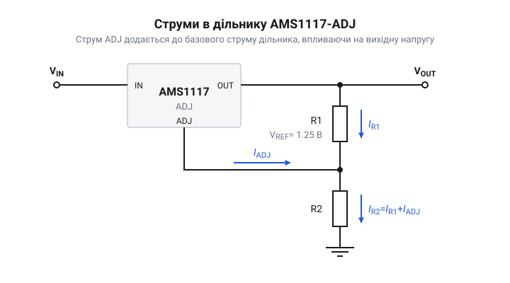

# Математичний розрахунок дільника напруги для регульованої версії AMS1117 ADJ

## Чому напругу треба налаштовувати

Багато мікросхем і модулів живляться стандартними напругами на кшталт 3.3 В або 5 В, для яких існують стабілізатори з фіксованим виходом. Проте іноді виникає потреба в нестандартному значенні напруги, наприклад 1.8 В для живлення процесорного ядра або 4.2 В для заряджання літій-іонного акумулятора. Стабілізатори з фіксованою напругою, такі як [XC6206 (662K)](root:cat-hw-power/xc6206), тут не підходять. Для таких завдань використовують регульовані стабілізатори, де вихідна напруга задається зовнішніми компонентами. 

Щоб мікросхема могла підтримувати потрібну напругу, вона повинна бачити її частину через зовнішній резистивний дільник. Але прямий розрахунок дільника напруги лише через співвідношення двох опорів дає хибний результат. Це відбувається тому, що регульована версія AMS1117 ADJ не є ідеальним компонентом. Її внутрішня схема живиться та керується струмом, який протікає через ті самі зовнішні резистори, втручаючись у роботу дільника і змінюючи розподіл напруг.

## Опорна напруга між виводами

Робота регулятора AMS1117 ADJ будується навколо підтримки стабільної різниці потенціалів між його виводами OUT (вихід) та ADJ (керування). Усередині мікросхеми міститься джерело опорної напруги `V_ref`, яке постійно порівнюється зі спадом напруги на зовнішніх компонентах. Подібний принцип підтримання опорної напруги використовується і в регульованих стабілітронах на кшталт [TL431](root:cat-hw-power/tl431). Для серії AMS1117 це значення становить 1.25 В. 

*Схема дільника показує, що резистор R1 увімкнений між виводами OUT і ADJ, а отже, напруга на ньому завжди підтримується рівною опорній напрузі мікросхеми.*

Мікросхема автоматично змінює свій внутрішній опір між входом IN та виходом OUT так, щоб напруга між виводами OUT і ADJ завжди дорівнювала рівно 1.25 В. Верхній резистор дільника `R1` вмикається саме між цими двома виводами. Оскільки напруга на `R1` фіксована, струм, що протікає через цей резистор `I_R1`, також є фіксованим і визначається за законом Ома:

        I_R1
        = V_ref ÷ R1      [за законом Ома для ділянки кола]

Цей струм тече далі в нижній резистор `R2`, створюючи на ньому спад напруги. Сума напруги на `R2` і `V_ref` формує загальну вихідну напругу `V_out`.

## Вплив струму виводу ADJ

Якби мікросхема була ідеальною, струм `I_R1` протікав би через `R2` без змін. Проте для роботи внутрішніх кіл керування — підсилювача помилки та джерела опорної напруги — мікросхема споживає власний струм. Оскільки регульований стабілізатор не має окремого виводу землі, цьому струму більше нікуди стікати, тому в AMS1117 він витікає безпосередньо з виводу ADJ і позначається як `I_adj`. Завдяки внутрішній схемотехніці цей струм залишається постійним: він практично не залежить ані від коливань вхідної напруги, ані від струму навантаження. За документацією, типове значення `I_adj` становить 50 мкА.

Цей струм зливається зі струмом верхнього резистора `I_R1` у вузлі виводу ADJ, і через нижній резистор `R2` протікає вже сумарний струм. Отже, струм через нижній резистор обчислюється так:

        I_R2
        = I_R1 + I_adj      [за першим правилом Кірхгофа для вузла ADJ]

Оскільки струм через `R2` збільшився на величину `I_adj`, напруга на ньому також зростає. Цей додатковий спад напруги додається до вихідної напруги. Якщо опір `R2` великий, то навіть невеликий струм `I_adj` може суттєво завищити вихідну напругу `V_out` порівняно з розрахунковим значенням. Тому цей струм необхідно завжди враховувати у розрахунках.

## Розрахунок резисторів дільника

Тепер ми можемо скласти повну формулу для обчислення вихідної напруги `V_out`. Вона дорівнює сумі спадів напруг на обох резисторах:

        V_out
        = V_R1 + V_R2                                [сума спадів напруг послідовного кола]
        = V_ref + (I_R2 × R2)                        [напруга V_R1 фіксована мікросхемою як V_ref]
        = V_ref + ( (I_R1 + I_adj) × R2 )            [розписано струм I_R2 через суму]
        = V_ref + ( (V_ref ÷ R1) + I_adj ) × R2      [заміна I_R1 за законом Ома]
        = V_ref × (1 + R2 ÷ R1) + (I_adj × R2)       [математичне перегрупування для виділення похибки]

Алгоритм розрахунку дільника завжди починається з вибору `R1`. Щоб вплив `I_adj` був мінімальним, струм через дільник `I_R1` має бути значно більшим за `I_adj`. Для AMS1117 ADJ виробник рекомендує обирати `R1` рівним 120 Ом або менше, що забезпечує струм дільника понад 10 мА. Це заодно задовольняє вимогу мінімального струму навантаження для стабільної роботи регулятора. 

Після того, як обрано `R1` (наприклад, 120 Ом), опір `R2` для отримання потрібної напруги `V_out` вираховується з тієї ж формули.

**Розрахунок резистора R2 для напруги 3.3 В:**

        R2
        = (V_out - V_ref) ÷ ( (V_ref ÷ R1) + I_adj )            [вираження R2 з основної формули]
        = (3.3 - 1.25) ÷ ( (1.25 ÷ 120) + 0.00005 )             [підстановка V_out = 3.3 В, V_ref = 1.25 В, R1 = 120 Ом, I_adj = 50 мкА]
        = 2.05 ÷ (0.010416 + 0.00005)                           [обчислення знаменника та чисельника]
        = 2.05 ÷ 0.010466                                       [додавання струмів]
        ≈ 195.8                                                 [результат в Омах]

Для виходу 3.3 В з `R1` = 120 Ом знадобиться `R2` з опором близько 196 Ом.

## Оцінка сумарної похибки напруги

У реальному пристрої вихідна напруга ніколи не буде абсолютно точною. Головна нестабільність криється у параметрі `I_adj`. Типове його значення — 50 мкА, але від мікросхеми до мікросхеми та при зміні температури він може сягати 120 мкА. 

Цей розкид струму формує додаткову напругу, що падає на резисторі `R2`. Якщо взяти наш розрахований `R2` = 196 Ом, то зміна струму на 70 мкА (від 50 мкА до 120 мкА) призведе до зміни напруги всього на 13 мВ (0.00007 А × 196 Ом), що для 3.3 В становить менше половини відсотка. Але якби ми обрали `R1` великим (наприклад, 1.2 кОм), `R2` довелося б збільшити приблизно до 2 кОм. Тоді ті самі 70 мкА коливання `I_adj` дадуть розкид уже 140 мВ, що є відчутною похибкою.

Крім того, самі резистори мають технологічний допуск (наприклад, 1% або 5%). Розкид опорів `R1` та `R2` безпосередньо впливає на дріб `(1 + R2 ÷ R1)` у формулі. Якщо `R1` виявиться меншим за номінал, а `R2` більшим, напруга зросте. Тому для дільників стабілізаторів напруги використовують прецизійні резистори з допуском 1%, а `R1` обирають досить малим, щоб гарантувати домінування стабільного струму дільника над плаваючим струмом `I_adj`.