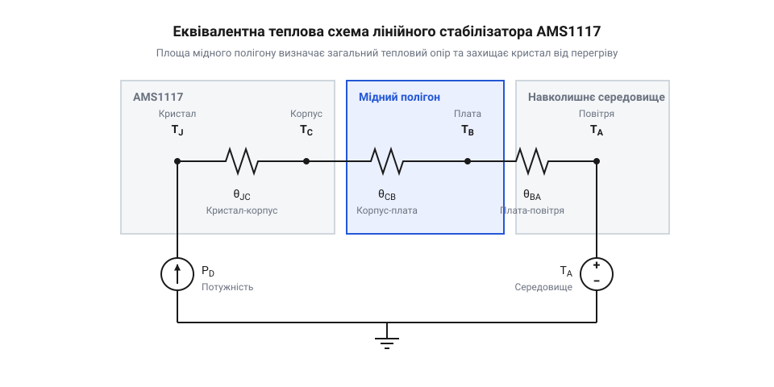

# Математичний розрахунок теплових режимів та площі мідного тепловідводу AMS1117

## Звідки береться тепло в регуляторі

Лінійний стабілізатор перетворює надлишок напруги на тепло. Уяви, що твій пристрій потребує для роботи 3.3 вольта, а джерело живлення видає 5 вольт. Зайві 1.7 вольта не можуть просто зникнути. Регулятор на зразок AMS1117 працює як розумний керований резистор, утворений внутрішнім транзистором: він поглинає цю різницю напруг, щоб на виході постійно лишалися стабільні 3.3 вольта. Оскільки весь струм, який споживає навантаження, безперервно протікає через цей «резистор», виконуючи роботу, виділяється енергія у вигляді тепла. У цьому полягає суть лінійного регулювання: надлишкова енергія фізично спалюється.

Чим більший струм протікає через регулятор і чим більша різниця між вхідною та вихідною напругами, тим більше тепла генерує кристал мікросхеми. Ця потужність теплових втрат `P` обчислюється як добуток спаду напруги на струм навантаження `I_load`. Крім того, сам регулятор споживає певний невеликий струм для роботи своїх внутрішніх кіл керування — струм спокою `I_q` (від @@en|quiescent current@@). Він береться від повної вхідної напруги `V_in`, що також додає свою частку тепла.

```
P
= (V_in - V_out) × I_load + V_in × I_q   [повна формула потужності втрат]
≈ (V_in - V_out) × I_load                [якщо струмом спокою I_q можна знехтувати]
```

Для AMS1117 типовий струм спокою становить близько 5 міліампер. Коли твоє навантаження споживає сотні міліампер, внесок `I_q` у загальне нагрівання стає мізерним порівняно з втратами на головному транзисторі. Через це на практиці другою частиною формули часто нехтують. Проте за мікрострумів навантаження нехтувати струмом спокою вже не можна: струм через транзистор падає майже до нуля, і саме струм спокою стає домінантним джерелом тепла. Якщо відкинути цей крайовий випадок, з розрахунку видно єдиний спосіб зменшити виділення тепла за незмінного струму: зменшити вхідну напругу, максимально наближаючи її до вихідної.

## Шлях тепла від кристала назовні

Коли кремнієвий кристал мікросхеми нагрівається, це тепло має постійно відводитися назовні. Якщо тепло не зможе покинути чип із тією ж швидкістю, з якою воно генерується, температура невпинно зростатиме. Відведення тепла інженери моделюють як протікання електричного струму. У цій зручній аналогії виділена потужність — це джерело струму, різниця температур — це різниця потенціалів, а середовища, крізь які проходить потік тепла, мають свій тепловий опір `θ` (від @@en|thermal resistance@@).


*Еквівалентна схема теплового ланцюга від кристала мікросхеми до навколишнього середовища, де джерело струму — це виділена потужність, а резистори — теплові опори.*

Тепловий опір показує, на скільки градусів нагріється об'єкт відносно середовища, якщо пропустити крізь нього рівно один ват тепла. Він вимірюється в °C/Вт. Щоб теплова енергія дісталася від розігрітого кристала (переходу, @@en|junction@@) до навколишнього кімнатного повітря, вона долає дві головні перешкоди на своєму шляху. Перша — внутрішній опір від самого кристала до металевої підкладки чи пластику корпусу мікросхеми `θ_JC`. Він фіксований і залежить лише від конструкції чипа; ми на нього жодним чином не впливаємо. Друга перешкода — опір від поверхні корпусу до навколишнього повітря `θ_CA`, який визначає, наскільки легко поверхня віддає тепло в простір.

Загальний тепловий опір системи `θ_JA` (від кристала до повітря) дорівнює простій сумі цих двох послідовних опорів. Чим цей опір менший, тим менший температурний бар'єр, і тим холоднішим залишається кристал під час роботи. Для крихітних регуляторів, таких як [XC6206](root:cat-hw-power/xc6206), тепло доводиться віддавати лише через малу поверхню пластику. Але в потужніших корпусах на зразок SOT-223 для AMS1117 виробник передбачив спеціальний великий металевий вивід — таб. Він лежить безпосередньо під кристалом, тому опір `θ_JC` до нього дуже малий, що дозволяє вивести основний потік тепла на плату.

## Розрахунок робочої температури переходу

Знаючи значення загального теплового опору системи `θ_JA` та обчисливши потужність втрат `P`, ми отримуємо змогу точно розрахувати, до якої саме температури нагріється внутрішній кристал. Це критичний параметр, оскільки для кремнієвих напівпровідників, використаних в AMS1117, максимально допустима робоча температура переходу `T_J` становить 125 °C. Якщо перевищити цю межу, тепловий рух електронів починає руйнувати закладені властивості транзисторів, і регулятор втрачає здатність стабілізувати напругу. Зазвичай у таких випадках спрацьовує аварійний тепловий захист мікросхеми, який відключає вихід.

Робоча температура всередині мікросхеми складається з температури навколишнього середовища `T_A`, до якої додається власний внутрішній перегрів кристала від виділеної потужності.

```
T_J
= T_A + P × θ_JA                         [загальна формула температури кристала]
```

З цього простого лінійного виразу стає очевидною одна пастка: чим вища базова температура повітря довкола плати `T_A`, тим менший температурний «бюджет» залишається мікросхемі до критичної межі в 125 °C. Якщо твій пристрій лежить на столі в кімнаті при 25 °C, ти маєш цілих 100 градусів запасу на нагрівання. Але якщо цей же пристрій монтується у вуличний герметичний корпус під прямим сонцем, де повітря розжарюється до 60 °C, твій запас миттєво скорочується до 65 градусів. Під час проєктування теплового режиму необхідно завжди спиратися на найгіршу (найвищу) очікувану температуру довкілля, інакше пристрій відключиться спекотного літнього дня.

Базова температура `T_A` — це не погода надворі, а температура повітря безпосередньо навколо регулятора. Коли плата працює в глухому невентильованому корпусі, це внутрішнє повітря збирає тепло як від самої мікросхеми AMS1117, так і від решти деталей пристрою. У замкненому об'ємі виникає ефект теплової пастки: нагрітому повітрю нікуди вийти, і локальна температура `T_A` неухильно зростає. Тому навіть за кімнатних 25 °C простір усередині пластикової коробки може розігрітися до 45 °C, з'їдаючи запас теплового бюджету ще до того, як ми додамо до нього власний нагрів кристала.

## Визначення площі мідного полігону

Сам по собі металевий таб корпусу SOT-223 надто малий, щоб розсіяти хоч трохи значну потужність у повітря. Його власний тепловий опір від корпусу до повітря `θ_CA` величезний, і кристал дуже швидко перегріється. Щоб вирішити цю проблему, таб обов'язково припаюють до широкого майданчика міді на друкованій платі. Мідь чудово проводить тепло, тому цей полігон діє як плоский радіатор. Він розтягує тепло від таба на велику площу, збільшуючи площу контакту з повітрям. Це різко знижує опір `θ_CA`, а разом із ним і загальний `θ_JA`.

Щоб дізнатися, який розмір цього мідного радіатора потрібен, інженери виконують розрахунок у зворотному напрямку. Беремо найгіршу очікувану температуру довкілля `T_A`, беремо розраховану раніше потужність втрат `P` і знаходимо максимально допустимий тепловий опір, за якого кристал нагріється рівно до межових 125 °C.

**Обчислення допустимого опору для AMS1117**
На вході 5 В, на виході 3.3 В, струм навантаження 0.5 А, максимальна температура повітря 50 °C.

```
P
= (5 - 3.3) × 0.5                        [спад напруги помножений на струм]
= 0.85 Вт                                [потужність, яку треба розсіяти]

θ_JA
= (125 - 50) ÷ 0.85                      [запас температури ділимо на потужність]
= 75 ÷ 0.85                              [запас температури до межі]
≈ 88.2 °C/Вт                             [максимально допустимий тепловий опір]
```

Отримане значення 88.2 °C/Вт — це максимальна верхня межа теплового опору всієї системи. Далі потрібно відкрити технічну документацію на AMS1117 і знайти графік залежності теплового опору `θ_JA` від площі мідного полігону. Зазвичай ці графіки наводяться для стандартного текстоліту FR-4 із товщиною мідної фольги 1 oz (унція на квадратний фут, що відповідає товщині 35 мікрометрів). Знаходиш на графіку рівень 88 °C/Вт і дивишся, яка площа полігону забезпечує такий опір або нижчий. 

Варто пам'ятати, що збільшення площі міді допомагає лише до певної межі. Тонка мідна фольга сама має тепловий опір. На надто великих відстанях від мікросхеми тепло просто не доходить до країв полігону, розсіюючись по дорозі. Тому графік швидко виполоджується, і після кількох квадратних сантиметрів додавання міді майже не впливає на охолодження.