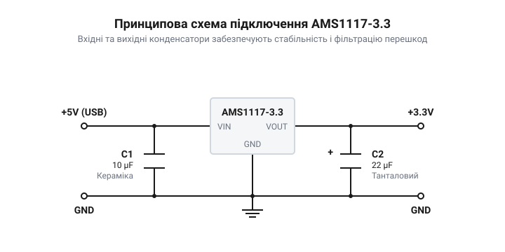
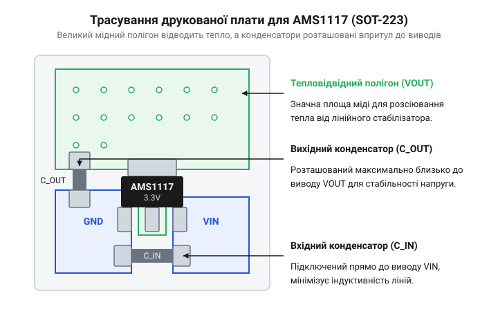

# Проєктування та випробування модуля живлення 5 В в 3.3 В на AMS1117-3.3

## Потреба у стабільних 3.3 В

Більшість сучасних мікроконтролерів (як-от ESP8266, ESP32 чи STM32) потребують напруги живлення 3.3 В. Однак найпоширенішим джерелом живлення сьогодні є порт USB, що видає 5 В. Якщо підключити мікроконтролер безпосередньо до USB, перевищення напруги спричинить пробій внутрішніх транзисторів і миттєве вигоряння кристала. Тому потрібен проміжний елемент, який знизить 5 В до безпечного рівня і постійно утримуватиме цю напругу, незалежно від струму, який споживає мікроконтролер. Цю задачу виконує лінійний стабілізатор. Він діє як керований опір, що автоматично змінюється так, щоб на його виході завжди залишалося рівно 3.3 В. Зайва напруга (тут 1.7 В) просто гаситься на цьому опорі, перетворюючись на тепло. Сама мікросхема AMS1117 випускається як у версії з регульованою напругою, де вихідний рівень задається зовнішніми резисторами, так і з фіксованою. Для нашого завдання ми обираємо саме версію з фіксованою напругою 3.3 В (AMS1117-3.3): це усуває потребу в додаткових деталях, заощаджує місце на платі та гарантує, що напруга не підскочить через відхилення опору чи відмову зовнішнього подільника. Створення окремого модуля живлення на основі такого стабілізатора дозволяє безпечно підключати чутливі мікроконтролери до звичайних джерел на 5 В.

## Вибір конденсаторів та стабільність

Лінійний стабілізатор не може працювати без обв'язки. Щоб мікросхема миттєво реагувала на стрибки струму навантаження і тримала напругу рівною, їй потрібні додаткові елементи — конденсатори на вході та виході. 

*Принципова схема: конденсатори обв'язки стабілізатора.*

Особливість AMS1117 у тому, що він схильний до самозбудження: замість того, щоб утримувати постійні 3.3 В, стабілізатор починає генерувати високочастотні коливання, через які мікроконтролер буде постійно перезавантажуватися. Щоб запобігти цьому, на виході стабілізатора обов'язково має стояти танталовий конденсатор. Чому саме він? Справа в еквівалентному послідовному опорі (@@en|Equivalent Series Resistance@@, ESR). Для стабільності внутрішнього контуру стабілізатора вихідний конденсатор повинен мати ESR від 0.5 до 5 Ом. Звичайні керамічні конденсатори мають надто низький ESR, тому їх використання на виході без додаткового послідовного резистора призводить до нестабільності. На вході стабілізатора ставлять звичайний керамічний конденсатор ємністю близько 10 мкФ — він згладжує імпульси струму від джерела 5 В. Правильний вибір вихідного конденсатора для AMS1117 важливіший, ніж для новіших регуляторів на кшталт [XC6206 (662K)](root:cat-hw-power/xc6206) чи джерел опорної напруги як [TL431](root:cat-hw-power/tl431). Детальніше про те, як [еквівалентний послідовний опір конденсатора впливає на стабільність схем](root:hw-components/capacitor-esr-impedance), читайте в окремій темі.

## Розрахунок охолодження для SOT-223

Падіння напруги в 1.7 В, яке стабілізатор відсікає від 5 В, нікуди не зникає — воно перетворюється на тепло. Потужність цього тепла залежить від струму навантаження. Якщо струм досягає 800 мА, потужність розсіювання обчислюється так:

    P
    = (5 В - 3.3 В) × 0.8 А
    = 1.36 Вт

Для мікросхеми в маленькому корпусі SOT-223 виділення 1.36 Вт тепла — це серйозне навантаження. Без належного відведення тепла кристал швидко нагріється понад 125 °C, спрацює тепловий захист, і стабілізатор вимкнеться. Оскільки корпус SOT-223 не дозволяє закріпити масивний алюмінієвий радіатор, єдиним способом охолодити його є друкована плата. Мідний полігон на платі відіграє роль радіатора.

*Топологія плати: мідний полігон відводить тепло від центрального виводу стабілізатора.*

Щоб відвести 1.36 Вт тепла і не дати кристалу перегрітися, потрібно обчислити максимально допустимий тепловий опір від кристала до середовища `θ_JA`, який дістають із різниці між граничною температурою кристала `T_J` (125 °C для AMS1117) та очікуваною температурою навколишнього середовища `T_A` (наприклад, 40 °C), поділеної на розсіювану потужність `P`:

    θ_JA
    = (T_J - T_A) ÷ P
    = (125 °C - 40 °C) ÷ 1.36 Вт
    ≈ 62.5 °C/Вт

Цей вираз зіставляє доступний температурний запас мікросхеми з кількістю розсіюваного тепла, і з нього видно, що система охолодження має не допускати нагрівання кристала більше ніж на 62.5 градуси на кожен ват. Для досягнення такого низького теплового опору `θ_JA` площа мідного полігону, підключеного до широкого виводу стабілізатора, має бути не менше 10 квадратних сантиметрів (при стандартній товщині міді 35 мкм). Цей розрахунок визначає фізичні розміри модуля живлення: якщо зробити плату меншою за потрібний радіатор, модуль вимикатиметься під навантаженням.

## Трасування друкованої плати модуля

Для надійної роботи модуля компоненти на платі слід розташувати так, щоб мінімізувати довжину провідників і забезпечити ефективне відведення тепла. Лінійний стабілізатор перетворює надлишок напруги на тепло. Щоб мікросхема не перегрівалася і не вимикалася через тепловий захист, її корпус SOT-223 припаюють до мідного полігону, який виконує роль радіатора. Чим більша площа цього полігону, тим більше тепла він зможе розсіяти в навколишнє середовище.

Тут криється головна пастка корпусу SOT-223 для лінійних стабілізаторів. Великий контакт (підкладка) мікросхеми AMS1117 внутрішньо з'єднаний із виводом вихідної напруги `VOUT`, а не з землею. Відповідно, мідний полігон, до якого він припаюється для охолодження, перебуватиме під потенціалом 3.3 В. Його не можна з'єднувати із земляним полігоном, інакше відбудеться коротке замикання. Цей тепловий полігон варто робити якомога більшим на верхньому шарі плати. Для покращення тепловідведення під ним можна розмістити аналогічний полігон на нижньому шарі плати і з'єднати їх мережею перехідних отворів (@@en|thermal vias@@). Це дозволить теплу розподілятися по обох боках текстоліту.

Вхідні та вихідні конденсатори розташовують якомога ближче до відповідних виводів стабілізатора. Це зменшує індуктивність провідників, яка заважає конденсаторам швидко віддавати заряд під час різких стрибків струму навантаження. Якщо провідник довгий, його індуктивність уповільнює реакцію конденсатора, і напруга на виході встигає просісти. Спочатку, найближче до виводів мікросхеми, встановлюють керамічний конденсатор, оскільки він найшвидше реагує на високочастотні перешкоди. Одразу за ним розміщують танталовий конденсатор, який забезпечує основний запас енергії для згладжування пульсацій і завдяки своєму ESR гарантує стабільність петлі зворотного зв'язку стабілізатора.

Особливу увагу приділяють підключенню землі. Контакти землі обох конденсаторів та вивід землі стабілізатора мають з'єднуватися суцільним земляним полігоном з мінімальним опором. Це запобігає виникненню різниці потенціалів між компонентами: коли струм повертається до джерела через тонку доріжку, на ній падає напруга, і «земля» для різних компонентів стає різною. Суцільний полігон робить опір зворотного шляху струму нікчемно малим, знижуючи рівень шумів у схемі.

Ширина провідників, якими тече струм від стабілізатора до навантаження, має бути достатньою, щоб уникнути падіння напруги. Для струму 800 мА ширини доріжки 1 міліметр на стандартній міді завтовшки 35 мікрометрів цілком достатньо. Вужча доріжка працюватиме як резистор: при струмі 800 мА на довгому й тонкому провіднику може загубитися кілька десятків мілівольтів, і мікроконтролер отримає менше за свої законні 3.3 В.

## Вимірювання пульсацій і тестування

Зібраний модуль живлення необхідно перевірити під реальним навантаженням. Без навантаження або з малим споживанням стабілізатор може показувати ідеальні 3.3 В, але реальне випробування — це здатність утримувати цю напругу, коли мікроконтролер починає споживати великий струм. Наприклад, ESP8266 під час передачі даних по Wi-Fi різко споживає імпульси струму понад 400 мА. Для тестування до виходу модуля підключають електронне навантаження або потужний резистор, який змусить стабілізатор віддавати стабільні 800 мА, і перевіряють його реакцію на такі імпульси.

Щоб побачити, як стабілізатор справляється з перетворенням, використовують осцилограф. Щуп осцилографа підключають безпосередньо до вихідних контактів модуля. Звичайний дріт із затискачем-«крокодилом» для землі тут не підходить: він утворює великий контур, який працює як антена і збирає зовнішні електромагнітні перешкоди. Ці перешкоди накладаються на сигнал, і на екрані здаватиметься, що модуль видає величезні шуми. Для вимірювання пульсацій з щупа знімають ковпачок і використовують спеціальну пружинну насадку для землі, впираючись нею безпосередньо в земляний контакт конденсатора, а центральною голкою — у вивід 3.3 В.

На екрані осцилографа обирають режим закритого входу (@@en|AC coupling@@). Цей режим відсікає постійну напругу 3.3 В і залишає лише змінні коливання (пульсації) навколо нуля, дозволяючи розглянути їх у масштабі мілівольтів. Для AMS1117 з правильно підібраними конденсаторами амплітуда пульсацій під статичним навантаженням зазвичай не перевищує 20–30 мВ. 

Під час перевірки різким перемиканням навантаження (@@en|load transient@@), наприклад від 10 мА до 800 мА і назад, на екрані буде видно провал напруги під час різкого зростання струму та сплеск під час його різкого падіння. Це відбувається через скінченний час реакції петлі зворотного зв'язку стабілізатора. Якщо ці провали та сплески не виходять за межі допустимих для мікроконтролера 3.0–3.6 В і швидко повертаються до номіналу без довгих коливань, конденсатори підібрані правильно і модуль працює стабільно. Якщо ж після сплеску напруга довго коливається вгору-вниз (@@en|ringing@@), це ознака нестабільності: можливо, танталовий конденсатор має занадто низький ESR, і петля зворотного зв'язку збуджується.

Фінальний етап тестування — перевірка теплового режиму. Під безперервним навантаженням 800 мА при зниженні з 5 В до 3.3 В мікросхема розсіює 1.36 Вт тепла. За кілька хвилин роботи корпус SOT-223 нагріється. Якщо площа теплового полігону достатня, температура стабілізується на рівні 70–80 °C, і стабілізатор продовжить працювати. Якщо ж охолодження бракує, мікросхема швидко нагріється понад 125 °C, спрацює внутрішній тепловий захист, і вихідна напруга різко впаде до нуля, поки кристал не охолоне. Стабільна робота під повним навантаженням без вимикань доводить, що трасування плати виконано правильно.