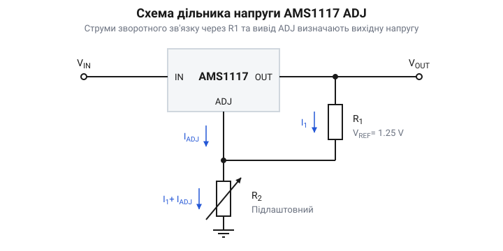
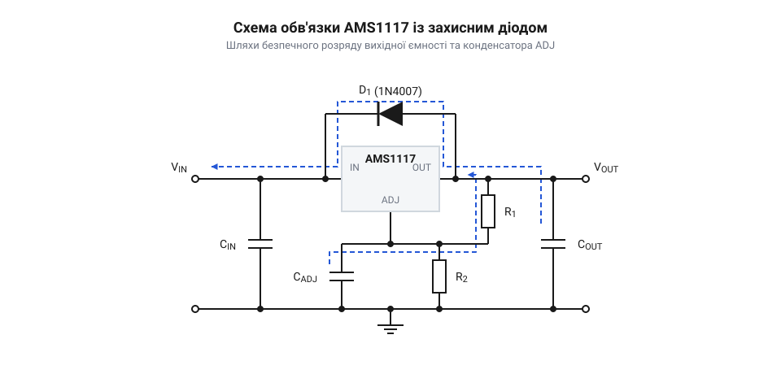

# Створення регульованого лабораторного джерела живлення на AMS1117 ADJ

<preknowlist>
- [XC6206 (662K)](root:cat-hw-power/xc6206) — загальний принцип роботи лінійного регулятора напруги та призначення базових фільтруючих конденсаторів.
</preknowlist>

## Потреба у змінній напрузі

Під час роботи з електронікою фіксованого значення напруги часто буває недостатньо. Ти можеш перевіряти новий датчик, живити незнайомий двигун або досліджувати мінімальну робочу напругу, яку витримує [LDO-регулятор 3.3 В](root:cat-hw-power/xc6206). Кожен компонент має власні вимоги, і тримати на столі окреме фіксоване джерело для кожного можливого значення — незручно й неефективно. Для швидкого прототипування та лабораторних експериментів потрібне єдине джерело, здатне плавно змінювати напругу в широкому діапазоні. Це дає змогу на льоту адаптуватися до будь-якого навантаження без перезбирання схеми. Водночас для таких експериментів критичною є чистота живлення, щоб не спотворювати роботу чутливих компонентів. Якщо імпульсні перетворювачі вносять високочастотні завади від постійних перемикань, то лінійний регулятор видає гладку напругу без цих електричних шумів. Саме поєднання можливості плавного налаштування та електричної «безшумності» зумовлює потребу у створенні власного регульованого джерела живлення на основі лінійного регулятора.

## Механізм регулювання в AMS1117

Основою нашого регульованого джерела є лінійний регулятор AMS1117 у версії ADJ (від @@en|adjustable@@ — регульований). На відміну від мікросхем із фіксованою напругою, які жорстко прив'язують вихід до землі й видають задане значення, регульована версія має іншу внутрішню логіку. Вона не знає, яка напруга відносно землі їй потрібна. Єдине, що робить ця мікросхема, — постійно підтримує точну опорну напругу 1.25 В між своїм виходом `OUT` і виводом підлаштування `ADJ`. 

Внутрішній контур зворотного зв'язку мікросхеми порівнює напругу між цими двома виводами. Якщо різниця стає меншою за 1.25 В, регулятор відкриває внутрішній транзистор і пропускає більше струму з входу на вихід. Якщо більшою — прикриває. Ця властивість гарантує, що на будь-якому компоненті, увімкненому між виводами `OUT` та `ADJ`, завжди буде стабільна напруга рівно 1.25 В, незалежно від струму навантаження чи вхідної напруги.

*Принципова схема дільника напруги навколо AMS1117 ADJ демонструє утворення контуру зворотного зв'язку, завдяки якому мікросхема керує вихідною напругою.*

Щоб перетворити цю опорну напругу на керований вихід, ми будуємо зовнішній дільник. Між `OUT` та `ADJ` ставимо постійний резистор `R₁`. Оскільки мікросхема примусово тримає на ньому 1.25 В, через цей резистор тече стабільний і незмінний струм `I₁ = 1.25 / R₁`. Цьому струму нікуди подітися, окрім як текти далі — з виводу `ADJ` на землю. 

Для керування фінальною напругою ми ставимо на цьому шляху другий резистор — `R₂`, з'єднуючи `ADJ` із землею. Струм `I₁`, протікаючи через `R₂`, створює на ньому спад напруги, прямо пропорційний опору. Тепер вивід `ADJ` піднятий над землею на цю величину. Оскільки напруга на виході `OUT` завжди на 1.25 В вища за напругу на `ADJ`, загальна вихідна напруга `Vₒᵤₜ` стає сумою опорної напруги та спаду на `R₂`:

        Vₒᵤₜ
        = 1.25 + I₁ × R₂          [напруга на виході — сума спадів на двох резисторах]
        = 1.25 + (1.25 / R₁) × R₂ [підстановка відомого струму через R₁]
        = 1.25 × (1 + R₂ / R₁)    [винесення спільного множника]

Зробивши `R₂` змінним резистором, ми отримуємо прямий контроль над вихідною напругою: що більший опір `R₂`, то сильніше вихід відривається від землі і напруга зростає. 

Але формула вище приховує одну деталь — власний струм виводу підлаштування `I_ADJ`. Внутрішні кола мікросхеми також споживають невеликий струм (зазвичай близько 50 мкА), який витікає з виводу `ADJ` і протікає через `R₂` на землю, додаючись до струму `I₁`. Через це повна формула вихідної напруги насправді містить ще один доданок, який збільшує спад напруги:

        Vₒᵤₜ
        = 1.25 × (1 + R₂ / R₁) + I_ADJ × R₂      [повна напруга з урахуванням струму виводу підлаштування]

Чому ж на практиці цим додатковим струмом нехтують? Усе залежить від вибору `R₁`. Будь-який лінійний регулятор, такий як AMS1117, потребує мінімального струму навантаження (близько 5–10 мА), щоб стабільно тримати напругу, коли до виходу нічого не підключено. Тому `R₁` спеціально вибирають малим — класично 120 або 240 Ом. Якщо `R₁` дорівнює 240 Ом, струм `I₁` становить понад 5 мА. На його тлі власний струм `I_ADJ` у 50 мкА є меншим у сто разів. Похибка, яку він створює на типовому змінному резисторі `R₂` (наприклад, 2 кОм для досягнення 12 В), становить усього 0.1 В. Малий номінал `R₁` одночасно виконує дві функції: гарантує мінімальне навантаження для мікросхеми і робить струм дільника настільки великим, що непередбачуваним струмом `I_ADJ` можна безпечно знехтувати.

Ця ж механіка встановлює і нижню межу регулювання. Якщо викрутити змінний резистор `R₂` у нуль, його опір зникне, і вивід `ADJ` з'єднається із землею напряму. Спад напруги на `R₂` дорівнюватиме нулю, але мікросхема все одно невтомно підтримуватиме свої 1.25 В між `OUT` і `ADJ`. Тому вихідна напруга впаде до свого фізичного мінімуму — 1.25 В. Отримати від такої схеми меншу напругу неможливо.

*Повна схема обв'язки регулятора показує доданий діод для захисту від розряду вихідної ємності назад у мікросхему та шунтувальний конденсатор на виводі ADJ для зменшення шумів.*

## Точне налаштування вихідної напруги

Формула спирається на ідеальні резистори, проте реальні радіодеталі мають похибку. Звичайний підлаштовний резистор може мати відхилення 10-20%, і його опір здатен відчутно плавати від зміни температури. Оскільки співвідношення `R₂` та `R₁` безпосередньо задає вихідну напругу, будь-яка недосконалість цих деталей перетворюється на нестабільну напругу. Для лабораторного джерела, де тобі може знадобитися виставити рівно 2.5 В, як це робить [TL431](root:cat-hw-power/tl431), таке плавання є неприпустимим.

Щоб усунути цю проблему, звичайні деталі замінюють на прецизійні. Для `R₁` беруть резистор із похибкою 1%, що робить базовий струм незмінним. Для `R₂` замість звичайного потенціометра використовують багатооборотний підлаштовний резистор. У ньому потрібно зробити 10-25 повних обертів гвинта, щоб пройти шлях від нуля до максимального опору. Така механічна редукція дає змогу виставити точний опір і, відповідно, вихідну напругу з точністю до сотих часток вольта, а також гарантує, що налаштування не з'їде від випадкового дотику чи вібрації.

## Стабільність живлення та захист
Вихідна напруга лінійного регулятора безпосередньо спирається на потенціал виводу `ADJ`. Якщо в цьому вузлі з'явиться електричний шум або пульсація, внутрішній підсилювач помилки мікросхеми перенесе їх на вихід, помноживши на коефіцієнт дільника. Щоб зробити живлення по-справжньому чистим, паралельно нижньому підлаштовному резистору `R₂` (між виводом `ADJ` та землею) встановлюють додатковий шунтувальний конденсатор, зазвичай ємністю `10 мкФ`. Він поглинає високочастотні завади й робить опорну напругу стабільною, запобігаючи стрибкам на виході при різких змінах навантаження. Загальні принципи використання вхідних та вихідних фільтрів можна переглянути на прикладі [лінійного регулятора напруги](root:cat-hw-power/xc6206) з фіксованим виходом, проте для регульованих мікросхем шунтування `ADJ` є критично важливим.

Проте додавання ємностей створює нову загрозу. Коли ми вимикаємо первинне джерело живлення, напруга на вході регулятора різко падає до нуля. Але на виході залишається заряджений конденсатор, а також ємності самої схеми, яку ми живимо. У цей момент потенціал виводу `OUT` стає значно вищим за потенціал виводу `IN`. Струм починає текти у зворотному напрямку — від виходу до входу крізь внутрішні напівпровідникові переходи мікросхеми. Цей зворотний струм здатен миттєво зруйнувати кристал.

Щоб цьому запобігти, мікросхему потрібно захистити зовні. Між виводами `OUT` та `IN` встановлюють звичайний випрямний діод, повернутий катодом до входу. У нормальному режимі роботи, коли вхідна напруга вища за вихідну, цей діод закритий і ніяк не впливає на струм. Але щойно джерело вимикається і вихідна напруга перевищує вхідну, діод миттєво відкривається. Він створює безпечний прямий шлях для розряджання вихідного конденсатора в обхід мікросхеми, надійно захищаючи її від пробою.

## Збірка та калібрування джерела
Об'єднавши мікросхему AMS1117 ADJ, прецизійний дільник із багатооборотним потенціометром, набір фільтрувальних і шунтувальних конденсаторів та захисний зворотний діод, ми отримуємо завершену схему. Вона готова стати інструментом для лабораторних експериментів, але перед підключенням до цільових плат її потрібно перевірити.

Насамперед зібрану плату оглядають на відсутність коротких замикань між шинами живлення та землею. Потім на вхід подають нерегульовану базову напругу — наприклад, від мережевого адаптера на `12 В`. До виходу паралельно підключають мультиметр, переведений у режим вимірювання постійної напруги. На цьому етапі до виходу не повинно бути підключено жодного іншого навантаження.

Далі починається калібрування. Плавно обертаючи гвинт багатооборотного резистора за допомогою викрутки, потрібно пройти весь діапазон доступних напруг. Важливо переконатися, що показання мультиметра змінюються лінійно і без раптових стрибків. Нижня межа має становити близько `1.25 В`, що відповідає внутрішній опорній напрузі мікросхеми. Верхня межа буде трохи нижчою за вхідну напругу через падіння на самому регуляторі. Якщо межі збігаються з очікуваннями, а зміна відбувається плавно, пристрій зібрано правильно.

Тепер можна виставити конкретну напругу, необхідну для роботи, скажімо `3.3 В` або `5.0 В`. Завдяки багатооборотному механізму це робиться з точністю до сотих часток вольта. Після того, як потрібний рівень зафіксовано на екрані приладу, лабораторне джерело готове до безпечного підключення та живлення ваших схем.