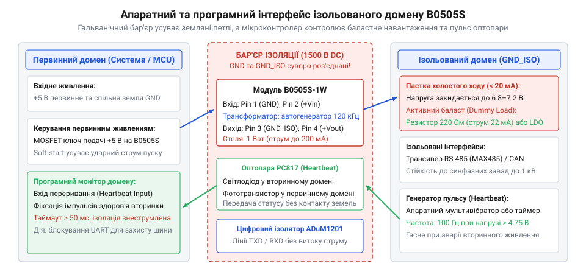

# ⚙️ Керування ізольованим живленням B0505S: захист від холостого ходу, ізольована телеметрія та безпечний UART

Модуль B0505S-1W — це мініатюрний перетворювач постійної напруги 5 В у 5 В з гальванічною розв'язкою до 1500 В постійного струму. Його ставлять там, де треба розірвати спільний нульовий провід (земляну петлю) між чутливою керуючою частиною та силовою периферією: у портах RS-485, вузлах CAN-шини, програматорах та вимірювальних приладах.

На перший погляд, це пасивний 4-вивідний брусок: два піни на вхід, два на вихід. Проте спроба живити від нього цифрову мікросхему напряму часто призводить до виходу обладнання з ладу. Причина — у **відсутності петлі зворотного зв'язку**. Усередині B0505S працює автогенератор Ройєра з фіксованим коефіцієнтом трансформації. Якщо навантаження перетворювача падає нижче 10% (менше 20 мА), вихідна напруга стрімко зростає і **досягає 6.8–7.2 В**, випалюючи чутливі 5-вольтові трансивери та входи АЦП.

Ця стаття описує повний інтерфейс безпечної роботи з B0505S: контракт виводів модуля, динамічне керування баластним навантаженням (Dummy Load), зняття телеметрії здоров'я вторинного домену через оптопару без порушення ізоляції та надійний драйвер ізольованого UART на C (ESP-IDF, STM32 HAL, Arduino) та C++.

> 🔧 **Навіщо це.** Головна пастка нерегульованих перетворювачів — режим сну периферії. Коли ізольований мікроконтролер чи трансивер RS-485 засинає, його споживання падає з 30 мА до лічених мікроампер. Модуль B0505S миттєво переходить у некерований холостий хід і піднімає напругу до 7 В. Щойно пристрій прокидається, він отримує удар перенапруги. Програмно-керований баласт підтримує обов'язкові 10% навантаження лише тоді, коли це справді необхідно.

## Апаратний контракт B0505S: цоколівка, межі та інваріанти

Модуль виконано в однорядному 4-піновому корпусі SIP-4. Повний електричний контракт визначає межі безпечної експлуатації:

```
Первинний домен (GND)                 Вторинний ізольований домен (GND_ISO)
   Pin 2 (+Vin: +5 В ±10%) ──┐     ┌── Pin 4 (+Vout: +5 В номінал)
                             [ B0505S ]
   Pin 1 (GNDin: земля)   ──┘     └── Pin 3 (-Vout: ізольована земля)
             │                              │
             └─── 1500 В DC ІЗОЛЯЦІЯ ───────┘
```

### Електричні параметри та граничні умови (Contract Invariants)

| Параметр інтерфейсу | Номінальне значення | Гранично допустиме | Наслідок порушення |
| :--- | :--- | :--- | :--- |
| **Вхідна напруга Vin** | 5.0 В | 4.5–5.5 В | Вихід за межі призводить до зриву генерації Ройєра |
| **Вихідна напруга (номінал)** | 5.0 В (при навантаженні 100%) | 4.75–5.25 В | Робочий режим при споживанні 20–200 мА |
| **Вихідна напруга холостого ходу** | 6.8 В | 7.2 В (при струмі &lt; 5 мА) | **Перенапруга!** Вихід з ладу підключеної цифрової логіки |
| **Мінімальний струм навантаження** | 20 мА (10% від 1 Вт) | 15 мА (мінімум) | Обов'язкова умова для втримання вихідної напруги нижче 5.5 В |
| **Максимальний вихідний струм** | 200 мА (1 Вт) | 220 мА | Перевантаження феритового осердя, просідання напруги, нагрів |
| **Напруга пробою ізоляції** | 1000 В DC (тривало) | 1500 В DC (1 хв) | Пробій бар'єра, вигорання первинного контролера |
| **Прохідна ємність бар'єра** | 20–30 пФ | 40 пФ | Передача високих синфазних завад (dU/dt) між доменами |


*Архітектура системи: B0505S живить вторинний домен через гальванічний бар'єр; оптопара передає сигнал здоров'я, а мікроконтролер вмикає баласт 220 Ом при переході периферії в режим сну.*

## Крок 1. Активне баластне навантаження (Active Dummy Load)

Щоб утримати напругу вторинної шини в межах 5.0 В ±5%, струм споживання ніколи не повинен опускатися нижче 20 мА. Постійно припаяний баластний резистор марно розсіює 100 мВт енергії під час активної роботи, що суттєво для автономних пристроїв.

Розумний підхід — **динамічне підключення баласту**:
1. Резистор 220 Ом (струм I = 5.0 / 220 ≈ 23 мА) комутується транзисторним ключем.
2. Перед подачею первинного живлення на B0505S баласт **завжди вмикається першим**, щоб ліквідувати викид напруги під час пуску.
3. Коли мікроконтролер ініціалізує лінію зв'язку й трансивер споживає свій робочий струм (30–60 мА), баласт вимикається.
4. Перед переходом лінії в очікування або сном пристрою баласт знову підключається до шини.

:::tabs
:::code api-isolated-power/c/esp-idf/krok-1-dummy-load-control.c
:::code api-isolated-power/c/stm32/krok-1-dummy-load-control.c
:::code api-isolated-power/c/arduino/krok-1-dummy-load-control.ino
:::

## Крок 2. Зняття телеметрії вторинного домену через оптопару

Первинний мікроконтролер не може напряму підключити свій АЦП до виходу B0505S: з'єднання виводу GNDin із землею -Vout миттєво знищує всю гальванічну розв'язку й замикає земляну петлю.

Для контролю здоров'я вторинного живлення використовується оптичний бар'єр на оптопарі PC817:
- У вторинному домені стоїть найпростіший релаксаційний генератор або компаратор живлення, що генерує імпульси частотою 100 Гц лише тоді, коли напруга шини перевищує 4.75 В.
- Світлодіод оптопари засвічує фототранзистор у первинному домені.
- Вивід мікроконтролера налаштовується на апаратне переривання (EXTI). Якщо імпульси надходять частіше ніж раз на 50–60 мс — вторинне живлення гарантовано стабільне.

:::tabs
:::code api-isolated-power/c/esp-idf/krok-2-isolated-heartbeat.c
:::code api-isolated-power/c/stm32/krok-2-isolated-heartbeat.c
:::code api-isolated-power/c/arduino/krok-2-isolated-heartbeat.ino
:::

> 🔧 **Навіщо це.** Опитування статусу через оптопару зберігає повну електричну міцність 1500 В і водночас дає контролеру знати, що силова лінія з іншого боку плати не має короткого замикання, не перегрілася й живить приймач штатно.

## Крок 3. Надійний драйвер ізольованого UART

Цифровий ізолятор (наприклад, магнітний ADuM1201 або ємнісний Si8621) переносить логічні рівні TXD і RXD крізь бар'єр. Проте якщо вторинне живлення раптово просяде (через перевантаження або КЗ на зовнішній лінії), вхідний каскад ізолятора з боку приймача переходить у невизначений стан. 

Лінія RXD може «повиснути» в логічному нулі, викликаючи безперервний потік помилок кадру (Framing Error) та переривань переповнення буфера UART в ядрі мікроконтролера.

Правильний драйвер зв'язує статус живлення з інтерфейсом передачі:

:::tabs
:::code api-isolated-power/c/esp-idf/krok-3-isolated-uart.c
:::code api-isolated-power/c/stm32/krok-3-isolated-uart.c
:::code api-isolated-power/c/arduino/krok-3-isolated-uart.ino
:::code api-isolated-power/cpp/isolated_power_domain.hpp
:::

Перед початком транзакції драйвер перевіряє наявність імпульсів здоров'я вторинного домену. Якщо живлення ізоляції зникло, запити блокуються, а приймальний буфер очищається.

## Типові пастки інтеграції B0505S

### 1. Випадкове коротке замикання земель під час налагодження

Найчастіша катастрофа в лабораторії: розробник встановлює B0505S для захисту комп'ютера від силового інвертора, а потім підключає стандартний двоканальний осцилограф. 

Крокодил заземлення щупа першого каналу чіпляється на первинну землю GND, а крокодил другого каналу — на ізольовану землю GND_ISO. Оскільки крокодили всіх щупів осцилографа з'єднані між собою через заземлення корпусу приладу, **гальванічна розв'язка миттєво закорочується накоротко** через кабель приладу. Силовий струм інвертора тече через щуп і спалює плату разом з осцилографом.

**Правило:** Під час роботи з ізольованими доменами використовуйте диференційні щупи або живіть вимірювальний пристрій від повністю відв'язаного акумулятора.

### 2. Зрив коливань автогенератора через надмірну ємність виходу

Автогенератор Ройєра всередині B0505S працює на частоті 100–150 кГц і дуже чутливий до ємнісного навантаження в момент старту. Якщо підключити на вихід модулі з великими електролітичними конденсаторами (понад 47–100 мкФ), пусковий струм заряду розцінюється генератором як коротке замикання. Генерація зривається, і модуль зависає в стані споживання надструму з нульовою вихідною напругою.

**Правило:** Не перевищуйте сумарну ємність на виході B0505S понад 10–22 мкФ (кераміка X7R з низьким ESR).

## Що забрати з собою

1. **B0505S вимагає мінімального струму 20 мА.** Без навантаження вихід піднімається до 7.0 В, що смертельно для логіки 5 В.
2. **Баласт підключають перед стартом.** Динамічний резистор 220 Ом усуває пусковий стрибок і відключається після старту периферії.
3. **Землі ніколи не з'єднуються.** Сигнали контролю передаються виключно через оптопару або цифровий ізолятор.
4. **Програмний контроль пульсу (Heartbeat).** Моніторинг статусу вторинки запобігає зависанню драйверів UART і шин даних при зникненні ізольованого живлення.
