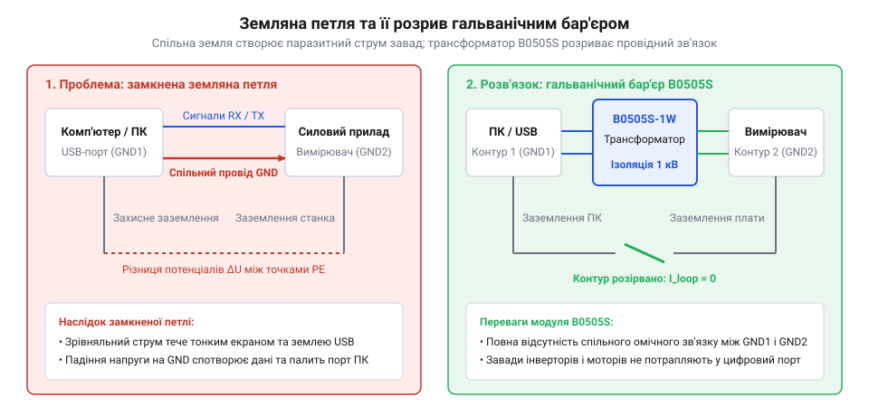
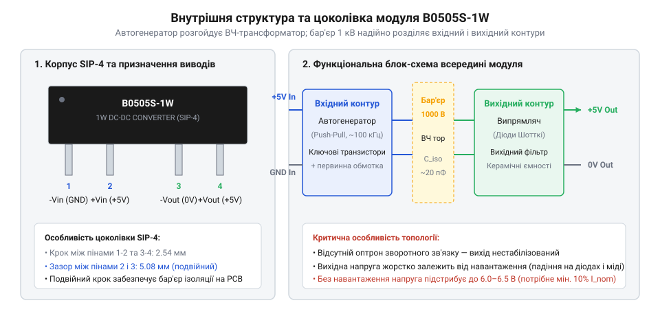
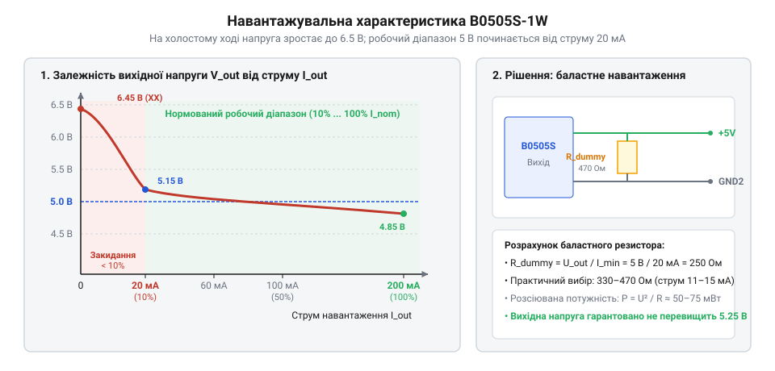
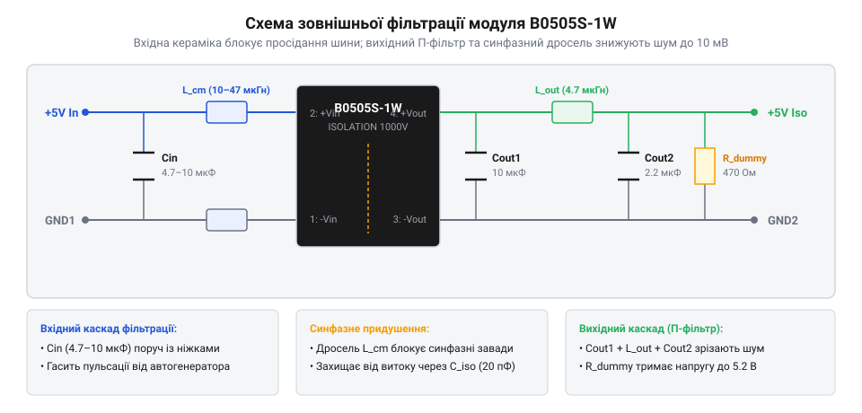

# B0505S-1W — ізольований DC-DC 5 В → 5 В

<preknowlist>
- [LM2596 — регульований понижувач (і версія CC/CV)](root:cat-hw-power/lm2596-buck) — Базовий принцип імпульсного перетворення напруги на дроселі та робота ключів.
- [Перетворювач 5 В → ±12 В (двополярне живлення)](root:cat-hw-power/dual-rail-converter) — Концепція отримання нестандартних живильних рівнів для аналогових каскадів.
</preknowlist>

## Захід із проблеми: земляні петлі та небезпека прямого з'єднання

Уявіть типову робочу ситуацію: ви налагоджуєте плату керування потужним кроковим двигуном або частотним перетворювачем і підключаєте мікроконтролер до комп'ютера через звичайний USB-кабель для зняття телеметрії в терміналі. Живлення силової частини йде від потужного імпульсного блока живлення, а ПК увімкнено в мережевий подовжувач. Раптом під час пуску мотора комп'ютер перезавантажується, екран блимає, а USB-порт на материнській платі назавжди перестає розпізнавати будь-які пристрої. Ще підступніший випадок — точний АЦП або звуковий тракт, де при підключенні кабелю живлення з'являється незрозуміле низькочастотне гудіння або хаотичні викиди в молодших розрядах вимірювань.

Причина таких аварій криється у виникненні земляної петлі (@@en|ground loop@@). Коли дві частини системи живляться від різних джерел, їхні «земляні» дроти мають мізерну, але відмінну від нуля різницю потенціалів через падіння напруги від струмів повернення. З'єднуючи їхні нульові проводи спільним провідником або обплетенням кабелю, ви замикаєте контур великої площі. Будь-яке силове перемикання або індуктивний викид наводить у цій петлі струми силою в кілька ампер, які течуть прямо крізь тонкі земляні доріжки мікроконтролера та сигнальні лінії USB.

Класичною ілюстрацією цієї руйнівної взаємодії є вихід з ладу популярного USB-UART перетворювача на мікросхемі FT232RL або CH340 під час налагодження стенда з імпульсним живленням. Нехай верстат або силова установка живляться від промислового джерела 24 В, вхідні мережеві фільтри якого мають конденсатори Y-класу, з'єднані з незаземленим металевим шасі. Через витік струму потенціал «землі» керуючої плати зміщується відносно захисного заземлення ПК на 15 В. Поки кабелі роз'єднані, обидві частини працюють штатно. Проте в момент під'єднання стандартного USB-кабелю роз'єм типу USB-A часто спочатку замикає контакти шини даних або сигнальні лінії, або струм зрівнювання спрямовується через захисні контури кремнієвого чипа.

Різниця потенціалів усього в 15 В миттєво відкриває вбудовані захисні діоди від статичної електрики (ESD-діоди) на лініях D+, D- або земляних виводах мікросхеми FT232RL, розраховані на максимальну напругу не більше ніж VCC + 0.5 В. Через надмалий опір відкритого p-n переходу струм зрівнювання контуру за частки мікросекунди перевищує допустимі 20–50 мА, викликаючи лавинний тиристорний ефект защіпання (від англ. @@en|latch-up effect@@). Кристал FT232RL за лічені секунди розігрівається до кількох сотень градусів, пластиковий корпус плавиться з характерним клацанням, а надмірний струм випалює внутрішні захисні ключі USB-контролера південного мосту комп'ютера. Уникнути цього фатального сценарію дозволяє лише повний фізичний розрив земляного провідника.

> 🔧 **Навіщо це.**
> Гальванічна розв'язка усуває фізичний електричний контакт між двома частинами системи. Енергія та сигнали передаються через магнітне поле, тому спільний провід відсутній, земляна петля фізично не може замкнутися, а високовольтні імпульси з боку навантаження не здатні пробитися до чутливої керуючої електроніки.


*Земляна петля утворює паразитний контур струму між різними блоками живлення; гальванічний бар'єр усуває фізичний контакт провідників.*

Усунути цю проблему покликаний компактний ізольований DC-DC перетворювач **B0505S-1W** [Перетворювач 5 В → ±12 В](root:cat-hw-power/dual-rail-converter). Його завдання — взяти нестабільні 5 В від первинного джерела і сформувати на виході повністю незалежні 5 В, електрично ізольовані від вхідної землі на напругу до 1000–1500 В постійного струму.

Детальний екскурс у розвиток технологій магнітної ізоляції та матеріалів феритових осердь викладено у вставці [Еволюція технологій гальванічної розв'язки](root:cat-hw-power/b0505s-isolated/hist-galvanic-isolation-evolution.md).

## Внутрішній устрій модуля B0505S та цоколівка SIP-4

Зовні модуль B0505S виглядає як крихітний чорний пластиковий брусок розміром приблизно 11.5×6.0×10.0 мм із чотирма виводами, розташованими в один ряд (корпус SIP-4, крок 2.54 мм). Маркування читається просто: перша літера «B» позначає двополярну ізоляцію без стабілізації (серія фіксованих нерегульованих перетворювачів), перші дві цифри «05» — номінальна вхідна напруга 5 В, наступні дві цифри «05» — номінальна вихідна напруга 5 В, літера «S» — однорядний корпус SIP, а приставка «1W» — гранична вихідна потужність 1 ват (максимальний вихідний струм 200 мА).

Усередині герметичного пластикового корпусу, залитого компаундом, міститься мініатюрна плата поверхневого монтажу, на якій реалізовано автогенераторну схему:

```
[ +Vin ] ───┬──> [ Автогенератор Ройєра ] ──> [ Первинна обмотка ]
            │        (100–150 кГц)                     ║ (Магнітний потік)
[ GNDin ] ──┴────────────────────────────────> [ ТРАНСФОРМАТОР ]
                                                       ║ (Ізоляція 1 кВ)
[ +Vout ] <───┬── [ Діодний випрямляч ] <───── [ Вторинна обмотка ]
              │       + LC-фільтр
[ -Vout ] <───┴───────────────────────────────────────
```

Ключовим елементом розв'язки є високочастотний тороїдальний трансформатор на феритовому осерді. Його первинна і вторинна обмотки намотані дротом із посиленою потрійною ізоляцією (@@en|triple insulated wire@@), що й гарантує витримування випробувальної напруги ізоляції до 1500 В постійного струму протягом 1 хвилини.


*Функціональна схема модуля B0505S: автогенератор, високочастотний ізольований трансформатор і випрямляч у чотирививідному SIP-виконанні.*

Розташування виводів модуля є фіксованим галузевим стандартом:
1. **Вивід 1 (GNDin):** мінус первинного вхідного живлення.
2. **Вивід 2 (+Vin):** плюс первинного живлення (+5 В ±10%).
3. **Вивід 3 (-Vout / 0V):** мінус ізольованого вихідного живлення (вторинна земля, повністю відокремлена від GNDin).
4. **Вивід 4 (+Vout):** плюс ізольованої вихідної напруги (+5 В).

Між виводами 2 і 3 на платі витримано подвійну відстань (ізоляційний повітряний проміжок), що унеможливлює поверхневий пробій між вхідними та вихідними колами при високій вологості або накопиченні пилу.

Розрахунок теплових втрат, ККД перетворювача та прохідної паразитної ємності між обмотками наведено у вставці [Електричний розрахунок втрат та ємності розв'язки](root:cat-hw-power/b0505s-isolated/math-isolation-and-efficiency-losses.md). Програмне керування баластним навантаженням, телеметрію через оптопару та безпечний UART розглянуто в [API ізольованого живлення B0505S](root:cat-hw-power/b0505s-isolated/api-isolated-power.md).

## Специфіка нестабілізованого виходу та закидання напруги

Головна схемотехнічна особливість перетворювача B0505S-1W полягає в тому, що його вихід є нестабілізованим (від англ. @@en|unregulated output@@). Усередині компактного чотириконтактного корпусу SIP-4 принципово відсутні оптопара зворотного зв'язку, підсилювач помилки та контролер широтно-імпульсної модуляції (ШІМ). Первинний генератор працює з постійним коефіцієнтом заповнення, передаючи імпульси фіксованої тривалості через трансформатор на випрямний діод та вихідний конденсатор. Таке спрощення є свідомим інженерним компромісом: відмова від ланцюга зворотного зв'язку усуває потребу в додаткових високовольтних ізолювальних компонентах, що дозволило втиснути модуль у корпус завширшки лише 6 мм і знизити його собівартість до мінімуму.

Прямим наслідком відсутності стабілізації є жорстка залежність вихідної напруги від струму, який споживає підключене навантаження.


*Навантажувальна характеристика модуля B0505S: у зоні струмів менше 10% (менше 20 мА) спостерігається закидання напруги до 6.2–6.8 В, а номінальний рівень 5.0 В досягається лише в робочому діапазоні 20–200 мА.*

На холостому ході (від англ. @@en|no-load condition@@) або при мізерному споживанні вихідна напруга стрімко зростає і може досягати 6.5–7.0 В. Причина криється у фізиці нагромадження заряду: кожен імпульс автогенератора переносить фіксовану порцію енергії через магнітний сердечник, і якщо споживач не відбирає цю енергію, вона заряджає вихідний конденсатор до амплітудного піку індуктивного сплеску вторинної обмотки. Подача напруги понад 6 В на чутливі цифрові мікросхеми логіки 5 В або аналогові АЦП може призвести до їхнього термічного пробою або збою.

Щоб вихідна напруга гарантовано вкладалася в допустимий діапазон 5 В ± 5%, модуль вимагає мінімального робочого струму на рівні не менше 10% від максимальної потужності (для 1-ватного модуля на 5 В це 20 мА). Якщо навантаження є динамічним або пристрій регулярно переходить у глибокий режим сну з мікроамперним споживанням, на вторинній стороні обов'язково встановлюють баластний резистор (так зване фіктивне навантаження, від англ. @@en|dummy load@@).

Резистор опором 100–120 Ом розсіює:

    P = U² ÷ R
      = 5² ÷ 120
      ≈ 0.21 Вт

Він постійно споживає близько 20–25 мА струму, надійно утримуючи робочу точку перетворювача на пологій ділянці кривої. Детальні формули для розрахунку енергетичних втрат та прохідної ємності наведено у вставці [Втрати, ККД та паразитна ємність ізолятора](root:cat-hw-power/b0505s-isolated/math-isolation-and-efficiency-losses.md).

Коли цільова система потребує живлення сучасної 3.3-вольтової цифрової мікроелектроніки або прецизійного аналогового опорного джерела, баластний резистор є не найкращим рішенням: він марно витрачає понад 20% енергії акумулятора і не рятує від просідання виходу при максимальному струмі. Елегантним інженерним виходом є тандем модуля B0505S та лінійного стабілізатора з ультранизьким власним струмом споживання (від англ. @@en|low dropout regulator@@, LDO), такого як Microchip MCP1700 або Torex XC6206.

Мікросхема MCP1700-3302 у корпусі SOT-23 споживає на власні потреби лише 1.6 мкА у стані спокою, має падіння напруги всього 178 мВ при струмі 250 мА і витримує максимальну вхідну напругу до 6.0 В (або версії MCP1702/AP2112 до 13.2 В). Підключений після вторинного випрямляча B0505S, такий стабілізатор виконує одразу три критичні функції:
1. **Ідеальна фіксація потенціалу:** коли мікроконтролер переходить у глибокий сон і струм споживання падає до мікроампер, закидання вихідної напруги B0505S до 6.5 В повністю гаситься регулятором MCP1702, а на живлення контролера надходять бездоганні 3.30 В без жодного ризику пошкодження кристала.
2. **Усунення комутаційного шуму:** лінійний стабілізатор володіє високим коефіцієнтом придушення пульсацій живлення (PSRR), зрізаючи високочастотні викиди автогенератора на 40–50 дБ і перетворюючи нестабільний імпульсний вихід на лабораторну лінію живлення.
3. **Енергоефективність:** відпадає потреба в постійному баластному резисторі на 120 Ом, що дозволяє заощаджувати понад 200 мВт потужності в сплячих автономних бездротових датчиках.

Для ліній із напругою 5.0 В застосовують споріднений ізольований модуль B0506S або B0509S у поєднанні з LDO на 5.0 В, забезпечуючи гарантований запас падіння напруги навіть при максимальному просіданні вторинної обмотки під навантаженням.

> 🔧 **Навіщо це.** Якщо ви підключаєте через B0505S ізольований цифровий датчик температури, який опитується раз на секунду і спить решту часу, без баластного резистора на 120 Ом напруга в момент сну підскочить до 6.8 В і спалить контролер датчика ще до першого вимірювання.

## Схеми зовнішнього обв'язування та фільтрації завад

Проста топологія внутрішнього автогенератора Роєра (від прізвища винахідника Джорджа Роєра, англ. George H. Royer) комутує силовий струм із крутими фронтами на частотах близько 100–150 кГц. У поєднанні з паразитними індуктивностями виводів SIP-корпусу це генерує виражений високочастотний шум: типовий розмах пульсацій на голих виводах ненавантаженого B0505S досягає 75–100 мВ від піку до піку (від англ. @@en|peak-to-peak@@, Vp-p). Якщо живити таким струмом прецизійний АЦП або звуковий тракт, завади проявляться у вигляді плаваючого шуму в молодших розрядах або чутного писку.

Для отримання чистої напруги живлення застосовують багаторівневу схему фільтрації на первинній та вторинній сторонах.


*Каскад фільтрації перетворювача B0505S: вхідний керамічний конденсатор Cin, синфазний дросель L_cm між контурами та вихідний п-подібний LC-фільтр з низькоімпедансною керамікою.*

Схема фільтрації розбивається на три ключові контури:
1. **Вхідний розв'язувальний конденсатор (Cin):** керамічний конденсатор ємністю 4.7–10 мкФ (розрахований на напругу не менше 16 В), розміщений максимально близько до виводів 1 та 2 модуля. Він бере на себе імпульсний струм комутації автогенератора і не пускає високочастотні просідання назад у загальну шину первинного живлення 5 В.
2. **Вихідний згладжувальний конденсатор (Cout):** високоякісна кераміка (MLCC) типу X7R або X5R ємністю 4.7–10 мкФ. Використання звичайних алюмінієвих електролітів без керамічного шунта неефективне через їхній високий еквівалентний послідовний опір (ESR) на комутаційних гармоніках понад 100 кГц.
3. **Вихідний додатковий LC-фільтр:** для відповідальних аналогових схем за конденсатором Cout встановлюють маленький SMD-дросель номіналом 2.2–4.7 мкГн і ще один конденсатор на 2.2 мкФ. Такий п-подібний фільтр знижує амплітуду пульсацій до комфортних 10–15 мВ.
4. **Синфазний дросель (L_cm):** при наявності довгих сигнальних дротів паразитна ємність між первинною та вторинною обмотками трансформатора (близько 20–30 пФ) стає шляхом протікання високочастотного синфазного струму завади. Синфазний дросель (від англ. @@en|common-mode choke@@) на 10–47 мкГн, увімкнений у вхідні або вихідні лінії, ефективно придушує синфазні перешкоди без розриву гальванічного бар'єра.

Якщо ж модуль B0505S застосовується в парі з перетворювачами на зразок [MT3608](root:cat-hw-power/mt3608-boost) або [LM2596](root:cat-hw-power/lm2596-buck), наявність вхідного фільтра є обов'язковою, аби гармоніки двох імпульсних джерел не входили в резонансну інтерференцію.

> 🔧 **Навіщо це.** Встановлення мініатюрного керамічного конденсатора на 10 мкФ та дроселя 4.7 мкГн за 10 центів на виході B0505S зменшує розмах завад у 5 разів, перетворюючи шумне живлення на чисту лінію, від якої 16-бітний АЦП працює без тремтіння молодших бітів.

## Типові сценарії практичного застосування: інтерфейси та аудіотракти

Завдяки крихітним розмірам і незалежності вторинного контуру модуль B0505S-1W став класичним будівельним блоком у системах передачі даних та аналоговій вимірювальній техніці.

Найбільш критичні сфери його застосування охоплюють:
1. **Ізоляція промислових польових шин RS-485 та CAN:** при прокладанні витої пари на сотні метрів між будівлями чи різними цехами потенціал землі між вузлами може відрізнятися на десятки вольт або відчувати наведення від потужних електродвигунів. Пряме з'єднання заземлень гарантовано випалює мікросхеми трансиверів (MAX485, SN65HVD). Модуль B0505S забезпечує чисте ізольоване живлення 5 В для «гарячої» лінії трансивера, а цифрові сигнали передаються через швидкісні ізолятори — детальніше див. [Цифрові ізолятори ADuM та Si84xx](root:hw-components/digital-isolators-adum-and-si84xx).
2. **Захищений USB-UART міст для налагодження силової електроніки:** під час розробки частотних перетворювачів, драйверів крокових двигунів чи інверторів випадкове торкання щупом осцилографа або пробій транзистора скеровує високу напругу в лінію USB комп'ютера. B0505S створює надійний захисний бар'єр, що рятує материнську плату ноутбука. Повна інструкція зі збирання такого приладу наведена у проєкті [Ізольований USB-UART перехідник](root:cat-hw-power/b0505s-isolated/proj-isolated-usb-uart-dongle.md).
3. **Усунення шуму та гулу в аудіотрактах (USB-ЦАП):** зовнішні звукові карти та підсилювачі для навушників при живленні від комп'ютерного USB-порту часто страждають від високочастотного писку й потріскування, спричинених роботою процесора й відеокарти. Гальванічний розрив земляного дроту модулем B0505S повністю ліквідує петлю заземлення, прибираючи паразитні фонові шуми в динаміках.
4. **Живлення вимірювачів струму в плюсовому плечі (High-Side Current Sensing):** вимірювання струму шунтом, що стоїть у високовольтному колі (наприклад, 48 В), вимагає, щоб операційний підсилювач жився плаваючим потенціалом, прив'язаним саме до цієї шини.

Під час розробки та налагодження приладів із гальванічним бар'єром інженер обов'язково потребує візуального підтвердження працездатності вторинної ізольованої підсистеми. Якщо первинне живлення подано, але на вторинній стороні згорів запобіжник або перебито лінію зв'язку, прилад зовні здається повністю «мертвим», ускладнюючи діагностику на об'єкті.

Для контролю вторинної шини безпосередньо біля вихідних виводів `+Vout` та `-0V` модуля B0505S встановлюють світлодіодний індикатор (LED). Проте при його проектуванні слід враховувати енергетичний баланс та специфіку нестабілізованого виходу:
1. **Вибір струму та номіналу баластного резистора:** стандартний червоний або зелений SMD-світлодіод типорозміру 0805 має пряме падіння напруги близько 1.8–2.2 В. Щоб не перевантажувати 1-ватний перетворювач і не витрачати дорогоцінні міліампери на марне підсвічування, струм діода обмежують на комфортному рівні 2–3 мА. За законом Ома розраховують струмообмежувальний резистор:
   R = (V_out - V_f) ÷ I_led = (5.0 - 2.0) ÷ 0.003 = 1000 Ом (1 кОм).
2. **Подвійна функція (індикація та баластинг):** цей струм 2–3 мА є вкрай корисним, оскільки створює постійний мінімальний підпір навантаження, частково обмежуючи закидання вихідної напруги на холостому ході без встановлення додаткових потужних баластів.
3. **Правило ізоляції контуру:** світлодіод вторинного контуру повинен бути повністю підключений до ізольованих площадок `+Vout` та `-0V`. Категорично неприпустимо з'єднувати його катод із первинною землею `GND_IN` — це миттєво закоротило б гальванічний бар'єр і перекреслило всю ізоляцію плати.

На багатошарових друкованих платах поруч зі світлодіодом зазвичай шовкографією наносять чітку лінію маркування або значок блискавки з написом «ISOLATED 5V», що допомагає сервісному інженеру з першого погляду переконатися в наявності живлення за бар'єром.

> 🔧 **Навіщо це.** Встановлення B0505S на вході плати керування промисловою вентиляцією повністю ліквідує зависання мікроконтролера, які раніше виникали щоразу при пуску трифазного компресора.

## Обмеження, правила безпеки та вибір альтернатив

Попри всю універсальність, модуль B0505S є приладом початкового класу з фіксованими фізичними межами, нехтування якими призводить до виходу обладнання з ладу.

По-перше, вихідна потужність суворо обмежена значенням 1 Вт. При вихідній напрузі 5 В максимальний тривалий струм навантаження становить рівно:

    I_max = P ÷ U
          = 1 ÷ 5
          = 0.2 А (200 мА)

Оскільки ККД модуля становить 70–80%, близько 0.25 Вт потужності розсіюється у вигляді тепла всередині герметичного пластикового корпусу об'ємом менше одного кубічного сантиметра. При тривалій роботі на струмах близько 180–200 мА корпус розігрівається до 60–65 °C, що є нормальним, проте вимагає доброї конвекції повітря.

По-друге, слід враховувати прохідну паразитну ємність між первинною та вторинною обмотками трансформатора, яка становить 20–30 пФ. При роботі в колах із дуже високою швидкістю наростання напруги (dU/dt > 15 кВ/мкс), наприклад, у затворах швидких SiC- або GaN-транзисторів, через цю ємність протікає високочастотний струм витоку, здатний спричинити помилкові спрацьовування логіки.

Коли B0505S варто замінити альтернативними рішеннями:
1. **Необхідність строгої стабілізації напруги (Regulated):** якщо навантаження споживає змінний струм від 0 до 200 мА і не терпить стрибків напруги вище 5.0 В, обирають повністю стабілізовані перетворювачі (наприклад, серію IB0505S) або ставлять після B0505S лінійний регулятор з малим падінням.
2. **Потреба у вищій потужності:** для живлення кількох датчиків і радіомодулів обирають модулі потужністю 2 Вт (серія B0505S-2W) або модулі в корпусах DIP/SMD на 3–5 Вт.
3. **Підвищені вимоги до медичної ізоляції:** пробійна напруга 1000 В DC є достатньою для побутових і промислових задач, проте медичні стандарти вимагають посиленої ізоляції від 3000 до 6000 В змінного струму.

Про історичний шлях розвитку мініатюрних гальванічних ізоляторів читайте у вставці [Еволюція технологій гальванічної розв'язки](root:cat-hw-power/b0505s-isolated/hist-galvanic-isolation-evolution.md).

> 🔧 **Навіщо це.** Якщо ваш проєкт споживає 250 мА, спроба використати B0505S призведе до просідання напруги до 4 В та термічного руйнування модуля через кілька годин безперервної роботи — для такого струму слід одразу закладати версію на 2 Вт.
