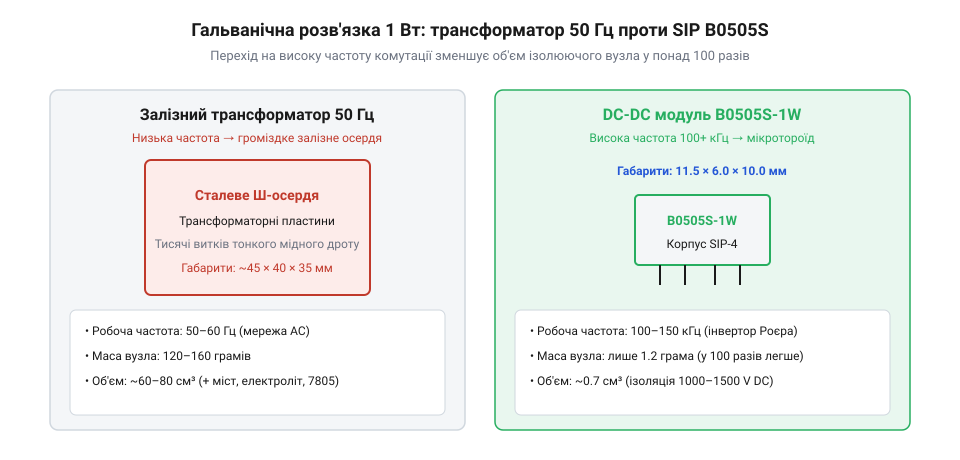
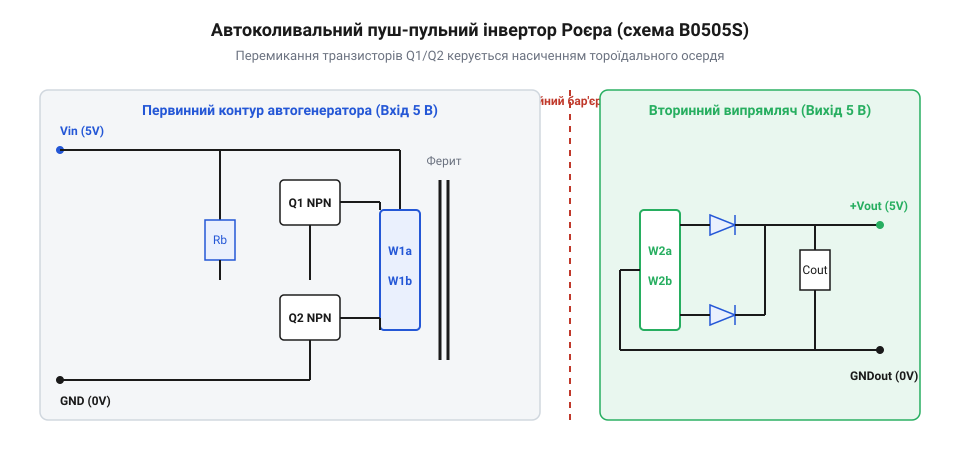

# B0505S-1W — ізольований DC-DC 5 В → 5 В

## Залізна межа низької частоти: чому 50 Гц блокували мініатюризацію

Будь-яка електронна схема, що працює поруч із промисловими верстатами або вимірює слабкі мікровольтові потенціали датчиків на заземлених металевих конструкціях, неминуче стикається з паразитною різницею потенціалів між точками заземлення. Якщо об'єднати сигнальну землю чутливого підсилювача із заземленням цеху прямим мідним провідником, цим контуром потече зрівняльний струм у кілька амперів, який спотворить вимірювання або миттєво зруйнує вхідні кола. Єдиним фізичним порятунком є гальванічна розв'язка (від імені італійського анатома і фізика Луїджі Гальвані, @@it|Luigi Galvani@@) — усунення провідного контакту між двома контурами при збереженні передачі енергії.

До середини XX століття єдиним доступним інструментом для розриву земляного контуру був електромагнітний трансформатор, увімкнений безпосередньо в мережу змінного струму частотою 50 або 60 Гц. Фізика електромагнітної індукції Фарадея встановлює суворий зв'язок між амплітудою індукованої електрорушійної сили, робочою частотою перемагнічування та геометричними параметрами магнітопроводу:

```
E = 4.44 · f · N · B_max · S_core
```

У цій рівності `f` — робоча частота мережі (50 Гц), `N` — кількість витків обмотки, `B_max` — максимальна індукція насичення трансформаторної сталі (близько 1.2–1.5 Тл), а `S_core` — площа поперечного перерізу осердя. Якщо частота становить лише 50 коливань на секунду, добуток `N · S_core` мусить бути величезним навіть для передачі мізерної потужності в один ват.

Щоб передати крихітну потужність для живлення вхідного вимірювального каскаду чи одного операційного підсилювача, інженер мусив закладати важке осердя з пластин електротехнічної кремнієвої сталі масою 150–300 грамів і намотувати тисячі витків найтоншого мідного дроту товщиною з волосину. Такі трансформатори грілися через вихрові струми у сталі, вимагали об'ємних металевих екранів для захисту від мережевого фону 50 Гц і займали третину об'єму всього вимірювального приладу.


*Низька частота 50 Гц вимагає масивного сталевого осердя й тисяч витків дроту, тоді як частота 100 кГц дозволяє зменшити об'єм трансформатора у сотні разів до мініатюрного корпусу SIP.*

> 🔧 **Навіщо це.**
> Розуміння формули Фарадея показує корінь інженерного глухого кута 1950-х років: зменшити габарити й масу розв'язувального вузла неможливо зміною кількості міді чи форми заліза — єдиний шлях радикального стиснення полягає у піднятті робочої частоти `f` на кілька порядків.

У ранній ламповій та першій дискретній транзисторній автоматиці кожен ізольований сенсор вимагав окремої вторинної обмотки масивного мережевого трансформатора. Якщо в складній вимірювальній стійці було потрібно розв'язати десять незалежних датчиків, прилад перетворювався на непідйомну залізну шафу, а міжканальні ємності між обмотками зводили нанівець якість розв'язки на високих частотах. Справжній технологічний прорив став можливим лише тоді, коли інженери навчилися штучно генерувати високу частоту локально, прямо на друкованій платі.

## Генератор Роєра: автоколивальна революція 1954 року

У 1954 році американський інженер Джордж Роєр (@@en|George H. Royer@@), який працював у дослідницькій лабораторії корпорації @@en|Westinghouse Electric@@, зробив фундаментальний винахід. Він об'єднав два щойно винайдені біполярні p-n-p германієві транзистори з тороїдальним осердям із матеріалу з прямокутною петлею гістерезису (магніто-м'який сплав пермалой) в елегантну автоколивальну схему двотактного перетворювача (патент США @@en|US Patent 2,783,384@@, виданий у 1957 році).

Схема Роєра стала першим в історії високоефективним транзисторним інвертором постійної напруги в змінну. Її геніальність полягала в самосинхронізації: транзистори працювали не в лінійному режимі підсилення, де вони марно розсіювали б тепло, а в ключовому режимі, почергово насичуючись і закриваючись за рахунок магнітного стану самого осердя.


*Двотактний інвертор Роєра: почергове магнітне насичення тороїда перемикає транзистори бази через обмотки додатного зворотного зв'язку без зовнішніх мікросхем керування.*

Принцип дії генератора Роєра спирається на циклічне перемагнічування матеріалу осердя між двома рівнями індукції насичення: `+B_sat` та `-B_sat`:

1. При подачі постійної напруги живлення `V_in` через несиметрію схеми один із транзисторів (наприклад, VT1) починає відкриватися швидше за інший.
2. Струм колектора VT1 тече через верхню половину первинної обмотки трансформатора `W1a`, викликаючи зростання магнітного потоку в осерді.
3. Зміна магнітного потоку наводить у базових обмотках зв'язку `W_base` електрорушійну силу, яка додатково відкриває VT1 і надійно закриває VT2 (позитивний зворотний зв'язок). Транзистор VT1 миттєво входить у режим повного насичення.
4. Напруга на обмотці залишається сталою й дорівнює напрузі живлення `V_in`. Відповідно, магнітний потік у тороїді лінійно зростає з часом, доки індукція не досягне граничної величини насичення `+B_sat`.
5. Щойно матеріал осердя насичується, диференційна магнітна проникність різко падає практично до нуля. Зміна магнітного потоку припиняється (`dΦ/dt = 0`), напруга на базових обмотках зникає, і базовий струм VT1 падає до нуля.
6. Транзистор VT1 виходить із насичення і починає закриватися. Енергія, накопичена в індуктивності розсіювання, породжує ЕРС самоіндукції протилежного знака. Це відкриває транзистор VT2, і процес дзеркально повторюється в протилежному напрямку перемагнічування до досягнення `-B_sat`.

Період коливань `T` та робоча частота `f` такого генератора жорстко визначаються напругою живлення та фізичними параметрами трансформатора за формулою Роєра:

```
f = V_in / (4 · N_p · B_sat · S_core)
```

де:
- `V_in` — вхідна напруга живлення (В),
- `N_p` — кількість витків половини первинної обмотки,
- `B_sat` — індукція насичення матеріалу магнітопроводу (Тл),
- `S_core` — площа поперечного перерізу осердя (м²).

Піднявши робочу частоту з мережевих 50 Гц до 20–100 кГц, інженери скоротили потрібну площу осердя та кількість витків у сотні разів. Замість кілограмів сталі з'явилися мініатюрні феритові кільця зовнішнім діаметром менше сантиметра. Що ще важливіше: схема Роєра не потребувала жодних зовнішніх задавальних генераторів, таймерів чи складних схем керування — вона запускалася самостійно від звичайної батареї чи шини живлення постійного струму і працювала з коефіцієнтом корисної дії понад 80%.

Саме автоколивальний принцип Роєра заклав схемотехнічний фундамент для створення перших ізольованих DC-DC перетворювачів. Він довів, що для створення компактного бар'єра ізоляції не потрібна централізована мережа змінного струму — високу частоту можна генерувати локально в точці використання, перетворивши гальванічну розв'язку на стандартний мікромодульний компонент електронної плати.

## Ера гібридних мікромодулів: Burr-Brown і Newport Components

Наприкінці 1970-х та на початку 1980-х років розвиток промислової автоматики й прецизійних вимірювальних систем висунув нову вимогу: ізольовані джерела живлення мали встановлюватися безпосередньо на друковану плату поруч із мікроконтролерами й операційними підсилювачами. До того часу розробники мусили самостійно мотати мініатюрні тороїди на феритових кільцях вручну або використовувати громіздкі модулі у металевих екранованих коробках. Ручне намотування призводило до величезного розкиду параметрів, нестабільної міжвиткової ємності та непередбачуваної електричної міцності ізоляції.

Прорив здійснили дві компанії, які заклали фундамент комерційних розв'язувальних мікромодулів. Американська корпорація @@en|Burr-Brown@@ (відома своїми прецизійними операційними підсилювачами та АЦП) представила лінійки гібридних ізольованих перетворювачів у корпусах DIP, де мініатюрний тороїдальний трансформатор монтувався на керамічну підкладку разом із безкорпусними транзисторами й заливався компаундом. Майже одночасно у Великій Британії компанія @@en|Newport Components@@ (заснована у 1980 році в Мілтон-Кінз, згодом увійшла до складу японської корпорації @@en|Murata Power Solutions@@) розробила технологію високоточного автоматизованого тороїдального намотування дротом із потрійною поліімідною ізоляцією (@@en|triple insulated wire@@).

Гібридна технологія дозволила інженерам Newport упакувати повноцінний двотактний інвертор, трансформатор на високопроникному фериті марки MnZn (марганець-цинковий ферит із початковою магнітною проникністю понад 5000) та випрямні діоди Шотткі в герметичний пластиковий брусок розміром із поштову марку. Заливка епоксидним або поліуретановим компаундом не лише захищала витки від вологи й вібрацій, а й витісняла повітряні бульбашки, виключаючи виникнення коронних розрядів у мікропорах діелектрика при напругах вище 1000 В.

> 🔧 **Навіщо це.**
> Заливка компаундом є вирішальним фактором довговічності ізоляції: повітря за атмосферного тиску пробивається при напруженості поля близько 3 кВ/мм, тоді як якісний полімерний компаунд витримує понад 15–20 кВ/мм. Це дозволило зблизити первинну й вторинну обмотки до часток міліметра без ризику пробою.

## Стандартизація SIP-4 і поява копійчаного стандарту B0505S

Початково виробники використовували різні корпуси — від багатовивідних 14-пінових DIP до громіздких металевих кубиків. Проте розробникам на платі була потрібна гранична економія площі: кожен зайвий міліметр піднімав собівартість багатошарового текстоліту. У 1990-х роках ринок зійшовся на вертикальному однорядному форм-факторі @@en|SIP@@ (@@en|Single In-line Package@@).

Головним інженерним досягненням форм-фактора SIP-4 стала геометрична оптимізація шляху витоку струму по поверхні ізолятора (@@en|creepage distance@@):
- Піни 1 (-Vin) та 2 (+Vin) вхідного контуру розташовані зі стандартним кроком 2.54 мм (0.1 дюйма).
- Піни 3 (-Vout) та 4 (+Vout) вихідного контуру також мають крок 2.54 мм.
- Між піном 2 (вхід) та піном 3 (вихід) виробники навмисно вилучили один пін, створивши подвійний інтервал у 5.08 мм (0.2 дюйма).

Цей зазор у 5.08 мм дозволив виконувати суворі вимоги промислових стандартів електробезпеки (зокрема IEC 60950 та IEC 62368) щодо шляхів струму витоку на поверхні друкованої плати, не вимагаючи фрезерування спеціальних прорізів при робочих напругах до кількох сотень вольт.

На початку 2000-х років азійські напівпровідникові виробники — перш за все китайська компанія @@en|Mornsun@@ (заснована у 1998 році в Гуанчжоу), а за нею десятки інших фабрик — здійснили революцію собівартості. Вони замінили дискретні транзистори та базові обмотки єдиним монолітним кремнієвим контролером автогенератора (спеціалізованою мікросхемою push-pull драйвера) і повністю автоматизували лінію збирання. Маркування `B0505S-1W` (де перші дві літери позначали серію фіксованого нерегульованого модуля, перші дві цифри `05` — номінальну напругу входу 5 В, другі `05` — вихід 5 В, суфікс `S` — корпус SIP, а `1W` — потужність один ват) перетворилося з внутрішнього заводського артикулу на всесвітній індустріальний стандарт, доступний кожному розробнику буквально за долар.

## Фізичні межі відкритої топології та кремнієві спадкоємці

Незважаючи на колосальну популярність, модулі сімейства B0505S несуть у своїй конструкції принципові фізичні компроміси, які неможливо обійти в межах обраної топології:

1. **Нестабілізований вихід через відсутність зворотного зв'язку.** Щоб модуль залишався дешевим і компактним, у ньому немає другого гальванічного каналу зворотного зв'язку (оптопари чи допоміжної обмотки). Це означає, що вихідна напруга жорстко прив'язана до коефіцієнта трансформації та прямого падіння на діодах. Якщо струм споживання падає нижче 10% номінального (менше 20 мА), напруга на вихідному конденсаторі заряджається амплітудними піками індуктивних викидів і злітає вище 6 В, що загрожує виходом з ладу чутливих мікросхем.
2. **Паразитна бар'єрна ємність `C_iso`.** Мініатюрний тороїд вимагає щільного намотування первинної та вторинної обмоток поруч, через що паразитна ємність між ними становить від 20 до 30 пФ. У сучасній силовій електроніці на SiC (карбід кремнію) та GaN (нітрид галію) транзисторах, де швидкість наростання напруги `dV/dt` досягає 50–100 кВ/мкс, через цю крихітну ємність тече значний імпульсний синфазний струм зміщення:

```
i_cm = C_iso · (dV/dt)
```

При швидкості 50 кВ/мкс і ємності 20 пФ струм становить цілий ампер (`i_cm = 20·10⁻¹² · 50·10⁹ = 1.0 А`), здатний повністю зруйнувати передачу цифрових даних або викликати зависання мікроконтролера.

3. **Деградація тонкого лакового шару.** Для досягнення компактності в B0505S часто використовується звичайний емальований мідний дріт. Якщо модуль тривалий час працює в умовах високої вологості чи при постійній присутності високовольтних мікророзрядів, органічний лак поступово старіє й деградує, що обмежує безпечний термін служби порівняно з промисловими оптронами чи трансформаторами з потрійною ізоляцією.

Сьогодні традиційні SIP-модулі зустрічають потужну конкуренцію з боку повністю інтегрованих кремнієвих рішень — наприклад, технології @@en|isoPower@@ від Analog Devices або лінійок Texas Instruments. У таких мікросхемах мікротрансформатори виготовляються прямо на кремнієвому кристалі за допомогою осаду тонкоплівкових шарів золота та діоксиду кремнію (SiO₂). Вони працюють на мегагерцових частотах, займають площу звичайної мікросхеми SOIC-16 і мають прохідну ємність менше 2–3 пФ, остаточно витісняючи дискретні моточні вироби в завданнях із високими швидкостями комутації. Тим не менш, завдяки неперевершеній простоті підключення, стійкості до перевантажень і копійчаній ціні модуль B0505S залишається головним робочим конем у навчальній, аматорській та бюджетній промисловій схемотехніці.
