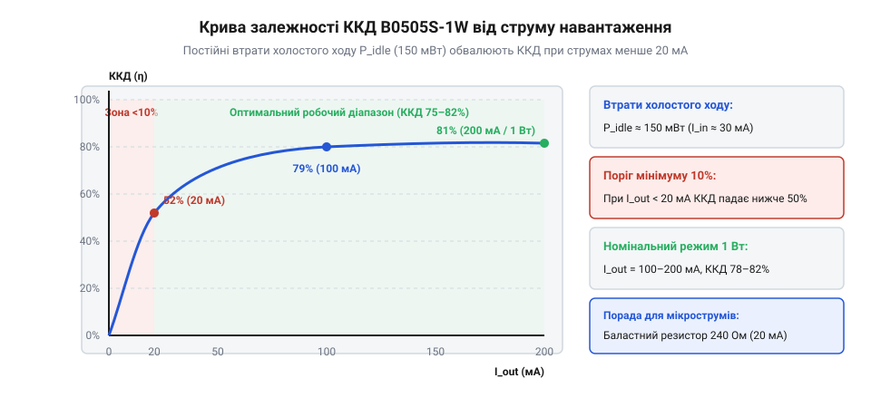
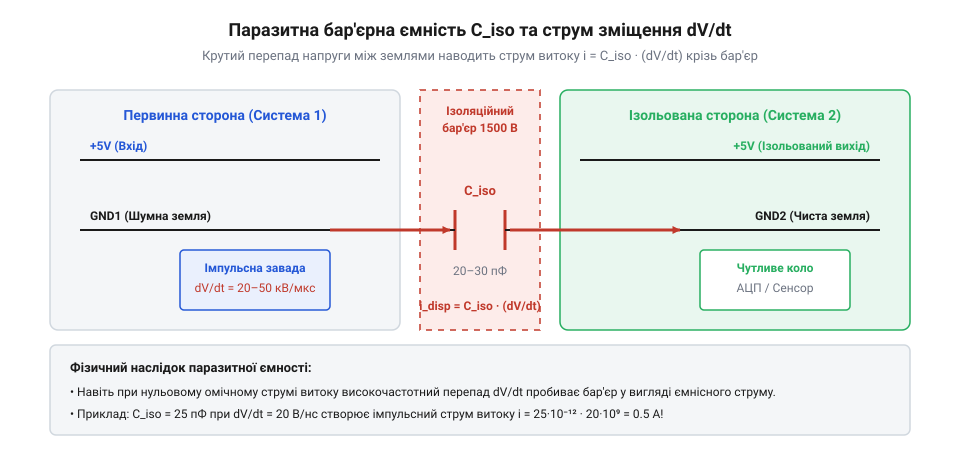

# B0505S-1W — ізольований DC-DC 5 В → 5 В

<preknowlist>
- [MT3608 — підвищувач 2 А / 28 В](root:cat-hw-power/mt3608-boost) — поняття коефіцієнта корисної дії імпульсних перетворювачів та імпульсної комутації
- [Mini560 — понижувач з фіксованими 5 В](root:cat-hw-power/mini560-buck) — співвідношення вхідної й вихідної потужності та теплове розсіювання
</preknowlist>

## Енергетичний баланс і математична модель ККД нерегульованого перетворювача

Будь-який імпульсний перетворювач живлення споживає від первинного джерела більшу потужність, ніж віддає у корисне навантаження. Різниця між споживаною потужністю P_in та корисною вихідною потужністю P_out перетворюється на тепло всередині компактного корпусу модуля:

`
P_loss = P_in - P_out
`

Коефіцієнт корисної дії (ККД), що позначається грецькою літерою η (ета), визначає частку енергії, яка успішно доходить до навантаження:

`
η = P_out / P_in
  = P_out / (P_out + P_loss)
`

У стабілізованих перетворювачах з широтно-імпульсною модуляцією ([MT3608](root:cat-hw-power/mt3608-boost), [Mini560](root:cat-hw-power/mini560-buck)) тривалість імпульсів підлаштовується під струм споживання, що дозволяє утримувати високий ККД у широкому діапазоні. Проте в модулі B0505S-1W автогенератор працює безперервно з фіксованою частотою комутації (близько 100 кГц) незалежно від того, чи підключене до виходу реальне навантаження. Через це сумарна потужність втрат P_loss складається з двох фундаментально різних компонентів:

`
P_loss = P_idle + P_dyn(I_load)
`

1. **Статичні втрати холостого ходу P_idle.** Вони виникають навіть тоді, коли струм виходу дорівнює нулю (I_load = 0). Вони включають втрати на циклічне перемагнічування феритового осердя тороїдального трансформатора (петля гістерезису та вихрові струми у фериті) і струм зміщення базових кіл автогенератора. Для типового модуля B0505S ця величина є сталою і становить:

`
P_idle ≈ 55–65 мВт   (струм холостого ходу I_in0 ≈ 11–13 мА при V_in = 5.0 В)
`

2. **Динамічні втрати під навантаженням P_dyn(I_load).** Вони прямо пропорційні або квадротично залежні від струму навантаження:
   - Втрати на прямому падінні напруги випрямних діодів Шотткі: P_diode = I_load · V_f, де пряме падіння V_f становить близько 0.35 В.
   - Омічні втрати в активному опорі мідного дроту первинної та вторинної обмоток трансформатора й опорі відкритих каналів транзисторів R_eq: P_copper = I_load² · R_eq, де сумарний зведений опір R_eq ≈ 1.2–1.8 Ом.

Підставивши ці компоненти у вираз для коефіцієнта корисної дії, отримуємо повну аналітичну функцію ефективності від струму навантаження:

`
η(I_load) = (V_out · I_load) / (V_out · I_load + P_idle + I_load · V_f + I_load² · R_eq)
`

*Крива ККД модуля B0505S: фіксовані втрати холостого ходу 60 мВт призводять до спаду ефективності до 25–30% при струмах менше 20 мА.*

> 🔧 **Навіщо це.**
> Математична формула пояснює, чому не можна вибирати ізольований модуль «із десятикратним запасом за потужністю»: якщо пристрій споживає лише 5 мА, модуль B0505S-1W розсіюватиме в повітря втричі більше енергії, ніж споживає корисне навантаження.

Простежимо поведінку ефективності у трьох характерних точках навантаження:

**1. Мале навантаження: I_load = 5 мА (2.5% від номіналу):**
Корисна потужність: P_out = 5.0 В · 0.005 А = 0.025 Вт (25 мВт).
Втрати під навантаженням: P_dyn = 0.005 · 0.35 + 0.005² · 1.5 ≈ 1.8 мВт.
Сумарні втрати: P_loss = 60 + 1.8 = 61.8 мВт.
Обчислюємо ККД:

`
η = 25 / (25 + 61.8)
  = 25 / 86.8
  ≈ 0.288  (28.8%)
`

При мізерному навантаженні постійні втрати P_idle домінують над корисною потужністю майже у 2.5 рази, обвалюючи ефективність нижче 30%.

**2. Мінімально рекомендоване навантаження: I_load = 20 мА (10% від номіналу):**
Корисна потужність: P_out = 5.0 В · 0.020 А = 0.100 Вт (100 мВт).
Втрати під навантаженням: P_dyn = 0.020 · 0.35 + 0.020² · 1.5 = 7.0 + 0.6 = 7.6 мВт.
Сумарні втрати: P_loss = 60 + 7.6 = 67.6 мВт.
Обчислюємо ККД:

`
η = 100 / (100 + 67.6)
  = 100 / 167.6
  ≈ 0.597  (59.7%)
`

У цій точці корисна потужність починає значно переважати втрати холостого ходу, і графік ККД виходить на пологий робочий режим близько 60%.

**3. Повне номінальне навантаження: I_load = 200 мА (100% від номіналу, 1 Вт):**
Корисна потужність: P_out = 5.0 В · 0.200 А = 1.000 Вт (1000 мВт).
Втрати під навантаженням: P_dyn = 0.200 · 0.35 + 0.200² · 1.5 = 70 + 60 = 130 мВт.
Сумарні втрати: P_loss = 60 + 130 = 190 мВт.
Обчислюємо ККД:

`
η = 1000 / (1000 + 190)
  = 1000 / 1190
  ≈ 0.840  (84.0%)
`

При повному навантаженні ККД досягає максимального значення 80–84%, а теплове розсіювання модуля становить близько 0.19–0.25 Вт, що викликає помірний саморозігрів корпусу SIP на 25–30 °C вище температури навколишнього середовища.

Усі наведені розрахунки базувалися на нормальній початковій температурі навколишнього середовища T_0 = 20 °C. Проте в реальних умовах експлуатації всередині герметичних корпусів датчиків або при тривалій безперервній роботі на граничному струмі 200 мА модуль суттєво нагрівається. Через малий об'єм епоксидного компаунда та відсутність зовнішнього тепловідводу робоча температура всередині корпусу SIP-4 піднімається до T_1 = 65 °C. Приріст робочої температури становить:

`
ΔT = T_1 - T_0
   = 65 - 20
   = 45 °C
`

Питомий електричний опір металевих провідників зростає при нагріванні через посилення теплових коливань кристалічної ґратки. Для міді, з якої намотані мікрообмотки тороїдального трансформатора, температурний коефіцієнт електричного опору (ТКО, позначається грецькою літерою α) дорівнює:

`
α_Cu ≈ 0.00393 °C⁻¹  (або приблизно +0.393% на кожен градус нагріву)
`

Залежність активного зведеного опору обмоток від температури описується лінійним рівнянням теплового дрейфу:

`
R_eq(T) = R_eq0 · (1 + α_Cu · ΔT)
`

Обчислимо, як змінюється зведений опір R_eq при нагріванні від початкових R_eq0 = 1.5 Ом (при 20 °C) до робочих 65 °C:

`
R_eq(65°C) = 1.5 · (1 + 0.00393 · 45)
           = 1.5 · (1 + 0.17685)
           = 1.5 · 1.17685
           ≈ 1.765 Ом
`

Зведений опір міді зріс на 17.7%. Оскільки омічні втрати в провідниках пропорційні квадрату сили струму, нагрівання викликає помітний додатковий розгін тепловиділення. Для номінального струму навантаження I_load = 200 мА обчислимо оновлені омічні втрати в гарячих обмотках:

`
P_copper(65°C) = I_load² · R_eq(65°C)
               = 0.200² · 1.765
               = 0.040 · 1.765
               = 0.0706 Вт  (70.6 мВт)
`

При 20 °C ці втрати становили 60 мВт, тобто омічні втрати в міді зросли більш ніж на 10 мВт. Одночасно дещо збільшується опір відкритого стану каналів польових транзисторів внутрішнього автогенератора, тоді як пряме падіння на діодах Шотткі V_f, навпаки, має невеликий негативний температурний коефіцієнт (близько -1.5...-2 мВ/°C) і зменшується до V_f(65°C) ≈ 0.28 В.

Перерахуємо повні втрати потужності та коефіцієнт корисної дії модуля в гарячому стані:

`
P_dyn(65°C) = I_load · V_f(65°C) + P_copper(65°C)
            = 0.200 · 0.28 + 0.0706
            = 0.056 + 0.0706
            = 0.1266 Вт  (126.6 мВт)
`

Сумарна потужність втрат гарячого модуля з урахуванням втрат у фериті P_idle = 60 мВт:

`
P_loss(65°C) = 60 + 126.6
             = 186.6 мВт
`

Хоча часткове зменшення падіння напруги на діодах компенсує частину втрат у міді, нагрівання обмоток небезпечне іншим ефектом: збільшення омічного опору обмоток безпосередньо впливає на навантажувальну характеристику виходу. Додаткове спадання напруги на гарячих обмотках при струмі 200 мА становить:

`
ΔV_drop = I_load · (R_eq(65°C) - R_eq0)
        = 0.200 · (1.765 - 1.500)
        = 0.200 · 0.265
        = 0.053 В  (53 мВ)
`

Враховуючи, що модуль B0505S не має кола зворотного зв'язку зі стабілізацією вихідної напруги, ці додаткові 53 мВ падіння безпосередньо віднімаються від вихідної напруги 5 В. Таким чином, нагрівання модуля посилює просідання виходу під навантаженням, перетворюючи тепловий розрахунок на важливий крок проектування ізольованого вузла.

## Фізика бар'єрної ємності C_iso та розрахунок наведеного струму зміщення

Гальванічна розв'язка усуває омічний (гальванічний) контакт між двома частинами електронної схеми: опір постійному струму між вхідною та вихідною землею модулів серії B0505S перевищує 10⁹ Ом (1 ГОм). Проте первинна і вторинна обмотки мініатюрного тороїдального трансформатора намотані на спільне феритове кільце й фізично розташовані на відстані менше міліметра одна від одної. Два провідники, розділені шаром діелектрика (лак дроту та полімерний компаунд), неминуче утворюють паразитний конденсатор — бар'єрну ємність ізоляції C_iso.

Для мініатюрних SIP-модулів потужністю 1 Вт ця ємність лежить у межах:

`
C_iso ≈ 20–30 пФ
`

Поки різниця потенціалів між первинною землею GND1 та вторинною землею GND2 залишається постійною (V_iso = const), конденсатор заряджений, і струм через бар'єр не тече. Проте якщо модуль використовується для живлення верхнього ключа мостового інвертора (наприклад, у схемах керування двигунами або імпульсних джерелах), потенціал GND2 стрибає відносно GND1 на сотні вольт за лічені наносекунди.

Фізичний закон Максвелла для струму зміщення в конденсаторі визначає амплітуду наведеного струму:

`
i_cm = C_iso · (dV/dt)
`

де:
- i_cm — наведений синфазний струм витоку (від англ. @@en|common-mode current@@),
- C_iso — прохідна ємність бар'єра ізоляції,
- dV/dt — швидкість зміни напруги між двома гальванічно розв'язаними контурами (у специфікаціях ізоляторів цей параметр позначається як @@en|CMTI@@, @@en|Common-Mode Transient Immunity@@, і вимірюється в кВ/мкс).

*Струм зміщення i_cm протікає крізь міжомоточну ємність C_iso при крутих фронтах напруги dV/dt, викликаючи наведення синфазної завади на земляних шинах.*

> 🔧 **Навіщо це.**
> Розрахунок струму зміщення критично важливий для оцінки завадостійкості: струм силою в частки ампера, протікаючи через паразитну ємність B0505S у сигнальну землю, здатний скинути мікроконтролер або викликати помилкове відкриття силового транзистора.

Розглянемо практичний розрахунок для двох сценаріїв перемикання:

**1. Традиційний кремнієвий MOSFET-інвертор промислової частоти:**
Амплітуда шини постійного струму: ΔV = 400 В.
Час наростання фронту: Δt = 40 нс.
Швидкість наростання напруги:

`
dV/dt = 400 В / (40 · 10⁻⁹ с)
      = 10 · 10⁹ В/с
      = 10 кВ/мкс
`

Синфазний струм зміщення при ємності C_iso = 25 пФ:

`
i_cm = 25 · 10⁻¹² Ф · 10 · 10⁹ В/с
     = 0.25 А  (250 мА)
`

Імпульс струму амплітудою 250 мА замикається через зворотний опір сигнальної шини. Якщо опір земляного провідника між датчиком і АЦП становить навіть 0.5 Ом, це породить імпульсну напругу наведення:

`
U_noise = i_cm · R_gnd
        = 0.25 А · 0.5 Ом
        = 125 мВ
`

Сплеск напруги в 125 мВ у сотні разів перевищує вагу молодшого розряду 12-бітного АЦП (при опорній напрузі 3.3 В крок квантування становить лише 0.8 мВ).

**2. Сучасний швидкодіючий транзистор на нітриді галію (GaN):**
При швидкості перемикання dV/dt = 50 кВ/мкс струм витоку сягає:

`
i_cm = 25 · 10⁻¹² · 50 · 10⁹
     = 1.25 А
`

Такий ударний струм здатний зруйнувати вхідні логічні каскади цифрових мікросхем.

Для блокування цього струму в розрив ліній живлення встановлюють синфазний дросель (@@en|common-mode choke@@). Оскільки струм зміщення тече односпрямовано по обох лініях живлення (+Vout та GND2), його високочастотний опір Z_cm на робочій частоті спектра перешкоди _noise = 1 / (π · Δt) створює дільник напруги:

`
Z_cm = 2 · π · f_noise · L_cm
`

При тривалості фронту Δt = 40 нс еквівалентна частота становить близько 8 МГц. Дросель індуктивністю L_cm = 47 мкГн має імпеданс:

`
Z_cm = 2 · 3.1416 · 8 · 10⁶ Гц · 47 · 10⁻⁶ Гн
     ≈ 2360 Ом
`

Додавання синфазного імпедансу 2.36 кОм послаблює амплітуду струму витоку у понад 20 разів, зводячи високочастотну заваду на земляних колах до безпечних мікровольтових рівнів.

Поряд із синфазним дроселем для керованого відведення високочастотного струму зміщення інженери застосовують конденсатор безпеки класу Y (@@en|Y-capacitor@@), увімкнений безпосередньо між первинною землею GND1 та вторинною ізольованою землею GND2.

Фізичний зміст цього рішення полягає у створенні штучного контрольованого шляху повернення для струму зміщення i_cm. Якщо між первинною та вторинною частинами схеми немає спеціального високочастотного з'єднання, струм витоку через бар'єрну ємність C_iso змушений шукати шлях повернення через довгі зовнішні кабелі, паразитні ємності друкованої плати на металевий корпус шасі або захисне заземлення електромережі. Це перетворює весь пристрій та його підключені кабелі на потужну випромінювальну антену, що створює значні електромагнітні завади в радіоефір і призводить до провалу тестів на електромагнітну сумісність.

Увімкнення Y-конденсатора ємністю C_y безпосередньо паралельно бар'єру ізоляції формує високочастотний ємнісний шунт. Номінал Y-конденсатора зазвичай обирають у діапазоні C_y ≈ 470–1000 пФ, що у 20–40 разів перевищує власну міжомоточну ємність модуля C_iso ≈ 25 пФ. На частотах спектра комутаційних завад (від одиниць до десятків мегагерц) реактивний імпеданс конденсатора C_y визначається класичною формулою:

`
Z_y = 1 / (2 · π · f_noise · C_y)
`

Для еквівалентної частоти перешкоди _noise = 8 МГц і номіналу C_y = 1000 пФ (1 нФ) реактивний опір становить:

`
Z_y = 1 / (2 · 3.1416 · 8 · 10⁶ Гц · 1 · 10⁻⁹ Ф)
    = 1 / 0.050265
    ≈ 19.89 Ом
`

Порівняно з високим імпедансом синфазного дроселя або просторових паразитних контурів друкованої плати (кілооми), шлях через Y-конденсатор з опором менше 20 Ом є значно привабливішим для високочастотного струму. У результаті струм зміщення замикається в компактну локальну петлю мінімальної площі безпосередньо біля виводів модуля B0505S, не розтікаючись по чутливих земляних полігонах сигнальних датчиків і не спотворюючи цифрові сигнали зв'язку.

Вибір номіналу Y-конденсатора жорстко обмежений стандартами електробезпеки людини. На низькій промисловій частоті мережі живлення 50 Гц реактивний опір конденсатора 1000 пФ є надзвичайно великим:

`
Z_y(50Гц) = 1 / (2 · 3.1416 · 50 · 1 · 10⁻⁹)
          ≈ 3.18 МОм
`

Струм витоку промислової частоти при напрузі 230 В через такий імпеданс становить менше ніж 0.075 мА, що є абсолютно безпечним для людини при дотику. Крім того, Y-конденсатор повинен мати високий клас безпеки (зазвичай Y1 або Y2 з робочою напругою від 250 В змінного струму та випробувальною напругою ізоляції до 4–5 кВ), щоб його внутрішнє пошкодження ніколи не призвело до короткого замикання між ізольованими контурами.
