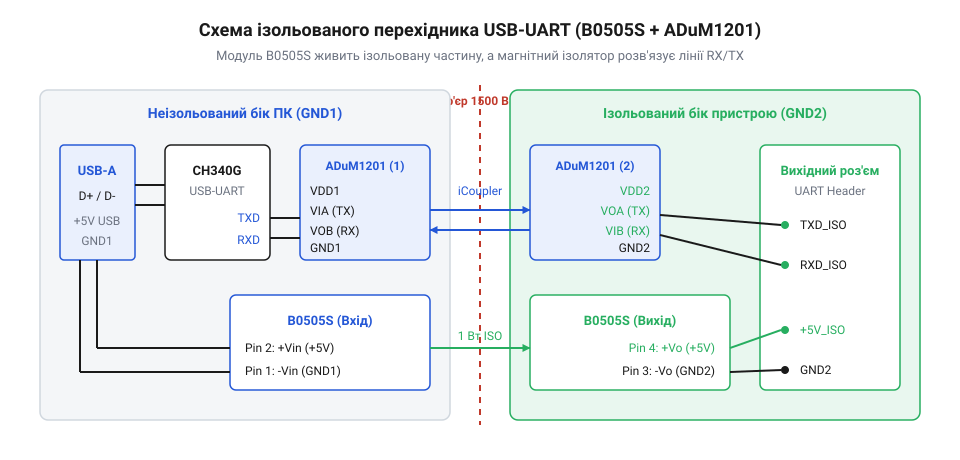

# B0505S-1W — ізольований DC-DC 5 В → 5 В

<preknowlist>
- [MT3608 — підвищувач 2 А / 28 В](root:cat-hw-power/mt3608-boost) — комутація постійного струму та фільтрація живлення
- [Mini560 — понижувач з фіксованими 5 В](root:cat-hw-power/mini560-buck) — розведення полігонів землі та блокувальні конденсатори
</preknowlist>

## Архітектура ізольованого моста та принципова електрична схема

Під час налагодження силових схем — імпульсних перетворювачів, приводів крокових двигунів чи мережевих джерел — послідовний інтерфейс UART стає основним вікном у внутрішній стан мікроконтролера. Проте пряме з'єднання USB-порту комп'ютера з макетною платою утворює небезпечний спільний провідник землі. Будь-який пробій силового транзистора, імпульсна завада від комутації або помилка підключення щупа за частки мікросекунди спрямовують високий струм у шину заземлення USB. Це спричиняє миттєве вигорання південного моста чи чипсета материнської плати. Гальванічно ізольований адаптер розриває цей контур, повністю усуваючи земляні петлі та захищаючи комп'ютер.

Пристрій розділено на два електрично незалежні контури, між якими немає жодного прямого металевого контакту: первинний контур комп'ютера (GND1, VBUS) та вторинний ізольований контур піддослідного пристрою (GND2, VOUT_ISO).

*Принципова електрична схема ізольованого перехідника: живлення та сигнали передаються через гальванічний бар'єр за допомогою B0505S-1W та цифрового ізолятора ADuM1201.*

### Первинний контур: живлення та зв'язок з хостом

Первинна частина підключається до USB-порту ПК через роз'єм Type-C або Type-A:
1. **USB-UART міст**: спеціалізована мікросхема (наприклад, CH340N або CP2102) перетворює диференціальні USB-сигнали D+/D- у стандартні логічні рівні послідовного порту TXD та RXD. Вона живиться безпосередньо від лінії VBUS (+5 В) комп'ютера.
2. **Живлення гальванічного перетворювача**: напруга +5 В із шини USB надходить на вхідні виводи 1 (VIN) та 2 (GND1) модуля DC-DC перетворювача B0505S-1W. Біля вхідних контактів встановлюється керамічний конденсатор ємністю 10 мкФ (MLCC) паралельно з фільтруючим конденсатором 0.1 мкФ для блокування високих частот.
3. **Первинна сторона цифрового ізолятора**: напруга VBUS також живить лінію VDD1 цифрового ізолятора ADuM1201. Лінія TXD від моста USB-UART підключається до входу VIA ізолятора, а вихід VOA передає зворотний сигнал у лінію RXD мікроконтролера моста.

### Вторинний ізольований контур: стабілізація та інтерфейс

Вторинний контур живиться виключно енергією, яка передається через високочастотний внутрішній трансформатор модуля B0505S-1W:
1. **Вихідна напруга та фільтрація**: виводи 4 (0V / GND2) та 6 (+VOUT) модуля формують плаваючу ізольовану шину живлення +5 В. Оскільки B0505S-1W працює на частоті близько 100 кГц без замкненого зворотного зв'язку за напругою, на виході монтується LC-фільтр або комбінація електролітичного конденсатора 10 мкФ із низьким ESR та керамічного конденсатора 0.1 мкФ для згладжування імпульсних пульсацій.
2. **Баластне навантаження**: критичною особливістю нерегульованих перетворювачів родини B0505S є вимога до мінімального навантаження не менше 10% від номіналу (тобто не менше 20 мА). На холостому ході вихідна напруга може піднятися до 6.5–7.0 В, що здатне пошкодити чутливі мікросхеми логіки. Для запобігання перенапрузі паралельно виходу встановлено баластний резистор опором 330–470 Ом (потужністю 0.25 Вт), який гарантує стабільні 5.0 В навіть при відключеній піддослідній платі.
3. **Цифровий магнітний ізолятор**: мікросхема ADuM1201 використовує запатентовані планарні котушки індуктивності на кристалі (технологія @@en|iCoupler@@), що забезпечує електричну міцність ізоляції до 2.5 кВ (RMS) та швидкість обміну до 25 Мбіт/с без значного енергоспоживання, характерного для світлодіодних оптопар. Живлення VDD2 надходить від ізольованих +5 В через локальний конденсатор 0.1 мкФ.
4. **Вихідні клеми**: на зовнішній 4-контактний роз'єм виведено лінії GND2, +5V_ISO, TX_ISO (вихід з VIB/VOB) та RX_ISO (вхід на VIA/VOA). Для роботи з платами логіки 3.3 В лінію живлення можна доповнити компактним лінійним стабілізатором.

> 🔧 **Навіщо це.**
> Повна гальванічна розв'язка дозволяє підключати осцилограф і налагоджувальний термінал до вузлів, які перебувають під плаваючим потенціалом або живляться від високовольтної батареї. Навіть при короткому замиканні силової частини перехідник бере удар на себе, зберігаючи USB-порт та материнську плату комп'ютера цілими.

## Трасування друкованої плати та правила гальванічного бар'єра

Електрична принципова схема гарантує гальванічну розв'язку лише теоретично. Реальна надійність ізолятора повністю визначається фізичною топологією друкованої плати. Навіть найкращий трансформатор чи мікросхема втрачають захисні властивості, якщо під час трасування порушено правила просторового рознесення високовольтних та низьковольтних ліній.

У високовольтній схемотехніці розрізняють два ключові параметри: повітряний зазор (@@en|clearance@@) — найкоротшу відстань між провідниками по повітрю, та шлях струму витоку (@@en|creepage@@) — відстань між провідниками по поверхні діелектрика. Поверхня склотекстоліту FR-4 у процесі експлуатації неминуче припадає пилом, піддається впливу вологості та залишкових слідів флюсу. Під дією високої напруги ці мікрозабруднення іонізуються, формуючи мікроскопічні струмопровідні вуглецеві канали (явище трекінгу), якими електрична дуга здатна подолати відстань у кілька міліметрів.

*Топологія друкованої плати з фізичним розділовим зазором (creepage slot) під корпусами B0505S-1W та ADuM1201: повітряний проріз розриває поверхню текстоліту, багаторазово підвищуючи електричну міцність бар'єра.*

### Ізоляційний рівчачок у текстоліті

Найефективнішим інженерним рішенням проти трекінгу є наскрізний фрезерований паз у платі — @@en|creepage slot@@:
1. **Розташування бар'єра**: лінія ізоляційного розрізу проходить суцільно крізь усю друковану плату, розділяючи її на дві фізичні зони. Вона пролягає безпосередньо під корпусом перетворювача B0505S-1W (між ніжками входу 1–2 та виходу 4–6) та під корпусом SOIC-8 ізолятора ADuM1201 (між виводами первинного 1–4 та вторинного 5–8 боків).
2. **Геометрія прорізу**: ширина фрезерованого паза обирається від 1.5 до 5.0 мм. Повітряний розрив змушує шлях витоку огинати краї отвору, що штучно збільшує ефективний шлях витоку втричі порівняно з простою плоскою ділянкою склотекстоліту.
3. **Краї паза**: навколо отвору з обох боків плати видаляється захисна паяльна маска на ширину не менше 0.5 мм, щоб виключити накопичення вологи біля мідних провідників.

### Заборона перекриття полігонів землі

Головне правило проєктування гальванічних мостів — повна просторова ізоляція земляних шарів:
- Полігони GND1 (первинна земля USB) та GND2 (вторинна ізольована земля) категорично заборонено накладати один на одного навіть на різних шарах багатошарової плати.
- Якщо полігон GND1 проходить над GND2, між ними виникає паразитна ємність монтажу (від десятків до сотень пікофарад). Через цю паразитну ємність високочастотні синфазні завади (швидкі перепади dV/dt від імпульсних трансформаторів та ключів) вільно проникають на первинну сторону, зводячи нанівець ефективність бар'єра та спричиняючи збої в роботі USB-порту.
- Між межами мідних полігонів двох зон витримується суцільний безпечний зазор завширшки щонайменше 5–6 мм.

### Розміщення фільтруючих компонентів

Керамічні блокувальні конденсатори ємністю 0.1 мкФ для живлення VDD1 і VDD2 ізолятора ADuM1201 розташовують максимально близько до відповідних виводів живлення мікросхеми (не далі 2–3 мм). Сигнальні провідники TXD та RXD трасуються найкоротшими прямими лініями під прямим кутом до розділового бар'єра, щоб мінімізувати площу сигнальних петель і знизити електромагнітне випромінювання на швидкостях обміну до 115200 бод і вище.

> 🔧 **Навіщо це.**
> Фрезерований паз під корпусом ізолятора гарантує надійну роботу пристрою при випробувальній напрузі до 1500–2500 В навіть в умовах підвищеної вологості цеху або польової лабораторії, повністю захищаючи користувача та обладнання.

## Збирання, тестування цілісності сигналу та перевірка безпеки

Після монтажу компонентів на плату обов'язково проводиться поетапна верифікація працездатності: спершу перевірка статичних режимів живлення, потім перевірка цілісності сигналів на високих швидкостях та фінальний стрес-тест передачі даних.

### Первинний запуск та перевірка холостого ходу

Перед підключенням дорогого мікроконтролера чи комп'ютера перехідник живлять від лабораторного блока або зовнішнього повербанка:
1. Підключаємо вхід USB до джерела 5.0 В і вимірюємо напругу між контактами GND2 та +5V_ISO мультиметром.
2. Завдяки встановленому баластному резистору (330–470 Ом) вихідна напруга не перевищує 5.05–5.20 В. Якщо резистор забути, вихід нерегульованого модуля B0505S-1W без навантаження підніметься до небезпечних 6.8–7.2 В.
3. Перевіряємо споживання первинної сторони: струм споживання без обміну даними не повинен перевищувати 25–35 мА (струм холостого ходу перетворювача плюс баласт).

### Апаратне відлуння на боці мікроконтролера

Для перевірки двостороннього каналу зв'язку на піддослідний мікроконтролер прошивається програма апаратного відлуння (@@en|loopback echo@@). Контролер ініціалізує модуль UART на швидкості 115200 бод, слухає вхідний потік і негайно відправляє кожен отриманий байт назад:

:::code proj-isolated-usb-uart-dongle/c/uart.h

:::code proj-isolated-usb-uart-dongle/c/uart.c

:::code proj-isolated-usb-uart-dongle/c/main.c

На швидкості 115200 бод тривалість одного біта становить близько 8.68 мкс. Цифровий магнітний ізолятор ADuM1201 має затримку поширення фронту менше 50 нс і швидкість наростання 3 нс. Це гарантує ідеально круті прямокутні імпульси без завалів фронтів, які часто трапляються в дешевих повільних оптопарах типу PC817.

### Автоматизований стрес-тест каналу на Python

Для підтвердження надійності передачі даних в умовах можливих електромагнітних завад на комп'ютері запускається тестовий скрипт. Програма генерує псевдовипадкові бінарні кадри, доповнює їх контрольною сумою CRC32, відправляє в послідовний порт і зіставляє отриману відповідь:

:::code proj-isolated-usb-uart-dongle/py/uart_stress_test.py

Скрипт фіксує круглу затримку проходження пакета (RTT), контролює кількість втрачених байтів та підраховує частоту бітових помилок (BER). Показник BER повинен дорівнювати нулю навіть під час роботи поблизу імпульсних силових трансформаторів або двигунів.

### Безпечне зневадження силових схем

Завдяки зібраному перехіднику налагодження імпульсних перетворювачів стає повністю захищеним:
- Клеми GND2, TX_ISO та RX_ISO підключаються до піддослідного мікроконтролера, розташованого на високовольтній платі або плаваючому потенціалі.
- Земля комп'ютера GND1 залишається повністю ізольованою: при пробої силового ключа чи випадковому короткому замиканні струм розряду замикається виключно у вторинному контурі піддослідного пристрою, не досягаючи портів материнської плати.

> 🔧 **Навіщо це.**
> Циклічний стрес-тест із розрахунком CRC32 дає стовідсоткову впевненість у тому, що ізолюючий бар'єр не спотворює передані байти телеметрії під час роботи потужних індуктивних навантажень.
