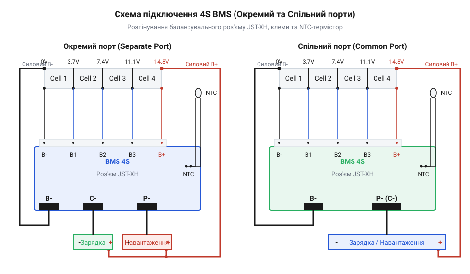
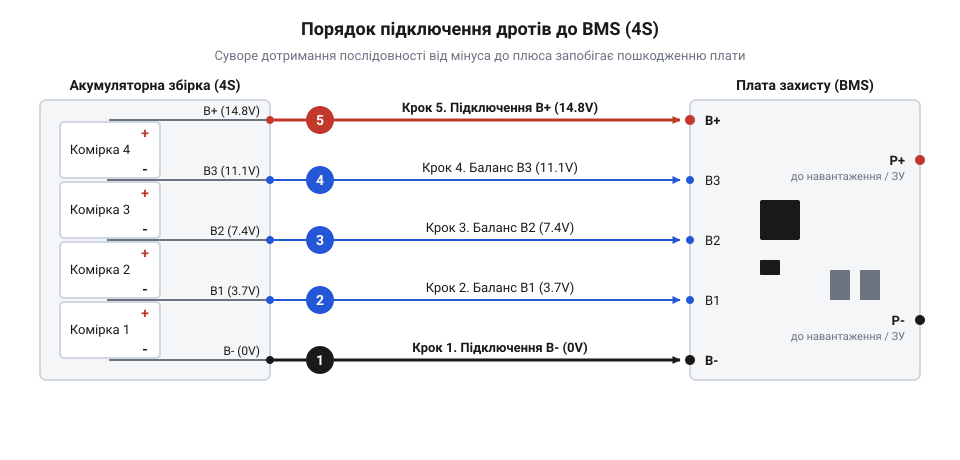

# Специфікація підключення та електричний інтерфейс плат BMS 2S/3S/4S

<preknowlist>
- [Плата захисту 1S Li-Ion](root:cat-hw-power/pcb-1s-protection) — Принцип роботи силових затворів @@en|MOSFET@@ та логіка спрацьовування відсічки за напругою й струмом у 1S збірках.
- [TP5100 — заряд 1S/2S](root:cat-hw-power/tp5100-charger) — Принцип організації двокоміркової зарядки акумуляторів та обмеження зарядного струму на первинному етапі.
</preknowlist>

## Небезпека неконтрольованої збірки та роль BMS

Пряме з'єднання кількох літієвих елементів у послідовний ланцюг без плати контролю призводить до швидкої деградації акумулятора й пожежної небезпеки. Під час експлуатації батарейного блоку поодинокі комірки мають природний розкид параметрів: еквівалентний послідовний опір (@@en|ESR@@, від англ. *Equivalent Series Resistance*) та реальна ємність відрізняються на кілька відсотків. Коли через послідовний ланцюг протікає єдиний струм навантаження, слабша комірка з меншою ємністю розряджається швидше за інші. Доки загальна напруга батареї залишається в межах норми, слабкий елемент переходить через критичну межу 2.5 V у режим глибокого перерозряду. У цьому стані починається незворотний процес розчинення мідного колектора анода в електроліті, що викликає внутрішнє коротке замикання та незворотну втрату ємності.

Під час заряджання батарейного блоку від небалансованого джерела відбувається зворотний аварійний процес. Комірка з найменшою ємністю досягає верхньої межі 4.25 V значно раніше за решту елементів. Якщо зарядний пристрій контролює лише сумарну напругу всього блоку, струм продовжує протікати через перезаряджену комірку. На її катоді починається металізація літію, виділення кисню та газоутворення всередині корпусу. Це викликає спучення елемента, розрив захисного клапана та термічне розганяння з займанням. На відміну від однокомірних схем із [платами захисту 1S](root:cat-hw-power/pcb-1s-protection) чи [двокоміркового зарядного модуля](root:cat-hw-power/tp5100-charger), багатоелементні акумуляторні збірки вимагають постійного індивідуального контролю напруги на кожній серійній ланці.

Цю задачу вирішує система керування батареєю (@@en|BMS@@, від англ. *Battery Management System*). Плата @@en|BMS@@ безперервно вимірює напругу кожного елемента за допомогою аналогового переднього краю (@@en|AFE@@, від англ. *Analog Front-End*) та розмикає силові ключі на транзисторах @@en|MOSFET@@ (від англ. *Metal-Oxide-Semiconductor Field-Effect Transistor*), якщо бодай одна комірка виходить за безпечні межі. Проте сама плата @@en|BMS@@ є чутливим вузлом. При помилковому порядку підключення дротів балансувального шлейфу під напругою виникає різниця потенціалів між входами мікросхеми @@en|AFE@@, яка перевищує допустиму напругу пробою резистивних дільників. Це викликає вигорання вхідних каналів та заклинювання силових ключів у замкненому стані. Щоб уникнути аварій, розробник повинен дотримуватися електричного інтерфейсу та апаратного розпінування плат захисту конфігурацій @@en|2S@@, @@en|3S@@ та @@en|4S@@.

## Силові клеми та розпінування балансувального роз'єму

Силова група контактів плати @@en|BMS@@ комутує струми заряду й розряду та підключає крайні потенціали акумуляторної батареї:

* `B-` (Battery Minus) — головний негативний полюс акумуляторної збірки (0 V). * `B+` (Battery Plus) — головний позитивний полюс збірки (потенціал залежить від конфігурації @@en|2S@@–@@en|4S@@). * `P-` (Power/Pack Minus) — негативний контакт навантаження та зарядного пристрою у схемах зі спільним портом. * `P+` (Power/Pack Plus) — позитивний контакт навантаження (зазвичай з'єднаний з `B+`). * `C-` (Charge Minus) — мінусовий контакт зарядного пристрою в платах із розділеним портом.

За топологією силових шляхів плати захисту поділяють на схеми зі спільним портом (@@en|common port@@) та окремим портом (@@en|separate port@@). У платах @@en|common port@@ струми заряду й розряду проходять через контакт `P-`, де ключі @@en|MOSFET@@ увімкнені зустрічно-послідовно в мінусову лінію: один відсікає розряд, інший — заряд. У платах @@en|separate port@@ контакт `C-` керується окремим ключем на малий зарядний струм (наприклад, 5 A), тоді як `P-` комутує потужніший струм розряду (наприклад, 30 A). Це зменшує габарити й вартість плати, коли струм заряду значно менший за розрядний.

Для моніторингу потенціалів комірок використовують [роз'єми серії JST-XH](root:cat-hw-parts/jst-xh-connectors) із кроком 2.5 mm. Число контактів роз'єму на одиницю більше за кількість послідовних комірок:
* Конфігурація @@en|2S@@: 3-контактний роз'єм — `B-` (0 V), `B1` (3.7 V), `B+` / `B2` (7.4 V). * Конфігурація @@en|3S@@: 4-контактний роз'єм — `B-`, `B1`, `B2`, `B+` / `B3`. * Конфігурація @@en|4S@@: 5-контактний роз'єм — `B-`, `B1`, `B2`, `B3`, `B+` / `B4`.


*Підключення силових та балансувальних ліній плати BMS 4S зі зворотним зв'язком за температурою NTC.*

Для температурного захисту на платі передбачено площадки під зовнішній термістор @@en|NTC@@ (від англ. *Negative Temperature Coefficient* — негативний температурний коефіцієнт), який закріплюють на найменш охолоджуваній комірці. При перевищенні +45 °C під час заряду або +60 °C при розряді компаратор мікросхеми @@en|AFE@@ закриває затвори силових ключів, запобігаючи тепловому самозайманню.

## Порогові напруги, струми та алгоритми активації

Електричні параметри та часові затримки спрацьовування плати @@en|BMS@@ залежать від хімії елементів. Використання плати для @@en|Li-ion@@ у збірці @@en|LiFePO4@@ зруйнує акумулятори через різницю робочих напруг.

Порогові параметри захисту:
* Захист від перезаряду (@@en|Overcharge Protection@@):
  * @@en|Li-ion@@: відсікання 4.25 V ± 0.05 V (затримка 0.5 s – 2.0 s), відновлення при 4.10 V – 4.15 V. * @@en|LiFePO4@@: відсікання 3.65 V ± 0.05 V (затримка 0.5 s – 1.5 s), відновлення при 3.55 V – 3.60 V. * Захист від перерозряду (@@en|Over-discharge Protection@@):
  * @@en|Li-ion@@: відсікання 2.50 V – 2.80 V ± 0.08 V (затримка 50 ms – 150 ms), відновлення при 3.00 V. * @@en|LiFePO4@@: відсікання 2.00 V – 2.35 V ± 0.08 V (затримка 50 ms – 150 ms), відновлення при 2.50 V – 2.60 V.

Двоступеневий струмовий захист запобігає тепловому пробою ключів @@en|MOSFET@@: перевантаження по струму (у 1.5–3 рази вище номіналу) відсікається за 10 ms – 20 ms, а пряме коротке замикання на клемах `P+`/`P-` (перевищення у 5–10 разів) — за 100 μs – 500 μs.

Після спрацьовування захисту плата @@en|BMS@@ заблокована. Активація здійснюється зняттям навантаження (при автовідновленні), подачею напруги від зарядного пристрою на `P+`/`P-` для відкриття ключів або короткочасним шунтуванням `P-` та `B-` під час налагодження.

При глибокому розбалансуванні комірок застосовують поланковий дозаряд через [зовнішній зарядний пристрій](root:cat-hw-power/imax-b6-charger).

## Вибір провідників AWG та правило монтажу

Вибір перерізу силових провідників для підключення акумуляторного блоку до плати @@en|BMS@@ здійснюється за стандартами американського калібру провідників (@@en|AWG@@, від англ. *American Wire Gauge*). Силові лінії повинні витримувати тривалий робочий струм 20 A – 40 A без перевищення припустимого нагріву (не більше +40 °C вище температури довкілля) та з мінімальним падінням напруги на лінії. Найкращим вибором є багатожильний силіконовий дріт, який зберігає гнучкість і термостійкість під час паяння.

Для вибору перерізу провідника користуються орієнтовними нормативами:
* Струм до 20 A — калібр `14 AWG` (площа перерізу `2.08 mm²`). * Струм до 30 A — калібр `12 AWG` (площа перерізу `3.31 mm²`). * Струм до 40 A – 50 A — калібр `10 AWG` (площа перерізу `5.26 mm²`).

**Умова:** Розрахунок падіння напруги `ΔU` на силіконовому силовому провіднику довжиною `L = 0.3 м` та перерізом `S = 3.31 мм²` (калібр `12 AWG`) при тривалому струмі навантаження `I = 30 А` та питомому опорі міді `ρ = 0.0175 Ом·мм²/м`.

```
R_line = 2 × ρ × L ÷ S
       = 2 × 0.0175 × 0.3 ÷ 3.31   [підстановка параметрів двожильної лінії]
       = 0.0105 ÷ 3.31             [обчислення чисельника]
       = 0.00317 Ом                [опір дротів живлення]

ΔU     = I × R_line
       = 30 × 0.00317              [закон Ома для ділянки кола]
       = 0.095 В                   [підсумкове падіння напруги]
```

Отримане падіння напруги `0.095 V` становить менше 1% від номінальної напруги збірки @@en|4S@@, що підтверджує правильність вибору калібру `12 AWG`.

Під час електричного монтажу існує фундаментальне апаратне правило: **послідовне підключення дротів здійснюється строго від потенціалу B- до B+**. Порушення цього правила викликає подачу високого потенціалу на проміжні входи мікросхеми @@en|AFE@@ до того, як з'явиться опорний мінус регулятора, що призводить до негайного вигорання вхідних резисторів та мікросхеми контролера.


*Покроковий порядок комутації балансувального шлейфу та силових провідників для запобігання пошкодженню AFE.*

Порядок безпечного монтажу [багатоелементної акумуляторної збірки](root:cat-hw-power/bms-multicell):
1. Припаяти силовий дріт калібру `12 AWG` від мінусового полюса батареї до площадки `B-` на платі @@en|BMS@@. 2. Припаяти балансувальний дріт `B-` (0 V) шлейфу до мінуса першої комірки. 3. Послідовно припаяти балансувальні дроти `B1`, `B2`, `B3` до відповідних міжкомірних з'єднань. 4. Припаяти останній балансувальний дріт `B+` до позитивного полюса останньої комірки. 5. Припаяти головний силовий дріт `B+` від батареї до площадки `B+` плати. 6. Вставити балансувальний роз'єм у гніздо плати @@en|BMS@@ **тільки після перевірки напруг** мультиметром.

Під час паяння слід використовувати паяльник потужністю 60–80 W із термостабілізацією, виконуючи паяння кожної точки не довше 2-3 секунд, щоб запобігти термічному пошкодженню прокладок акумуляторних елементів та перегріву друкованої плати.

## Контрольні вимірювання, запуск та діагностика блоку

Перед тим як уперше підключити балансувальний шлейф до гнізда плати @@en|BMS@@, обов'язково виконують контрольні вимірювання мультиметром. Помилка у дзеркальному розташуванні дротів у роз'ємі або переплутані міжкомірні точки призводять до пробою вхідних мультиплексорів мікросхеми захисту.

Покроковий регламент діагностики та введення в експлуатацію:

1. **Вимірювання потенціалів балансувального шлейфу.** Переключіть мультиметр у режим вимірювання постійної напруги (DC Volts). Щуп мінуса мультиметра фіксують на контакті `B-` (пін 1) балансувальної вилки. Послідовно торкаються позитивним щупом наступних контактів:
   * Пін 1 (`B-`) та Пін 2 (`B1`): напруга має дорівнювати напрузі першої комірки (`~3.7 V` для @@en|Li-ion@@ або `~3.3 V` для @@en|LiFePO4@@). * Пін 1 (`B-`) та Пін 3 (`B2`): напруга двох комірок (`~7.4 V` або `~6.6 V`). * Пін 1 (`B-`) та Пін 4 (`B3`): напруга трьох комірок (`~11.1 V` або `~9.9 V`). * Пін 1 (`B-`) та Пін 5 (`B4`/`B+`): повна напруга батареї (`~14.8 V` або `~13.2 V`).

2. **Перевірка диференційних напруг.** Вимірюють напругу між кожною парою сусідніх контактів шлейфу (`B1-B-`, `B2-B1`, `B3-B2`, `B+-B3`). Усі значення повинні бути позитивними та відрізнятися одне від одного не більше ніж на `0.02 V – 0.05 V`. Якщо на бодай одній парі виявлено негативну напругу або нульове значення, комутація є помилковою й підключати роз'єм до плати заборонено.

3. **Первинний запуск та зняття блокування.** Після успішної перевірки вилку шлейфу вставляють у гніздо плати @@en|BMS@@. Вимірюють напругу на силових виходах `P+` та `P-`. Якщо вихідна напруга відсутня (дорівнює 0 V або близька до нуля), плата перебуває у стані транспортувального блокування. Для активації системи до силових клем `P+`/`P-` короткочасно (на 2–3 секунди) підключають зарядну напругу від зовнішнього джерела, наприклад [лабораторного модуля живлення](root:cat-hw-power/yp-08-power). Після цього силові транзистори відкриваються, і напруга на виході `P+/P-` стає рівною напрузі акумуляторного блоку `B+/B-`.

4. **Контроль пасивного балансування.** Під час завершального етапу заряджання, коли напруга на одній із комірок досягає порогу балансування (`4.18 V` для @@en|Li-ion@@ або `3.50 V` для @@en|LiFePO4@@), на платі @@en|BMS@@ засвічується відповідний світлодіод індикатора балансування. Балансувальний резистор починає розряджати переповнену комірку малим струмом (30 mA – 60 mA), вирівнюючи її стан із рештою елементів збірки.

Після завершення діагностичних процедур зібрана батарея готова для безпечної інтеграції в складний [багатоелементного блоку живлення](root:cat-hw-power/power-management) пристрою.