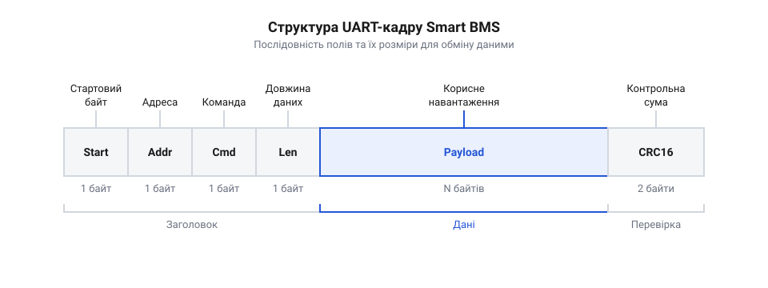
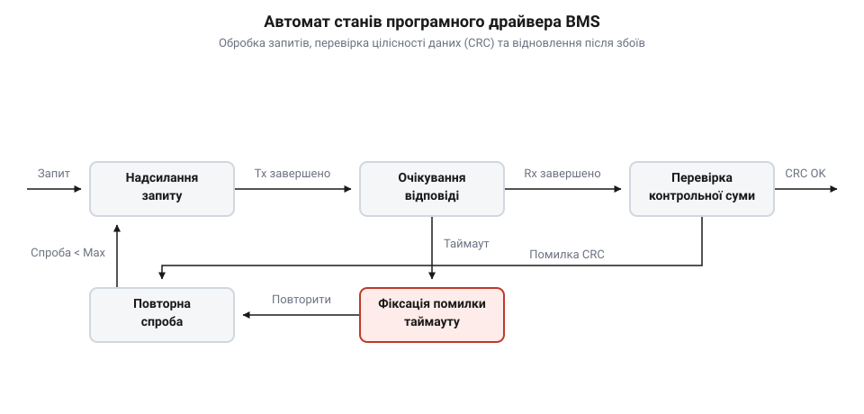

# Програмно-апаратний інтерфейс розумних BMS (UART / SMBus / I2C)

<preknowlist>
- [Плата захисту 1S Li-Ion](root:cat-hw-power/pcb-1s-protection) — базові функції захисту акумуляторів від перевищення напруги, глибокого розряду та струмового перевантаження
</preknowlist>

## Небезпека сліпого управління акумуляторною батареєю

В автономних робототехнічних комплексах, електротранспорті та джерелах безперебійного живлення акумуляторні блоки складаються з кількох послідовно з'єднаних елементів. У простих системах для запобігання аваріям використовують аналогові [модулі захисту 1S Li-Ion](root:cat-hw-power/pcb-1s-protection) або апаратні [багатоелементні плати BMS 2S-4S](root:cat-hw-power/bms-multicell). Такі плати відстежують напругу на комірках за допомогою компараторів і в разі перевищення критичних порогів просто розмикають силові ключі @@en|MOSFET@@ (англ. *Metal-Oxide-Semiconductor Field-Effect Transistor* — польовий транзистор зі структурою метал-оксид-напівпровідник). Для зовнішнього мікроконтролера така захисна плата залишається «чорною скринькою»: управляюча система бачить лише загальну напругу акумуляторної батареї і не має жодного уявлення про її поточний внутрішній стан.

Вимірювання лише загальної напруги батареї створює ілюзію безпеки. Розглянемо акумуляторну батарею конфігурації `4S` з номінальною напругою `14.8 В`. Якщо одна з чотирьох комірок через деградацію втратила ємність і під навантаженням швидко розрядилася до небезпечного рівня `2.4 В`, а інші три утримують високий потенціал `3.9 В`, вольтметр мікроконтролера зафіксує загальну напругу:

```
U_total
= 2.4 + 3.9 + 3.9 + 3.9
= 14.1 В      [загальна напруга батареї 4S з розбалансованою коміркою]
```

З точки зору програмного забезпечення мікроконтролера, середня напруга на комірку становить `3.525 В`, що відповідає цілком робочому стану акумулятора. Проте слабка комірка вже перебуває в зоні глибокого розряду, що руйнує її хімічну структуру. Коли апаратний захист плати раптово знеструмить систему, мікроконтролер не встигне зберегти критичні дані у завислу пам'ять або аварійно зупинити приводи.

Аналогічна небезпека виникає під час заряджання батареї. На відміну від ситуації, коли застосовується зовнішній [балансир SkyRC iMAX B6](root:cat-hw-power/imax-b6-charger) з відображенням параметрів на екрані, вбудований у пристрій зарядний модуль контролює лише сумарний потенціал. Якщо одна комірка заряджається швидше за інші й досягає критичної позначки `4.35 В`, виникає ризик теплового розгону (англ. @@en|thermal runaway@@ — самоприскорювальний розігрів) та займання.

Для усунення цих ризиків застосовують цифровий обмін даними на основі [інтелектуальних контролерів Smart BMS](root:cat-hw-power/smart-bms-controllers) (англ. @@en|Smart BMS@@ — розумна система керування батареєю). Наявність послідовного цифрового інтерфейсу перетворює захисну плату на інтелектуальний датчик телеметрії. Мікроконтролер отримує можливість у реальному часі зчитувати напругу кожної комірки окремо, вимірювати точний струм заряду й розряду, контролювати температуру за допомогою датчиків @@en|NTC@@ (англ. *Negative Temperature Coefficient* — негативний температурний коефіцієнт) та завчасно отримувати попереджувальні прапори про наближення до аварійних меж.

## Фізичні шини та специфікація кадру

Фізична взаємодія між управляючим мікроконтролером та контролером @@en|Smart BMS@@ реалізується через послідовні цифрові інтерфейси, серед яких найпоширенішими є @@en|UART@@ (англ. *Universal Asynchronous Receiver-Transmitter* — універсальний асинхронний приймач-передавач), @@en|SMBus@@ (англ. *System Management Bus* — системна шина керування) та шина @@en|I2C@@ (англ. *Inter-Integrated Circuit* — міжінтегральна схема). При виборі фізичного рівня для високовольтних батарейних блоків обов'язково застосовують гальванічну розв'язку (англ. @@en|galvanic isolation@@ — електрична ізоляція кіл) на основі оптопар або цифрових ізоляторів, щоб запобігти протіканню вирівнювальних струмів через спільну лінію заземлення мікроконтролера. Шина @@en|SMBus@@, яка широко використовується в портативних пристроях та модулях на зразок [живлення Li-ion Battery HAT](root:cat-hw-power/liion-hat-rpi), є розширенням @@en|I2C@@ із жорстко нормованими часовими таймаутами (25–35 мс) та опціональною підтримкою апаратного контролю помилок.

На логічному рівні обмін даними здійснюється за допомогою кадрових пакетів (англ. @@en|frame@@ — кадр, пакет). Кожен кадр являє собою суворо впорядкований масив байтів, що забезпечує однозначну ідентифікацію запитів та відповідей у завадоактивному середовищі. Типова структура кадру протоколу обміну через @@en|UART@@ складається з п'яти основних функціональних полів:

1. **Заголовок кадру (Header / Start Byte):** Перші 1–2 байти (наприклад, `0xDD` або `0xA5`), які позначають початок нового пакета й дають змогу приймачу синхронізувати розбір потоку байтів. 2. **Код команди / Адреса регістру (Command Code / Address):** Байтовий ідентифікатор запитуваного параметра або операції (наприклад, `0x03` — зчитати базову інформацію, `0x04` — зчитати напруги комірок, `0x05` — зчитати версію прошивки). 3. **Довжина даних (Data Length):** Один байт, який вказує кількість байтів корисного навантаження у полі даних. Для запиту це значення часто дорівнює `0x00`, а для відповідей відповідає розміру запитуваної структури. 4. **Корисне навантаження (Payload / Data):** Байтовий масив зчитуваних або записуваних параметрів, упакованих у форматі з фіксованою точкою та суворим порядком проходження байтів (наприклад, @@en|Big-Endian@@ — старший байт попереду). 5. **Контрольна сума (Checksum / CRC):** Один або два байти наприкінці кадру для перевірки цілісності переданих даних (байтова сума або контрольний циклічний код @@en|CRC16@@).


*Послідовність полів кадру обміну даними між мікроконтролером та Smart BMS через послідовний інтерфейс.*

При формуванні кадру запиту мікроконтролер послідовно записує байти заголовка, код команди, довжину очікуваного навантаження та обчислену контрольні суму у буфер передавача. Приймальний блок контролера @@en|BMS@@ дешифрує заголовок, перевіряє цілісність пакета й у разі успіху повертає кадр-відповідь із дзеркальним кодом команди та запитаними даними телеметрії.

## Зчитування оперативної телеметрії акумуляторного блоку

Оперативна телеметрія дає змогу управляючому мікроконтролеру отримувати вичерпний цифровий портрет акумуляторного блоку в режимі реального часу. Після відправлення кадру запиту базової інформації контролер @@en|Smart BMS@@ повертає масив сирих байтів, у якому закодовані фізичні параметри системи. Завдання програмного драйвера — правильно розпакувати байти та перетворити їх у дійсні числові величини з урахуванням масштабних коефіцієнтів (англ. @@en|scaling factor@@ — коефіцієнт масштабування).

Напруги окремих комірок передаються у вигляді послідовності двохбайтових беззнакових цілих чисел (англ. @@en|uint16@@) в одиницях мілівольт. Для отримання значення напруги в абсолютних вольтах застосовують ділення на `1000`:

```
U_cell
= Raw_mV × 0.001          [переведення мілівольт у вольти]
= 3785 × 0.001            [значення сирого регістра 0x0ECA]
= 3.785 В                 [напруга окремої комірки]
```

Загальна напруга акумуляторного блоку `U_total` та миттєвий струм `I_pack` розраховуються аналогічно. Струм батареї передається як двохбайтне ціле число зі знаком (англ. @@en|int16@@, додатковий код). Додатне значення свідчить про протікання струму заряду, а від'ємне — про розряд під навантаженням. Крок дискретизації регістра струму зазвичай становить `10 мА` (`0.01 А`):

```
I_pack
= Raw_int16 × 0.01        [переведення одиниць 10 мА в ампери]
= -450 × 0.01             [значення сирого регістра 0xFE3E]
= -4.5 А                  [розрядний струм батареї]
```

Вимірювання температури виконується за допомогою зовнішніх аналогових датчиків @@en|NTC@@, розташованих між комірками та на силових ключах. Контролер @@en|BMS@@ кодує температуру в десятих частках Кельвіна (`0.1 K`), що дає змогу уникнути від'ємних чисел у сирому масиві. Перетворення у градуси Цельсія виконується за формулою:

```
T_celsius
= (Raw_K - 2731) / 10     [переведення з 0.1 Кельвіна у градуси Цельсія]
= (2981 - 2731) / 10      [значення сирого регістра 0x0BA5]
= 25.0 °C                 [поточна температура комірки]
```

Крім первинних фізичних величин, кадр телеметрії містить розраховані внутрішнім алгоритмом @@en|BMS@@ оціночні параметри: рівень заряду @@en|SoC@@ (англ. *State of Charge* — залишковий рівень заряду у відсотках від `0%` до `100%`) та рівень здоров'я батареї @@en|SoH@@ (англ. *State of Health* — залишкова ємність відносно початкової паспортної). Отримання цих значень дає змогу мікроконтролеру коригувати алгоритми енергоспоживання пристрою без виконання складних обчислень інтегрування струму.

## Дешифрування станів захисту та запис регістрів

Поряд із неперервними фізичними величинами контролер @@en|Smart BMS@@ передає у складі кадру телеметрії системний регістр захистів (англ. @@en|protection status register@@). Цей регістр являє собою двобайтову або чотирибайтову бітову маску (англ. @@en|bitmask@@ — маска бітів), де кожен окремий біт сигналізує про вихід конкретного параметра за безпечні межі або про спрацьовування апаратного захисту.

Для виявлення несправностей програмний драйвер мікроконтролера виконує побітове логічне множення (операція `AND`) між значенням регістра статусів та відповідною бітовою константою:

* **Біт 0 (`0x0001`):** Спрацював захист від перенапруги комірки @@en|OVP@@ (англ. *Overvoltage Protection*). * **Біт 1 (`0x0002`):** Спрацював захист від глибокого розряду комірки @@en|UVP@@ (англ. *Undervoltage Protection*). * **Біт 2 (`0x0004`):** Спрацював захист від перенапруги всього акумуляторного блоку. * **Біт 3 (`0x0008`):** Спрацював захист від розряду блоку нижче критичного порогу. * **Біт 4 (`0x0010`):** Перевищення допустимої температури під час заряджання. * **Біт 5 (`0x0020`):** Перевищення допустимої температури під час розряджання. * **Біт 6 (`0x0040`):** Перевантаження по струму заряду @@en|OCP@@ (англ. *Overcurrent Protection*). * **Біт 7 (`0x0080`):** Перевантаження по струму розряду під навантаженням. * **Біт 8 (`0x0100`):** Виявлено коротке замикання в силовому колі (англ. @@en|short circuit protection@@).

Отримавши активний біт @@en|UVP@@, мікроконтролер може коректно завершити роботу периферії ще до того, як плата фізично відключить силові транзистори.

Модифікація конфігураційних регістрів @@en|BMS@@ (наприклад, зміна порогів спрацьовування @@en|OVP@@ з `4.25 В` на `4.20 В` для збільшення ресурсу елементів) вимагає суворого дотримання процедури безпечного запису. Щоб випадкові завади на шині зв'язку не пошкодили енергонезалежну пам'ять @@en|EEPROM@@ (англ. *Electrically Erasable Programmable Read-Only Memory*), внутрішні регістри конфігурації заблоковані від прямого запису. Алгоритм зміни параметрів охоплює три обов'язкові етапи:

1. **Відкриття доступу (Unlock Sequence):** Відправка спеціальної команди розблокування запису (наприклад, команда `0x56` із 16-бітним ключем доступу `0x5A5A`). 2. **Запис нового значення (Write Register):** Передача кадру запису з кодом конфігураційного регістра, довжиною та новим параметром. 3. **Перевірочне зчитування (Read-Back Verification) та фіксація:** Зчитати змінений регістр зворотним запитом, перевірити збіг параметрів і відправити команду закриття доступу `0x56` із кодом `0x0000` для збереження змін у пам'яті.

## Обробка збоїв зв'язку та таймаутів

У реальних умовах експлуатації шина зв'язку між мікроконтролером та платою @@en|BMS@@ прокладається в безпосередній близькості від силових провідників, де високі імпульсні струми та перемикання ключових транзисторів створюють сильні електромагнітні завади. Це призводить до спотворення окремих бітів у кадрі або до повної втрати пакета відповідей. Надійний програмний драйвер повинен обробляти виняткові ситуації без блокування основної програми мікроконтролера.

Контроль цілісності отриманих кадрів здійснюється шляхом перевірки циклічного контрольного коду @@en|CRC16@@ (або @@en|CRC8@@ у шинах @@en|SMBus@@). При отриманні пакета приймач розраховує контрольні суми для приймального масиву байтів і порівнює результат із двома останніми байтами кадру:

```
CRC_calculated = Calculate_CRC16(payload_buffer, length)
Verify = (CRC_calculated == Frame_CRC)    [перевірка цілісності прийнятого кадру]
```

Якщо значення не збігаються, кадр відкидається як пошкоджений, а лічильник помилок зв'язку збільшується на одиницю.

Для відсутності блокування основної програми обмін даними організовують за принципом скінченного автомата станів (англ. @@en|state machine@@ — автомат станів). Програма послідовно переходить між станами ініціалізації запиту, очікування відповіді за таймером, розбору кадру та обробки винятків.


*Алгоритм роботи скінченного автомата програмного драйвера для обробки запитів телеметрії та виняткових ситуацій.*

Приклади реалізації non-blocking драйвера для мікроконтролерів @@en|Arduino@@ (C++) та @@en|ESP32@@ / @@en|STM32@@ (C) демонструють побудову стійкого програмного інтерфейсу:

:::tabs
:::code api-smart-bms-uart-smbus/cpp/arduino/pollbmstelemetry.cpp
:::code api-smart-bms-uart-smbus/c/esp-idf/calculate-crc16.c
:::

Якщо протягом визначеної кількості спроб (наприклад, 3 послідовні таймаути) зв'язок з контролером @@en|Smart BMS@@ не відновлюється, драйвер переводить систему в безпечний режим, вимикаючи споживачі або виводячи повідомлення про аварію на системну шину.