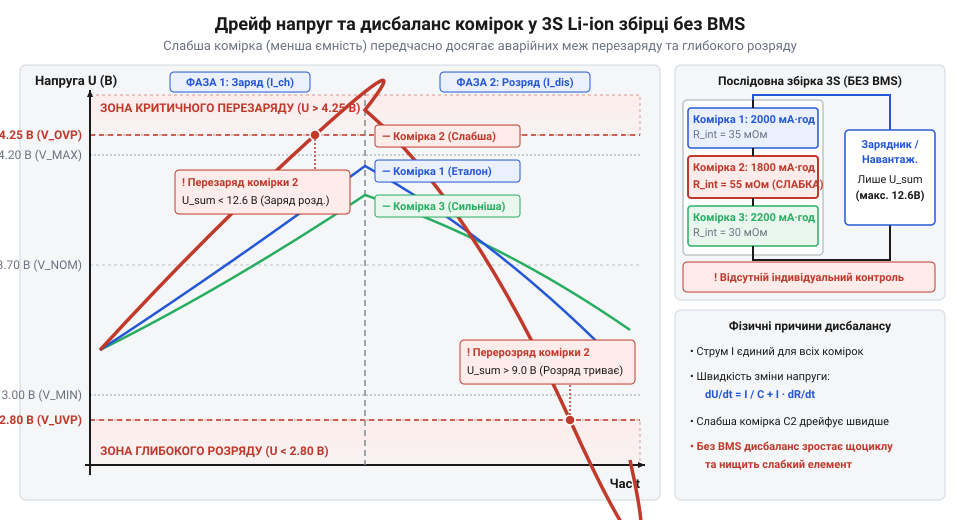
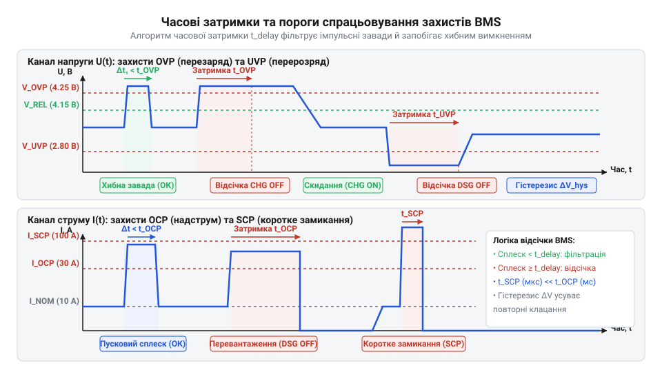
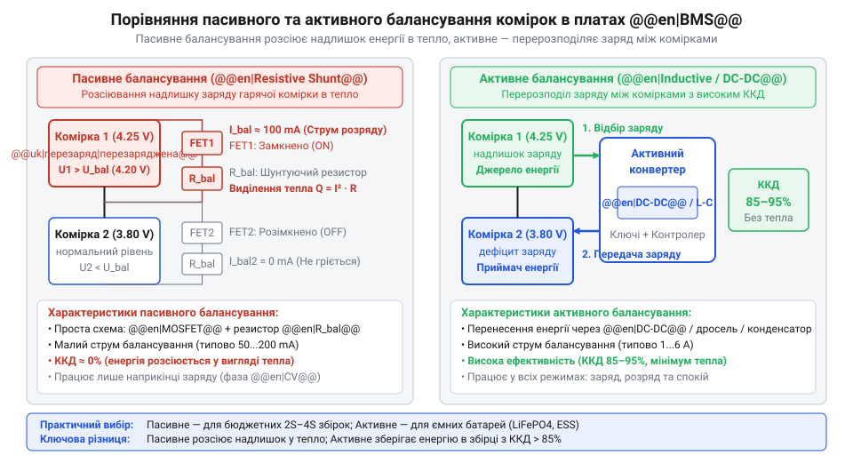
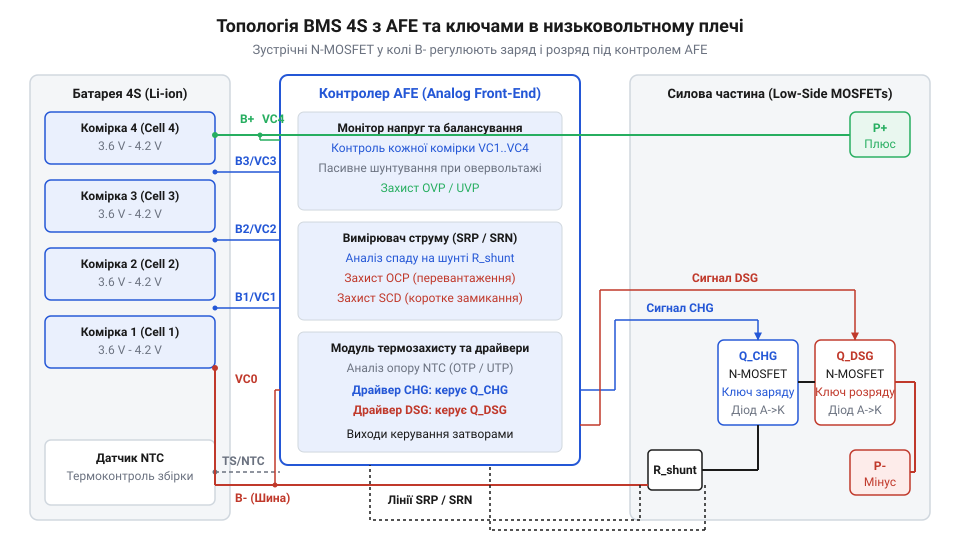
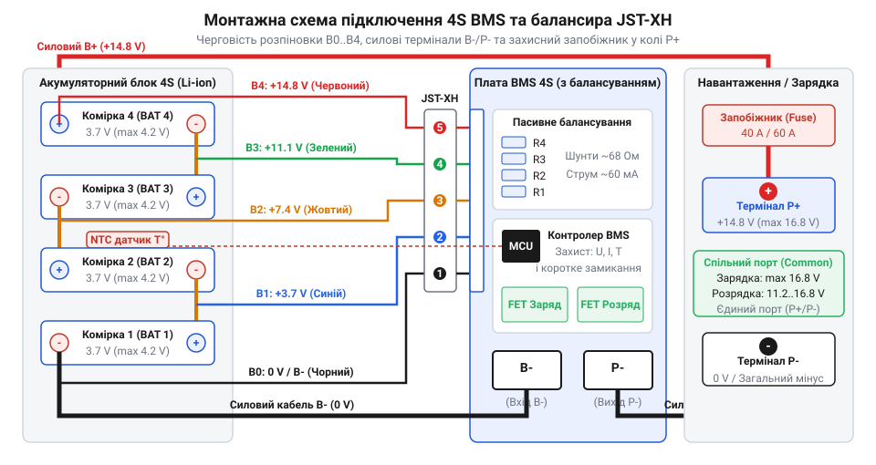

# BMS 2S/3S/4S із балансуванням

<preknowlist>
- [Плата захисту 1S Li-Ion](root:cat-hw-power/pcb-1s-protection) — принципи функціонування захисту одного Li-ion елемента від перезаряду та перерозряду за допомогою контролера DW01A та ключів 8205A
- [TP5100 — заряд 1S/2S](root:cat-hw-power/tp5100-charger) — особливості заряджання двопослідовних (2S) збірок Li-ion акумуляторів без вбудованого модуля балансування
- [SkyRC iMAX B6 Mini — зарядний пристрій-балансир](root:cat-hw-power/imax-b6-charger) — призначення балансувальних портів JST-XH і зовнішній контроль напруги кожной комірки під час заряду
</preknowlist>

## Небезпека дисбалансу послідовних елементів живлення

Одноосередкові @@en|Li-ion@@ та @@en|LiFePO4@@ акумуляторні елементи мають фіксовану номінальну напругу 3.6–3.7 В та 3.2 В відповідно. Для живлення портативних інверторів, електроінструменту, робототехніки чи безпілотних апаратів цієї напруги зазвичай недостатньо. Передача високої електричної потужності при низькій напрузі вимагає проходження величезних струмів, що призводить до непомірних втрат енергії на нагрів дротів та силових ключів. Для вивчення принципів та схемотехніки заряджання поодиноких комірок від USB дивіться огляд про [модулі та контролери заряду 1S акумуляторів](root:cat-hw-power/tp4056).

Щоб підвищити робочу напругу живлення, акумуляторні комірки з'єднують послідовно у конфігурації 2S (дві комірки), 3S (три комірки) або 4S (чотири комірки). Наприклад, 3S @@en|Li-ion@@ збірка має номінальну напругу 11.1 В (з максимумом 12.6 В), а 4S @@en|LiFePO4@@ — 12.8 В (з максимумом 14.4 В). На перший погляд здається, що таку батарею можна заряджати й розряджати як єдиний джерельний блок, підключивши звичайне двопровідне джерело живлення — так само як це робиться у [двопослідовних зарядних модулях](root:cat-hw-power/tp5100-charger) типу TP5100 без балансувального порту. Однак саме тут криється фундаментальна аварійна пастка послідовного електричного кола.

Згідно з законами електротехніки, через усі послідовно з'єднані елементи протікає абсолютно одинаковий струм `I` протягом одного й того самого часу `t`. Це означає, що кожна комірка під час заряду або розряду приймає чи віддає одинакову кількість електричного заряду `Q = I × t`. Проте ідеально однакових хімічних джерел струму не існує. Навіть комірки з однієї заводської партії мають технологічний розкид початкової ємності `C_0`, еквівалентного послідовного опору @@en|ESR@@ (англ. @@en|Equivalent Series Resistance@@, від @@en|equivalent@@ — рівноцінний, @@en|series@@ — послідовний, @@en|resist@@ — чинити опір) та швидкості саморозряду. Як пояснює [фізика акумуляторних комірок](root:hw-power/batteries), стан заряду @@en|SoC@@ (англ. @@en|State of Charge@@, від @@en|state@@ — стан та @@en|charge@@ — заряд) визначається співвідношенням поточного накопиченого заряду до повної ємності конкретного елемента.

Коли акумуляторний блок із декількох комірок заряджається без поелементного контролю, зовнішній зарядний пристрій вимірює лише сумарну напругу на крайніх клемах батареї `U_pack`. Розглянемо 3S @@en|Li-ion@@ збірку, де безпечний поріг заряду кожної комірки становить 4.20 В, а зарядний пристрій налаштовано на загальну відсічку 12.60 В. Якщо через різницю ємностей Комірка 1 заповнюється зарядом швидше за сусідні, напруга на ній досягає аварійної межі значно раніше за інших.

Сумарна напруга батарейного блоку `U_pack` обчислюється як сума потенціалів окремих послідовних елементів `U_cell_i`:

```
U_pack = ∑ U_cell_i
= U_cell_1 + U_cell_2 + U_cell_3            [сумування потенціалів трьох послідовних комірок]
= 4.40 + 4.12 + 4.08                         [підстановка значень напруг при виникненні дисбалансу]
= 12.60 В                                    [фіксований поріг відсічки зовнішнього зарядного пристрою]
```

Зовнішній зарядний пристрій "бачить" нормовані 12.60 В і вважає збірку повністю зарядженою, зупиняючи струм. Проте всередині батареї стався критичний аварійний перезаряд Комірки 1 до 4.40 В. При напрузі понад 4.25–4.30 В на @@en|Li-ion@@ комірці починається незворотний електролітичний розклад катодного матеріалу, інтенсивне газовиділення, здуття корпусу та осадження металевого літію на аноді у вигляді гострих голок (дендритів). Це створює пряму загрозу внутрішнього короткого замикання та руйнівного теплового розгону @@en|thermal runaway@@ (англ. @@en|thermal runaway@@, від @@en|thermal@@ — тепловий, @@en|runaway@@ — розгін).

Не менш небезпечний сценарій розгортається під час розряджання навантаженням. Коли загальна напруга 3S збірки знижується до сумарного порогу відсічки 9.00 В (розрахованого по 3.00 В на елемент), Комірка 1 із меншою ємністю виснажується першою. Вона просідає до 2.10 В (глибокий перерозряд), тоді як Комірка 2 має 3.42 В, а Комірка 3 — 3.48 В. Глибокий розряд нижче 2.50 В руйнує мідний струмознімальний шар анода: мідь починає розчинятися в електроліті, а при наступному заряді утворює корозійні містки, які пробивають сепаратор.


_*Графік розходження напруг у часі на окремих комірках 3S збірки під час заряду та розряду без BMS.*_

Головна небезпека дисбалансу полягає у лавиноподібній спіралі деградації. Найслабша комірка в кожному циклі зазнає найбільшого температурного й хімічного навантаження: вона першою досягає температурних і напругових екстремумів як при заряді, так і при розряді. Внаслідок цього її внутрішній опір @@en|ESR@@ зростає ще швидше, а залишкова ємність падає. Вже через 10–20 циклів без контролю батарея повністю виходить з ладу.

На перших етапах розвитку багатоклітинних систем застосовували плашки @@en|PCM@@ (англ. @@en|Protection Circuit Module@@, від @@en|protect@@ — захищати, @@en|circuit@@ — коло, @@en|module@@ — вузол). Вони відрізнялися від [одноосередкових плашок захисту](root:cat-hw-power/pcb-1s-protection) тим, що відключали відразу весь акумуляторний блок при виході загальної напруги за межі. Проте PCM не мали функцій вирівнювання заряду й не запобігали дисбалансу. Для лабораторного заряду застосовували пристрої типу [зовнішнього зарядного балансира](root:cat-hw-power/imax-b6-charger) SkyRC iMAX B6 Mini, які вимірювали потенціал кожної комірки через окремий балансувальний шлейф. 

Проте для автономних пристроїв виникла потреба в повноцінних вбудованих платах @@en|BMS@@ (англ. @@en|Battery Management System@@, від @@en|battery@@ — акумулятор, @@en|manage@@ — керувати, @@en|system@@ — система), які поєднують постійний поелементний моніторинг, багаторівневий захист та вирівнювання напруг. Детально про те, як розвивалися захисні модулі, розвідано у статті про еволюцію систем [послідовного захисту акумуляторів](root:cat-hw-power/bms-multicell/hist-bms-evolution.md).

## Фізика дисбалансу та пороги захисту

Щоб захистити багатоелементний акумуляторний блок від передчасного руйнування, необхідно кількісно оцінити механізми виникнення дисбалансу та побудувати надійну систему аварійних відсічок. Дисбаланс у збірці акумуляторів виникає під дією двох основних чинників: різниці початкової ємності `ΔC_0` та розкиду внутрішнього опору `ΔR_in`.

Під час проходження струму розряду `I_load` напруга на зовнішніх виводах кожної `i`-ї комірки `U_cell_i` знижується відносно її внутрішньої електрорушійної сили `E_i` за рахунок омічного просідання на внутрішньому опорі `R_in_i`. Якщо одна з комірок має збільшений внутрішній опір `R_in_1 = R_in_0 + ΔR_in`, додаткове падіння напруги `ΔU_drop` під навантаженням обчислюється наступним чином:

```
ΔU_drop = I_load × ΔR_in
= 10 × 0.005                                 [множення струму навантаження на різницю опорів]
= 0.05 В                                     [додаткове омічне просідання на слабкій комірці]
```

При робочому струмі 10 А різниця внутрішнього опору всього в 5 мОм викликає додаткове просідання напруги на слабкій комірці на 0.05 В. Це просідання змушує електронний контролер фіксувати хибний перерозряд значно раніше, ніж комірка насправді виснажить свій хімічний заряд. Крім того, на цьому опорі виділяється додаткова теплова потужність `P_loss = I_load² × ΔR_in = 10² × 0.005 = 0.5 Вт`, яка локально розігріває комірку й прискорює деструкцію електроліту. Більш детально кількісна [модель накопичення дисбалансу](root:cat-hw-power/bms-multicell/math-cell-imbalance-degradation.md) комірок показує, як температурні ґрадієнти всередині батарейного блоку прискорюють розходження параметрів елементів із кожним новим циклом.

Для контролю кожної комірки та запобігання виходу батареї за безпечні межі до складу плати @@en|BMS@@ входить спеціалізована мікросхема аналогового фронтенду @@en|AFE@@ (англ. @@en|Analog Front-End@@, від грец. @@grc|ἀνάλογος@@ — відповідний та англ. @@en|front-end@@ — передній край). Чип @@en|AFE@@ безперервно вимірює напругу на кожній комірці 2S–4S збірки, загальний струм та температуру, порівнюючи їх із п'ятьма фундаментальними порогами захисту:

1. **Захист від перезаряду (OVP — Over-Voltage Protection):**
   - Поріг відсічки `U_OVP` (від англ. @@en|over@@ — понад, @@en|voltage@@ — напруга, @@en|protect@@ — захищати): для @@en|Li-ion@@ комірок становить 4.25–4.28 В ±0.025 В; для @@en|LiFePO4@@ — 3.65–3.75 В ±0.025 В. - Поріг відновлення `U_OVPR` (OVP Release): для відновлення заряду напруга має опуститися до 4.15 В (Li-ion) або 3.55 В (LiFePO4). Гістерезис запобігає зворотній осциляції та частим перемиканням силових ключів.

2. **Захист від перерозряду (UVP — Under-Voltage Protection):**
   - Поріг відсічки `U_UVP` (від англ. @@en|under@@ — під, нижче): для @@en|Li-ion@@ становить 2.50–2.80 В ±0.05 В; для @@en|LiFePO4@@ — 2.00–2.50 В ±0.05 В. - Поріг відновлення `U_UVPR`: 3.00 В (Li-ion) або 2.80 В (LiFePO4).

3. **Захист від струмового перевантаження (OCP — Over-Current Protection):**
   - Фіксує перевищення допустимого струму розряду (DOCP, від @@en|discharge@@ — розряд) або струму заряду (COCP, від @@en|charge@@ — заряд). Вимірювання здійснюється за падінням напруги на низькоомному струмовому шунті `R_shunt`.

4. **Захист від короткого замикання (SCP — Short-Circuit Protection):**
   - Поріг надшвидкого вимкнення при виникненні імпульсного струму, що у 3–10 разів перевищує номінальний (падіння напруги на шунті понад 150–200 мВ).

5. **Захист від температурного відхилення (OTP / UTP):**
   - Використовує вимірювальний терморезистор із від'ємним температурним коефіцієнтом @@en|NTC@@ (англ. @@en|Negative Temperature Coefficient@@, від @@en|negative@@ — від'ємний, @@en|coefficient@@ — коефіцієнт). Відсічка заряду відбувається при `T > 45...50 °C` або `T < 0 °C` (заряджати Li-ion при від'ємних температурах заборонено через дендритоутворення), а відсічка розряду — при `T > 60...65 °C`.

У реальних живильних системах критично важливо відрізняти справжню аварію від короткочасних перехідних процесів. Наприклад, під час запуску електродвигуна або заряджання вхідних конденсаторів підключеного обладнання виникають короткі сплески струму та просідання напруги. Якби @@en|AFE@@-контролер реагував миттєво, пристрій хаотично вимикався б при кожному ввімкненні навантаження.

Тому в алгоритми @@en|AFE@@ закладено часові витримки (таймери затримки спрацьовування `t_delay`):

- **Затримка SCP (`t_SCP`):** становить 100–500 мкс (мікросекунд). Це найшвидший таймер, необхідний для того, щоб розімкнути [силові ключі MOSFET](root:cat-hw-drivers/high-side-mosfet-switch-circuit) до настання їхнього теплового пробою від струму короткого замикання. - **Затримка OCP (`t_OCP`):** становить 10–200 мс (мілісекунд), що дає змогу безпечно пропускати пускові струми двигунів та реактивних навантажень. - **Затримки OVP та UVP (`t_OVP`, `t_UVP`):** становлять 0.5–2.0 с (секунд). Тривала витримка відфільтровує високочастотні завади та короткочасні просідання напруги під підключеним імпульсним навантаженням.


_*Часова діаграма рівнів напруги та струму із зонами спрацьовування порогів OVP, UVP, OCP та часовими затримками відсічки.*_

При фіксації аварійного стану й завершенні відповідного таймера затримки @@en|AFE@@-чип знімає керуючу напругу з затворів транзисторів, розмикаючи силове коло. Втім, самі лише аварійні відсічки не здатні усунути дисбаланс, що накопичився: вони лише запобігають катастрофічному руйнуванню. Для відновлення корисної ємності батареї потрібні активні або пасивні балансири, що розглядаються у наступних розділах.

## Принципи пасивного та активного балансування

Аварійні пороги захисту @@en|AFE@@-контролера (англ. @@en|Analog Front-End@@, від грец. @@grc|ἀνάλογος@@ — відповідний та англ. @@en|front-end@@ — передній край) від перезаряду (OVP) та перерозряду (UVP) здатні відвернути небезпечне руйнування чи пожежу акумулятора, проте вони не усувають першопричину деградації багатоклітинного блоку — накопичений дисбаланс заряду. Коли під час заряджання одна з комірок досягає аварійного порогу 4.25 В для @@en|Li-ion@@, мікросхема захисту розмикає силове коло та припиняє процес, хоча решта комірок у послідовному ланцюзі можуть залишитися недозарядженими (наприклад, мають лише 4.05 В та 4.10 В). Аналогічно при розряджанні найслабший елемент першим просідає до порогу UVP (2.50–2.80 В), викликаючи вимкнення всього акумулятора. У результаті корисна ємність всієї збірки 2S–4S обмежується ємністю найгіршої комірки, а батарейний блок втрачає значну частину накопичуваної енергії. Для відновлення балансу напруг та повного використання хімічного потенціалу кожного елемента в платах @@en|BMS@@ застосовують методи пасивного та активного вирівнювання заряду.

Найбільш поширеним та схемотехнічно простим розв'язком є пасивне балансування (англ. @@en|passive balancing@@, від @@en|passive@@ — пасивний, бездіяльний та @@en|balance@@ — рівновага). Принцип його роботи полягає в примусовому розсіюванні надлишкової енергії більш заряджених комірок у вигляді тепла. Схема пасивного балансира для кожної комірки складається з послідовно з'єднаних розсіювального шунтуючого резистора `R_bal` (англ. @@en|shunt resistor@@, від @@en|shunt@@ — відгалужувати та @@en|resistor@@ — чинити опір) та малопотужного транзисторного ключа @@en|MOSFET@@ (англ. @@en|Metal-Oxide-Semiconductor Field-Effect Transistor@@, від @@en|metal@@ — метал, @@en|oxide@@ — оксид, @@en|semiconductor@@ — напівпровідник, @@en|field@@ — поле, @@en|effect@@ — ефект, @@en|transistor@@ — транзистор), яким керує порівнювач напруги або цифровий контролер @@en|AFE@@.

Пасивне вирівнювання активується виключно наприкінці фази заряду, коли напруга на окремій комірці перевищує заданий поріг початку балансування `U_bal` (зазвичай 4.15–4.18 В для @@en|Li-ion@@ та 3.40–3.45 В для @@en|LiFePO4@@). Коли ключ замикається, частина зарядного струму відгалужується в паралельний шунт `R_bal`, сповільнюючи подальше зростання напруги на цьому елементі та даючи змогу слабшим коміркам "нагнати" рівень заряду.

Струм пасивного шунтування `I_bal` безпосередньо визначається напругою комірки `U_cell` та опором розсіювального резистора `R_bal`. Розрахуємо робочі параметри пасивного балансира з типовим шунтуючим резистором 47 Ом при напрузі комірки 4.20 В:

```
I_bal = U_cell ÷ R_bal
= 4.20 ÷ 47                                  [ділення напруги комірки на опір балансувального резистора]
= 0.089 А                                    [струм пасивного шунтування (89 мА)]
```

Теплова потужність `P_diss`, яка виділяється на одному балансувальному резисторі у вигляді тепла, становить:

```
P_diss = U_cell × I_bal
= 4.20 × 0.089                               [множення напруги комірки на струм шунтування]
= 0.374 Вт                                   [теплова потужність, розсіювана на одному резисторі]
```

При струмі 89 мА пасивний балансир здатний компенсувати лише незначний дисбаланс ємності (порядку 50–100 мА·год за годину заряду). Якщо зарядний пристрій подає силовий струм 3–5 А, пасивний шунт розсіює менше 3% загального струму, тому вирівнювання відбувається повільно і вимагає тривалої стабілізаційної фази заряду постійною напругою фази @@en|CV@@ (англ. @@en|Constant Voltage@@, від @@en|constant@@ — постійний та @@en|voltage@@ — напруга). Спроба збільшити струм балансування шляхом зменшення опору `R_bal` призводить до катастрофічного локального нагріву друкованої плати @@en|BMS@@. Наприклад, для 4S збірки при струмі шунтування 0.5 А сумарне тепловиділення чотирьох каналів досягне 8.4 Вт (`4 × 4.20 В × 0.5 А`), що вимагає масивного алюмінієвого радіатора та примусового охолодження. Кількісні залежності між ємністю збірки, часом вирівнювання та температурними режимами резисторів розкрито у матеріалі про [розрахунок струмів балансування](root:cat-hw-power/bms-multicell/math-passive-balancing-calc.md).

Для акумуляторних блоків високої ємності (понад 20–50 А·год), де пасивні струми у 50–100 мА є неефективними, застосовують активне балансування (англ. @@en|active balancing@@, від @@en|active@@ — дієвий, активний). Замість марного перетворення електричної енергії на тепло, активний балансир за допомогою імпульсних перетворювачів відбирає заряд від більш заряджених комірок з вищою напругою і передає його менш зарядженим елементам.

За принципом накопичення та переносу енергії активні балансири поділяються на дві основні топології:

1. **Ємнісні балансири (човниковий конденсатор, або flying capacitor):**
   Використовують комутований керамічний або електролітичний конденсатор високої ємності `C_fly` (англ. @@en|flying capacitor@@, від @@en|fly@@ — літати, @@en|capacitor@@ — конденсатор), який за допомогою матриці @@en|MOSFET@@-ключів почергово підключається паралельно до сусідніх комірок із частотою 10–100 кГц. Коли конденсатор під'єднується до комірки з напругою 4.10 В, він заряджається до її потенціалу, а при перемиканні на сусідню комірку з напругою 3.90 В — віддає накопичений заряд. Струм переносу пропорційний різниці напруг `ΔU` між комірками та частоті комутації. Перевагою є відносна простота схеми, а недоліком — стрімке падіння струму балансування при наближенні напруг комірок одна до одної (при `ΔU < 50 мВ` струм знижується до одиниць міліампер).

2. **Індуктивні балансири (двонапрямлені імпульсні перетворювачі):**
   Використовують дроселі або багатообмоткові трансформатори. Під час роботи ключа струм від високовольтної комірки протікає через дросель, накопичуючи енергію в його магнітному полі. При розмиканні первинного ключа виникає ЕРС самоіндукції, і через вторинний діод або синхронний ключ накопичена енергія скидається у комірку з найнижчим потенціалом. Індуктивні балансири забезпечують високий та стабільний струм вирівнювання (від 1 А до 5–6 А) незалежно від величини `ΔU` між комірками, досягаючи ККД переносу енергії 85–95%.

На відміну від пасивних систем, активне балансування здатне працювати не лише під час заряджання, а й у режимі розряджання та навіть під час зберігання у режимі спокою. Це дозволяє вирівнювати комірки з суттєвою різницею внутрішнього опору без перевищення допустимих температурних меж. На практиці активні балансири часто виготовляють у вигляді окремих платок розширення, які підключаються паралельно до основної плати @@en|BMS@@ захисту. Схема розведення та інструкція з модернізації діючих збірок наведена у проєкті про [інтеграцію модульного активного балансира](root:cat-hw-power/bms-multicell/proj-active-balancer-retrofit.md).

Наочне порівняння проходження струмів та розподілу енергії в обох топологіях наведено на схемі:


_*Порівняльна схемотехнічна діаграма пасивного балансування через шунтуючі резистори та активного перерозподілу заряду дроселями чи конденсаторами.*_

Порівняльний аналіз показує: пасивне балансування є оптимальним вибором для малопотужних збірок (до 5–10 А·год, як-от акумуляторний інструмент чи безперебійники малої потужності) завдяки низькій вартості та високій надійності. Активне балансування є незамінним у високоємних батарейних блоках (електротранспорт, сонячні станції живлення на базі 4S @@en|LiFePO4@@ ємністю 100–280 А·год), де теплові втрати й повільність пасивних резисторів є неприпустимими.

## Схемотехніка плати та керування MOSFET

Розглянуті алгоритми захисту та балансування реалізуються на фізичному рівні за допомогою внутрішньої схемотехніки плати @@en|BMS@@. Серцем плати для 2S, 3S чи 4S акумуляторного блоку є мікросхема аналогового фронтенду @@en|AFE@@, яка поєднує мультиплексори вимірювальних каналів, високоточні компаратори напруги, драйвери керування силовими ключами та схеми термозахисту. Проте сама мікросхема @@en|AFE@@ є низьковольтним мікропотужним пристроєм — вона не здатна безпосередньо комутувати силові струми в десятки або сотні ампер. Для комутації силового кола використовуються зовнішні потужні напівпровідникові ключі на базі польових транзисторів @@en|MOSFET@@.

Головна схемотехнічна особливість силового блоку @@en|BMS@@ полягає у використанні двох зустрічно (послідовно-зустрічно) увімкнених транзисторів: ключа заряду `Q_chg` (англ. @@en|Charge MOSFET@@) та ключа розряду `Q_dsg` (англ. @@en|Discharge MOSFET@@). Таке включення є неминучим через наявність у кожному силовому @@en|MOSFET@@ внутрішнього паразитного технологічного діода (англ. @@en|body diode@@, від англ. @@en|body@@ — корпус, підкладка, @@en|diode@@ — діод).

Якби у колі стояв лише один транзистор, його паразитний діод пропускав би струм у зворотному напрямку навіть тоді, коли затвор транзистора повністю закритий. Наприклад, якщо закрити єдиний ключ при перерозряді, струм розряду припиниться, але при підключенні зарядного пристрою зарядний струм безшкодно потече через відкритий паразитний діод. Однак при аварії перезаряду (OVP) такий одноключовий захист не зможе зупинити зарядний струм, оскільки діод виявиться увімкненим у прямому напрямку. Зустрічне з'єднання двох ключових транзисторів (витоками `Source` або стоками `Drain` один до одного) гарантує, що їхні внутрішні діоди спрямовані назустріч один одному. Це дає змогу @@en|AFE@@-контролеру селективно керувати силовим колом:

- При виникненні перезаряду (OVP) розмикається лише ключ `Q_chg`. Зарядний струм блокується закритим транзистором `Q_chg`, але розрядний струм може вільно протікати через паразитний діод закритого `Q_chg` та відкритий транзистор `Q_dsg`, що дозволяє продовжити живлення навантаження. - При виникненні перерозряду (UVP) розмикається ключ `Q_dsg`. Розрядний струм припиняється, але підключення зарядного пристрою негайно викликає проходження зарядного струму через паразитний діод закритого `Q_dsg` та відкритий транзистор `Q_chg`, що забезпечує безпечне відновлення акумулятора.

Розміщення силових ключів у схемі підключення @@en|BMS@@ буває двох типів:

1. **Низьковольтне плече (low-side switching):**
   Транзистори встановлюються в розрив мінусового силового провідника між клемою акумуляторного блоку `B-` та зовнішнім силовим виводом `P-` (або `C-`). У цій топології застосовують N-канальні @@en|MOSFET@@, які мають значно менший опір відкритого каналу `R_DS(on)` та нижчу вартість порівняно з P-канальними аналогами. Для відкривання N-канального ключа в низьковольтному плечі @@en|AFE@@-чипу достатньо подати на затвор позитивну напругу 10–12 В відносно загальної шини `B-`. Недоліком низьковольтного розриву є розрив "земляного" провідника: у моменти спрацьовування захисту потенціал мінусового термінала пристрою `P-` піднімається до плюсового потенціалу батареї, що вимагає гальванічної розв'язки цифрових інтерфейсів.

2. **Високовольтне плече (high-side switching):**
   Транзистори встановлюються у розрив плюсового провідника `B+` / `P+`. Це зберігає спільний мінусовий провідник заземлення, що критично для систем із загальним корпусом (автомобілі, складні робототехнічні комплекси). Для керування N-канальними ключами у плюсовому плечі мікросхема @@en|AFE@@ містить вбудований помповий підкачувач заряду (англ. @@en|charge pump@@, від @@en|charge@@ — заряд, @@en|pump@@ — насос), який генерує керуючу напругу затвора, що перевищує напругу батареї `U_pack` на 10–15 В.

Вимірювання струму в схемі здійснюється за допомогою високоточного низькоомного шунта `R_shunt` (опором 0.5–5 мОм), що підключається послідовно з силовими ключами, а контроль температури — за допомогою зовнішніх @@en|NTC@@-терморезисторів (англ. @@en|Negative Temperature Coefficient@@, від @@en|negative@@ — від'ємний, @@en|coefficient@@ — коефіцієнт).

Внутрішню структуру плати @@en|BMS@@ 4S із низьковольтним розривом схематично зображено на фігурі:


_*Функціональна схема плати BMS 4S із чіпом AFE, струмовим шунтом, датчиком NTC та двома зустрічно увімкненими силовими N-канальними MOSFET у низьковольтному плечі.*_

Підключення плати @@en|BMS@@ до акумуляторної збірки вимагає суворого дотримання послідовності монтажу. Балансувальний шлейф підключається через багатопіновий роз'єм типу @@en|JST-XH@@. Першим дріт `B-` (0 В, мінус першої комірки) підключається до плати, після чого під'єднуються провідники `B1` (плюс першої комірки), `B2`, `B3` та `B4` (`B+`, плюс останньої комірки). Порушення черговості підключення (наприклад, подача високого потенціалу `B4` до підключення заземлення `B-`) спричиняє проходження вирівнювальних струмів через внутрішні захисні діоди @@en|AFE@@-чипа, що призводить до негайного вигоряння вхідних каналів вимірювання напруги.

Силові провідники від акумуляторного блоку підключаються до відповідних масивних контактних майданчиків плати `B-` та `B+`, а навантаження й зарядний пристрій — до силових виводів `P-` та `P+` (або `C-` при суміщеному порті). З детальною розводкою електричного інтерфейсу можна ознайомитися у матеріалі про [специфікацію підключення BMS](root:cat-hw-power/bms-multicell/api-bms-2s-4s-wiring-hw.md), а покроковий алгоритм монтажу наведено у практичному керівництві про [збірку 4S акумуляторного блоку](root:cat-hw-power/bms-multicell/proj-bms-4s-assembly.md).

Монтажну схему збірки 4S з деталізацією дротів JST-XH показано нижче:


_*Монтажна схема підключення 4S акумуляторного блоку до плати BMS з позначенням черговості дротів роз'єму JST-XH, силових терміналів та захисного запобіжника.*_

Сучасні "розумні" плати @@en|Smart BMS@@ крім апаратного захисту містять вбудований мікроконтролер та цифрові послідовні інтерфейси телеметрії, такі як @@en|UART@@, @@en|I2C@@ або @@en|SMBus@@ (англ. @@en|System Management Bus@@, від @@en|system@@ — система, @@en|management@@ — керування, @@en|bus@@ — шина). Це дозволяє зовнішньому керуючому контролеру пристрою (наприклад, робота чи інвертора) зчитувати в реальному часі напругу кожної комірки, поточний струм, температуру, розрахований стан заряду @@en|SoC@@ та рівень деградації @@en|SoH@@ (англ. @@en|State of Health@@, від @@en|state@@ — стан, @@en|health@@ — здоров'я). Специфіку цифрового обміну та карти регістрів висвітлено у матеріалі про [інтерфейси розумних BMS](root:cat-hw-power/bms-multicell/api-smart-bms-uart-smbus.md).

## Інтерфейси підключення та балансувальні шлейфи

Монтаж багатоелементного акумуляторного блоку @@en|Li-ion@@ або @@en|LiFePO4@@ (від @@en|Lithium Iron Phosphate@@) конфігурації 2S, 3S чи 4S вимагає суворого дотримання електричних і механічних правил. Помилки при комутації силових шин або недотримання послідовності з'єднання балансувальних провідників призводять до миттєвого виходу з ладу аналогового фронтенду @@en|AFE@@ (від @@en|Analog Front End@@) на платі @@en|BMS@@ (від @@en|Battery Management System@@) або до короткого замикання з ризиком термічного розгону.

Силовий тракт плати BMS розрахований на проходження повного струму розряду та заряду акумуляторної збірки. Для підключення негативного полюса батареї до контактної площадки `B-` та силових виходів навантаження `P-` або `C-` використовують багатожильні мідні дроти з силіконовою ізоляцією. Переріз силових провідників обирають за стандартом @@en|AWG@@ (від @@en|American Wire Gauge@@) залежно від максимального тривалого струму: для струмів до 15 А застосовують провідники 14 AWG (переріз 2.08 мм²), для 30 А — 12 AWG (3.31 мм²), а для струмів понад 50 А — 10 AWG (5.26 мм²) або подвоєні шини. Недостатній переріз провідника створює паразитичний активний опір, що викликає понаднормове падіння напруги під навантаженням та локальний перегрів контактних майданчиків BMS.

Для захисту всієї системи у силове коло позитивного полюса `B+` поблизу клеми батареї обов'язково встановлюють запобіжник відповідного номіналу. Це запобігає катастрофічним наслідкам у разі пробою силових ключів @@en|MOSFET@@ (від @@en|Metal-Oxide-Semiconductor Field-Effect Transistor@@) або зовнішнього короткого замикання.

Для вимірювання напруги на кожній окремій комірці та підведення струму пасивного балансування використовують окремий багатожильний шлейф із роз'ємом @@en|JST-XH@@ з кроком виводів 2.54 мм. Кількість контактів у балансувальному роз'ємі завжди на один більша за кількість послідовних комірок:
- Для збірки 2S застосовують 3-контактний роз'єм (`B-`, `B1`, `B2`/`B+`);
- Для збірки 3S — 4-контактний роз'єм (`B-`, `B1`, `B2`, `B3`/`B+`);
- Для збірки 4S — 5-контактний роз'єм (`B-`, `B1`, `B2`, `B3`, `B4`/`B+`).

Оскільки струм пасивного балансування рідко перевищує 50–100 мА, для балансувального шлейфу використовують гнучкі провідники перерізом 24–22 AWG (0.2–0.34 мм²).


*Схема безпечного підключення провідників та порядок верифікації потенціалів на роз'ємі JST-XH перед підключенням до BMS.*

Найпоширенішою причиною виходу з ладу плати BMS під час монтажу є вставлення балансувального роз'єму JST-XH у гніздо плати до того, як припаяно основний силовий дріт `B-`, або підключення клем шлейфу у довільному порядку. Вимірювальні входи мікросхеми AFE всередині плати мають вбудовані захисні @@en|ESD@@ (від @@en|Electrostatic Discharge@@) діоди та паразитичні діоди підкладки між сусідніми каналами. Якщо підключити провідник високого потенціалу (наприклад, `B4` з напругою +14.4 В відносно загального мінуса) при відключеному контакті `B-` (0 В), струм батареї протікає через внутрішній захисний діод AFE-чипа на незапитану підкладку мікросхеми. Виникає ефект защіпкання @@en|latch-up@@ (від @@en|latch-up effect@@), через який струм через силіконовий кристалик зростає до сотень міліампер, що призводить до миттєвого вигорання вхідних регістрів та каналів вимірювання AFE.

Щоб уникнути пошкодження електронних компонентів, монтаж збірки здійснюють за суворим регламентом:
1. Зачищають та залуджують силові шини та контактні майданчики на батарейному блоці. 2. Припаюють основний негативний силовий провідник `B-` від загального мінуса акумуляторної збірки до відповідної площадки `B-` на платі BMS. 3. Послідовно припаюють дроти балансувального шлейфу до міжканальних перемичок акумуляторної збірки: дріт `B0` (чорний) — до загального мінуса (Cell 1-), `B1` — до плюса першої комірки (Cell 1+ / Cell 2-), `B2` — до плюса другої комірки (Cell 2+ / Cell 3-), `B3` — до плюса третьої комірки (Cell 3+ / Cell 4-), `B4` (червоний) — до плюса четвертої комірки (Cell 4+). 4. Здійснюють верифікацію потенціалів мультиметром. Перед вставленням коннектора JST-XH у гніздо BMS беруть мультиметр у режимі вимірювання постійної напруги. Чорний щуп фіксують на гнізді `B0` шлейфу, а червоним щупом послідовно перевіряють напруги на контактах:
   - Відносно `B0` на `B1`: від +3.2 В до +3.6 В (напруга комірки 1);
   - Відносно `B0` на `B2`: від +6.4 В до +7.2 В (сума напруг 1 та 2 комірок);
   - Відносно `B0` на `B3`: від +9.6 В до +10.8 В (сума напруг 1, 2 та 3 комірок);
   - Відносно `B0` на `B4`: від +12.8 В до +14.4 В (повна напруга 4S збірки). 5. Лише після підтвердження монотонного зростання потенціалів без інверсій шлейф підключають до плати BMS.

Для контролю температури комірок плата BMS має виносний терморезистор @@en|NTC@@ (від @@en|Negative Temperature Coefficient@@) з опором 10 кОм при 25 °C. Його закріплюють тейпом або теплопровідним клеєм у найгарячішій точці збірки — на середніх комірках акумуляторного блоку, де ускладнено природне охолодження. Докладну розпіновку та електричні параметри клем описує [електричний інтерфейс плат](root:cat-hw-power/bms-multicell/api-bms-2s-4s-wiring-hw.md), що задає вимоги до фізичного підключення модулів BMS.

## Цифрові протоколи та діагностика акумуляторів

Апаратні пороги захисту BMS забезпечують автоматичну відсічку при аварійних режимах, проте вони не надають детальних даних про поточний стан деградації акумуляторного блоку. Для побудови систем із цифровим моніторингом використовують @@en|Smart BMS@@, які оснащені цифровими послідовними інтерфейсами передачі телеметрії на зовнішній мікроконтролер.

Телеметрія містить інформацію про напругу кожної комірки, струм заряду й розряду, температуру, обчислені параметри @@en|SoC@@ (від @@en|State of Charge@@) та @@en|SoH@@ (від @@en|State of Health@@), а також бітові прапори спрацьовування захистів @@en|OVP@@ (від @@en|Overvoltage Protection@@), @@en|UVP@@ (від @@en|Undervoltage Protection@@), @@en|OCP@@ (від @@en|Overcurrent Protection@@) та @@en|OTP@@ (від @@en|Overtemperature Protection@@).

Діалогові протоколи реалізують на базі трьох основних шин:
1. **@@en|UART@@ (від @@en|Universal Asynchronous Receiver-Transmitter@@):** Послідовний асинхронний інтерфейс зі швидкостями 9600 або 115200 бод. Оскільки потенціал землі BMS зв'язаний із мінусом акумулятора, шину UART обов'язково розв'язують гальванічно за допомогою оптопар або цифрових ізоляторів для захисту мікроконтролера керування. 2. **@@en|I2C@@ (від @@en|Inter-Integrated Circuit@@) та @@en|SMBus@@ (від @@en|System Management Bus@@):** Двопровідна синхронна шина (лінії `SDA` та `SCL`). Протокол SMBus є стандартизованою надбудовою над I2C із фіксованими таймаутами та контрольними сумами @@en|PEC@@ (від @@en|Packet Error Code@@) на основі @@en|CRC@@ (від @@en|Cyclic Redundancy Check@@). Структуру бінарних кадрів визначає [цифровий інтерфейс BMS](root:cat-hw-power/bms-multicell/api-smart-bms-uart-smbus.md).


*Структурна схема передачі телеметрії з BMS на контролер із використанням оптичної розв'язки ліній UART.*

Завдяки цифровому опитуванню Smart BMS зовнішній контролер виявляє приховані дефекти батареї під час її експлуатації:

1. **Розрахунок внутрішнього опору комірок @@en|ESR@@ (від @@en|Equivalent Series Resistance@@):**
Контролер фіксує напругу кожної комірки у стані спокою `V_idle` та у момент стрибка струму розряду `I_load`. Внутрішній опір комірки обчислюють за співвідношенням:

```
R_in_k = (V_idle_k - V_load_k) / I_load
```

Якщо для однієї з комірок значення `R_in_k` зростає у 1.5–2 рази відносно середнього значення по збірці, це свідчить про хімічну деградацію або пошкодження її контактів.

2. **Діагностика падіння ефективної ємності:**
При заряді деградована комірка з меншою ємністю досягає порогу OVP значно швидше за інші. Контролер аналізує швидкість зростання напруги `dV/dt`: висока швидкість при сталому струмі заряду вказує на втрату активної маси електродів.

3. **Контроль роботи пасивних балансирів:**
Smart BMS передає у бітовому масиві статус активності балансувальних ключів для кожного каналу. Якщо телеметрія показує, що прапорець балансування комірки активований протягом тривалого часу, але напруга цієї комірки не зменшується відносно сусідніх, це вказує на обрив балансувального резистора або несправність керуючого транзистора.

Особливості збірки та первинної діагностики 4S блоку розкрито у матеріалі про [інструкцію зі збірки 4S блоку](root:cat-hw-power/bms-multicell/proj-bms-4s-assembly.md). Якщо у процесі діагностики виявлено стабільний дисбаланс, який не компенсується малопотужним штатним пасивним балансиром, застосовують [інтеграцію модульного активного балансира](root:cat-hw-power/bms-multicell/proj-active-balancer-retrofit.md), що дозволяє перерозподіляти струми між комірками.

Нижче наведено приклад коду зчитування та парсингу бинарного кадру телеметрії з Smart BMS через UART на мікроконтролері.

:::tabs

:::code bms-multicell-d/c/esp-idf/calculate-checksum.c

:::code bms-multicell-d/cpp/arduino/bmsdata.cpp

:::