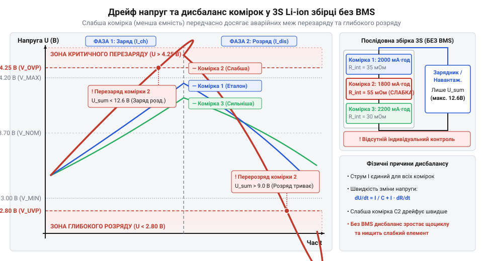
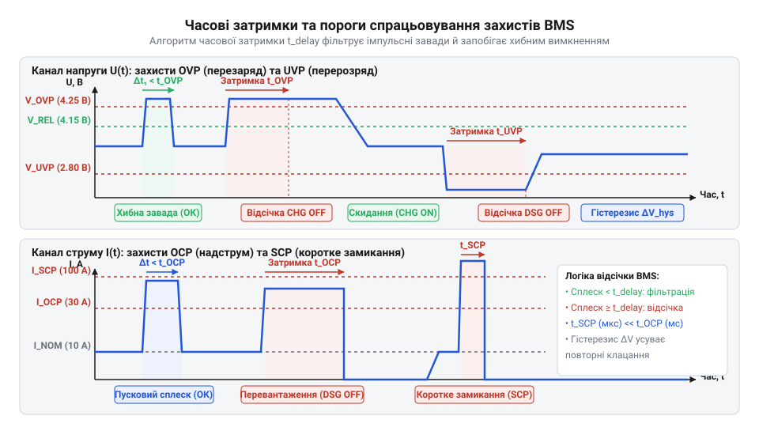
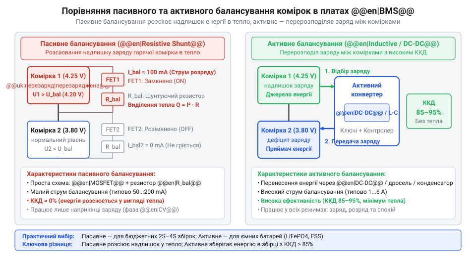
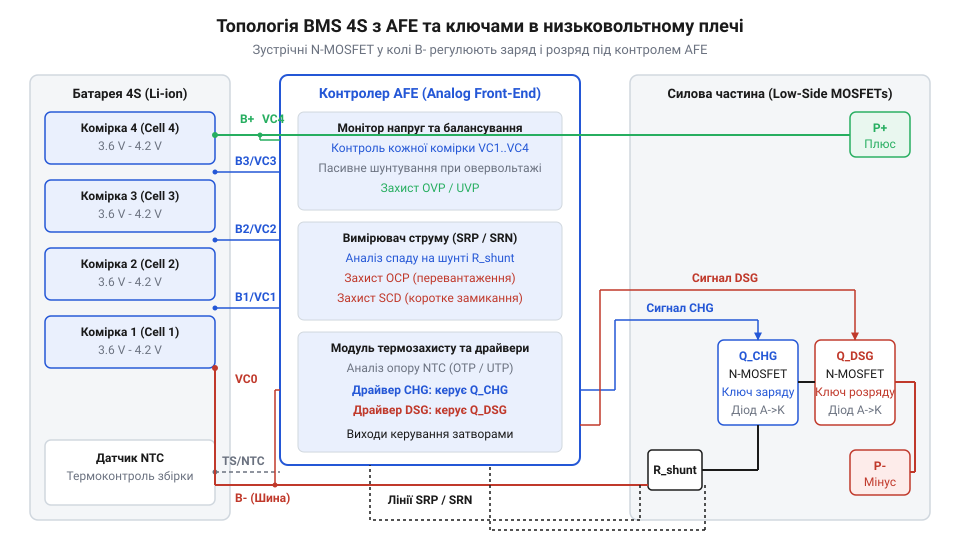

# BMS 2S/3S/4S із балансуванням

<preknowlist>
- [Плата захисту 1S Li-Ion](root:cat-hw-power/pcb-1s-protection) — принципи апаратного захисту одного @@en|Li-ion@@ елемента від перезаряду та перерозряду за допомогою спеціалізованого контролера й силових ключів
- [TP5100 — заряд 1S/2S](root:cat-hw-power/tp5100-charger) — особливості заряджання двопослідовних збірок @@en|Li-ion@@ акумуляторів без вбудованого модуля балансування напруг
- [SkyRC iMAX B6 Mini — зарядний пристрій-балансир](root:cat-hw-power/imax-b6-charger) — призначення балансувальних портів @@en|JST-XH@@ і зовнішній контроль напруги кожної комірки під час заряду
</preknowlist>

## Небезпека дисбалансу в послідовних збірках

Послідовне з'єднання комірок @@en|Li-ion@@ або @@en|LiFePO4@@ у збірки 2S–4S підвищує напругу живлення. Через технологічний розкид ємності та внутрішнього опору @@en|ESR@@ (англ. @@en|Equivalent Series Resistance@@, еквівалентний послідовний опір) елементи мають розбіжності, які накопичуються з кожним циклом і створюють міжкомірковий дисбаланс.

Двопровідний зарядний пристрій вимірює лише сумарну напругу збірки. Для блоку 3S @@en|Li-ion@@ модуль вважає заряд завершеним за загальним порогом 12.6 В:

```
U_pack = U1 + U2 + U3
= 4.1 В + 4.1 В + 4.4 В      [сумування напруг послідовних комірок]
= 12.6 В                     [загальна напруга збірки 3S]
```

Коли простий [модуль заряду TP5100](root:cat-hw-power/tp5100-charger) подає струм на всі елементи разом, перезаряд слабкої комірки понад 4.25 В руйнує електроліт і спричиняє тепловий розгін. При розряді вона виснажується першою і просідає нижче 2.5 В, руйнуючи струмознімач. На відміну від 1S-систем, де [одноканальна плата захисту](root:cat-hw-power/pcb-1s-protection) контролює один елемент, багатоелементні збірки вимагають постійного поелементного нагляду.


*Дрейф напруг між окремими елементами послідовної збірки при циклуванні без балансування.*

## Апаратний захист та пороги відсічки

Аналоговий фронтенд @@en|AFE@@ (англ. @@en|Analog Front-End@@) у складі @@en|BMS@@ моніторить поелементну напругу, струм через шунт і температуру через датчик @@en|NTC@@.

Контролер @@en|AFE@@ реалізує п'ять апаратних відсічок із затримками спрацьовування для відфільтровування завад і пускових струмів:
1. @@en|OVP@@ (англ. @@en|Overvoltage Protection@@): відсікає заряд при 4.25–4.35 В на комірку для @@en|Li-ion@@ (3.65 В для @@en|LiFePO4@@) за ~ 1 с. 2. @@en|UVP@@ (англ. @@en|Undervoltage Protection@@): розмикає розряд при просіданні нижче 2.5–2.8 В (2.0–2.5 В для @@en|LiFePO4@@) за ~ 100 мс. 3. @@en|OCP@@ (англ. @@en|Overcurrent Protection@@): блокує розряд при перевищенні струму за 10–20 мс. 4. @@en|SCP@@ (англ. @@en|Short Circuit Protection@@): надшвидко відсікає струм при короткому замкненні за 200–500 мкс. 5. Захист за температурою @@en|NTC@@: блокує роботу при перегріві понад 60–65 °C або заряді нижче 0 °C.


*Пороги напруги й струму та часові затримки спрацьовування апаратних відсічок.*

## Пасивне та активне балансування комірок

Без вирівнювання потенціалів ємність батареї обмежується найслабшим елементом. Для вирівнювання напруг у @@en|BMS@@ застосовують пасивне або активне балансування.

Пасивне балансування розсіює надлишок енергії у тепло. Наприкінці заряду @@en|CV@@ контролер @@en|AFE@@ через ключ @@en|MOSFET@@ підключає баластний резистор 33–100 Ом. Малий струм (40–100 мА) обмежує його застосування малоємними збірками.


*Принципові схеми пасивного розсіювання на резисторах та активного перекачування.*

Активне балансування перекачує заряд між комірками через конденсатори чи дроселі зі струмом 0.5–2 А та ККД понад 90 %. Метод розрахований на ємні [автономні живильні модулі](root:cat-hw-power/liion-hat-rpi); інакше використовують [зовнішній пристрій-балансир](root:cat-hw-power/imax-b6-charger).

## Схемотехніка силових ключів та підключення

Силовий тракт плат @@en|BMS@@ містить два зустрічно увімкнені транзистори @@en|MOSFET@@ у негативній шині (`B-` / `P-`). Зустрічне ввімкнення необхідне через наявність у транзисторі паразитного діода. Один транзистор керує зарядом (CHG), другий — розрядом (DSG). При спрацьовуванні @@en|OVP@@ ключ CHG закривається, але паразитний діод пропускає струм розряду на навантаження. При @@en|UVP@@ закривається ключ DSG, залишаючи можливість заряджання. Модулі @@en|Smart BMS@@ додатково містять контролер, що транслює напруги, струм та рівень заряду @@en|SoC@@ (англ. @@en|State of Charge@@, рівень заряду) через @@en|UART@@ або @@en|CAN@@.


*Двотранзисторний силовий ключ та розпайка балансувального шлейфу.*

Підключення плати @@en|BMS@@ вимагає суворого порядку комутації шин та шлейфу @@en|JST-XH@@:
1. Припаюють силовий провідник негативного полюса `B-` до плати @@en|BMS@@. 2. Розпаюють виводи шлейфу @@en|JST-XH@@ від `B-` (0 В) послідовно до `B+` (наприклад, `B1` = 3.7 В, `B2` = 7.4 В, `B3` = 11.1 В, `B4` = 14.8 В). 3. Вимірюють мультиметром напругу між контактами шлейфу @@en|JST-XH@@ відносно `B-`, переконуючись у правильному зростанні потенціалів. 4. Підключають шлейф @@en|JST-XH@@ у роз'єм плати та припаюють позитивну шину `B+`.