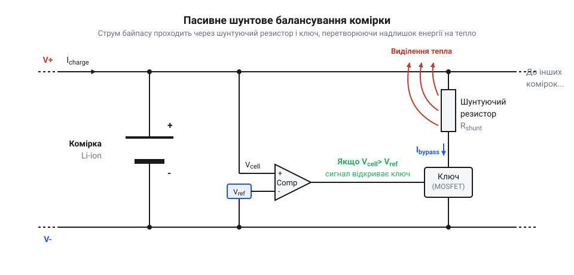
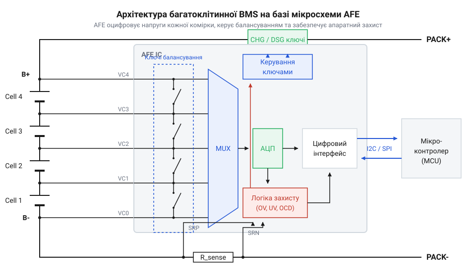

# Від простих плашок захисту PCM до розумних BMS з балансуванням

## Проблема дисбалансу в багатоклітинних батареях

Масове впровадження літієвих хімічних джерел струму (технології @@en|Li-ion@@) на початку 1990-х років вимагало послідовного з'єднання поодиноких комірок (напругою 2.5–4.2 В) у батарейні блоки для живлення потужних пристроїв. Саме тут інженери зіштовхнулися з фундаментальною фізичною проблемою: відсутністю двох абсолютно ідентичних акумуляторних елементів у реальному світі, що призводить до розбалансування комірок (@@en|cell imbalance@@).

Першопричина криється в технологічних допусках (@@en|manufacturing tolerances@@) під час виготовлення акумуляторів. Навіть у межах однієї партії елементи мають відхилення товщини активного шару електродів, маси літію та об'єму електроліту, що створює початковий розкид ємності й внутрішнього опору. Крім того, виникають температурні градієнти (@@en|thermal gradient@@): центральні комірки охолоджуються гірше за крайні. Підвищена температура прискорює деградацію та збільшує саморозряд центральних елементів, що з кожним циклом поглиблює розрив між комірками.

Головна небезпека послідовного з'єднання полягає в тому, що крізь усі елементи протікає один і той самий струм, але реагують вони на нього по-різному. Спроба контролювати збірку лише за загальною напругою (@@en|pack-level voltage sensing@@) є небезпечною. Розглянемо послідовну збірку 4S з чотирьох елементів @@en|Li-ion@@ з максимальною напругою заряду 16.8 В (по 4.2 В на комірку).

У послідовному колі струм заряду `I` протягом часу `t` збільшує напругу кожної комірки обернено пропорційно до її ємності:

```
ΔU₁ = I · t ÷ C₁
ΔU₂ = I · t ÷ C₂
```

Якщо ємність другої комірки менша (`C₂ < C₁`), напруга `ΔU₂` зростає швидше. Якщо три комірки набрали по 4.1 В (сумарно 12.3 В), то слабша четверта при досягненні загальної напруги блоку 16.8 В сягне критичного значення:

```
U₄ = 16.8 - 12.3 = 4.5 В
```

Перевищення порогової напруги 4.2 В (перезаряд, @@en|Overcharge@@) викликає окиснення електроліту, руйнування катода та виділення літію на аноді. Це супроводжується газовиділенням, саморозігрівом і термічним розгоном (@@en|thermal runaway@@) із займанням чи вибухом.

Аналогічно під час розряду до загальної межі 12.0 В три міцні комірки можуть утримувати 3.3 В (сумарно 9.9 В), а слабка комірка просяде до:

```
U₄ = 12.0 - 9.9 = 2.1 В
```

Падіння напруги нижче 2.5 В (глибокий перерозряд, @@en|Overdischarge@@) запускає незворотне розчинення мідної фольги анода в електроліті. При наступному заряді мідь осідає у вигляді дендритів, які пробивають сепаратор і спричиняють внутрішнє коротке замикання. Отже, вимірювання лише загальної напруги є непридатним для безпечної експлуатації й вимагає постійного моніторингу кожного акумулятора (@@en|per-cell voltage monitoring@@).

## Ручний підбір комірок та плашки PCM

На світанку розвитку багатоклітинних літієвих батарей інженери намагалися розв'язати проблему дисбалансу суто технологічним шляхом на етапі виробництва. Основним методом забезпечення довговічності збірок у 1990-х роках став підбір ідентичних елементів (@@en|cell matching@@). Перед збиранням акумулятори сортували за ємністю, рівнем заряду (@@en|State of Charge@@, @@en|SoC@@) та еквівалентним послідовним опором (@@en|ESR@@), відбираючи комірки з відхиленням у частки відсотка.

Для аварійного захисту використовували плашки @@en|PCM@@ (@@en|Protection Circuit Module@@). На відміну від [плати захисту 1S Li-Ion](root:cat-hw-power/pcb-1s-protection), плашка @@en|PCM@@ для багатоклітинних збірок містила аналогові компаратори для кожного каналу. Два силових ключі на @@en|MOSFET@@-транзисторах розмикали коло живлення у трьох випадках:
1. @@en|Overcharge Protection@@ — відключення заряджання при напрузі бодай однієї комірки понад 4.25–4.35 В. 2. @@en|Overdischarge Protection@@ — відключення навантаження при падінні напруги елемента нижче 2.5–2.8 В. 3. @@en|Overcurrent Protection@@ — розмикання кола при струмовому перевантаженні або короткому замиканні.

Проте підбір елементів (@@en|cell matching@@) у зв'язці з плашкою @@en|PCM@@ лише відтерміновував дисбаланс. У процесі циклування через нерівномірний нагрів і хімічне старіння параметри комірок неминуче розходилися.

Плашка @@en|PCM@@ позбавлена засобів вирівнювання заряду (@@en|cell balancing@@) і працює за принципом відсікання по найгіршому елементу. Найслабша комірка першою досягає верхньої межі напруги під час заряду — @@en|PCM@@ розмикає коло, залишаючи решту недозарядженими. Під час розряду ця ж комірка виснажується першою, змушуючи @@en|PCM@@ відключити навантаження за наявності запасу енергії в інших.

Поширене уявлення, ніби плата @@en|PCM@@ балансує акумулятори чи відновлює ємність, є хибним. Вона є виключно аварійним запобіжником. Без вирівнювання потенціалів ємність блоку деградує до рівня найгіршої комірки, а @@en|PCM@@ лише запобігає аварії, скорочуючи реальний термін служби батареї.

## Дискретний аналоговий захист і пасивне балансування

Недостатність захисту @@en|PCM@@ змусила розробити схемотехніку пасивного балансування (@@en|passive balancing@@) на дискретних аналогових компонентах. Її суть — скидання надлишкової енергії більш заряджених комірок у вигляді тепла наприкінці заряду, що дозволяє іншим елементам досягти повної ємності.

Схема будується індивідуально для кожного послідовного каналу. Вона містить аналоговий компаратор (наприклад, `@@en|LM339@@` або стабілітрон `@@en|TL431@@`), прецизійний дільник напруги, силовий ключ (@@en|P-MOSFET@@ чи @@en|N-MOSFET@@) та шунтувальний резистор `R_shunt` (@@en|shunt resistor@@).

У фазі сталої напруги (@@en|CV phase@@), коли потенціал комірки досягає порогу `U_bal` (зазвичай 4.20 В), компаратор відкриває транзистор. Ключ підключає `R_shunt` паралельно комірці, спрямовуючи частину зарядного струму в обхід акумулятора з виділенням тепла (джоулеве нагрівання, @@en|Joule heating@@). Це сповільнює зростання напруги на зарядженому елементі, поки решта струму дозаряджає інші.


*Принципова схема дискретного вузла пасивного балансування з аналоговим компаратором та шунтувальним резистором.*

Потужність `P_dis`, яка розсіюється у вигляді тепла на шунтуючому резисторі `R_shunt` при напрузі комірки `U_cell`, розраховується через закон Ома:

```
I_bal = U_cell ÷ R_shunt
P_dis = U_cell · I_bal
= U_cell² ÷ R_shunt            [підстановка струму балансування в формулу потужності]
```

Для типового значення напруги `U_cell = 4.20 В` та шунтувального опору `R_shunt = 47 Ом` струм балансування та розсіювана потужність становлять:

```
I_bal = 4.20 ÷ 47 ≈ 0.0894 А
P_dis = 4.20 × 0.0894 ≈ 0.375 Вт
```

Тобто на кожному балансувальному каналі розсіюється майже 0.4 Вт теплової потужності під час проходження струму близько 90 мА.

Дискретна аналогова схемотехніка має три ключові обмеження:
1. Тепловий бар'єр та низький струм: Струм балансування обмежений 50–100 мА через ризик перегріву щільного блоку, чого замало для батарей великої ємності. 2. Високе власне енергоспоживання (@@en|quiescent current@@): Постійно підключені компаратори та дільники розряджають комірки під час тривалого зберігання. 3. Громіздкість і низька надійність: Збірки на 10S–16S вимагають сотень компонентів, що збільшує габарити плати та знижує надійність.

Ці недоліки змусили перейти до спеціалізованих мікросхем аналогового фронтенду (@@en|Analog Front-End@@, @@en|AFE@@) з інтегрованими ключами й АЦП. У портативних пристроях використовуються [контролер TP5100](root:cat-hw-power/tp5100-charger) або зовнішній [балансир SkyRC iMAX B6](root:cat-hw-power/imax-b6-charger), а у складних акумуляторних блоках — [багатоелементні плати BMS](root:cat-hw-power/bms-multicell) та [інтелектуальні контролери BMS](root:cat-hw-power/smart-bms-controllers).

## Інтегральні AFE та багатоклітинні контролери

Масове виробництво батарейних блоків 4S–16S унеможливило використання дискретних аналогових схем: сотні компонентів збільшували габарити плати, струм власного споживання та температурні похибки. Схемотехнічним проривом початку 2000-х років стала поява спеціалізованих мікросхем аналогового фронтенду — @@en|AFE@@ (@@en|Analog Front-End@@).

@@en|AFE@@ інтегрує всі аналогові вузли моніторингу та первинного захисту на одному кремнієвому кристалі. Прецизійний аналоговий мультиплексор (@@en|Analog Multiplexer@@) послідовно комутує напруги комірок на один спільний аналого-цифровий перетворювач (@@en|ADC@@). Внутрішні схеми зсуву рівнів (@@en|level shifters@@) дозволяють вимірювати малі диференціальні напруги на тлі високої синфазної напруги з точністю до кількох мілівольт. Крім того, у кристал вбудовано ключі та драйвери балансування, що дозволило випускати компактні [багатоелементні плати BMS](root:cat-hw-power/bms-multicell).


*Функціональна блокова схема багатоклітинної BMS на базі AFE з аналоговим мультиплексором, АЦП, вбудованими ключами балансування та цифровим шинним інтерфейсом до мікроконтролера.*

Архітектура сучасних систем захисту базується на двобар'єрному розподілі ролей між апаратним кристалом @@en|AFE@@ та мікроконтролером (@@en|MCU@@):

1. Апаратний захист @@en|AFE@@ працює безперервно й автономно від програмного забезпечення. Швидкі компаратори порівнюють напруги та струм шунта з апаратними порогами, розмикаючи силові ключі на @@en|MOSFET@@ за частки мілісекунди навіть при зависанні керуючої програми. 2. Цифрова аналітика покладається на мікроконтролер, який зчитує дані напруг, струмів та температур через шину зв'язку (@@en|SPI@@ або @@en|I2C@@) й обчислює алгоритми балансування.

Таке поєднання гарантує миттєвий апаратний захист від аварій із гнучкістю інтелектуального цифрового керування.

## Інтелектуальні BMS та розвінчання міфів

Поєднання апаратного @@en|AFE@@ з мікроконтролером створило інтелектуальні системи керування батареями — @@en|BMS@@ (@@en|Battery Management System@@). Замість аварійного вимкнення, [інтелектуальні контролери BMS](root:cat-hw-power/smart-bms-controllers) передають телеметрію кожної комірки й температурних датчиків @@en|NTC@@ через цифрові інтерфейси (@@en|UART@@, @@en|SMBus@@, @@en|CAN@@, @@en|RS485@@). Це дозволяє зовнішньому обладнанню плавно знижувати споживання струму до настання критичного стану.

Обчислювальне ядро @@en|BMS@@ розраховує невимірювані напряму параметри батареї:

1. Стан заряду (@@en|State of Charge@@, @@en|SoC@@) — залишок ємності у відсотках. Через пологу розрядну криву @@en|LiFePO4@@ вимірювання напруги не дає точності, тому @@en|BMS@@ інтегрує струм `I(t)` через шунт за час `t` (підрахунок кулонів, @@en|Coulomb Counting@@):

```
Q_rem = Q_0 - ∫ I(t) dt
SoC = (Q_rem ÷ Q_nom) · 100%
```

Накопичену похибку інтегрування алгоритм коригує під час спокою за напругою відкритого кола (@@en|OCV@@, @@en|Open Circuit Voltage@@) за допомогою фільтра Калмана (@@en|Kalman filter@@).

2. Стан здоров'я (@@en|State of Health@@, @@en|SoH@@) — рівень деградації відносно початкового стану. @@en|BMS@@ оцінює його за зростанням послідовного опору (@@en|ESR@@) та втратою ємності протягом циклів.

У потужних батареях пасивне вирівнювання неефективне через теплові втрати. Там застосовують активне балансування (@@en|active balancing@@): імпульсні перетворювачі — зворотньоходові (@@en|flyback converter@@) або на перемикальних конденсаторах (@@en|switched capacitor@@) — перекачують енергію між комірками з ККД 85–90%. Це дозволяє вирівнювати заряд не лише під час заряджання, а й у режимі розряду чи спокою.

Попри розвиток @@en|BMS@@, зберігаються поширені міфи:

- @@en|PCM@@ балансує комірки: плата @@en|PCM@@ містить лише компаратори аварійного відключення без ключів вирівнювання. Вирівняти напруги може лише зовнішній пристрій, на кшталт [зарядного пристрою SkyRC iMAX](root:cat-hw-power/imax-b6-charger). - @@en|BMS@@ збільшує ємність: система не додає енергії, а лише береже ресурс, дозволяючи безпечно використати наявний потенціал усіх комірок. - Активне балансування відновлює зношену комірку: перерозподіл заряду вирівняє напругу, але підсумкова ємність збірки все одно визначається найслабшим елементом.

Вибір між @@en|PCM@@ та інтелектуальною @@en|BMS@@ визначається вимогами до безпеки, допустимими тепловими втратами й вартістю виробу.