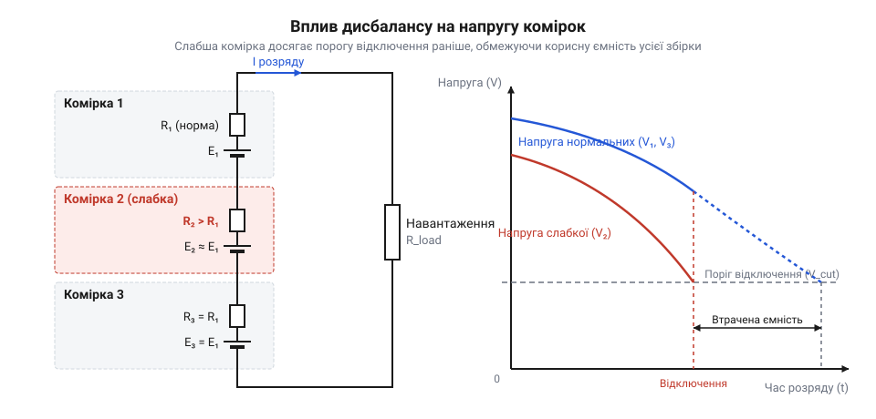

# Математична модель накопичення дисбалансу та внутрішнього опору комірок

<preknowlist>
- [Плата захисту 1S Li-Ion](root:cat-hw-power/pcb-1s-protection) — пороги спрацьовування за напругою для захисту від перенапруги та глибокого розряду
- [SkyRC iMAX B6 Mini — зарядний пристрій-балансир](root:cat-hw-power/imax-b6-charger) — принцип вимірювання внутрішнього опору та балансування послідовних комірок
</preknowlist>

## Передчасне відключення акумуляторної збірки під навантаженням

Живильна система портативного приладу раптово вимикається, хоча індикатор загальної напруги триелементної акумуляторної збірки (3S) показує 10.5 В — рівень, який відповідає приблизно 40% залишкової енергії. Спроба повторного увімкнення під навантаженням одразу призводить до повторного відсікання живлення. Усі елементи збірки з'єднані послідовно, тому через них протікає абсолютно однаковий струм розряду. Проте захисний ключ на @@en|MOSFET@@-транзисторах спрацьовує не за усередненим значенням напруги всієї батареї, а при просіданні напруги хоча б на одній окремій комірці нижче безпечного межевого порогу.

Під час розряду послідовного кола напруга на виводах довільної `i`-ї комірки `V_i` описується базовим співвідношенням:

```
V_i = OCV_i - I · R_i
```

де `OCV_i` — внутрішня напруга розімкненого кола (англ. @@en|OCV@@ — *Open Circuit Voltage*), яка залежить від поточного рівня заряду `SoC_i` (англ. @@en|SoC@@ — *State of Charge*), `I` — струм навантаження, а `R_i` — внутрішній послідовний опір (англ. @@en|ESR@@ — *Equivalent Series Resistance*).

Якщо всі комірки у збірці абсолютно ідентичні за ємністю `Q` та опором `R`, їхні напруги знижуються синхронно. Однак у реальних батареях завжди існує початковий розкид параметрів. Слабша комірка має менший запас ємності `Q_weak` та вищий опір `R_weak`. Під дією єдиного струму розряду `I` рівень заряду `SoC` слабкої комірки вичерпується швидше, що викликає стрімке падіння її `OCV_weak`. Одночасно з цим підвищений опір `R_weak` створює додаткове омічне падіння напруги `I · R_weak`.

У результаті саме слабка комірка першою досягає критичного порогу блокування за зниженої напруги (англ. @@en|UVLO@@ — *Under-Voltage Lockout*), який для літієвих елементів зазвичай становить від 2.5 В до 3.0 В. Керуючий контролер @@en|BMS@@ (англ. *Battery Management System* — система керування акумулятором) фіксує це просідання на своєму вимірювальному каналі та миттєво розмикає силовий ключ. Залишкова енергія в інших, більш міцних комірках збірки виявляється повністю заблокованою для споживача. Традиційна [одноканальна плата захисту](root:cat-hw-power/pcb-1s-protection) контролює лише один елемент, тоді як у багатоелементних системах без регулярного вирівнювання параметрів цей ефект стає головною причиною передчасного виходу обладнання з ладу. Для розуміння того, чому цей розкид неминуче збільшується з кожним днем експлуатації, необхідно дослідити фізичні механізми деградації всередині хімічних джерел струму.

## Фізика виникнення та накопичення розкиду параметрів

Навіть у межах однієї виробничої партії акумуляторні комірки @@en|Li-ion@@ та @@en|LiFePO4@@ виходять із заводу з технологічним допуском: відхилення за ємністю `C` зазвичай становить 1–3%, а розкид внутрішнього опору `ESR` досягає 5–10%. Ці початкові мікроскопічні відмінності в товщині активного шару електродів, порожнистості сепаратора та кількості електроліту створюють основу для подальшого автокаталітичного дисбалансу.

Основним каталізатором прискореного розходження параметрів є нерівномірний тепловий режим всередині батарейного блоку. Згідно із законом Джоуля-Ленца, потужність теплових втрат `P_heat` на внутрішньому опорі комірки прямо пропорційна величині цього опору:

```
P_heat = I² · R_i
```

Комірка з вищим початковим опором `R_i` під час проходження робочого струму `I` виділяє більше тепла. Крім того, елементи, розташовані в центрі акумуляторного блоку, мають гірші умови тепловідведення порівняно з периферійними комірками. Підвищення робочої температури всього на 10 °C прискорює швидкість побічних хімічних реакцій приблизно вдвічі.

Прискорене старіння гарячішої або слабшої комірки супроводжується двома основними деградаційними процесами:

1. **Розростання пасиваційного шару @@en|SEI@@** (англ. *Solid Electrolyte Interphase* — твердоелектролітна інтерфаза). На поверхні графітового анода постійно розкладається рідкий електроліт з утворенням плівки. Цей процес споживає вільні іони літію, незворотно зменшуючи корисну ємність `Q_i`. 2. **Зростання внутрішнього опору `R_i`**. Потовщення плівки @@en|SEI@@ та часткова деструкція кристалічної ґратки катода перешкоджають дифузії літію, збільшуючи омічний та завадовий опір елемента.

Утворюється замкнене порочне коло деградації:

```
Вищий R_i → Більший нагрів P_heat → Швидше розростання SEI → Втрата активного літію та зростання R_i
```

До додаткового прискорення деградації призводить відсутність контролю напруг окремих елементів під час заряджання. Коли збірка заряджається загальним струмом без балансування, комірка з меншою ємністю `Q_weak` насичується першою. Її напруга стрімко зростає до порогу блокування за перенапруги (англ. @@en|OVLO@@ — *Over-Voltage Lockout*), який становить 4.25–4.35 В для @@en|Li-ion@@. Регулярне перебування під високим потенціалом викликає окиснення електроліту на катоді та виділення газів. Натомість під час розряду ця ж комірка першою вичерпується і зазнає глибокого перерозряду. Постійне циклування в екстремальних точках напруги призводить до того, що стан здоров'я (англ. @@en|SoH@@ — *State of Health*) слабкої комірки падає у кілька разів швидше, ніж у сусідніх елементів.

## Математична модель еквівалентного кола деградації

Для кількісного аналізу процесів у послідовному акумуляторному блоці з `N` комірок застосовують математичну модель еквівалентного кола. Кожен елемент `i` представляють у вигляді послідовного з'єднання керованого джерела напруги розімкненого кола `OCV_i(Q_i)` та внутрішнього опору `R_i`.

Загальний струм розряду `I(t)` протікає через усі елементи, тому зміна вилученого заряду `q_i(t)` для кожної комірки описується диференціальним рівнянням:

```
dq_i / dt = I(t)
```

Інтегральний рівень заряду `SoC_i(t)` у довільний момент часу `t` визначається відношенням залишкового заряду до поточної максимальної ємності комірки `Q_i`:

```
SoC_i(t) = SoC_i(0) - (1 / Q_i) · ∫₀ᵗ I(τ) dτ
```

Напруга на клемах `i`-ї комірки під навантаженням `I(t)` становить:

```
V_i(t) = OCV_i(SoC_i(t)) - I(t) · R_i
```

Загальна напруга акумуляторного блоку `V_total(t)` є сумою напруг окремих елементів:

```
V_total(t) = ∑ᵢ₌₁ⁿ (OCV_i(SoC_i(t)) - I(t) · R_i)
= ∑ᵢ₌₁ⁿ OCV_i(SoC_i(t)) - I(t) · ∑ᵢ₌₁ⁿ R_i
```


*Еквівалентна схема послідовного кола комірок з різними параметрами C та ESR разом із часовими діаграмами просідання напруги до порога UVLO.*

Теплові втрати на внутрішній деградації описуються виразом для миттєвої потужності розсіювання `P_loss_i(t)` та сумарної виділеної енергії `E_loss_i`:

```
P_loss_i(t) = I(t)² · R_i
```

```
E_loss_i = R_i · ∫₀ᵗ I(τ)² dτ
```

Аналіз отриманої системи рівнянь показує важливу залежність: просідання клемної напруги `V_i` складається з двох незалежних компонентів — хімічного виснаження (зниження `OCV_i` через падіння `SoC_i`) та динамічного омічного падіння `I · R_i`. Якщо у збірці присутня комірка з параметрами `Q_weak < Q_nom` та `R_weak > R_nom`, швидкість падіння її клемної напруги `dV_weak / dt` стає значно вищою за відповідні значення для здорових елементів:

```
dV_i / dt = (d OCV_i / d SoC_i) · (d SoC_i / dt) - R_i · (d I / dt)
= - (1 / Q_i) · (d OCV_i / d SoC_i) · I(t) - R_i · (d I / dt)
```

Оскільки множник `1 / Q_weak` є більшим, а початковий опір `R_weak` вищим, графік напруги слабкої комірки на часовій діаграмі відхиляється донизу значно стрімкіше, перетинаючи поріг `V_UVLO` задовго до виснаження інших елементів.

## Обчислення втрати корисної ємності збірки

Практична корисна ємність послідовної збірки (англ. @@en|Usable Capacity@@) обмежена принципом найслабшого елемента. Оскільки струм розряду припиняється в момент спрацьовування захисту найгіршої комірки, вилучений з всієї батареї заряд `Q_avail` дорівнює заряду, який встигає віддати слабка комірка від її початкового стану `SoC_start_weak` до кінцевого `SoC_cutoff_weak`:

```
Q_avail = Q_weak · (SoC_start_weak - SoC_cutoff_weak)
```

Якщо початковий розкид рівня заряду між комірками становить `ΔSoC = SoC_max - SoC_min`, а розкид максимальної ємності дорівнює `ΔQ = Q_nom - Q_weak`, то підсумкове скорочення доступної ємності збірки `Capacity Loss %` відносно номіналу здорового елемента `Q_nom` розраховується за формулою:

```
Capacity Loss % = (1 - Q_avail / Q_nom) · 100%
```

Розглянемо покрокове обчислення на конкретному практичному прикладі триелементного батарейного блоку (3S @@en|Li-ion@@).

**Умова розрахунку:**
Номінальна ємність здорових комірок `Q₁ = Q₂ = 2.5 А·год`, опір `R₁ = R₂ = 20 мОм` (0.020 Ом). Деградована комірка 3 має ємність `Q₃ = 2.1 А·год`, опір `R₃ = 50 мОм` (0.050 Ом). Початковий стан заряду всіх комірок перед розрядом дорівнює 100% (`SoC(0) = 1.0`). Струм розряду постійний: `I = 5.0 А`. Поріг спрацьовування захисту від глибокого розряду `V_UVLO = 3.0 В`. Припустимо, що в точці розряду поріг `V_UVLO` досягається на комірці 3, коли її `OCV₃` під навантаженням падає до відповідного значення.

Покрокове обчислення критичного рівня `OCV₃` у момент відключення:

```
V₃ = OCV₃ - I · R₃
3.00 = OCV₃ - 5.0 · 0.050            [підстановка параметрів струму та опору]
3.00 = OCV₃ - 0.250                  [обчислення омічного падіння напруги]
OCV₃ = 3.25 В                        [визначення необхідного значення OCV]
```

Згідно з розрядними характеристиками @@en|Li-ion@@ хімії, напрузі `OCV = 3.25 В` відповідає залишковий рівень заряду `SoC_cutoff₃ = 0.08` (8%).

Обчислення фактично відданої ємності збірки `Q_avail`:

```
Q_avail = Q₃ · (SoC_start₃ - SoC_cutoff₃)
= 2.1 · (1.0 - 0.08)                [підстановка початкового та граничного SoC]
= 2.1 · 0.92                        [обчислення частки відданого заряду]
= 1.932 А·год                       [фактична корисна ємність збірки]
```

Розрахунок загальної втрати ємності батарейного блоку відносно номіналу (2.5 А·год):

```
Capacity Loss % = (1 - Q_avail / Q_nom) · 100%
= (1 - 1.932 / 2.500) · 100%       [відношення корисної ємності до номінальної]
= (1 - 0.7728) · 100%               [обчислення невикористаної частки]
= 22.72%                            [підсумковий відсоток втрати ємності]
```

Отже, хоча ємність окремої слабкої комірки впала на 16% (з 2.5 до 2.1 А·год), загальна корисна ємність всієї збірки через додаткове омічне просідання напруги під струмом 5 А скоротилася на 22.72%. Залишкова енергія в здорових комірках (які на момент відключення мали `SoC` близько 23%) залишається невикористаною.

## Прогнозування моментів спрацьовування захисту BMS

Щоб правильно проектувати джерела живлення та розраховувати час автономної роботи обладнання, необхідно вміти математично прогнозувати момент спрацьовування засобів захисту. Визначення часу до аварійного відключення `t_uvlo` під час розряду постійним струмом `I` зводиться до розв'язання рівняння граничного стану для найслабшого елемента:

```
V_weak(t_uvlo) = V_UVLO
```

Підставляючи вираз для клемної напруги через `OCV`, отримуємо рівність:

```
OCV_weak(SoC_weak(t_uvlo)) - I · R_weak = V_UVLO
```

Звідси значення внутрішньої напруги розімкненого кола, при якому відбудеться вимкнення:

```
OCV_weak(SoC_cutoff) = V_UVLO + I · R_weak
```

Це рівняння висвітлює критичну математичну залежність: чим вищий опір деградованого елемента `R_weak` та чим більший струм навантаження `I`, тим вищим має бути `OCV_weak` у момент відключення. Це означає, що відсікання відбудеться при значно вищому залишковому рівні заряду `SoC_cutoff`. Час роботи збірки до відключення `t_uvlo` (у годинах) визначається як:

```
t_uvlo = (Q_weak · (SoC_start_weak - SoC_cutoff)) / I
```

Аналогічна математична модель застосовується для визначення моменту передчасного припинення заряду (спрацьовування порогу перенапруги `V_OVLO`). Зарядний струм `I_ch` створює на внутрішньому опорі падіння напруги зі зворотним знаком, підвищуючи потенціал на клемах:

```
V_weak_charge = OCV_weak + I_ch · R_weak
```

Умова спрацьовування захисту за перенапругою має вигляд:

```
OCV_weak(SoC_charge_cutoff) = V_OVLO - I_ch · R_weak
```

Якщо опір комірки `R_weak` великий, значення `OCV_weak` під час відключення заряду буде суттєво нижчим за повноцінні 4.20 В. Зарядний пристрій або [контролерів балансування збірок](root:cat-hw-power/bms-multicell) через аварійний сигнал плати захисту припинять процес, коли комірка фактично накопичить лише 70–80% від своєї максимальної ємності.

Під час проектування живильних систем із проміжними зарядними модулями, такими як [модуля зарядки TP5100](root:cat-hw-power/tp5100-charger) або автономний [акумуляторного модуля Li-ion HAT](root:cat-hw-power/liion-hat-rpi), нехтування математичним прогнозуванням дисбалансу призводить до помилок розрахунку автономності. Використання [зарядного пристрою з балансиром](root:cat-hw-power/imax-b6-charger) або вбудованих [пасивних та активних балансирів](root:cat-hw-power/passive-vs-active-balancing) дозволяє періодично примусово вирівнювати значення `SoC_i` та перерозподіляти заряд між комірками, повертаючи корисну ємність збірки `Q_avail` до теоретично можливого максимуму.