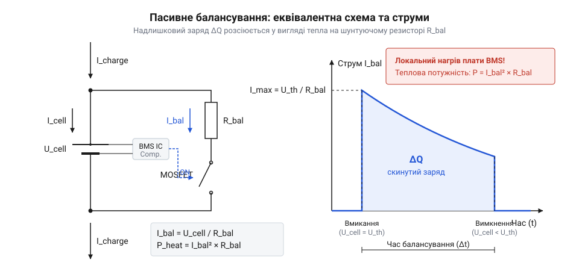

# Розрахунок струмів балансування та тепловиділення пасивних BMS

<preknowlist>
- [Багатоелементні плати BMS 2S-4S](root:cat-hw-power/bms-multicell) — загальний принцип побудови та моніторингу послідовних збірок акумуляторів
- [Пасивний проти активного балансира](root:cat-hw-power/passive-vs-active-balancing) — концептуальні відмінності між розсіюванням лишків заряду та їх перекачуванням
- [SkyRC iMAX B6 Mini — зарядний пристрій-балансир](root:cat-hw-power/imax-b6-charger) — практичні режими балансувального заряджання багатокомпонентних збірок
</preknowlist>

## Перезаряд окремих комірок під час заряджання

При розробці батарейних блоків із послідовним з'єднанням кількох літієвих елементів (наприклад, збірок 2S–4S у [багатоелементних платах BMS](root:cat-hw-power/bms-multicell)) інженери зіштовхуються з принциповим обмеженням: струм заряджання `I_charge` протікає через усі комірки послідовного кола абсолютно однаково. Проте внаслідок виробничих допусків, нерівномірного старіння та температурних градієнтів всередині корпусу реальні акумулятори мають відхилення номінальної ємності `ΔC` та внутрішнього опору `ESR`.

Коли джерело живлення подає зарядний струм у послідовний ланцюг, швидкість зростання напруги `ΔU` на кожному елементі за проміжок часу `t` визначається його фактичною ємністю `C`:

```
ΔU = (I_charge × t) ÷ C
```

Комірка з найменшою фактичною ємністю `C_min` накопичує заряд швидше за інші. У процесі заряджання за профілем сталого струму й сталої напруги (англ. @@en|CC/CV phase@@) ця «слабка» комірка першою досягає гранично припустимого порогу напруги `U_max = 4.20 В`. Якщо система моніторингу виявить перевищення безпечного порогу, аварійний контролер захисту (подібний до тих, що застосовуються в [одноканальних платах захисту](root:cat-hw-power/pcb-1s-protection)) розімкне силові транзистори й повністю зупинить процес заряджання всієї батареї.

У цей момент решта послідовних елементів з більшою ємністю залишаться недозарядженими, оскільки їхня напруга ще не сягнула 4.20 В (наприклад, становить лише 4.05 В–4.10 В). З кожним наступним циклом цей розрив у рівні заряду (англ. @@en|State of Charge@@, @@en|SoC@@) поглиблюється, викликаючи прискорену деградацію батарейного блоку та суттєве зменшення його корисної енергоємності.

**Обчислення недозаряду збірки 4S через розкид ємностей**

Розглянемо послідовний блок 4S із номінальним струмом заряджання `I_charge = 1.5 А`. Одна з комірок через деградацію має ємність `C₁ = 2.0 А·год` (7200 Кл), тоді як три інші зберегли `C₂ = C₃ = C₄ = 2.2 А·год` (7920 Кл). Початковий стан усіх елементів рівний — `SoC = 0%` (`U = 3.0 В`).

```
t_charge = C₁ ÷ I_charge
= 2.0 ÷ 1.5                      [час до повного заряду першої комірки]
≈ 1.333 години                   [80 хвилин]

Q_added = I_charge × t_charge
= 1.5 × 1.333                    [заряд, переданий у послідовне коло]
= 2.000 А·год                    [накопичений заряд у кожному елементі]

SoC₂ = Q_added ÷ C₂
= 2.000 ÷ 2.200                  [рівень заряду решти комірок]
≈ 0.909                          [90.9% від повної ємності]
```

При досягненні першою коміркою напруги 4.20 В процес заряджання зупиняється. Три інші комірки недоотримують по 0.200 А·год заряду (понад 9% своєї потенційної енергії), а підсумкова напруга збірки становить лише 16.35 В замість номінальних 16.80 В.

Щоб розв'язати цю проблему без зупинки заряджання, виникає фізична потреба в утворенні обхідного каналу — перенаправлення (англ. @@en|bypass@@, від *by* — поруч та *pass* — проходити) частини зарядного струму в обхід більш зарядженого елемента. Це дозволяє пригальмувати зростання напруги на лідуючій комірці й дати можливість решті елементів догнати її за рівнем заряду.

## Математична модель пасивного шунтування струму

Для реалізації перенаправлення заряду в платах @@en|BMS@@ застосовують пасивне вирівнювання. Принцип полягає в паралельному підключенні баластного резистора `R_bal` до комірки за допомогою керованого ключа на польовому транзисторі (англ. @@en|MOSFET@@). Коли напруга на комірці досягає заданого порогу активації `U_bal` (зазвичай 4.15–4.20 В), аналоговий чип фронтенду (англ. @@en|AFE@@) або мікроконтролер відкриває ключ, замикаючи шунтуюче коло.


*Еквівалентна електрична схема пасивного шунтування комірки та часова діаграма струму балансування.*

Миттєвий струм балансування `I_bal`, що протікає через шунт, розраховується за законом Ома з урахуванням опору відкритого каналу транзистора `R_ds(on)`:

```
I_bal = U_cell ÷ (R_bal + R_ds)
```

Оскільки опір відкритого транзистора `R_ds(on)` у сучасних силових ключах становить одиниці або десятки міліом (наприклад, 0.05–0.2 Ом), основним обмежувачем струму виступає опір баластного резистора `R_bal` (десятки Ом).

**Обчислення миттєвого струму шунтування**

Розрахуємо миттєвий балансувальний струм для комірки @@en|Li-ion@@ при напрузі `U_cell = 4.20 В`, якщо номінал балансувального резистора `R_bal = 47 Ом`, а опір відкритого ключа `R_ds = 0.1 Ом`:

```
R_total = R_bal + R_ds
= 47 + 0.1                       [сумарний опір шунтуючої гілки]
= 47.1 Ом                        [еквівалентний опір кола]

I_bal = U_cell ÷ R_total
= 4.20 ÷ 47.1                    [обчислення миттєвого струму за законом Ома]
≈ 0.0892 А                       [89.2 мА]
```

У багатьох інтелектуальних системах керування вимірювання напруги комірок проводиться циклічно. Під час вимірювання ключ балансування тимчасово закривається, щоб виключити спад напруги на внутрішньому опорі акумулятора. У такому разі балансування відбувається з широтно-імпульсною модуляцією (англ. @@en|PWM@@) з відносною тривалістю включення — коефіцієнтом заповнення `D` (англ. @@en|duty cycle@@).

Середній струм балансування `I_bal_avg` за період циклу `T` з урахуванням коефіцієнта заповнення `D` розраховується як:

```
I_bal_avg = D × I_bal
```

Якщо коефіцієнт заповнення становить `D = 0.85` (85% часу ключ відкрито, 15% виділено на вимірювання напруги), то середній струм дорівнює:

```
I_bal_avg = 0.85 × 0.0892
≈ 0.0758 А                       [75.8 мА]
```

Знання середнього струму шунтування є основою для подальшого обчислення часу, необхідного для повного усунення накопиченого дисбалансу ємності між елементами збірки.

## Розрахунок часу усунення дисбалансу ємності

Для повного вирівнювання заряду послідовної збірки пасивний балансир має розсіяти надлишок електричного заряду `ΔQ`, який накопичила більш ємна або менш саморозряджена комірка порівняно з найслабшою. Величина надлишкового заряду `ΔQ` вимірюється в ампер-динах (А·год) або кулонах (Кл) і визначається як різниця відносних рівнів заряду `ΔSoC`, помножена на номінальну ємність `C_nom`:

```
ΔQ = ΔSoC × C_nom
```

Час `t_bal`, необхідний для скидання цього надлишку через пасивний шунт із середнім струмом балансування `I_bal_avg`, розраховується за формулою:

```
t_bal = ΔQ ÷ I_bal_avg
= (ΔSoC × C_nom) ÷ I_bal_avg
```

**Розрахунок тривалості балансування для акумулятора 3S**

Нехай у збірці 3S з номінальною ємністю `C_nom = 2.5 А·год` одна з комірок має відхилення по заряду `ΔSoC = 4%` (`ΔQ = 0.100 А·год`). Пасивна плата @@en|BMS@@ забезпечує середній балансувальний струм `I_bal_avg = 60 мА` (0.060 А).

```
ΔQ = 0.04 × 2.5
= 0.100 А·год                    [накопичений надлишок заряду в ампер-годинах]
= 360 Кл                         [надлишок заряду у кулонах]

t_bal = ΔQ ÷ I_bal_avg
= 0.100 ÷ 0.060                  [обчислення часу балансування в годинах]
≈ 1.667 години                   [1 година 40 хвилин]
```

Як видно з розрахунку, навіть для незначного дисбалансу 4% у компактній збірці розсіювання вимагає понад 1.5 години безперервної роботи шунта. Якщо ж розкид ємності сягає `ΔQ = 0.5 А·год`, а струм балансування обмежений значенням 50 мА, тривалість вирівнювання зросте до:

```
t_bal = 0.500 ÷ 0.050
= 10.0 годин                     [необхідний час пасивного шунтування]
```

Оскільки пасивне вирівнювання зазвичай активується лише у фазі сталої напруги (англ. @@en|CV phase@@) наприкінці заряджання, тривалість якої у звичайних зарядних пристроях обмежується 30–60 хвилинами, малопотужний пасивний балансир просто не встигає усунути великий дисбаланс за один цикл. Для ретельного вирівнювання великих збірок доводиться використовувати спеціалізовані зовнішні пристрої, як-от [зарядний пристрій SkyRC iMAX B6](root:cat-hw-power/imax-b6-charger), або залишати батарею підключеною до слабострумового буферного зарядного пристрою на тривалий час.

## Тепловиділення та вибір потужності резисторів

Весь надлишковий електричний заряд, який шунтується пасивним балансиром, перетворюється на теплову енергію (джоулеве нагрівання, англ. @@en|Joule heating@@). Теплова потужність `P_th`, яка розсіюється на баластному резисторі `R_bal` під час проходження балансувального струму `I_bal`, розраховується за законом Джоуля-Ленца:

```
P_th = I_bal² × R_bal
= U_cell² ÷ R_bal
```

Для забезпечення долговічності та запобігання виходу з ладу елементів на друкованій платі (англ. @@en|PCB@@) номінальна допустима потужність резистора `P_res_rated` повинна обиратися з урахуванням коефіцієнта запасу потужності — дерейтингу (англ. @@en|derating@@, від *de-* — зниження та *rate* — номінал). Коефіцієнт запасу `k_safe` зазвичай беруть у межах 1.5–2.0, щоб резистор не працював на граничній межі свого теплового пакета:

```
P_res_rated ≥ k_safe × P_th
```

Компоненти поверхневого монтажу (англ. @@en|SMD@@) мають чітко визначені границі розсіюваної потужності залежно від стандартного типорозміру корпуса:
- Корпус `0805`: `P_max = 0.125 Вт` (125 мВт)
- Корпус `1206`: `P_max = 0.250 Вт` (250 мВт)
- Корпус `2010`: `P_max = 0.500 Вт` (500 мВт)
- Корпус `2512`: `P_max = 1.000 Вт` (1000 мВт)

**Розрахунок теплової потужності та вибір типорозміру SMD-резисторів**

Нехай у платі @@en|BMS@@ необхідно забезпечити струм балансування `I_bal = 100 мА` (0.100 А) при напрузі комірки `U_cell = 4.20 В`.

```
R_bal = U_cell ÷ I_bal
= 4.20 ÷ 0.100                   [необхідний опір баластного резистора]
= 42 Ом                          [найближчий стандартний номінал 43 Ом]

P_th = U_cell × I_bal
= 4.20 × 0.100                   [теплова потужність на шунті]
= 0.420 Вт                       [420 мВт]

P_res_rated = 1.5 × 0.420        [урахування коефіцієнта дерейтингу 1.5]
= 0.630 Вт                       [630 мВт]
```

Потужність розсіювання 420 мВт перевищує допустимий ліміт корпусу `1206` (250 мВт). Якщо встановити поодинокий резистор `1206`, він миттєво розігріється до температури понад 120 °C і депаяється або згорить. 

Для надійного розсіювання цієї потужності інженери застосовують два підходи:
1. Використання великого поодинокого резистора типорозміру `2512` з номіналом 43 Ом (допустима потужність 1.0 Вт, що перекриває розраховані 630 мВт). 2. Паралельне з'єднання двох менших резисторів типорозміру `1206` з подвоєним опором по 86 Ом кожен (еквівалентний опір 43 Ом). При цьому струм і теплова потужність діляться поровну — по 210 мВт на кожен резистор `1206`, що вкладається в їхній нормальний робочий режим.

Подібні розрахунки тепловиділення є критично важливими при розробці компактних плат живлення, таких як [модуль Li-ion HAT](root:cat-hw-power/liion-hat-rpi) або [плата живлення Waveshare](root:cat-hw-power/power-hat-family).

## Тепловий режим та обмеження пасивного вирівнювання

Головним недоліком пасивного вирівнювання є низький коефіцієнт корисної дії (ККД): 100% енергії, знятої з перезарядженої комірки, невідворотно перетворюється на тепло. Коли в батарейному блоці 4S активується пасивна плата @@en|BMS@@ і шунтування починається одночасно на кількох каналах, локальне тепловиділення на друкованій платі стрімко зростає.

Загальна теплова потужність `P_total`, яка виділяється на платі @@en|BMS@@ з кількістю активних каналів `N`, обчислюється як сума потужностей окремих шунтів:

```
P_total = N × P_th
```

Збільшення температури друкованої плати `ΔT` над температурою навколишнього середовища `T_amb` залежить від сумарного теплового опору «плата–довкілля» `R_th_ja` (вимірюється в °C/Вт або K/Вт):

```
ΔT = P_total × R_th_ja
T_board = T_amb + ΔT
```

Для стандартних двошарових плашок @@en|BMS@@ без масивних радіаторів тепловий опір `R_th_ja` становить близько 50–70 °C/Вт.

**Оцінка температурного нагріву плати BMS 4S**

Обчислимо нагрів компактної плати @@en|BMS@@ для збірки 4S при одночасному пасивному балансуванні чотирьох каналів зі струмом `I_bal = 100 мА` (`P_th = 0.42 Вт` на канал) за температури довкілля `T_amb = 25 °C` та теплового опору плати `R_th_ja = 60 °C/Вт`:

```
P_total = 4 × 0.42
= 1.68 Вт                        [сумарна розсіювана теплова потужність]

ΔT = 1.68 × 60
= 100.8 °C                       [температурний підйом плати]

T_board = 25 + 100.8
= 125.8 °C                       [підсумкова температура друкованої плати]
```

Температура плати понад 125 °C є критичною: вона спричиняє деградацію пайкувального припою, прискорене термостаріння силових транзисторів та нагрівання самих акумуляторних комірок, розташованих поруч.

Для захисту від термічного руйнування сучасні плати @@en|BMS@@ оснащують датчиками температури на основі терморезисторів із негативним температурним коефіцієнтом (англ. @@en|NTC thermistor@@). При досягненні платою порогової температури (зазвичай 60–70 °C) мікроконтролер реалізує термічне обмеження струму — термотротлінг (англ. @@en|thermal throttling@@), відключаючи ключі балансування до охолодження плати. Це додатково знижує реальний середній струм вирівнювання й збільшує підсумковий час процесу.

Через ці теплові обмеження пасивне балансування застосовують переважно для акумуляторів малої та середньої ємності (до 10–20 А·год), де струму шунтування 50–100 мА достатньо для компенсації природного саморозряду та невеликого розкиду параметрів. Для потужних батарейних блоків електротранспорту та систем накопичення енергії, де розбаланс може становити одиниці ампер-годин, пасивний опір виявляється непридатним, що змушує переходити на [пасивне й активне балансування](root:cat-hw-power/passive-vs-active-balancing) із перекачуванням енергії через індуктивні чи ємнісні перетворювачі.