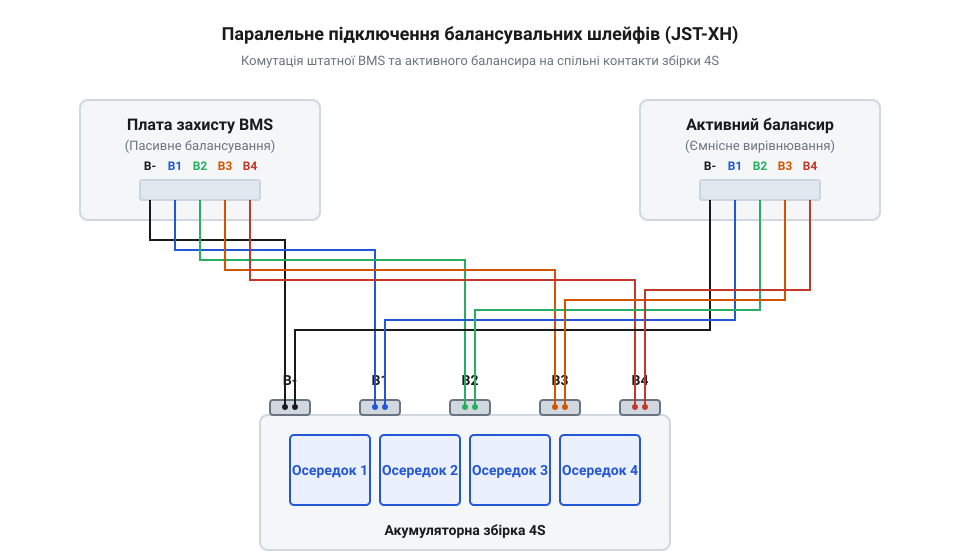
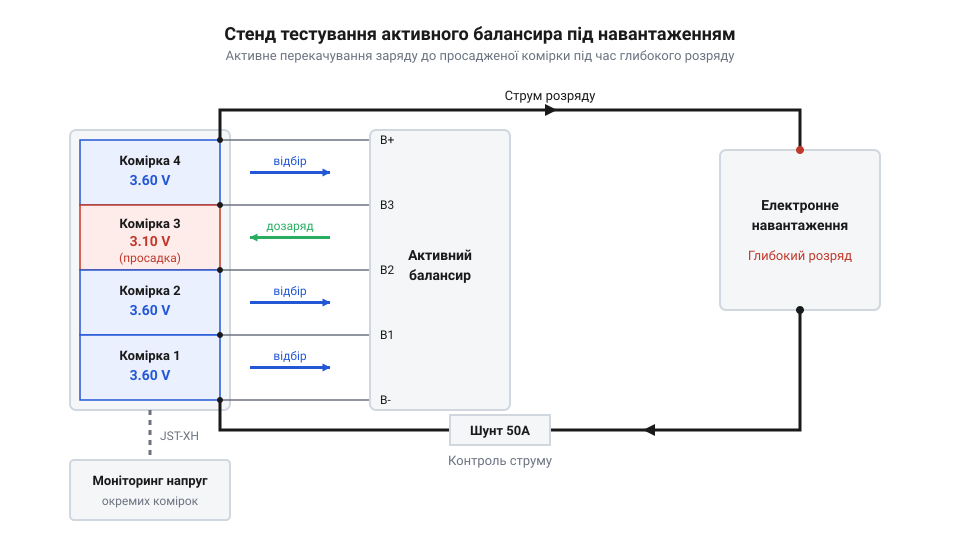

# Інтеграція модульного активного балансира у діючу збірку 3S/4S

<preknowlist>
- [SkyRC iMAX B6 Mini — зарядний пристрій-балансир](root:cat-hw-power/imax-b6-charger) — принципи контролю напруг поодиноких елементів у багатокомірних збірках та параметри безпечного балансувального струму.
- [Плата захисту 1S Li-Ion](root:cat-hw-power/pcb-1s-protection) — алгоритми спрацьовування ключових транзисторів при перепідйомі або просіданні напруги комірки нижче критичного порогу.
</preknowlist>

## Обмеження пасивного вирівнювання акумуляторних осередків

Під час експлуатації акумуляторних блоків конфігурацій @@en|3S@@ та @@en|4S@@ на основі елементів @@en|Li-ion@@ користувачі часто стикаються із передчасним вимкненням живлення під струмовим навантаженням. Навіть у новій акумуляторній збірці окремі осередки мають незначні розбіжності у хімічному складі, що виражається у відхиленні ємності та внутрішнього опору @@en|ESR@@ (від англ. *@@en|Equivalent Series Resistance@@* — еквівалентний послідовний опір). Коли блок живить потужне навантаження, осередок із найменшою ємністю або вищим опором розряджається швидше за інші. У певний момент напруга на цьому слабкому елементі просідає до нижнього критичного порогу (наприклад, 2.8 В), хоча сусідні комірки ще містять значний залишок заряду (скажімо, 3.55 В та 3.60 В). У цей момент штатну [плату BMS](root:cat-hw-power/bms-multicell) (від англ. *@@en|Battery Management System@@* — система керування батареєю) аварійно розмикають силові ключі @@en|MOSFET@@ (від англ. *@@en|Metal-Oxide-Semiconductor Field-Effect Transistor@@* — польовий транзистор зі структурою метал-оксид-напівпровідник), повністю блокуючи віддачу струму у навантаження. Збірка зупиняє роботу, хоча її загальний енергетичний потенціал вичерпано лише частково.

Класичне вирішення цієї проблеми покладається на пасивне балансування, яке вбудовано у більшість стандартних плашок захисту. Принцип пасивного вирівнювання полягає у шунтуванні комірок, напруга яких під час заряджання досягає верхньої межі (зазвичай 4.18 В–4.20 В). Ключ пасивного балансира вмикає паралельно комірці розрядний резистор, який перетворює надлишковий струм заряду на теплову енергію. Проте цей метод має кілька критичних обмежень, які унеможливлюють ефективну роботу у динамічних режимах:

1. **Мізерний струм балансування.** Більшість пасивних плашок оперують струмами від 35 мА до 50 мА. Якщо розбіжність ємності між комірками у блоці ємністю 3000 мА·год становить хоча б 10% (300 мА·год), пасивному розрядникові знадобиться понад 6 годин безперервної роботи наприкінці заряду лише для вирівнювання цієї дельти. 2. **Пасивність під час розряду.** Пасивний шунт працює виключно на завершальному етапі заряджання акумулятора. Під час розряду під навантаженням струмом 5 А чи 10 А пасивні резистори повністю знеструмлені й ніяк не допомагають слабкому осередку, що стрімко просідає. 3. **Тепловий перегрів.** Вся надлишкова енергія розсіюється у вигляді тепла всередині замкненого корпусу акумуляторного блоку. Потужність, що виділяється на шунтах, обчислюється за базовим законом Джоуля-Ленца:

```
P_heat = I_bal × U_cell
= 0.050 × 4.20    [струм 50 мА при напрузі 4.20 В]
= 0.21 Вт         [теплова потужність на один осередок]
```

При щільному компонуванні збірки цей розігрів прискорює деградацію електроліту сусідніх комірок, ще більше посилюючи розбаланс.

У результаті пасивний метод виявляється безсилими проти динамічного дрейфу напруг під струмовим навантаженням. Щоб повністю використати корисну ємність усіх елементів збірки та запобігти передчасному відключенню, необхідний механізм, здатний не знищувати енергію на тепло, а безперервно перерозподіляти її від більш заряджених комірок до просаджених безпосередньо у процесі розряду.

## Принцип роботи активного ємнісного балансира

Для подолання обмежень резистивного вирівнювання застосовують активну топологію на основі керованих ємнісних накопичувачів, відому як @@en|flying capacitor@@ (від англ. *@@en|flying capacitor@@* — «літаючий» або перемикальний конденсатор). На відміну від пасивного шунтування, де надлишок заряду безповоротно розсіюється у вигляді тепла, активний ємнісний модуль працює за принципом безпосереднього перекачування електричного заряду з комірки з вищою напругою у сусідню комірку з нижчою напругою.

Схемотехніка ємнісного балансира складається з матриці польових транзисторів та керамічних конденсаторів високої ємності з низьким послідовним опором. Силові ключі працюють під керуванням високочастотного контролера @@en|PWM@@ (від англ. *@@en|Pulse-Width Modulation@@* — широтно-імпульсна модуляція) з частотою перемикання від 100 кГц до 1 МГц. Процес перекачування заряду між двома сусідніми осередками складається з двох послідовних фаз:

1. **Фаза накопичення (заряд конденсатора):** Транзисторні ключі підключають накопичувальний конденсатор `C_sw` паралельно до комірки `N`, яка має вищий потенціал `U_N`. Конденсатор миттєво заряджається до напруги цієї комірки, накопичуючи заряд `Q = C_sw × U_N`. 2. **Фаза передачі (розряд конденсатора):** Ключі розмикають зв'язок з коміркою `N` та перемикають цей же конденсатор паралельно до сусідньої комірки `N+1`, на якій напруга є нижчою (`U_{N+1}`). Оскільки напруга на конденсаторі вища за напругу комірки `N+1`, електричний заряд `ΔQ` перетікає з конденсатора в просаджений осередок:

```
ΔQ = C_sw × (U_N - U_{N+1})
= C_sw × ΔU             [переданий заряд за один цикл перемикання]
```

Оскільки цикл перемикання повторюється сотні тисяч разів на секунду, усереднений вирівнювальний струм перекачування `I_bal` пропорційний ємності конденсатора, частоті комутації `f_sw` та міжкомірковій різниці напруг `ΔU`:

```
I_bal ≈ C_sw × f_sw × ΔU
```

З цієї залежності видно головну фізичну особливість ємнісного балансира: струм вирівнювання пропорційний величині дисбалансу `ΔU`. При суттєвому розбалансі (наприклад, `ΔU = 0.1 В`–`0.2 В`) струм перекачування досягає 0.8 А–1.2 А, що у 20 разів перевищує можливості пасивних @@en|BMS@@. У міру того, як напруги осередків зрівнюються (`ΔU → 0`), струм самочинно зменшується до мікроамперних значений.

Головні переваги активного ємнісного балансира над пасивним шунтом висвітлюються у порівнянні [активним й пасивним балансуванням](root:cat-hw-power/passive-vs-active-balancing):
- **Високий коефіцієнт корисної дії (ККД > 95%):** Енергія не перетворюється на тепло, а передається між комірками із мінімальними втратами на опорі каналів ключових транзисторів. - **Неперервність роботи:** Модуль працює динамічно у всіх режимах — під час заряджання, при глибокому розряді під високим навантаженням та у стані спокою. - **Динамічний самобаланс:** Пристрій не потребує зовнішнього мікроконтролерного керування; фізика перетікання заряду автоматично спрямовує струм від більш зарядженого осередку до найбільш виснаженого.

Завдяки цьому активний балансир підтримує міжкоміркову різницю напруг на рівні менше 5 мВ–10 мВ безпосередньо під час розряду збірки, запобігаючи достроковому спрацьовуванню захисту @@en|BMS@@.

## Схема паралельної комутації двох шлейфів

Для практичної реалізації процедури @@en|retrofit@@ (від англ. *@@en|retrofit@@* — модернізація або доопрацювання існуючої системи) активний ємнісний модуль підключається паралельно до штатної плати захисту. При цьому плата @@en|BMS@@ зберігає за собою функції силового контролю та аварійного відсікання живлення при коротких замиканнях чи критичних виходах напруги за безпечні межі, тоді як активний балансир бере на себе завдання швидкого перекачування струму між осередками.

Обидва пристрої використовують для контролю потенціалів окремих елементів стандартизовані балансувальні роз'єми @@en|JST-XH@@ (від назви виробника *@@en|Japan Solderless Terminal@@*) із кроком виводів 2.54 мм. Щоб уникнути громіздкого дублювання провідників безпосередньо на платах, вимірювальні шлейфи двох модулів об'єднуються у паралельний розгалужений джгут.


*Підпис: Схема паралельної комутації сигнальних провідників пасивної BMS та активного балансира на спільні контактні площадки акумулятора через роз'єми JST-XH.*

На принциповій схемі вимірювальні провідники штатної @@en|BMS@@ та активного балансира з'єднуються паралельно на контактних майданчиках осередків збірки. Для конфігурацій @@en|3S@@ застосовується 4-контактний роз'єм @@en|JST-XH@@, а для @@en|4S@@ — 5-контактний. Призначення ліній шлейфа є наступним:
- **`B-` (чорний дріт):** Підключається до загального мінусового виводу першої комірки (0 В). - **`B1` (перший кольоровий дріт):** Точка з'єднання плюса першої та мінуса другої комірки (3.7 В для Li-ion). - **`B2` (другий кольоровий дріт):** Точка з'єднання плюса другої та мінуса третьої комірки (7.4 В). - **`B3` (третій кольоровий дріт):** Позитивний вивід третьої комірки для @@en|3S@@ (11.1 В) або точка з'єднання третьої й четвертої комірки для @@en|4S@@. - **`B4` (четвертий кольоровий дріт):** Позитивний вивід четвертої комірки для конфігурації @@en|4S@@ (14.8 В).

Під час монтажу паралельного шлейфа на [багатоелементних платах BMS](root:cat-hw-power/bms-multicell) необхідно суворо дотримуватися послідовності пайки та запобіжних заходів:

1. **Відключення роз'ємів.** Перед паянням обидва роз'єми @@en|JST-XH@@ мають бути обов'язково витягнуті з гнізд @@en|BMS@@ та активного балансира. Заборонено паяти провідники під напругою, коли шлейф підключено до плати. 2. **Послідовне паяння провідників.** Пайку балансувальних жил до акумуляторних осередків здійснюють послідовно, починаючи від найнижчого потенціалу `B-`, рухаючись угору до `B1`, `B2`, `B3` та `B4`. Це знижує ризик випадкового короткого замикання інструментом. 3. **Ізоляція точок розгалуження.** У місцях паралельної скрутки та пайки дротів штатного шлейфа з дротами активного балансира кожне з'єднання ізолюють термоусаджувальною трубкою. 4. **Контрольна перевірка мультиметром.** Перед першим вставлянням шлейфів у модулі береться @@en|multimeter@@ у режимі вимірювання постійної напруги. Відносно контакту `B-` послідовно вимірюють напруги на кожному щупі роз'єму. Для справної збірки @@en|4S@@ потенціали мають наростати строго кроками: 3.7 В, 7.4 В, 11.1 В, 14.8 В.

Будь-яка помилка в черговості дротів або переполюсовка приведе до миттєвого виходу з ладу транзисторних матриць активного балансира чи вимірювальних входів @@en|BMS@@. Тільки після інструментального підтвердження правильності напруг роз'єми підключають до електронних плат.

## Монтаж та інтеграція балансира в збірку

Після виготовлення та підготовки паралельного балансувального шлейфа з роз'ємами @@en|JST-XH@@ постає завдання фізичного монтажу активного модуля всередину акумуляторного блоку. Конструкція активного ємнісного балансира містить відкриті керамічні конденсатори, силові ключі та струмопровідні доріжки, розташовані на компактній друкованій платі. У щільному корпусі акумуляторної збірки конфігурацій @@en|3S@@ або @@en|4S@@ будь-який випадковий контакт цих елементів із металевими гільзами комірок @@en|Li-ion@@ або силовими шинами призведе до миттєвого короткого замикання.

Для забезпечення надійної електричної та теплової ізоляції плату балансира повністю обгортають термостійким поліімідним скотчем @@en|Kapton@@ (від назви торгової марки *@@en|Kapton@@* — поліімідна ізоляційна плівка) або поміщають у прозору термоусаджувальну трубку (від англ. *@@en|heat shrink@@* — термоусаджуваний рукав). Застосування плівки @@en|Kapton@@ є переважним у порівнянні зі звичайним вініловим ізолентом, оскільки поліімід зберігає діелектричну міцність при температурах понад 200 °C і не проплавляється при можливому нагріванні ключів плати під час тривалого перекачування струму.

Під час вибору місця для встановлення балансира всередині корпусу необхідно враховувати фактор електромагнітних та теплових наведень. Схемотехніка ємнісного балансира оперує високочастотними перемиканнями ключів у топології @@en|flying capacitor@@ на частотах @@en|PWM@@ у сотні кілогерц. Якщо розмістити активний модуль безпосередньо над вимірювальними колами штатної плати захисту @@en|BMS@@, високочастотні імпульси струму можуть викликати хибні спрацьовування аналогових компараторів захисту від перевантаження за струмом.

Для запобігання взаємним наведенням та стабільної роботи систем дотримуються трьох правил компонування:

1. **Просторове рознесення плат.** Активний модуль закріплюють на максимально можливій відстані від аналогової частини та силових ключів @@en|MOSFET@@ штатної плати захисту, використовуючи двосторонній спінений скотч або силіконові демпфери. 2. **Трасування балансувального шлейфа.** Дроти вирівнювального шлейфа прокладають уздовж стінок корпусу подалі від силових кабелів розряду. Якщо перетин шлейфа із силовими шинами неминучий, провідники орієнтують строго під кутом 90°, що мінімізує індуктивну наводку. 3. **Тепловий розрив.** Балансир не повинен притискатися до елементів, що сильно нагріваються, таких як пасивні балансувальні резистори @@en|BMS@@ або струмовий вимірювальний шунт (від англ. *@@en|shunt@@* — вимірювальний відгалужувач струму). Нагрівання керамічних конденсаторів понад 65 °C зменшує їхню діелектричну проникність, що знижує ефективність перекачування заряду.

На відміну від спрощених систем захисту, які застосовуються в [однокоміркових платах захисту](root:cat-hw-power/pcb-1s-protection), багатокоміркові збірки вимагають ретельного контролю потенціалів усіх точок комутації. Після завершення механічного закріплення модулів виконують контрольний огляд: перевіряють відсутність натягу дротів роз'ємів @@en|JST-XH@@ та вимірюють опір ізоляції між платою балансира та мінусовою силовою шиною за допомогою @@en|multimeter@@ у режимі мегаомметра. Наявність найменшого витоку свідчить про пошкодження ізоляції та потребує негайного усунення.

## Тестування перекачування заряду під навантаженням

Після завершення монтажних робіт та ізоляції активного модуля акумуляторний блок готовий для проведення інструментальних випробувань. Головна мета тестування полягає у підтвердженні здатності ємнісного балансира утримувати міжкомірковий дрейф напруг у безпечних межах безпосередньо під час глибокого розряду збірки високим струмом.

Для проведения випробувань збирається експериментальний стенд, схема якого показана нижче.


*Схема випробувального стенда для оцінки ефективності активного вирівнювання напруг акумуляторних комірок під час глибокого розряду.*

До силових виходів акумуляторної батареї конфігурації @@en|4S@@ (або @@en|3S@@) підключається кероване електронне навантаження через послідовний вимірювальний @@en|shunt@@. Контроль напруги кожної з чотирьох комірок здійснюється за допомогою мультиметра @@en|multimeter@@ або багатоканального логера напруг, підключеного до вільного вимірювального роз'єму @@en|JST-XH@@.

Методика перевірки ефективності вирівнювання складається з трьох послідовних етапів:

1. **Замір у стані спокою (100% @@en|SoC@@):** Батарею повністю заряджають. Перед початком розряду вимірюють напруги на кожній комірці. Для справної збірки з активним балансиром різниця напруг між найменш і найбільш зарядженими елементами не перевищує ΔU ≤ 5 мВ (наприклад, комірки мають напруги 4.195 В, 4.198 В, 4.200 В, 4.197 В). 2. **Розряд під стабільним навантаженням:** На електронному навантаженні встановлюють струм, що відповідає робочому режиму збірки (наприклад, 1C або 5 А–10 А). У процесі розряду кожні 5 хвилин фіксують напругу на кожній комірці та обчислюють поточний міжкомірковий дрейф ΔU = U_max - U_min. 3. **Аналіз поведінки біля точки відсікання:** Коли ступінь зарядженості (від англ. *@@en|State of Charge@@* — @@en|SoC@@) досягає 10–15%, слабша комірка з вищим опором @@en|ESR@@ починає стрімко втрачати напругу. У цей момент міжкоміркова різниця ΔU зростає до 80–120 мВ.

У класичній збірці без активного балансира таке просідання слабкого елемента до 2.80 В при середній напрузі інших елементів 3.40 В викликає миттєве аварійне розмикання силових ключів @@en|MOSFET@@ штатної плати @@en|BMS@@. Проте при наявності активного ємнісного модуля стрімке зростання ΔU викликає пропорційне збільшення вирівнювального струму перекачування:

```
I_bal ≈ C_sw × f_sw × ΔU
= 47 × 10⁻⁶ × 1000000 × 0.10    [при ємності 47 мкФ, частоті 1 МГц та ΔU = 0.1 В]
≈ 4.7 А                         [теоретична пікова межа перекачування]
```

На практиці через реальний опір каналів транзисторів вирівнювальний струм досягає 0.9 А–1.2 А. Цей струм безперервно перекачує енергію від більш заряджених комірок у слабкий осередок, сповільнюючи його просідання й утримуючи напругу вище порогу аварійного відсікання.

Для точної оцінки приросту корисної ємності після процедури @@en|retrofit@@ проводять контрольний цикл повного заряду й розряду за допомогою [зарядного пристрою iMAX B6](root:cat-hw-power/imax-b6-charger). Вимірювальні результати порівняльного тестування наведено нижче:

- **Збірка лише зі штатною пасивною BMS:** Аварійне відключення відбувається при віддачі 2450 мА·год (слабка комірка просіла до 2.80 В, хоча решта залишалися на рівні 3.35 В). Корисне використання ємності становить лише 81.6% від номіналу 3000 мА·год. - **Модернізована збірка з активним балансиром:** Віддана ємність становить 2910 мА·год (усі чотири комірки досягають порогу 2.85 В практично одночасно з відхиленням у межах 15 мВ). Корисне використання ємності досягає 97.0%.

Таким чином, інтеграція модульного активного балансира дозволяє повністю компенсувати міжкомірковий дрейф напруг під навантаженням, забезпечуючи реальний приріст доступної ємності акумуляторного блоку на 15–20% та продовжуючи термін його ефективної служби.