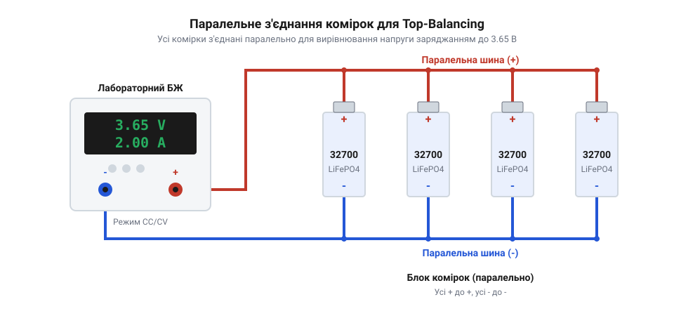
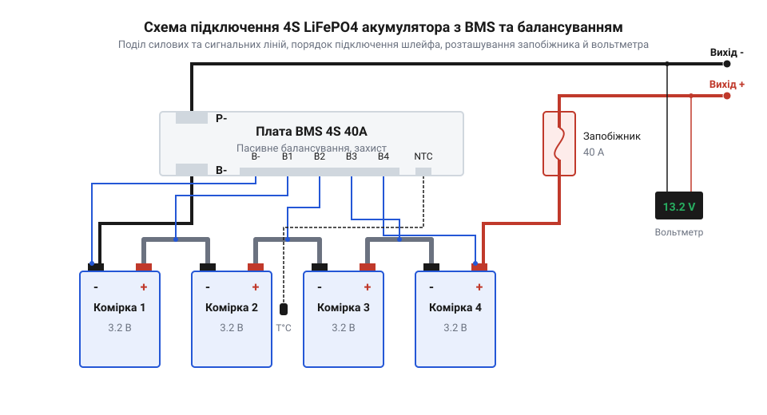
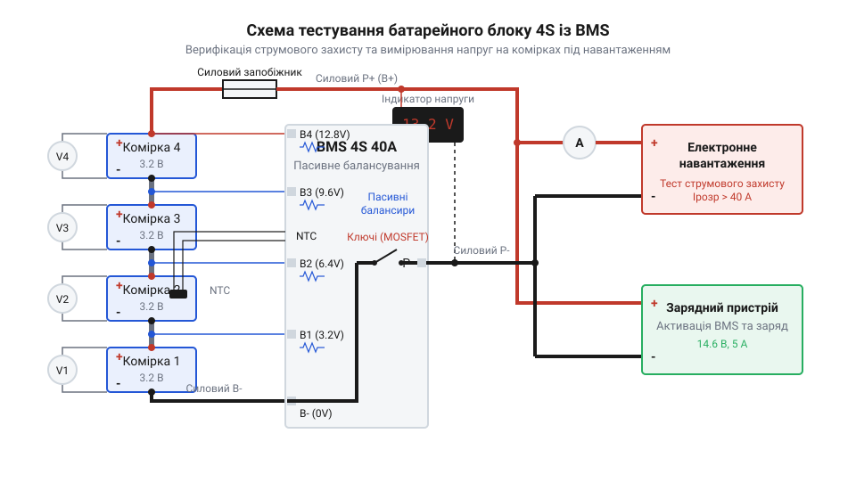

# Збірка та налагодження акумуляторного блоку 4S LiFePO4 з платою BMS та індикацією

<preknowlist>
- [SkyRC iMAX B6 Mini](root:cat-hw-power/imax-b6-charger) — принципи моніторингу напруги окремих каналів та процедура балансування багатоелементних батарей
- [Плата захисту 1S Li-Ion](root:cat-hw-power/pcb-1s-protection) — призначення та алгоритми спрацьовавання базових ключів захисту від перевантаження та замикання
</preknowlist>

## Чому послідовне з'єднання комірок небезпечне

Акумуляторна комірка @@en|LiFePO4@@ (від англійського @@en|Lithium Iron Phosphate@@ — літій-залізо-фосфат) типорозміру @@en|32700@@ має номінальну напругу 3.2 В. Робочий діапазон становить від 2.0–2.5 В (повний розряд) до 3.65 В (повний заряд). Для створення батарейного блока з робочою напругою 12.8 В чотири елементи з'єднують послідовно у конфігурацію @@en|4S@@ (від англійського @@en|4 Series@@ — чотири послідовні елементи). Підсумкова максимальна напруга заряду становить:

```
U_max = 4 × 3.65 В
      = 14.6 В
```

Пряме послідовне з'єднання без контролю кожного елемента є небезпечним через технологічний розкид параметрів. Навіть комірки з однієї партії відрізняються ємністю, саморозрядом та внутрішнім опором @@en|ESR@@ (від англійського @@en|Equivalent Series Resistance@@ — еквівалентний послідовний опір). Під час проходження однакового зарядного струму напруга на комірці з найменшою ємністю або найвищим опором зростає найшвидше.

Звичайний зарядний пристрій контролює лише сумарну напругу на клемах збірки. Коли загальний потенціал досягає 14.6 В, прилад вимикає струм. Однак через розбаланс напруг (@@en|cell imbalance@@) три комірки можуть недозарядитися до 3.50 В, тоді як четверта перевищить критичний поріг 3.85 В (наприклад, 4.10 В). Це спричиняє розклад електроліту, газоутворення та здуття елемента.

Під час розряду відбувається зворотний деструктивний процес: за загальної безпечної напруги 10.0 В слабка комірка глибоко розряджається нижче 1.5 В або зазнає переполюсовки, що призводить до мікрокоротких замикань.

Одноканальна [плата захисту 1S Li-Ion](root:cat-hw-power/pcb-1s-protection) не здатна контролювати міжланцюгові точки. Для безпечної роботи необхідні спеціалізовані [плати BMS 2S-4S](root:cat-hw-power/bms-multicell) (від англійського @@en|Battery Management System@@ — система керування акумуляторними батареями). Система @@en|BMS@@ моніторить кожен елемент окремо та вимикає силовий ланцюг у разі виходу напруги за безпечні межі.

## Підготовка та вирівнювання напруги комірок

Перед зварюванням блоку @@en|4S@@ комірки @@en|32700@@ сортують та вирівнюють за напругою (процедура @@en|top-balancing@@), оскільки пасивні балансири @@en|BMS@@ на 30–50 мА не усунуть великий початковий дисбаланс. Вимірюють напругу розімкненого кола @@en|OCV@@ (від англ. @@en|Open Circuit Voltage@@) та внутрішній опір @@en|ESR@@ (міліометром на 1 кГц). Відбирають елементи з розкидом @@en|ESR@@ до 0.5–1.0 мОм (при нормі 6.0–9.0 мОм) і близьким @@en|OCV@@.

Через плоску криву @@en|LiFePO4@@ при 3.20–3.25 В рівень заряду @@en|SoC@@ (від англ. @@en|State of Charge@@) різниться навіть при однаковій напрузі. Тому вирівнювання виконують на ділянці понад 3.50 В:


*Схема ілюструє паралельну комутацію одноіменних полюсів чотирьох елементів 32700 та підключення лабораторного джерела живлення для безпечного дозаряду й вирівнювання потенціалів.*

1. **Індивідуальний заряд.** Комірки заряджають поштучно до 3.60 В [пристроєм SkyRC iMAX B6](root:cat-hw-power/imax-b6-charger). 2. **Паралельне з'єднання.** Елементи об'єднують паралельно одноіменними полюсами. 3. **Дозаряд.** Подають 3.65 В (струм 2.0–3.0 А) до спаду споживання нижче 50 мА. 4. **Релаксація.** Збірку витримують 12–24 години.

Зрівнювальний струм між паралельними комірками визначається за законом Ома:

```
I_bal = (U1 - U2) / (R1 + R2)
```

Через малий опір `R1` і `R2` різниця `U1 - U2` у 0.2 В створює струм `I_bal` у десятки ампер, що здатне розплавити провідники. Попередній заряд усуває цей ризик. Готова збірка має розкид напруг між комірками не більше 1–2 мВ.

## Зварювання силового каркаса з комірок

Чотири елементи @@en|32700@@ фіксують у пластикових тримачах (@@en|cell holders@@). Пряме з'єднання комірок без тримачів є помилкою: при вібрації металеві корпуси (негативні полюси) перетирають зовнішню ізоляційну плівку та викликають коротке замикання. Модульні тримачі забезпечують 1–2 мм зазору для пасивного охолодження та запобігають зсувам зварних точок. Елементи розставляють у матриці 2×2 або 1×4 з чергуванням полярності, що мінімізує довжину з'єднувальних шин.

Для з'єднання полюсів використовують стрічку з чистого нікелю (@@en|pure nickel strip@@). Застосування нікельованої сталі (@@en|nickel-plated steel strip@@) для струмів 40 А недопустиме через її високий питомий опір (0.13 Ом·мм²/м проти 0.068 Ом·мм²/м у нікелю), що призводить до нагріву контактів.

Безпечна тривала щільність струму для чистого нікелю становить 4–5 А/мм². Площа перерізу одного шару стрічки 0.15×8 мм дорівнює:

```
S = 0.15 мм × 8 мм = 1.2 мм²
```

Проходження струму 40 А через один шар створює небезпечну щільність струму:

```
j = 40 А / 1.2 мм² = 33.3 А/мм²
```

Це викликає тепловий розгін за законом Джоуля-Ленца (`P = I² × R`) та оплавлення тримачів. Для струму 40 А з допустимою щільністю `j_safe ≈ 8.33 А/мм²` шини виконують у 4 паралельні шари стрічки 0.15×8 мм (або 2 шари 0.2×10 мм):

```
S_total = 4 × 1.2 мм² = 4.8 мм²
j_safe = 40 А / 4.8 мм² = 8.33 А/мм²
```

Монтаж виконують контактним точковим зварюванням (@@en|spot welding@@). Пайка паяльником заборонена: нагрів понад 120 °C плавить поліпропіленовий сепаратор, деградує електроліт і псує клапан тиску. Імпульс зварювального апарата (10–30 мс) розплавляє нікель локально без нагріву акумулятора.

На кожен контакт наносять по 4 зварні точки. Якість перевіряють відривом стрічки пасатижами: нікель має рватися з вириванням металу. В результаті отримують силовий каркас з виводами `B-`, `B+` та проміжними точками, готовий до підключення плати @@en|BMS@@.

## Підключення шлейфа BMS та індикатора

Підключення навантаження або зарядного пристрою безпосередньо до клем `B-` та `B+` без моніторингу потенціалів окремих комірок призводить до аварійного перезаряду або виснаження елементів @@en|LiFePO4@@. Захист та керування блоком здійснює багатоканальна плата @@en|BMS@@ (від англійського @@en|Battery Management System@@ — система керування акумуляторними батареями). Проте паяння балансувальних провідників під напругою є поширеною причиною виведення з ладу вхідних компараторів і мікросхем контролера.

Монтаж починають із суворого дотримання послідовності комутації. Ключове правило: сигнальний роз'єм шлейфа пасивного балансування обов'язково від'єднують від плати @@en|BMS@@ на весь час паяльних робіт. Пайка дротів при підключеному роз'ємі через випадковий дотик паяльника або перекриття виводів створює коротке замикання через внутрішні ключі плати, що спалює вхідні канали моніторингу.

Послідовність паяння провідників сигнального шлейфа виконують суворо від найнижчого потенціалу до найвищого (від `B-` до `B4`):
1. Провідник `B-` (зазвичай чорний) припаюють до негативного полюса першої комірки (загальний мінус). 2. Провідник `B1` припаюють до плюсового контакту першої комірки (точка з'єднання з мінусом другої комірки). 3. Провідник `B2` припаюють до точки з'єднання плюса другої та мінуса третьої комірки. 4. Провідник `B3` припаюють до точки з'єднання плюса третьої та мінуса четвертої комірки. 5. Провідник `B4` (або `B+`, зазвичай червоний) припаюють до плюсового полюса четвертої комірки (загальний плюс).

Послідовне підключення від 0 В заземлює спільну шину керування, запобігаючи виникненню плаваючих високих потенціалів на затворах внутрішніх польових транзисторів @@en|MOSFET@@ (від англійського @@en|Metal-Oxide-Semiconductor Field-Effect Transistor@@ — польовий транзистор зі структурою метал-оксид-напівпровідник).


*Послідовна схема комутації елементів акумуляторного блоку, сигнального шлейфа пасивного балансування B--B4, силового запобіжника та цифрового кулонометра.*

Після припаювання всіх п'яти ліній сигнального джгута перед підключенням шлейфа обов'язково виконують верифікацію напруг мультиметром на самому пластиковому роз'ємі. Чорний щуп фіксують у гнізді `B-`, а червоним послідовно торкаються клем `B1`, `B2`, `B3` та `B4`. Виміряні значення потенціалів відносно спільного мінуса повинні зростати на крок напруги однієї комірки (близько 3.3 В).

Для перевірки правильності набрання загальної напруги на контакті `B4` використовують розрахунок суми потенціалів чотирьох послідовно з'єднаних елементів. Якщо позначити напругу кожної з комірок як `U_cell1`, `U_cell2`, `U_cell3` та `U_cell4`, підсумкове значення на піні `B4` обчислюється так:

```
U_pin4 = U_cell1 + U_cell2 + U_cell3 + U_cell4
= 3.30 В + 3.30 В + 3.30 В + 3.30 В      [додавання потенціалів комірок]
= 13.20 В                                [сумарна напруга на роз'ємі шлейфа]
```

Значення напруги на контактах відносно `B-` мають становити послідовно: `B1 ≈ 3.30 В`, `B2 ≈ 6.60 В`, `B3 ≈ 9.90 В`, `B4 ≈ 13.20 В`. Нульова напруга або відхилення свідчать про обрив або переплутану черговість дротів. Підключати такий роз'єм до плати @@en|BMS@@ заборонено до усунення помилки.

Окрім сигнального шлейфа, до системи входить виносний термодатчик @@en|NTC@@ (від англійського @@en|Negative Temperature Coefficient@@ — негативний температурний коефіцієнт), який за допомогою термоскотчу або теплопровідного клею фіксують на стінці центральної комірки з найгіршим відведенням тепла. Якщо температура елементів перевищить поріг (55–60 °C), плата @@en|BMS@@ розімкне силові ключі.

Силову комутацію виконують гнучким силіконовим проводом перерізом 10–12 AWG. Від мінуса `B-` проводять кабель до силового майданчика `B-` на платі @@en|BMS@@. Вихідні силові клеми позначають як `P-` та `P+`. На плюсову лінію біля контакту `B+` акумулятора встановлюють плавкий запобіжник на 50 А. Напівпровідникові ключі плати @@en|BMS@@ у разі пробою затвора транзистора @@en|MOSFET@@ можуть втратити здатність до розмикання, а плавкий запобіжник забезпечує гальванічне розмикання кола під час короткого замикання.

Для моніторингу стану акумулятора до клем `P+` та `P-` підключають цифровий індикатор напруги або [модуль живлення YP-08](root:cat-hw-power/yp-08-power) через кнопку без фіксації або тумблер, щоб уникнути розряджання власним споживанням (10–25 мА). Більш просунуті системи використовують цифровий кулонометр (від англійського @@en|coulometer@@ — вимірювач електричного заряду) з вимірювальним шунтом @@en|shunt resistor@@, який інтегрує струм у часі для точного визначення залишкової ємності в ампер-годинах.

Після перевірки напруг і монтажу силових дротів сигнальний шлейф вставляють у роз'єм плати @@en|BMS@@.

## Активація та випробування акумуляторного блоку

Після монтажу шлейфа плата @@en|BMS@@ перебуває у заблокованому стані: напруга на вихідних клемах `P+` та `P-` близька до нуля. Контролер автоматично блокує затвори силових транзисторів @@en|MOSFET@@ для запобігання хибному спрацьовуванню під час збирання.

Для активації плати на клеми `P+` та `P-` подають зовнішню зарядну напругу 14.4–14.6 В з обмеженням струму 1.0–2.0 А від лабораторного джерела живлення. Зарядний струм проходить через зворотні діоди силових ключів, живлячи драйвер. Контролер верифікує напруги на каналах `B1–B4`, скидає засувку захисту та відкриває транзистори, виводячи робочу напругу блоку на вихід.


*Схема проведення контрольних випробувань під навантаженням та верифікації параметрів спрацьовавання захисту плати BMS.*

Пасивні балансири перевіряють наприкінці заряду при досягненні напруги 14.4 В на блоці та 3.60 В на комірці. Компаратор каналу відкриває ключ і підключає баластний SMD-резистор опором 33–68 Ом паралельно комірці. Струм балансування обчислюють за законом Ома:

```
I_bal = U_cell / R_bal
= 3.60 В / 51 Ом      [ділення напруги комірки на опір балансувального резистора]
= 0.0705 А            [струм балансування 70.5 мА]
```

Струм 70 мА розсіює у вигляді тепла лишок енергії випереджальної комірки (близько 0.25 Вт). На відміну від інтелектуального [зарядного пристрою iMAX B6](root:cat-hw-power/imax-b6-charger), пасивний балансир плати @@en|BMS@@ скидає лише фіксовану потужність. Роботу каналу контролюють мультиметром за спадом напруги на нагрітому SMD-резисторі.

Силовий тракт випробовують підключенням електронного навантаження до клем `P+` та `P-`, нарощуючи струм до номінальних 40 А. Виміряний спад напруги дозволяє обчислити внутрішній опір збірки разом із транзисторами @@en|MOSFET@@ (`R_ds(on)` — @@en|Drain-Source On-State Resistance@@):

```
R_total = (U_open - U_load) / I_load
= (13.20 В - 12.40 В) / 40 А      [обчислення різниці напруг під навантаженням]
= 0.80 В / 40 А                   [ділення спаду напруги на струм розряду]
= 0.020 Ом                        [сумарний опір збірки 20 мОм]
```

Значення 20 мОм підтверджує якість точкового зварювання. Під час тривалого розряду струмом 40 А нагрів транзисторів не повинен перевищувати 65 °C.

Наприкінці верифікують захисні функції:
1. **Захист від глибокого розряду (@@en|Under-Voltage Protection@@).** При падінні напруги комірки до 2.10 В контролер вимикає розрядні ключі, і напруга на `P-` падає до нуля. 2. **Захист від перевантаження по струму та короткого замикання (@@en|Over-Current / Short-Circuit Protection@@).** Вимірювальний шунт @@en|shunt resistor@@ фіксує спад напруги; при струмі понад 60 А або короткому замиканні ключі розмикаються менш ніж за 200 мікросекунд.

Після випробувань блок @@en|4S LiFePO4@@ готовий до експлуатації.