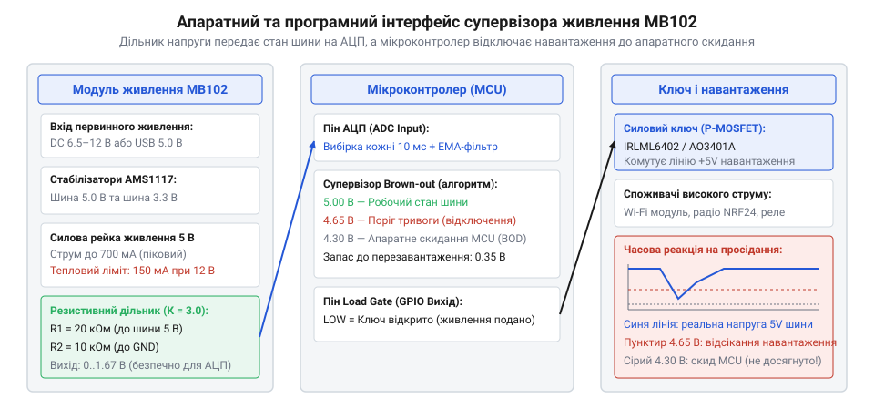

# ⚙️ Контроль шин живлення MB102: супервізор напруги, захист від Brown-out та комутація навантаження

Плата живлення MB102 не має цифрової шини I²C чи SPI й не віддає статусів за регістрами. Проте для мікроконтролера, розташованого на тій самій макетній платі, цей модуль має жорсткий **фізичний та логічний контракт (Hardware API)**: що він приймає на вхід, що гарантує на виходах та як реагує на перевантаження.

Головна небезпека живлення від MB102 у лабораторних макетах — **раптові просідання напруги (Brown-out)**. Коли на макеті поруч із процесором вмикається радіопередавач (Wi-Fi у момент передачі маяка, ESP-NOW чи модуль NRF24) або спрацьовує котушка реле, імпульсний струм до 300–500 мА спричиняє миттєвий спад напруги на виході лінійного стабілізатора AMS1117. Якщо напруга просідає нижче порогу внутрішнього супервізора мікроконтролера, процесор аварійно скидається в перезавантаження. Без програмного контролю такі збої виглядають як примарні зависання прошивки.

Ця стаття описує повний інтерфейс взаємодії з MB102: апаратні обмеження модуля як «чорної скриньки», програмний моніторинг шини через АЦП з калібруванням, виявлення просідання напруги задовго до апаратного скидання чипа та двоетапний запуск навантаження (Power Sequencing) на базі ESP-IDF та STM32 HAL.

> 🔧 **Навіщо це.** Сприймати модуль живлення як «просто дві рейки з напругою» — причина більшості плаваючих помилок на макеті. Апаратний супервізор мікроконтролера (BOD) — це останній рубіж, який просто вирубує ядро без збереження даних. Програмний супервізор шини MB102 дає змогу зловити просідання напруги за 0.3–0.5 В до катастрофи, встигнути скинути буфери флеш-пам'яті й відсікти силове навантаження ключем, утримавши процесор у робочому стані.

## Апаратний контракт: що MB102 приймає, що віддає і де межі

Інтерфейс модуля визначається електричною схемою перетворення: гніздо DC Jack із діодом захисту 1N4007, первинний стабілізатор AMS1117-5.0 та вторинний AMS1117-3.3, підключений послідовно до виходу 5 В.

```
Вхід DC Jack (6.5..12 В) ──►[ Діод 1N4007 ]──►[ AMS1117-5.0 ]──┬──► Шина 5.0 В
                                 (падіння 0.7 В)                 │
                                                                 └──►[ AMS1117-3.3 ]──► Шина 3.3 В
```

### Електричні параметри та граничні умови (Contract Invariants)

| Параметр інтерфейсу | Номінальне значення | Гранично допустиме | Наслідок порушення |
| :--- | :--- | :--- | :--- |
| **Вхідна напруга DC Jack** | 7.0–9.0 В | 6.5–12.0 В | При &lt; 6.5 В LDO виходить із режиму стабілізації; при &gt; 12 В перегрів |
| **Падіння напруги на вході** | 0.75 В (діод 1N4007) | 1.1 В (при 1 А) | Напруга перед AMS1117-5.0 завжди на ~0.8 В нижча за напругу блока |
| **Dropout Voltage стабілізаторів** | 1.1 В при 500 мА | 1.3 В при 800 мА | Для стабільних 5.0 В на вході LDO має бути щонайменше 6.1 В (6.9 В на DC Jack) |
| **Піковий струм виходу** | 500 мА | 800 мА | Спрацьовує вбудоване струмове обмеження AMS1117 |
| **Теплове розсіювання SOT-223** | 0.8 Вт (без радіатора) | 1.2 Вт (критично) | Тепловий тротлінг: стабілізатор циклічно скидає напругу до нуля |
| **Пульсації виходу (Ripple)** | 15–30 мВ | 80 мВ (під навантаженням) | Вимагає програмного фільтрування вибірок АЦП |

### Стеля струму залежно від вхідної напруги

Головна прихована пастка модуля: хоча чип AMS1117 розрахований на струм до 800 мА, на корпусі SOT-223 без мідного полігону розсіюється не більше 1 Вт тепла. Формула теплових втрат лінійного регулятора:

    P_loss = (V_in_ldo - V_out) × I_load

Якщо ви підключаєте стандартний блок живлення на 12 В:
- Напруга після діода: 12.0 - 0.75 = 11.25 В.
- Падіння на стабілізаторі 5 В: 11.25 - 5.0 = 6.25 В.
- Допустимий струм до перегріву: I_max = 1.0 Вт / 6.25 В ≈ 160 мА.

Спроба зняти 500 мА при живленні від 12 В змушує регулятор розсіювати понад 3.1 Вт тепла — через 10 секунд чип розігрівається до +140 °C і вимикається. Безпечні межі тривалого струму:
- **При Vin = 7.5 В:** до 400 мА на обидві шини.
- **При Vin = 9.0 В:** до 250 мА.
- **При Vin = 12.0 В:** не більше 140–160 мА.


*Архітектура взаємодії: резистивний дільник транслює напругу шини на вхід АЦП, мікроконтролер веде періодичний моніторинг і через P-MOSFET відсікає навантаження при фіксації просідання нижче 4.65 В.*

## Крок 1. Моніторинг шини живлення через АЦП із калібруванням

Оскільки контролери працюють із логічними рівнями 3.3 В (ESP32) або опорною напругою 3.3 В (STM32), пряме підключення 5-вольтової шини до виводу спалить аналоговий вхід. 

Потрібен прецизійний резистивний дільник:
- **R1 (до шини MB102 5V):** 20 кОм (1%).
- **R2 (до землі GND):** 10 кОм (1%).
- **Коефіцієнт ділення:** K = (20 + 10) / 10 = 3.0.
- Максимальна напруга на виводі при шині 5.0 В становить 1.67 В, що безпечно вкладається в лінійну ділянку АЦП обох платформ.

Паразитні ємності та опір контактів макетки вносять високочастотний шум. Тому сирий вимір обов'язково фільтрується ковзним усередненням.

:::tabs
:::code api-rail-control/c/esp-idf/krok-1-rail-monitor.c
:::code api-rail-control/c/stm32/krok-1-rail-monitor.c
:::code api-rail-control/c/arduino/krok-1-rail-monitor.ino
:::

На ESP32 використовується калібрувальна крива eFuse (`adc_cali_raw_to_voltage`), яка усуває нелінійність вбудованого АЦП на краях діапазону. На STM32 розрахунок спирається на читання внутрішнього джерела опорної напруги `VREFINT` із заводською калібровкою: навіть якщо власна лінія живлення ядра мікроконтролера просяде під час стрибка струму, обчислене абсолютне значення шини MB102 залишиться точним.

> 🔧 **Навіщо це.** Поширена помилка — вимірювати напругу зовнішньої шини, приймаючи напругу власного живлення процесора як еталонну сталу (`VDDA = 3300 мВ`). Коли шина MB102 просідає, напруга живлення мікроконтролера падає синхронно. Якщо вимірювати одне через інше без корекції на незалежний внутрішній `VREFINT` або eFuse-калібрування, сире число АЦП майже не зміниться, і прошивка взагалі не помітить аварії!

## Крок 2. Супервізор Brown-out: аварійне реагування до скидання процесора

Апаратний Brown-out Detector (BOD) більшості чипів налаштовується на критичні рівні (для 3.3 В контролерів поріг зазвичай становить 2.7–2.9 В; для 5-вольтових схем — 4.3 В). Коли апаратний BOD спрацьовує, часу на реакцію немає — генератор зупиняється, ядро скидається, транзакції запису у флеш руйнують файлову систему, а підключені реле зависають у невизначеному стані.

Програмний супервізор встановлює поріг попередження **вище за рівень апаратного скидання**:
- **Поріг спрацьовування (Trip):** 4650 мВ (на шині 5 В) або 3050 мВ (на шині 3.3 В).
- **Поріг відновлення (Recovery):** 4800 мВ (гістерезис 150 мВ запобігає автоколиванням).

:::tabs
:::code api-rail-control/c/esp-idf/krok-2-brownout-supervisor.c
:::code api-rail-control/c/stm32/krok-2-brownout-supervisor.c
:::code api-rail-control/c/arduino/krok-2-brownout-supervisor.ino
:::

Щойно супервізор фіксує просідання нижче 4650 мВ:
1. Керувальний вивід розмикає P-MOSFET ключ живлення зовнішніх споживачів.
2. Струм навантаження спадає, і вихідний конденсатор MB102 (100 мкФ) відновлює напругу шини.
3. Процесор продовжує роботу, уникнувши перезавантаження.

## Крок 3. Керована комутація навантаження та Power Sequencing

Модуль MB102 оснащений лише кнопкою із фіксацією. Увімкнення живлення кнопкою подає напругу одночасно на всі компоненти макетної плати. 

Якщо на макеті встановлено модулі з власними вхідними електролітичними конденсаторами (наприклад, фільтри біля радіомодуля чи сервоприводів сумарною ємністю 220–470 мкФ), у мить замикання кнопки виникає **пусковий струм заряду (inrush current)**:

    I_inrush = C × (dU / dt)

Опір розрядженого конденсатора в перші мікросекунди близький до нуля. Струм стрибає до 2–3 А, переводячи AMS1117 у режим миттєвого відсікання. Напруга на шині затримується на рівні 1–2 В, і контролер або зависає в некоректному стані скидання, або входить у нескінченний цикл рестартів.

Розв'язок — розділення живлення схеми на етапи:
1. **Етап 0:** Старт MB102, зарядка власних конденсаторів плати (150 мс).
2. **Етап 1:** Запуск мікроконтролера та опитування слабкострумових датчиків.
3. **Етап 2:** Увімкнення живлення радіочастини та потужної периферії через польовий P-канальний транзистор (IRLML6402 або AO3401A).

:::tabs
:::code api-rail-control/c/esp-idf/krok-3-load-switch-sequencing.c
:::code api-rail-control/c/stm32/krok-3-load-switch-sequencing.c
:::code api-rail-control/c/arduino/krok-3-load-switch-sequencing.ino
:::code api-rail-control/cpp/rail_supervisor.hpp
:::

P-MOSFET комутує плюсову шину живлення споживача. Логічний нуль на затворі відкриває транзистор, подаючи струм; логічна одиниця надійно замикає ключ.

> 🔧 **Навіщо це.** Комутація силового навантаження «низом» (розрив мінусового дроту N-канальним транзистором) суворо протипоказана для цифрових модулів. Якщо розірвати землю датчика або радіомодуля, зворотний струм піде через сигнальні лінії (SDA, SCL, RX, TX) прямо в порти процесора. Це призводить до фантомного живлення через захисні діоди виводів і миттєво випалює входи МК. Силові споживачі завжди комутують **«верхом» (High-Side Switch) за допомогою P-MOSFET**, зберігаючи спільну непорушну шину GND.

## Складність і типові пастки MB102

### 1. Зустрічне живлення через USB (Backfeeding Hazard)

Гніздо USB Type-A на платі MB102 з'єднане з шиною 5.0 В напряму, без захисного діода чи контролера пріоритету джерел. 

Якщо ви підключили зовнішній блок живлення 12 В у DC Jack модуля і водночас з'єднали USB-порт плати з ноутбуком кабелем USB-A — USB-A:
- Стабілізатор AMS1117-5.0 видає 5.05 В.
- Шина USB комп'ютера тримає 4.95 В.
- Різниця напруг викликає зворотний струм із макета прямо у вихідні ланцюги живлення материнської плати ноутбука. У найкращому разі контролер порту комп'ютера піде в захист за струмом; у гіршому — згорить вхідний ключ USB.

**Правило:** Використовуйте гніздо USB модуля **виключно як вихід** для живлення додаткових пристроїв або **виключно як вхід** при повністю відключеному круглому DC-штекері. Ніколи не з'єднуйте обидва порти одночасно.

### 2. Каскадне навантаження стабілізаторів (дві рейки не незалежні)

На платі MB102 стабілізатор 3.3 В живиться **не від вхідного DC Jack, а від виходу стабілізатора 5 В**. 

Це означає, що будь-який струм, споживаний по шині 3.3 В (наприклад, 200 мА модулем ESP32), спочатку повністю проходить крізь стабілізатор AMS1117-5.0, а вже потім крізь AMS1117-3.3. 

Сумарний струм шини 5 В дорівнює:

    I_5V_total = I_5V_direct + I_3V3_load

Якщо шина 5 В навантажена реле на 150 мА, а шина 3.3 В — процесором на 200 мА, перший стабілізатор віддає 350 мА. При напрузі блока 12 В теплова потужність на ньому сягає:

    P = (11.25 - 5.0) × 0.35 = 2.19 Вт

Через дві хвилини стабілізатор перегріється й вимкне обидві рейки одночасно.

### 3. Деренчання кнопки з фіксацією та скидання рейок

Механічна кнопка вимикача модуля має значне пружне деренчання під час натискання (до 15–20 мс). За цей час напруга встигає кілька разів піднятися до 3–4 В і впасти до нуля. 

Якщо прошивка починає ініціалізацію апаратної периферії (SPI-флеш, радіостек) безпосередньо з першого мікроконтролерного такту, вона потрапляє на серію провалів живлення. Саме тому в коді ініціалізації супервізора закладається обов'язкова затримка стабілізації (Power-On Reset Delay) тривалістю не менше 100–150 мс перед зверненням до шин.

## Що забрати з собою

1. **MB102 має чіткий інтерфейсний контракт.** Вхідна напруга вимагає запасу не менше 1.8 В над вихідною (діод + dropout LDO). Тепловий бюджет становить не більше 1.0 Вт на корпус.
2. **Моніторинг шини обов'язковий.** Резистивний дільник 20 кОм / 10 кОм і періодичне опитування АЦП дають точну картину просідання напруги під навантаженням.
3. **Калібрування рятує від сліпоти.** Використовуйте апаратні опорні джерела (`VREFINT` у STM32, eFuse-калібрування в ESP-IDF), щоб контролер не втрачав точність вимірювання під час просідання власного живлення.
4. **Поріг тривоги супервізора ставиться вище за BOD.** Реакція на рівні 4.65 В (відсікання силового P-MOSFET ключа) рятує систему від апаратного скидання чипа на рівні 4.3 В.
5. **Поетапний запуск (Power Sequencing).** Двоетапна подача живлення усуває стрибки струму inrush від заряджання конденсаторів периферійних модулів.
