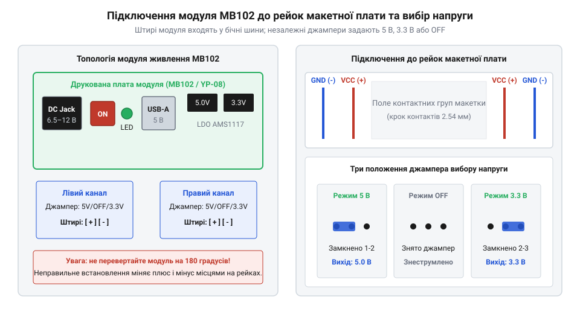
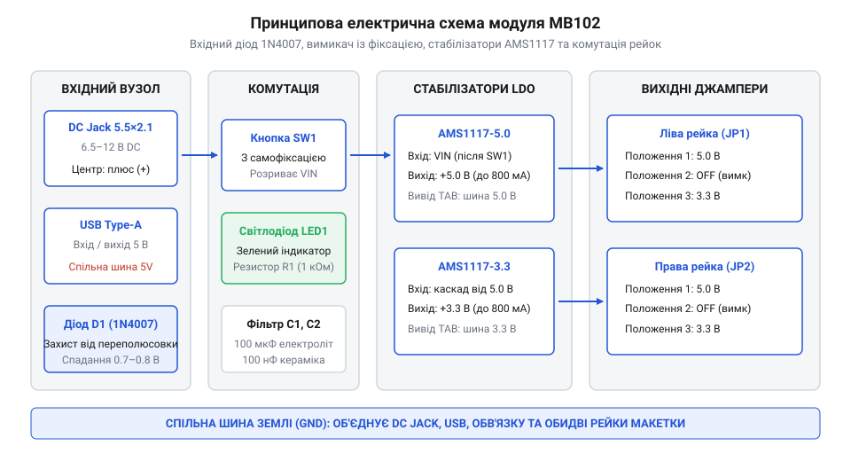
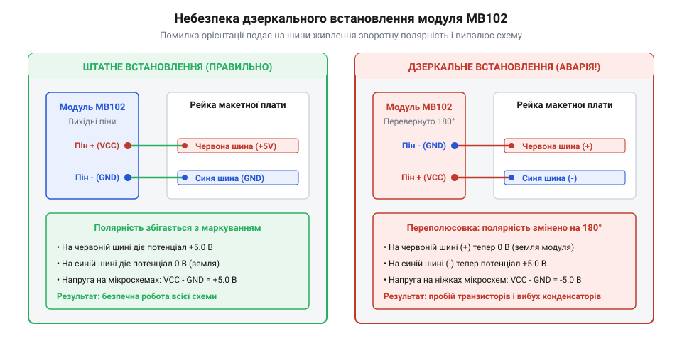

# Модуль живлення для макетної плати

<preknowlist>
- [LM2596 — регульований понижувач (і версія CC/CV)](root:cat-hw-power/lm2596-buck) — Поняття падіння напруги, перетворення рівнів живлення та обмеження струму.
</preknowlist>

## Захід із проблеми: хаос живлення на макетній платі та падіння напруги

Збирання будь-якого прототипу на безпаяльній макетній платі (@@en|breadboard@@) неминуче починається з питання: звідки взяти стабільне живлення. Початківці зазвичай намагаються живити всю зібрану схему безпосередньо з 5-вольтового виводу плати Arduino або ESP32, підключеної до USB-порту ноутбука. Поки на макеті горить пара світлодіодів і працює датчик температури, все здається бездоганним. Але щойно на макет додається сервопривід, реле або Wi-Fi модуль, який у момент передачі радіопакета споживає імпульсний струм до 300–400 мА, схема починає поводитися хаотично: мікроконтролер циклічно перезавантажується, зв'язок обривається, а дисплей гасне.

Причина полягає у фізичних обмеженнях вбудованих стабілізаторів мікроконтролерних плат і тонких гнучких дротів-перемичок (@@en|jumper wires@@). Вбудований LDO-регулятор плати розробника не розрахований на живлення зовнішніх потужних споживачів — він миттєво перегрівається і йде в захист. Крім того, масив дротів, що тягнуться від різних зовнішніх блоків живлення, перетворює макетну плату на заплутане гніздо провідників, де один випадковий рух рукою призводить до замикання ліній або подачі 12 В прямо на 3.3-вольтовий порт мікросхеми.

Другий, часто прихований ворог стабільності — паразитний електричний опір механічних контактів самої макетної плати. Під кожним отвором безпаяльної макетки ховаються нікельовані або фосфор-бронзові пружні пелюстки. У новій якісній макетній платі перехідний опір одного контакту становить близько 0.05–0.1 Ом. Проте в процесі багаторазового вставляння товстих ніжок компонентів чи окиснення металу опір окремих затискачів легко зростає до 0.3–0.5 Ом на контакт.

Коли живлення подається тонкими гнучкими перемичками, які самі нерідко виготовлені з дешевого обмідненого алюмінію або мають опір жили до 0.2 Ом, утворюється довгий послідовний ланцюг: роз'єм плати розробника, провідник, контактна пружина макетки, металева шина рейки живлення та кінцевий контакт датчика. Сумарний паразитний опір контуру живлення та землі нерідко сягає 0.8–1.2 Ом.

Згідно із законом Ома, імпульсний стрибок струму споживання мікроконтролера чи передавача викликає миттєве динамічне просідання напруги:

    ΔU = I_pulse × R_loop
       = 0.4 × 1.0
       = 0.4 В

Якщо базова напруга живлення логіки становить 3.3 В, просідання на 0.4 В опускає потенціал на ніжках мікроконтролера до критичних 2.9 В. Вбудована схема супервізора живлення (від англ. @@en|brown-out detector@@, BOD) фіксує аварійний рівень і негайно скидає процесор у перезавантаження. Модуль MB102 кардинально змінює топологію розподілу енергії: він вставляється чотирма масивними квадратними штирями безпосередньо в металеві пружини силових шин макетки, скорочуючи довжину шляху струму й усуваючи паразитні провідники.

> 🔧 **Навіщо це.**
> Спеціалізований модуль живлення для макетної плати позбавляє лабораторний стіл від хаосу дротів. Він підключається безпосередньо до стандартних бічних рейок безпаяльної плати, приймає живлення від будь-якого доступного адаптера та формує жорстко фіксовані живильні шини 5 В і 3.3 В із захистом від випадкового відключення.

Історія появи стандарту безпаяльних макетних плат та розробки першого компактного адаптера компанією YwRobot описана у вставці [Історія стандарту MB102 та макетування](root:cat-hw-power/breadboard-power-module/hist-mb102-and-breadboard-prototyping.md).

## Механічна сумісність і конструкція плати MB102

Основою цього класу пристроїв є дизайн плати **MB102** (на клонах часто нанесено шовкографію **YP-08**), спеціально спроектований під геометричні розміри класичних безпаяльних макеток на 400 і 830 контактних точок [Понижувач LM2596](root:cat-hw-power/lm2596-buck). Плата має прямокутну форму зі спеціальними виступами з обох боків, на нижній поверхні яких розпаяно пари штирьових роз'ємів (крок 2.54 мм).

Штирі спроектовані так, що при встановленні на край макетки вони входять точно в гнізда поздовжніх шин живлення: одна пара штирів входить у ліву рейку (плюс і мінус), а друга пара — у праву. При цьому центральна частина плати залишається піднятою над робочим полем макетної плати, не перекриваючи контактні отвори для встановлення мікросхем і дискретних радіодеталей.

*Установка модуля в бічні рейки макетної плати: незалежне конфігурування лівої та правої рейок джамперами 5V/OFF/3.3V.*

На верхньому боці текстоліту згруповано всі органи комутації та індикації:
- **Кругле гніздо DC 5.5×2.1 мм:** вхід для зовнішнього мережевого блоку живлення з напругою від 6.5 до 12 В.
- **Роз'єм USB Type-A:** може використовуватися як альтернативний вхід 5 В від повербанка або як вихід для підключення кабелю живлення зовнішньої плати.
- **Кнопковий перемикач із фіксацією:** дозволяє одним натисканням миттєво знеструмити весь макет без необхідності висмикувати штекери з розетки.
- **Зелений світлодіод:** наочно сигналізує про наявність вихідної напруги після натискання кнопки живлення.
- **Дві групи вихідних конфігураційних джамперів:** незалежно задають напругу для кожної рейки живлення (5V, 3.3V або повне відключення).

Тепловий розрахунок втрат енергії на лінійних стабілізаторах модуля залежно від вхідної напруги наведено у вставці [Тепловий розрахунок LDO-стабілізаторів AMS1117](root:cat-hw-power/breadboard-power-module/math-ldo-thermal-dissipation-and-efficiency.md). Програмний моніторинг шин, захист від Brown-out та поетапне підключення навантаження розглянуто в [API супервізора живлення MB102](root:cat-hw-power/breadboard-power-module/api-rail-control.md).

## Схемотехніка та первинне живлення: DC-гніздо, USB та захист

Електрична побудова модуля живлення MB102 вирізняється практичною простотою та надійністю, забезпечуючи макету автономність від комп'ютера або робочого столу. Модуль розрахований на два альтернативні способи подачі первинної енергії.

Перший — стандартне циліндричне гніздо DC 5.5×2.1 мм (від англ. @@en|barrel jack@@), куди підключають мережевий адаптер або акумуляторну збірку з напругою від 6.5 В до 12 В з центральним позитивним контактом. Одразу за гніздом у розрив плюсової лінії встановлено випрямний кремнієвий діод 1N4007. Його єдина функція — апаратний захист від переполюсовки: якщо користувач помилково під'єднає блок живлення зі зворотною полярністю (мінус у центрі), діод буде замкнений у зворотному напрямку і не пропустить струм у схему. Ціною такого захисту є пряме спадання напруги близько 0.7–0.8 В.

Другий інтерфейс — гніздо USB Type-A. Завдяки схемному рішенню цей порт є двонаправленим:
1. Якщо DC-гніздо вільне, через роз'єм USB Type-A можна подати живлення 5 В від порту комп'ютера, зарядного блока або повербанка за допомогою кабелю типу «тато-тато» (USB-A — USB-A).
2. Якщо ж плата живиться від мережевого адаптера через DC-гніздо, шина 5 В з'єднується з цим роз'ємом, перетворюючи його на вихідне джерело для живлення зовнішніх USB-приладів або логічного аналізатора.

Однак двонаправлена природа роз'єму USB Type-A приховує серйозну апаратну загрозу, про яку не здогадується більшість початківців. На більшості дешевих китайських копій плати MB102 вивід живлення VBUS гнізда USB Type-A розпаяний безпосередньо на вихідну шину 5.0 В стабілізатора AMS1117-5.0 без будь-якого розв'язувального діода чи електронного перемикача джерел (від англ. @@en|ideal diode controller@@ або @@en|power mux@@).

Уявіть ситуацію: ви під'єднали модуль до мережевого адаптера 12 В через кругле DC-гніздо для живлення сервоприводів і водночас вирішили зняти лог роботи чи підзарядити пристрій, з'єднавши USB-роз'єм модуля зі стандартним портом ноутбука або комп'ютера звичайним кабелем USB-A.
- Обидва джерела (вихід лінійного стабілізатора AMS1117 модуля та внутрішнє джерело 5 В комп'ютерного порту) виявляються замкненими паралельно між собою.
- Через різницю технологічного розкиду опорних напруг вихід модуля MB102 може формувати, наприклад, 5.08 В, тоді як порт комп'ютера має потенціал 4.95 В.
- Виникає паразитний вирівнювальний струм: потужний адаптер через мікросхему модуля починає «заштовхувати» струм назад у комп'ютер через лінію живлення USB (від англ. @@en|back-feeding@@).

У найгіршому випадку — якщо стабілізатор AMS1117 вийде з ладу через теплове перевантаження і проб'є перехід «вхід-вихід» накоротко — повна напруга 12 В від вхідного мережевого адаптера піде напряму в шину живлення 5 В комп'ютера. Це миттєво спалить контролер південного мосту або порт Thunderbolt ноутбука, ремонт якого коштує сотні доларів.

Тому діє суворе залізне правило: **ніколи не з'єднуйте порт USB Type-A модуля MB102 з комп'ютером, якщо в DC-гніздо вже вставлено блок живлення**. Якщо необхідно зв'язати схему на макеті з ПК через USB для програмування, використовуйте виключно сигнальні дроти RX/TX через окремий перехідник або впаяйте в кабель швидкий захисний діод Шотткі для розриву зворотного струму.

*Принципова схема модуля MB102: вхідні роз'єми DC та USB, захисний діод 1N4007, кнопковий вимикач з фіксацією, світлодіод індикації та лінійні регулятори AMS1117.*

Після захисного діода живлення надходить на механічний кнопковий перемикач із самофіксацією (від англ. @@en|latching push switch@@). Кнопка фізично розриває силову лінію перед стабілізаторами. Поруч розташований зелений індикаторний світлодіод із баластним резистором, який яскраво світиться лише тоді, коли кнопку натиснуто і живлення подано на стабілізаційні каскади.

> 🔧 **Навіщо це.** Кнопка вимикача дозволяє змінювати схему на макетній платі без смикання дротів із розетки чи витягування штекера живлення. Помітивши помилку або запах нагрівання деталі, достатньо клацнути пальцем по кнопці, миттєво знеструмивши весь макет.

## Двоканальна система регулювання напруги на LDO AMS1117

Серцем модуля є два незалежні інтегральні лінійні регулятори з малим падінням напруги серії [AMS1117](root:cat-hw-power/ams1117-linear-regulator) у трививідних планарних корпусах SOT-223: фіксований регулятор на 5.0 В (AMS1117-5.0) та регулятор на 3.3 В (AMS1117-3.3).

Вхідна напруга після кнопки надходить на регулятор AMS1117-5.0, який формує стабільну шину 5.0 В. Каскад на 3.3 В у типових ревізіях плати під'єднується паралельно до вхідної лінії або живиться від стабілізованих 5.0 В, що зменшує теплове навантаження на чип. Кожен стабілізатор обв'язаний танталовими або електролітичними конденсаторами ємністю 10–100 мкФ на вході й виході для запобігання високочастотному самозбудженню, притаманному лінійним регуляторам із глибоким зворотним зв'язком.

Головна перевага модуля MB102 перед простими перехідниками — гнучка комутація напруги за допомогою пари триконтактних груп зі знімними перемичками (від англ. @@en|jumpers@@, джамперами). Кожна рейка живлення макетки (умовна верхня та нижня) керується власним незалежним джампером, що підтримує три положення:
1. **Положення `5V`:** перемичка замикає контакти шини 5.0 В з контактними штирями відповідної бічної рейки.
2. **Положення `3.3V`:** перемичка підключає до рейки шину 3.3 В для живлення сучасної низьковольтної мікроелектроніки (ESP8266, STM32, nRF24L01).
3. **Положення `OFF` (знятий або переставлений джампер):** лінія рейки повністю ізолюється від живлення.

Така конфігурація дозволяє реалізувати на одному макеті змішану систему живлення: наприклад, живити мікроконтролер Arduino Nano напругою 5 В по нижній рейці, а чутливий радіомодуль напругою 3.3 В — по верхній. При цьому земляні шини (GND) обох рейок залишаються надійно об'єднаними на платі модуля.

Слід враховувати, що лінійні стабілізатори не мають високого коефіцієнта корисної дії: уся різниця напруг між входом і виходом перетворюється на тепло відповідно до закону Джоуля-Ленца. Докладний розрахунок безпечних режимів без термічного вимкнення наведено у вставці [Тепловий розрахунок стабілізаторів AMS1117](root:cat-hw-power/breadboard-power-module/math-ldo-thermal-dissipation-and-efficiency.md).

> 🔧 **Навіщо це.** Завдяки роздільним джамперам відпадає потреба городити додаткові понижувальні плати для датчиків на 3.3 В: один рух перемички подає потрібний рівень на сусідню рейку макетної плати.

## Теплові обмеження та струмові можливості стабілізаторів

У рекламних характеристиках модуля живлення MB102 часто зазначають максимальний струм до 700–800 мА. Проте початківці часто потрапляють у пастку: підключивши плату мікроконтролера з Wi-Fi (ESP8266 або ESP32) та адаптер живлення 12 В, вони спостерігають раптові зависання та циклічні перезавантаження пристрою.

Причина полягає у фізиці лінійного регулювання. Лінійний стабілізатор серії [AMS1117](root:cat-hw-power/ams1117-linear-regulator) не перетворює напругу імпульсним шляхом, а діє як керований резистор, розсіюючи надлишкову напругу у вигляді чистого тепла. Потужність втрат описується формулою:

    P = (V_in - V_out) × I_load

Розглянемо практичний приклад. Нехай на вхід DC-гнізда під'єднано поширений блок живлення 12 В (після захисного діода залишається близько 11.3 В), а мікроконтролер на шині 3.3 В у момент передачі радіопакетів короткочасно споживає 400 мА (0.4 А):

    P = (11.3 - 3.3) × 0.4
      = 8.0 × 0.4
      = 3.2 Вт

Корпус SOT-223 на мініатюрній друкованій платі модуля не має металевого радіатора і володіє тепловим опором «кристалл-навколишнє середовище» близько 90–100 °C/Вт. Розсіювання навіть 1.5–2 Вт тепла розігріває кристал до температури понад 140 °C за кілька десятків секунд. У чипі AMS1117 спрацьовує вбудований захист від перегріву (від англ. @@en|thermal shutdown@@): стабілізатор аварійно вимикає вихід, напруга 3.3 В падає до нуля, мікроконтролер перезавантажується, чип охолоджується, знову вмикається — і цикл повторюється безкінечно.

Докладні графіки нагрівання та безпечні межі струмів наведено у вставці [Тепловий розрахунок стабілізаторів AMS1117](root:cat-hw-power/breadboard-power-module/math-ldo-thermal-dissipation-and-efficiency.md).

Однак існує й протилежна, не менш підступна пастка низької вхідної напруги, відома як обмеження мінімального падіння напруги (від англ. @@en|dropout voltage@@). Часто розробники намагаються мінімізувати нагрівання модуля, живлячи його через USB-порт напругою 5.0 В або від одного літієвого акумулятора (3.7–4.2 В). При цьому вихід 3.3 В починає поводитися нестабільно або видавати значно занижену напругу.

Внутрішня архітектура мікросхеми AMS1117 побудована на базі складеного біполярного NPN-транзистора Дарлінгтона у прохідному каскаді. Через фізичні властивості такого переходу для коректного лінійного регулювання чипу потрібна мінімальна різниця напруг між входом і виходом:

    V_drop = V_in - V_out ≥ 1.1–1.3 В

За паспортом при номінальному струмі навантаження до 500–800 мА падіння напруги на кристалі AMS1117 становить щонайменше 1.2 В. Звідси випливає фундаментальна вимога до мінімальної напруги безпосередньо на вході чипа:

    V_in_min = V_out + V_drop
             = 3.3 + 1.2
             = 4.5 В

Якщо ж ви підключаєте модуль через роз'єм живлення DC або подаєте напругу через довгий тонкий кабель, згадайте про вхідний захисний діод 1N4007: на ньому неминуче падає ще 0.7–0.8 В. Отже, мінімальна зовнішня напруга на роз'ємі повинна становити не менше ніж:

    V_ext_min = 4.5 + 0.75 = 5.25 В

Якщо на вхід подати рівно 4.5 В (або живлення від трохи розрядженої літієвої батареї 3.8 В безпосередньо на стабілізатор), різниця напруг опуститься нижче 1.1 В. Стабілізатор виходить із лінійного режиму насичення (переходить у стан так званого «випадання» зі стабілізації), його прохідний транзистор повністю відкривається як простий резистор, а вихідна напруга на шині 3.3 В починає прямо пропорційно просідати до 2.8–2.9 В. Цифрові мікроконтролери та модулі флеш-пам'яті SPI при цьому починають збоїти, записувати пошкоджені байти або йти в циклічний апаратний перезапуск.

Щоб уникнути перегріву, слід дотримуватися простого правила: **чим вища вхідна напруга, тим менший струм можна знімати з плати**. Для тривалого живлення навантажень струмом 400–500 мА оптимально живити модуль MB102 напругою 6.5–7.5 В (наприклад, від двох послідовних літій-іонних акумуляторів або блоку живлення на 7.5 В).

> 🔧 **Навіщо це.** Якщо ваш макет з ESP32 дивно глючить і перезавантажується під час передачі даних по Wi-Fi, торкніться пальцем мікросхеми стабілізатора на модулі живлення: якщо вона обпікає шкіру, проблема не в програмному коді, а в тепловому захисті стабілізатора від вхідних 12 В.

## Пастки монтажу та правила безпеки на макеті

Найбільш підступна аварійна ситуація при роботі з модулем MB102 виникає через людський фактор під час механічного встановлення модуля на безпаяльну макетну плату.

*Небезпека дзеркального підключення: якщо встановити модуль на протилежний бік макетки, плюсовий пін модуля опиниться в синій рейці землі (GND), а земляний пін — у червоній плюсовій шині.*

Стандартні макетні плати MB102 мають вздовж обох боків дві контактні рейки живлення, промарковані синьою лінією з мінусом (`-`) та червоною з плюсом (`+`). На нижньому боці модуля MB102 розпаяно чотири пари штирів: дві з одного краю і дві з іншого. Конструкція розрахована так, що при встановленні на правильний торець плати плюсові штирі модуля потрапляють акуратно в червону лінію, а мінусові — в синю.

Проте якщо вставити модуль на протилежний бік макетки (або перевернути плату на 180°), контакти фізично потрапляють у гнізда, але **полярність дзеркально перевертається**:
- вихід `+` модуля з'єднується із синьою шиною мінуса;
- контакт землі `GND` модуля потрапляє в червону рейку плюса.

Якщо інженер збирає схему, орієнтуючись на кольорові смужки макетки, усі встановлені мікросхеми отримують напругу зворотної полярності (–5 В). Для більшості цифрових мікроконтролерів і датчиків це означає миттєву тиху смерть або вибух електролітичних і танталових конденсаторів.

Ще одна поширена небезпека — одночасне підключення зовнішнього джерела 12 В через DC-гніздо та під'єднання роз'єму USB до ноутбука. Якщо кабель USB не має розриву лінії живлення +5 В, вихід стабілізатора модуля виявляється замкненим накоротко з шиною живлення материнської плати комп'ютера, що може спричинити вихід з ладу USB-контролера ПК.

Як захистити свої схеми та модернізувати робоче місце:
1. Завжди перед першим увімкненням перевіряйте мультиметром напругу безпосередньо на штирях мікроконтролера, а не лише на виході модуля.
2. Позначте на макетці правильний край модуля перманентним маркером.
3. Про історію макетування та створення модуля читайте у вставці [Історія стандарту MB102 та прототипування](root:cat-hw-power/breadboard-power-module/hist-mb102-and-breadboard-prototyping.md).
4. Інструкцію з встановлення самовідновлюваного запобіжника та цифрового індикатора струму шукайте у проєкті [Лабораторна модернізація модуля MB102](root:cat-hw-power/breadboard-power-module/proj-breadboard-lab-bench-power.md).

> 🔧 **Навіщо це.** П'ятисекундний погляд на кольорові смужки рейок перед натисканням кнопки живлення рятує контролери вартістю в десятки доларів від миттєвого вигорання через дзеркальну переполюсовку.
