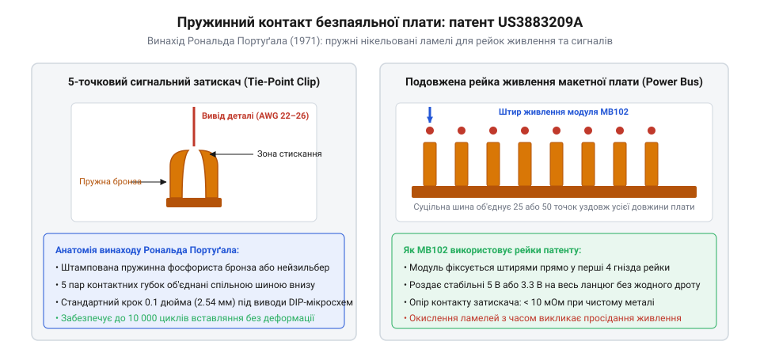

# Модуль живлення для макетної плати

## До безпаяльної ери: від кухонних дощок до джгутів Wire-Wrap

Сьогодні зібрати схему на мікроконтролері чи операційному підсилювачі за кілька хвилин видається абсолютно буденною справою: достатньо вставити ніжки компонентів у ряди отворів пластикової дощечки та з'єднати їх гнучкими перемичками. Проте ще в середині двадцятого століття прототипування електронних пристроїв вимагало годин копіткої слюсарної та паяльної праці.

Сама англійська назва макетної плати — @@en|breadboard@@ — походить з епохи лампової радіотехніки 1920–1930-х років. Радіоаматори буквально брали на кухні дерев'яні дошки для нарізання хліба, забивали в них мідні цвяхи чи вкручували латунні шурупи та припаювали між ними масивні радіолампи, дротяні реостати й паперові конденсатори. Такий монтаж був надійним, але кожна зміна номіналу резистора чи виправлення помилки вимагали розігріву важкого мідного паяльника й поступово перетворювали дерево на обвуглену основу.

З появою транзисторів у 1950-х роках стандартом став навісний монтаж на карболітових або текстолітових планках із металевими пелюстками (@@en|tag strips@@). Компоненти монтувалися у просторі між стійками, а з'єднання спаювалися вручну. Перевірка нової схемної ідеї забирала дні: виводи радіодеталей багаторазово загинались і відламувались від перепаювання, а випадковий перегрів транзистора паяльником виводив напівпровідниковий перехід із ладу ще до першого ввімкнення живлення.

У 1960-х роках, із початком ери цифрових мікросхем малої та середньої інтеграції, на зміну паянню прийшла технологія монтажу накруткою (@@en|wire-wrap@@). На перфоровану панель встановлювалися спеціальні панельки з довгими чотиригранними ніжками із позолоченої бронзи. З'єднання виконувалися тонким мідним ізольованим дротом діаметром 0.25 мм (калібр AWG 30) за допомогою спеціального пістолета або ручного інструмента. Дріт щільно намотувався на гострі грані виводу з колосальним натягом, утворюючи газонепроникний контакт холодного зварювання.

Монтаж Wire-Wrap дозволяв збирати складні обчислювальні блоки з сотень мікросхем, проте для швидких експериментів він був надто громіздким. Будь-яка помилка в топології вимагала розкручування всього стовпчика дротів на штирі, а густі переплетені «джгути-гнізда» заважали вимірюванням осцилографом. Лабораторії гостро потребували механізму, який дозволяв би багаторазово вставляти й виймати деталі взагалі без інструментів.

## Винахід Рональда Дж. Портуґала та стандартизація шин живлення

Прорив стався у вересні 1971 року, коли інженер американської компанії E&L Instruments Рональд Дж. Портуґал (Ronald J. Portugal) подав патентну заявку на «Клемну колодку для безпаяльного макетування» (патент США US3883209A).

Портуґал запропонував елегантну механічну конструкцію, яка поклала край епосі обов'язкового паяння прототипів. Основою став прямокутний пластиковий корпус із матрицею отворів, під кожним рядом яких розміщувалися пружні металеві контакти особливого профілю.

*Контактний затискач безпаяльної макетної плати: пружні ламелі утримують виводи компонентів без паяння; паралельні шини утворюють лінії живлення.*

Конструкція Портуґала містила три фундаментальні рішення, які визначили вигляд сучасної макетної плати:

1. **Пружна двопелюсткова кліпса.** Кожна секція виготовлялася штампуванням із високопружної фосфористої бронзи або нікельованого нейзильберу. Дві вигнуті ламелі притискали вивід деталі з зусиллям, достатнім для забезпечення стабільного перехідного опору менше 0.01 Ом навіть після кількох сотень циклів вставляння.
2. **Сітка 0.1 дюйма (2.54 мм) та роздільний паз.** Відстань між отворами точно відповідала новому промисловому стандарту розташування виводів корпусів мікросхем DIP (@@en|Dual In-line Package@@). По центру плати було виконано поздовжнє заглиблення завширшки 0.3 дюйма (7.62 мм). Корпус DIP сідав верхи на центральну канавку, а його протилежні ряди виводів потрапляли в електрично ізольовані п'ятиконтактні групи.
3. **Поздовжні шини живлення.** З обох боків плати розташовувалися суцільні металеві рейки з довгих з'єднаних затискачів. Вони розв'язали критичну проблему живлення цифрових схем: замість прокладання окремих дротів землі й плюса до кожної з десятків мікросхем інженер дістав дві спільні магістралі живлення, доступні в будь-якій точці макета.

> 🔧 **Навіщо це.**
> Бічні рейки макетної плати мінімізують паразитну індуктивність ліній живлення та запобігають утворенню хаотичних земляних петель, забезпечуючи надійну розв'язку паралельно підключених логічних чипів.

Винахід E&L Instruments миттєво став стандартом у навчальних закладах та інженерних лабораторіях світу. Проте відкритим лишалося питання, звідки на ці поздовжні шини має подаватися напруга: лабораторні джерела живлення залишалися окремими важкими приладами на столі.

## Проблема лабораторного живлення: хаос дротів і загроза переполюсовки

Хоча безпаяльна макетна плата Портуґала докорінно спростила складання сигнальних кіл, подача живлення на макет довгі десятиліття залишалася найбільш небезпечною та дражливою операцією.

У типовій лабораторії 1970–1990-х років джерелом енергії був важкий регульований лабораторний блок живлення, що стояв окремо на приладовій полиці. Підключення до макетної плати здійснювалося довгими гнучкими дротами з пружинними затискачами-«крокодилами» або зачищеними одножильними кінцями, які насилу встромлялися в роз'єми рейок живлення.

Таке механічне з'єднання мало кілька фатальних недоліків:

1. **Механічна нестабільність.** Важкі лабораторні кабелі звисали зі столу. Будь-який випадковий рух ліктем або натягнення дроту висмикували контакт із макетки. У колах цифрової логіки це призводило до раптових перезавантажень, скидання лічильників та втрати стану регістрів.
2. **Загроза короткого замикання.** Масивні металеві губки затискачів-крокодилів нічим не ізолювалися. Зісковзнувши з тонкого штиря, крокодил падав безпосередньо на сусідні відкриті ніжки мікросхем чи дискретних транзисторів, викликаючи іскріння та випалювання доріжок.
3. **Випадкова переполюсовка.** Провідники живлення не мали фіксованого ключа підключення. Достатньо було переплутати червоний і чорний дроти місцями під час повторного ввімкнення стенда, щоб миттєво спалити всю встановлену серію мікросхем TTL або КМОН (@@en|CMOS@@).

Радіоаматори та інженери потребували компактного джерела живлення, яке б не бовталося на кабелях, а надійно і жорстко кріпилося прямо на корпусі макетної плати.

## Бум Arduino та виклик двох напруг: 5 В проти 3.3 В

Ситуація загострилася в середині 2000-х років із настанням доби доступної мікроконтролерної електроніки, уособленням якої стала італійська платформа Arduino на чипах Atmel AVR. Навчання та прототипування вийшли за межі академічних лабораторій — мільйони ентузіастів, студентів і дизайнерів почали експериментувати з датчиками, двигунами та бездротовим зв'язком на домашніх столах.

Разом із масовим поширенням електроніки виник технологічний розкол стандартів живлення:

- **Класична 5-вольтова логіка.** Мікроконтролери ATmega328P (платформа Arduino Uno), цифрові мікросхеми серії 74HC, електромагнітні реле, сервоприводи та символьні рідкокристалічні дисплеї HD44780 вимагали стабільного живлення 5 В.
- **Нова 3.3-вольтова периферія.** Нове покоління кремнієвих датчиків (акселерометри I2C, гіроскопи, барометри), карти пам'яті microSD і популярні радіомодулі nRF24L01 виготовлялися за тонкими субмікронними техпроцесами й вимагали живлення строго 3.3 В. Подача навіть 4 вольтів на ці компоненти призводила до незворотного теплового пробою їхніх кристалів.

Сама плата Arduino Uno мала вбудований вихід 3.3 В, проте його струмова спроможність обмежувалася мізерними 50 мА (живлення знімалося зі службового чипа USB-UART). Цього не вистачало навіть для стабільної роботи радіомодуля в режимі передачі. Розробникам доводилося городити на макеті незграбні конструкції з додаткових лінійних стабілізаторів, конденсаторів та плутанини перемичок, намагаючись не закоротити 5-вольтову шину з 3.3-вольтовою.

## Поява модуля MB102 від YwRobot та відкриті клони YP-08

Відповіддю на цей виклик став винахід, що з'явився близько 2010 року в середовищі китайських виробників відкритого апаратного забезпечення. Компанія YwRobot запропонувала спеціалізовану плату живлення, розраховану під геометрію стандартної макетної плати MB-102 на 830 точок.

Конструкція модуля MB102 враховувала кожну деталь щоденної роботи радіоаматора:

1. **Штирі під рейки живлення.** З нижнього боку друкованої плати розробники встановили дві пари позолочених штирів із кроком і відстанню, що з міліметровою точністю відповідають інтервалу між бічними рейками живлення плати MB-102. Модуль монолітно вставляється в торець макетки, унеможливлюючи перекоси чи випадковий відрив контактів.
2. **Незалежна комутація шин.** На платі встановлено два незалежні лінійні стабілізатори серії AMS1117 (один на 5.0 В, другий на 3.3 В). За допомогою двох трьохпозиційних штирових перемичок (джамперів) користувач може окремо сконфігурувати кожну рейку макетної плати: ліва може бути встановлена на 5 В, права — на 3.3 В, або будь-яку з них можна повністю знеструмити.
3. **Універсальні входи.** Для живлення модуля передбачено стандартне циліндричне гніздо DC 5.5×2.1 мм, розраховане на підключення популярних мережевих адаптерів на 7–12 В, а також роз'єм USB Type-A.
4. **Кнопковий вимикач з фіксацією.** Механічна кнопка дозволяє миттєво знеструмити весь макет для безпечної заміни компонентів без смикання дротів із розетки.

*Еволюція макетного живлення: оригінальний дизайн YwRobot MB102 та масовий клон YP-08 із сумісною цоколівкою.*

> 🔧 **Навіщо це.**
> Модуль MB102 жорстко фіксується в роз'ємах макетної плати, виключаючи механічний відрив дротів живлення і дозволяючи живити 5-вольтову та 3.3-вольтову логіку одночасно з обох боків макета.

Оскільки компанія YwRobot не стала патентувати конструкцію, вільний дизайн миттєво підхопили десятки підприємств у Шеньчжені. На ринку з'явилися сотні модифікацій і клонів із маркуванням «YP-08», «HW-131» чи «Keyes». Попри копійчану ціну (менше одного долара), модуль MB102 став абсолютним стандартом робочого місця інженера поряд із мережевими модулями живлення [HLK-PM01/PM03/PM12](root:cat-hw-power/hlk-pm-mains), назавжди звільнивши прототипування від хаосу крокодилів та спалених мікросхем.
